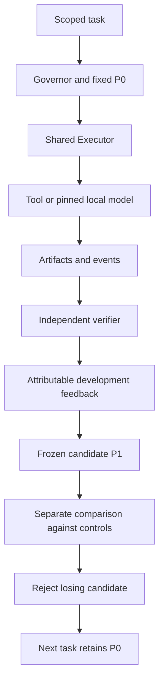

# HIVE v0.3.0.dev3 integration report

**INTEGRATED_PROTOTYPE_DEMONSTRATED — adaptation not yet validated.** One executable now connects task intake, governed tool/model execution, independent verification, persisted feedback, candidate comparison and recovery. Both genuine demonstration missions passed. The candidate then lost a critical comparison and was rejected; the next task retained the correct tool policy.

Last verified: **21 November 2026 Las Vegas / 22 November UTC**. Independent Terra acceptance is recorded for this bounded development workflow. Level A and Level B remain unaccepted. The public site distributes source and evidence; it is not a hosted model service.

[Download runnable source](/hive/downloads/HIVE_Integration_v0_3_0_dev3.zip) · [Runbook](/hive/implementation/integration-dev3/docs/HIVE_RUNBOOK.md) · [Architecture map](/hive/implementation/integration-dev3/docs/INTEGRATION_MAP.md) · [Publication hashes](/hive/implementation/integration-dev3-publication.json)

The latest source includes a separately verified crash-accounting repair.
The [exact source of the six-call run](/hive/downloads/HIVE_Integration_Run_Source_28239ab.zip)
is archived separately. Historical results retain their original source identity.

## One shared execution path

The governor excludes prohibited, unavailable, unverifiable and over-budget
routes before ranking them. Model text has no shell or filesystem authority.
The candidate is separate from the governing policy; feedback cannot approve
itself. Every executed route has source, task, configuration, model and policy
identities attached to immutable evidence. The existing Executor, Store,
verifier and Policy remain the shared implementation.

These boundaries do not depend on model size. The real adapter demonstrated here
is Ollama. A frontier-model adapter and evidence that HIVE improves a powerful
model are future work, not established capabilities.

## What actually ran

| Stage | Actual result |
| --- | --- |
| Mission A | Tool grouped real repository-source rows: core 61,800 bytes and nested 4,720 bytes. Independent reduction passed. |
| Mission B | Pinned local model classified three actual directive excerpts. All three independently frozen development labels matched. |
| Separate inventory comparison | P1 selected the local model and returned 42,073 bytes; the correct total was 41,907. Incumbent, strongest applicable fixed and learning-disabled controls used the tool and passed. |
| Separate classification comparison | All four arms returned `limits` for d5 where the independent label was `routing`; the other three labels matched. The failed verdicts and original labels are preserved. |
| Decision | **REJECTED**. Critical inventory regression; paired quality delta -0.5 on two development tasks against each control. No promotion. |
| Subsequent task | Governing P0 still chose the tool and correctly returned 71,415 bytes for new rows. |

The run made **6 local requests**, produced **147 generated tokens**, had
**768 reserved generated tokens**, and used **18.578 active seconds / 11 cycles**.
Ceilings were six requests, 768 tokens, 180 active seconds, 24 cycles and 64 MiB,
with zero retries and one local inference globally. This allocation is spent.
Prompt-token accounting is not exposed by the current adapter.

Model: `myr5-hold-local:latest`, Ollama manifest
`a45646773d1ee8a6c1557c7de09a68e78a74f2990c4174a1408f65e777db150c`.
Frozen runtime commit: `28239aba838fa7f6b2d04719ec75d629d1b14308`.
Runtime SHA256: `c73866989d9c03253af8eb199b0c93509adbc50b92bcab7e0a29fde15db0d9d2`.

## Reproduction and independent checks

**252 tests passed** on the latest hardened source, with two known Windows
symlink skips; **four Tester Army CLI journeys passed** in 12.09 seconds.
The original measured source had 249 passing tests and four passing journeys.
Terra independently replayed all eleven saved verdicts,
checked the 24 source-file byte counts and eight original directive excerpts,
reconstructed P1 from its two feedback records, and recomputed the comparisons.
Sixteen focused recovery tests passed. Substituted evidence and a corrupted
candidate were refused without dispatch or budget changes.

Two fresh-process replays, STOP/resume, and restoration of the initial and current
experimental policy snapshots spent zero additional model calls. The governing
P0 stayed unchanged. Production-policy rollback was not exercised; recovery
claims apply to the tested finite read-only flow, not arbitrary future external
side effects.

Sol subsequently found that explicit resume could requeue an interrupted job
before charging its reserved execution time. The latest source settles the
time debit, clears the reservation and requeues atomically; three independent
regressions and the full suite passed. The completed real run was unaffected.
Latest runtime SHA256:
`6ee9ae14b32ec6c9972bba693bb45395af5998516c4bc9de19dd5bbb5f550c99`.
Latest source commit: `6a044bb7adb5f8a082a5d298148461031fd9b506`.
No further real model calls were made on this later source.

From the downloaded source, run `python scripts/replay_integration_export.py`
to verify all eleven historical jobs and 43 hashed artifacts without a model
endpoint or private database. It prints the measured and current source
identities. A new model execution requires a separate resource allocation;
the recorded six-call allocation is spent.

- [Actual run report](/hive/implementation/integration-dev3/experiments/results/integration-smoke/20261121-run/report.json)
- [Independent Terra acceptance and checklist](/hive/implementation/integration-dev3/experiments/results/adaptation-demo/20261121-terra/review.md)
- [Independent machine-verifiable results](/hive/implementation/integration-dev3/experiments/results/adaptation-demo/20261121-terra/verification.json)
- [Restart, restore and complete exported artifact hashes](/hive/implementation/integration-dev3/experiments/results/adaptation-demo/20261121-complete-receipts/verification.json)
- [Latest full regression receipt](/hive/implementation/integration-dev3/experiments/results/integration-smoke/20261121-start/integration-tests-final.xml)
- [Latest CLI journey report](/hive/implementation/integration-dev3/experiments/results/integration-cli-e2e-final/report.json)
- [Hardening, source refusal and frozen-source replay](/hive/implementation/integration-dev3/experiments/results/integration-smoke/20261121-hardening/verification.json)
- [Clean source ZIP verification](/hive/implementation/integration-dev3-clean-zip-smoke.json)
- [Review findings and dispositions](/hive/implementation/integration-dev3/docs/INTEGRATION_REVIEW.md)

The original execution report remains `FRAMEWORK_WIRED` with acceptance pending
at its recording time. The later independent decision is separate; historical
receipts are never rewritten to acquire a later approval. The source package
includes public evidence and development inputs, while private SQLite stores,
private evaluator data and sealed holdout labels are excluded.

## What this establishes

This is an executed integration with a valid rejected candidate. It does not
establish useful adaptive gain, model-weight learning, general intelligence,
or superiority over strong AI. The small development comparison has overlapping
control routes and repeated classification inputs; it is not an unused holdout
or a statistical estimate of general performance. Frozen-label agreement is
narrower than universal semantic correctness.

The next hypothesis protects exact-tool capabilities from wasteful candidate
exploration. The next task-family gap is actual isolated repository/test work.
A future frontier study must compare the same strong model under equal budgets
against its strongest simple tool baseline and learning-disabled HIVE, counting
independently accepted outcomes and full overhead. [Next work and falsifiable gates](/hive/implementation/integration-dev3/docs/NEXT_WORK_ITEM.md).

Historical video results remain at [Video mission engineering alpha](/hive/notes/WORKING/).
Editorial video acceptance, unused multi-family Level A tasks and Level B
adaptive benefit remain open. [Implementation status](/hive/notes/STATUS/) ·
[Known gaps](/hive/notes/GAPS/).
