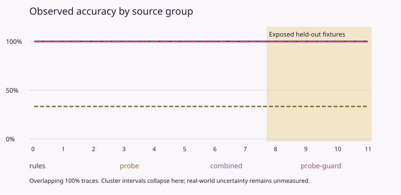

# Learning Progress

## Actual candidate change and rejection — v0.3.0.dev3

Two verified training observations produced P1. It actually selected a different inventory route on separate development input, returned 42,073 instead of 41,907 bytes, and was rejected. The unchanged P0 tool then passed a subsequent task. This distinguishes an executed learning loop from useful learning: **adaptation is not validated**. Experimental state restored and reloaded; no production policy changed. Last verified: **21 November 2026 Las Vegas / 22 November UTC**. [All controls, failures and independent decision](/hive/notes/INTEGRATION/).

## Video mission engineering alpha — 21 November 2026

The video mission saves policy hashes around verifier-backed development feedback and identifies the next proposed route without claiming that route executed. Editorial usefulness and strong-baseline learning benefit remain unverified. No production policy promotion occurred.

[Source, results, demo and limitations](/hive/notes/WORKING/).

## Latest executed increment: adaptive controller v0.2

**IMPLEMENTED / MEASURED; experimental checkpoints only.** The new controller
completed 30 real local-model calls. Direct model 3/6 → learned router 5/6;
it rejected a 4/6 regression, retained its checkpoint, then continued to
deterministic tools at 6/6. All 36 observations and decisions reverified in a
fresh process with zero new calls. Current v0.2.1 passed 136 tests and both CLI journeys; one Windows symlink
test was skipped. The measured run retains its v0.2.0 source snapshot.

[Executable controller, source, results and limits](/hive/notes/CONTROLLER/).
Last verified: **21 November 2026 UTC**. Repeated validation supports only this
finite selection experiment; broad learning and strong-baseline superiority
remain unproven. Earlier records below retain their original scope.

## Routing adaptation: autonomous local prototype v0.1

Valid development feedback changed later routing in a separate real-model
experiment. The learning-disabled ablation supports a within-suite routing
contribution; the learned router ties greedy and loses to deterministic tools.
The policy is **QUARANTINED**, with no production promotion or weight updates.
Repeated gains across independent experiments remain unproven.

[Read the learning experiment and reproduction checks](/hive/notes/PROTOTYPE/).
Last verified for this update: **21 November 2026 UTC**.

## Earlier caption-pilot learning report

**The first cycle completed with a rejected proposal. Compounding learning has not been demonstrated.**

1. The unchanged `probe` configuration produced repeated development false accepts.
2. The proposer used those episode IDs to select a bounded procedure: check timing and structure before conditionally invoking ffprobe.
3. Candidate source/configuration, rubric and fixture hashes were frozen for evaluation; the worker received one input path and a fixed configuration, never reference labels.
4. The independent evaluator compared all configurations against unchanged reference labels. Existing correctly solved tasks had no observed regressions.
5. The benefit gate rejected the candidate against the strongest simple control. Production remained unchanged.
6. Separate test-only staging and rollback restored the prior configuration and executed it successfully. No production approval is implied by that test.

| Configuration | Development | Held-out | Mean held-out latency | False accepts / rejects |
|---|---:|---:|---:|---:|
| rules | 48/48 | 24/24 | 63.5 ms | 0 / 0 |
| probe | 16/48 | 8/24 | 100.3 ms | 16 / 0 |
| combined | 48/48 | 24/24 | 96.1 ms | 0 / 0 |
| probe-guard | 48/48 | 24/24 | 73.3 ms | 0 / 0 |

The candidate improves the insufficient probe-only workflow, but does not improve upon `rules`. Its correction is a useful procedure experiment, not evidence of increased best-system capability. The initial diagnostic run proposed an already-existing composition; review caught that duplication. The final bounded procedure has a distinct fail-fast execution order and tool-call counts. Both outcomes are retained; the final comparison uses the same exposed regression fixtures and cannot establish fresh generalization.

## Curves, retention and sample efficiency

[Per-source curves](/hive/evidence/caption-pilot-1/learning-curves.json) records accuracy for every source group. [Repeated execution](/hive/evidence/caption-pilot-1/replay.json) checks deterministic output retention. Learning-speed indicator is **not estimated**: there has been no equal-budget, successive-distribution trials-to-threshold study. No neural training, forgetting study, transfer study or real-world performance claim is supported.

## Independent gates

- benefit: **FAIL**
- retention: **PASS**
- safety: **PASS**
- memory: **PASS**
- budgets: **PASS**
- reproducibility: **PASS**
- holdout integrity: **PASS**
- rollback: **PASS**

Here, holdout integrity means frozen bytes, disjoint groups and development-only proposal lineage; it does not mean the fixture labels remain secret from a local operator. Safety and memory gates refer to the 13 recorded regression tests, not a security audit. These trusted-process checks are not a hostile-code sandbox.

[Test and rollback evidence](/hive/evidence/caption-pilot-1/test-results.json) · [Candidate lineage](/hive/evidence/caption-pilot-1/candidate.json) · [Validated development-only dataset](/hive/evidence/caption-pilot-1/curated-dev.json)

Next smallest deciding experiment: freeze an independently labeled, source-disjoint set of real SRT/video tasks before designing the next candidate. Compare rule-only, retrieval/procedure and an already available model under the same budgets. A fresh holdout and real-task gain are prerequisites for any improvement claim.

Last verified: **2026-11-21T04:27:34.3337389Z**. Evidence is a local CPU/tool pilot on synthetic fixtures. No production HIVE runtime, trained weights, or compounding-learning result is claimed.
