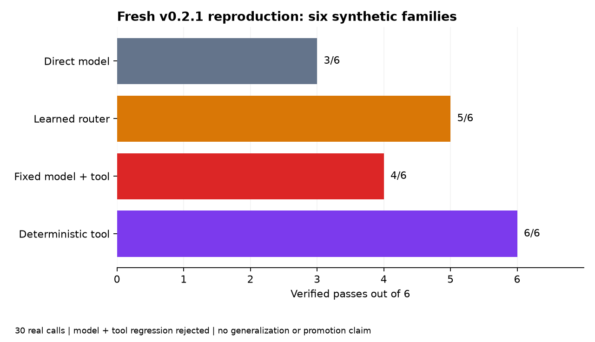

# HIVE v0.3 foundation — 21 November 2026

**Experimental engineering checkpoint; E0 completed with a recorded status defect, E1 draft, no policy deployed.**
Working branch: `build/v0.3`, based on published v0.2.1 commit
`eeec51497038ec34454d867f55ebe0fcadfffddf`. This additive source is version
`0.3.0.dev1`; it is not the source of the older v0.2.0 real-model measurements.

Final foundation checks: **217 tests passed, one skipped**, plus both Tester Army
CLI journeys. The initial full run found only an outdated exporter fixture count
after adding plans to the snapshot; the corrected assertion and passing rerun
are retained. Reports: `experiments/results/v03-foundation-tests.xml` and
`experiments/results/v03-foundation-e2e/report.json`.

## Reproduced release base

The live v0.2.1 publication manifest and downloaded ZIP match:

- ZIP SHA-256: `cd0c782e476f52c75952c923abc5cf16ca6dcbcd3a188c6f4f3c60102f03c445`.
- Runtime source SHA-256: `2f1ad5f919ec8918a6d699ee0c4328438e5b203294e4048717c0134c9e9bc37f`.
- Local model digest: `a45646773d1ee8a6c1557c7de09a68e78a74f2990c4174a1408f65e777db150c`.
- Baseline verification: 136 tests passed, one Windows symlink test skipped;
  both existing Tester Army CLI journeys passed. No new inference was used.

`experiments/results/v03-base-verification.json` records the downloaded payload
checks and doctor output. The original ZIP is retained locally under
`.hive/v03-base/`; the historical public artifacts are unchanged.
An additional check of the extracted pinned download passed 136 tests with one
skip; `experiments/results/v03-base-tests-confirmation.xml` records that run.

## Executable addition

`hive.benchmark_registry.BenchmarkRegistry` stores frozen manifests and exposure
records in SQLite. It validates source genealogy metadata, binds each fixture's
hash to canonical public JSON, rejects cross-split and cross-manifest identity or
fixture reuse, and removes private labels from public envelopes. Holdout/future
exposure commits atomically before returning data. An exact mission/policy/
evaluator/manifest identity can resume; it is marked reused, never fresh.

Terra's independent tests found and reproduced three reuse defects in the first
implementation: identical fixture across splits under new IDs, consumed cases
copied into a second manifest, and identical held-out fixtures relabeled within
the same split. Luna repaired them; the counterexamples remain tests. Astra found and fixed a
fourth case: identical public payloads counted twice under distinct sources in
one manifest. Duplicate fixture content now fails within the manifest too. Terra's
stable recovery/integrity run passed 27 tests, including ten new controls.

This is a logical boundary for a trusted curator/process. It cannot authenticate
the semantic independence of sources, prevent answers disguised inside text,
protect against the OS owner, or make arbitrary generated code safe. Registry
identity strings must be bound to actual policy/config/evaluator hashes by the
future campaign adapter. The old adaptive runner does not yet use this registry.
Its public envelope contains metadata; only nested `public` is intended for
future candidate requests. No independent benchmark corpus or evaluator service
has been completed or consumed.

Grok independently reproduced numeric/Unicode fixture aliases, disguised answer
keys, invisible identifiers and tuple coercion. The repairs preserve the wire
fixture hash, add a separate normalized ownership fingerprint, reject malformed
JSON values and normalize forbidden field names. New regression controls cover
the reported bypasses; semantic paraphrases and answers hidden in prose remain
outside this trusted-curator check. Existing registry databases are checked for
normalized collisions when opened; incompatible legacy data fails closed.

## E0 mission, executed under approved caps

`scripts/v03_e0.py prepare` verifies the pinned published source and model without
inference. The frozen plan is `experiments/plans/v03-e0.json`; configuration is
`configs/v03-e0.json`. Ian explicitly approved these caps; the authorization is retained in the local mission store.

Caps: **30 local requests, 3,840 reserved generated tokens, 600 active seconds,
64 MiB artifacts, one inference at once, zero retries**. A single fixed store
contains all resume spending; none of the former mission's unused allowance is
transferred. The schedule tests STOP before inference, resumes the same mission,
runs the finite historical task schedule, then re-verifies in a fresh process
with no new requests. Synthetic tests cover failure/restart behavior separately.

The fresh **v0.2.1** mission completed **30 calls**, **1,008 generated tokens**,
**3,840 reserved tokens**, and **23.125 active seconds**, with 36 evidence bundles.
STOP prevented all calls before resume; a fresh process reverified the evidence
and decisions with **zero additional calls**. The fixed-tool route remains the
strongest control; no policy was promoted. The full request allowance is spent.

The direct route passed 3/6, learned router 5/6, fixed model-plus-tool 4/6
(rejected for regression), and deterministic tools 6/6. These are freshly executed
historical synthetic families, not new independent sources or generalization.
Inference latency median was 0.313s and nearest-rank p95 1.203s; peak VRAM was
not sampled. The roughly 0.45 MiB local store stayed under its 64 MiB cap.

E0 also exposed stale top-level `status.stop_reason=kill switch` after the
adaptive state had finished. `v03-e0-decision.json` records
`COMPLETED_WITH_STATUS_OBSERVABILITY_DEFECT`; the original runner receipt is
preserved rather than silently rewritten. The v0.3 finalizer now publishes the
terminal campaign reason, with a synthetic STOP/resume regression. The real
evidence remains v0.2.1; this later fix is not relabeled as fresh real-model
validation. A complete unqualified reliability gate is therefore not claimed.

Grok also confirmed this status defect and found interrupted preflight resume,
wrapper cap-verification and historical-test attribution gaps. The final wrapper
requires an explicit resume for an already paused store, validates measured
budget counters, and keeps preparation checks separate from historical test
receipts. These repairs have synthetic coverage only. They do not modify the
pinned runtime or replace the original E0 evidence. The historical code-repair
tasks expose `fixture_outputs` in their requests; E0 therefore cannot validate
the new evaluator boundary or independent generalization.
The repaired wrapper was also checked against the already finished E0 store:
all historical receipt/plan bytes stayed identical, spending stayed at 30 calls,
and the status-defect decision reproduced. This cached check is recorded in
`experiments/results/v03-e0-wrapper-recheck.json` and used zero new calls.

## E1 design and independent review

[The draft](/hive/implementation/v03-foundation/docs/V03_EXPERIMENT_DESIGN.md) specifies B0/B1/B2/B4/C1, authentic source
families, wrong-tool controls, source-level paired inference, and a 12-task,
24-call diagnostic pilot. Its much larger confirmatory scenarios are unapproved
planning estimates. Sources, labels, calibration and empirical assumptions are
missing, so E1 cannot freeze or run yet. No E2/E3 result is claimed.

NVIDIA Nemotron reviewed the supplied design. We accepted its source inventory,
hierarchical dependence, baseline ceiling and cost-accounting cautions. Three
mathematical objections were rejected after derivation: a union bound gives
`P(all four succeed) >= 1 - 4*0.05 = 0.80`; a paired binary difference has
`Var(D) = P(D != 0) - E[D]^2`; and a 0.15 planning effect over a 0.02 margin leaves
0.13 signal, not 0.15. Review text and dispositions are preserved. A model's
critique is evidence to inspect, not approval by itself.

## Durable next work

1. Preserve the finished E0 checkpoint and consumed 30-call ceiling. Carry the
   observed status defect and tested v0.3 repair into the next authorized mission.
2. Integrate the registry with a development-only candidate adapter, independently
   owned evaluator, actual-source/config hash binding, and aggregate budget ledger.
3. Inventory genuinely independent sources and calibrate known-good/known-bad
   checker controls. Complete a zero-inference synthetic campaign first.
4. Review and freeze a newly authorized diagnostic pilot. A failed pilot opens a
   counterexample-linked hypothesis; it does not recycle its data as untouched.
5. Only after those gates, reconsider a powered E1 and chronological E2.

Publication ships this engineering checkpoint and evidence. It does not deploy
a learned policy, replenish inference budgets, or claim the v0.3 research goal
has been achieved.

## Measured reproduction

[Read all arms, per-family results and resource limits](/hive/implementation/v03-foundation/experiments/results/v03-e0.md).

## Source and evidence

[Download experimental source](/hive/downloads/HIVE_v0.3_Foundation_dev1.zip) | [Source manifest](/hive/implementation/v03-foundation/SNAPSHOT_MANIFEST.json) | [E0 decision](/hive/implementation/v03-foundation/experiments/results/v03-e0-decision.json) | [E1 draft](/hive/implementation/v03-foundation/experiments/plans/v03-e1-design.json)

Last verified: **21 November 2026 UTC**.
