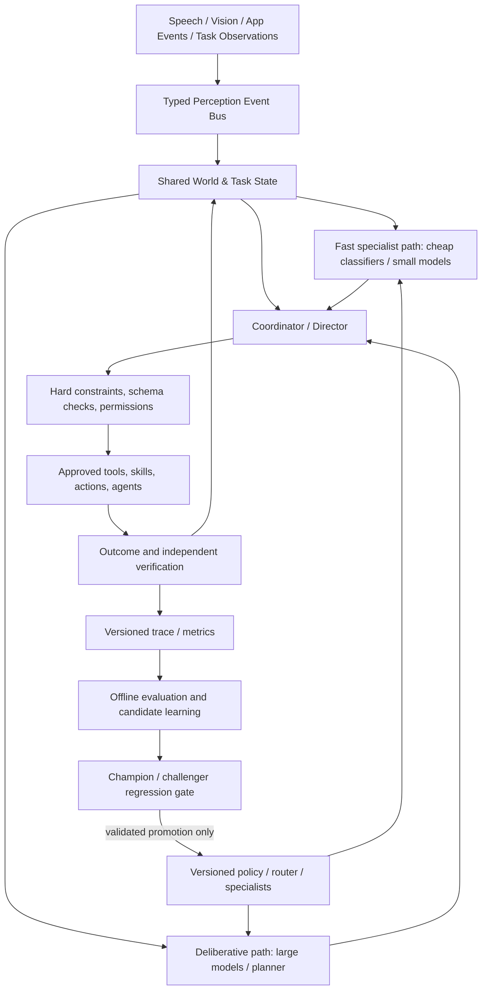

# HIVE Research Dossier: Disney + AWS Anzellan Multi-Model Character System

**Research date:** 2026-11-21  
**Status:** Public-source technical reconstruction, not a leaked architecture  
**Purpose:** Identify exactly what Disney has disclosed about its November 2026 autonomous Anzellan animatronics, investigate adjacent Disney research and independently available AWS/open-source implementation patterns, and extract reproducible architecture lessons for HIVE.

> **Evidence tags used below:** **[CONFIRMED]** explicitly disclosed by Disney/AWS or reported from named interviews; **[RECONSTRUCTION]** a plausible software implementation consistent with those disclosures, *not claimed to be Disney's actual code*; **[HIVE PROPOSAL]** a design choice for our own prototype; **[NOT DISCLOSED]** cannot be recovered from public information as of the research date.

---

## Executive finding

**Disney has publicly demonstrated a coordinated, heterogeneous, model-driven system: perception models and fast response models supply low-latency reactions; larger models consider context; an ensemble-director function coordinates three characters; and the outputs trigger pre-approved dialogue and movements.** Disney uses AWS and Amazon Bedrock and emphasizes replaceable models, low latency, and a shared character platform. This is a closer analogue to a *specialist assembly operating as one character* than to three independent chatbots.

**However, the Anzellans are not evidence of a self-retraining or self-rewriting AI.** Disney says interaction data is currently used only for the live encounter and is not stored for later use or model training. HIVE's continuous learning, evaluation, champion/challenger selection, verified self-modification, and checkpoints would need to be added as a separate layer.

Primary source: [Disney official announcement, Nov. 18, 2026](https://disneyexperiences.com/anzellans-imagineering-rd-robotic-characters/). Deepest named engineering interview: [TechRadar interview with Kyle Laughlin and AWS's Samira Panah Bakhtiar](https://www.techradar.com/science/robotics/our-most-advanced-audio-animatronics-in-the-world-disney-imagineering-reveals-how-aws-ai-brings-the-star-wars-anzellans-to-life).

## 1. Exact public disclosures

| Area | Finding | Evidence level |
|---|---|---|
| Prototype | Three distinct Star Wars Anzellans: Vilo Vele, Kado Bre'a, and Jibu Bre'a | CONFIRMED |
| Behavior | No fixed show loop; autonomous selection of what to say and how to move in response to guests and other characters | CONFIRMED |
| Input | Concealed cameras, microphones, and additional sensors; perception of multiple guests, speaker, appearance, environment | CONFIRMED |
| Inference | Fast-decision models supply rapid responses; larger models assess the broader situation | CONFIRMED |
| Modalities | Disney says it uses vision models, LLMs, and world models | CONFIRMED from leadership interview; exact models undisclosed |
| Model service | Amazon Bedrock supplies model access in AWS | CONFIRMED |
| Orchestration | The system acts like a show director to keep the trio coherent and prevent talking over one another | CONFIRMED functional behavior; internal algorithm undisclosed |
| Creative boundaries | Dialogue is Imagineer-written and prerecorded; character animations and personalities are artist-designed; AI chooses what to trigger | CONFIRMED |
| Development tool | AWS team used Kiro coding agent to translate creative briefs to software with staged human review | CONFIRMED interview; **Kiro is development support, not proven live runtime** |
| Runtime resilience | Disney says AWS cloud and edge infrastructure provide alternative experiences after failures | CONFIRMED broad strategy; deployment topology undisclosed |
| Model change | Bedrock lets team replace/upgrade models with less application redesign | CONFIRMED intended platform property |
| Privacy/training | Guest encounter information is currently not being stored in the cloud for Disney to reuse or used to train models | CONFIRMED interview |
| Underlying algorithms | Exact model names, sizes, prompts, inter-agent protocol, sensor count, scheduler, latency figures, model execution placement | NOT DISCLOSED |
| Public deployment | Planned demonstration AWS re:Invent, Las Vegas, Nov. 30–Dec. 4, 2026; no confirmed park rollout date as of Nov. 21 | CONFIRMED |

Sources: [Disney](https://disneyexperiences.com/anzellans-imagineering-rd-robotic-characters/), [AWS announcement](https://aws.amazon.com/blogs/media/meet-the-anzellans-inside-imagineering-rds-newest-robotic-characters/), [TechRadar interview](https://www.techradar.com/science/robotics/our-most-advanced-audio-animatronics-in-the-world-disney-imagineering-reveals-how-aws-ai-brings-the-star-wars-anzellans-to-life), [The Verge](https://www.theverge.com/tech/1036729/disney-star-wars-anzellans-animatronic-amazon-aws-cloud-ai).

## 2. Why the combination feels organic

### 2.1 Perception is continuous, not one prompt at a time

**[CONFIRMED]** The characters attend to guest speech, gestures, number/location of visitors, details such as a birthday button, and the actions of their peers. A quick response can happen while a more complex exchange is being worked out. Their behavior depends on new surroundings, not on a rigid script timeline.

**[RECONSTRUCTION]** Implement this as a stream of timestamped environmental events (e.g., `guest_waved`, `person_started_speaking`, `actor_A_talking`, `person_wearing_birthday_button`), with a shared, versioned world-state snapshot. Fast and slow reasoning subscribe to the same event stream. This avoids each specialist independently reconstructing the entire world from raw sensory inputs.

### 2.2 Different response speeds coexist

**[CONFIRMED]** Fast decision models handle immediate reactions, larger models help weigh the bigger picture. This is *heterogeneous cognition*, not sending every camera frame through the biggest LLM.

**[RECONSTRUCTION]** Use two asynchronously running paths:

- **Reflex path**: cheap input classification -> eligible micro-action -> safe execution; does not block on cloud reasoning.
- **Deliberative path**: larger context model selects interaction goals, proposed dialogue/animation group, narrative direction; may take longer and updates intent when ready.

The fast path should not issue irreversible or high-risk actions; the deliberate path should not need to approve every blink. Both paths still obey hard safety rules.

### 2.3 There is an ensemble coordinator

**[CONFIRMED]** AWS described a system functioning as a show director. Each character responds individually, but the system prevents interference and ensures a coherent exchange.

**[RECONSTRUCTION]** A director/arbiter controls shared resources: speech channel, target attention, physical interaction space, narrative priority. It can issue turn grants, cancel conflicting plans, interrupt when guests change behavior, and direct the next speaker. This can be mostly deterministic software with LLM assistance when ambiguity is genuinely present.

### 2.4 Generation of decisions is separated from generation of content

**[CONFIRMED]** The system selects authored/prerecorded dialogue and designed motions. The character does not invent dialogue at showtime. The combination and timing are dynamic, but the output space is bounded.

**HIVE inference:** For task execution, a useful analogous control is to let AI choose *approved capabilities/actions* and their order rather than freely execute unvalidated code or commands. For less safety-critical tasks, HIVE can permit new artifacts, but require verification before adopting them.

### 2.5 The foundation is reusable

**[CONFIRMED]** Disney describes a shared robotic character platform, related to its BDX droids and Olaf, intended to support many character experiences. Bedrock provides interchangeability of AI model providers. **Do not infer** that the complete Anzellan decision system, Olaf locomotion controller, and BDX navigation stack are identical—they are different capability layers.

## 3. Reference architecture for HIVE (NOT Disney's published diagram)



**Principle:** HIVE needs *two loops*, not one blended loop:

1. **Live operation loop:** sense -> decide -> coordinate -> act -> verify -> update state. Must remain responsive, recoverable, and bounded.
2. **Improvement loop:** record consented/synthetic benchmark evidence -> diagnose -> propose model/router/tool/prompt updates -> evaluate against held-out tests -> checkpoint and promote or rollback. Never overwrite the live system merely because a candidate asserts it is better.

### Layer contracts

| Layer | Minimum input | Minimum output | Failure rule |
|---|---|---|---|
| Perception | Raw or derived observations | Typed events, timestamp, source, confidence | Mark unavailable/uncertain; never fabricate sensing |
| World state | Accepted events | Current snapshot + version + TTL per fact | Expire stale facts |
| Reflex specialists | Event + subset of state | Suggested safe micro-action + deadline | Use deterministic idle/fallback |
| Deliberative planner | Goal, recent history, relevant state | Structured plan with rationale, constraints, expected effects | Timeout and default to simpler plan |
| Director | Plans + live statuses + resource locks | Action authorization, sequencing, interruption, priority | Resolve deadlock / restrict to safe action |
| Verifier | Claimed action + observable artifact | Pass/fail, evidence IDs, uncertainty | Failure never counted as success |
| Model registry | Benchmarked models + provider metadata | Eligible model selected under budget | Fallback to healthy known-good model |
| Improvement controller | Traces + benchmark suites + checkpoints | Candidate + validated promotion decision | Roll back on regressions |

## 4. How to reproduce the coordination without using AWS

**[HIVE PROPOSAL]** Use the user's local test subjects and existing available tools where verified, adding hosted models only where needed. Do not assume any particular local model or service is installed/running without checking the machine's software inventory.

### Minimal replaceable components

| Functional requirement | Public implementation option | Why it fits | Caution |
|---|---|---|---|
| Multi-agent workflows, handoffs, graph cycles | [Strands Agents SDK](https://github.com/strands-agents/harness-sdk) | Python/TypeScript, graph and swarm patterns, tools, tracing | Disney has **not** been confirmed to use it |
| Explicit state machines, checkpoints, persistent agents | [LangGraph](https://github.com/langchain-ai/docs/blob/main/src/oss/langgraph/overview.mdx) | Graph-based stateful orchestration and resumption | Complement with hard policies for live actions |
| Model gateway, routing/failovers | [LiteLLM](https://github.com/BerriAI/litellm-docs/blob/main/docs/proxy/model_access_guide.md) | Normalizes multiple providers; failover and model groups | Adaptive routing is not equivalent to broad learning |
| Local model inference | [Ollama API](https://github.com/ollama/ollama/blob/main/docs/api/introduction.mdx) or compatible installed inference server | Keeps specialist tests local | Benchmark latency on actual hardware |
| AWS-native multi-agent starter examples | [Amazon Bedrock Agent samples](https://github.com/awslabs/amazon-bedrock-agent-samples) | Supervisor routing, tool actions, tracing | Demonstrations not production-complete |
| Hosted agent runtime/memory/observability | [AWS AgentCore samples](https://github.com/awslabs/agentcore-samples) | Managed runtime, tools, identity, eval, monitoring | Managed costs and cloud dependency |
| NVIDIA-backed multiple-agent execution | [AWS Strands + NVIDIA NIM + AgentCore design](https://aws.amazon.com/blogs/machine-learning/build-high-performance-generative-ai-systems-with-strands-agents-nvidia-nim-and-amazon-bedrock-agentcore/) | Documented parallel specialists + shared memory and instrumentation | A relevant reference **not documented as Disney's stack** |

Of these, **Strands Agents is especially worth investigating** because it explicitly distinguishes a Graph (predefined dependencies/conditional cycles), a Swarm (agents choose handoffs based on shared context), and agents-as-tools (a supervisor delegates). See [their pattern comparison and shared-state documentation](https://github.com/strands-agents/harness-sdk/blob/main/site/src/content/docs/user-guide/sdk/multi-agent/multi-agent-patterns.mdx). For predictable production coordination, a hybrid—fixed event/director skeleton, flexible subagent handoffs—better matches the known Disney behavior than an unrestricted swarm.

### Event schema (illustrative)

```json
{
  "event_id": "e_000412",
  "type": "guest_speaking",
  "timestamp_ms": 1763769600000,
  "source": "speech_perception",
  "entity_id": "guest_02",
  "confidence": 0.94,
  "ttl_ms": 1500,
  "payload": {"direction": "left", "target_character": "actor_B"}
}
```

These numbers and names are **illustrations, not measured Disney specifications**. HIVE should establish them through actual testing. Each event should include a source, expiry, confidence and trace ID. The event bus should carry *facts with provenance*, not arbitrarily asserted narrative conclusions.

### Director rules (first implementation should be simple)

1. A character owns no shared channel until granted a short lease by the director.
2. Only one character can own the speech channel for a given audience at a time.
3. Characters may perform compatible nonverbal actions concurrently.
4. Incoming higher-priority safety or guest events can preempt a plan.
5. World-state changes invalidate plans that depend on stale facts.
6. If a large model is unavailable, deterministic rules and approved small-model responses continue.
7. A watchdog terminates abandoned leases and deadlocked tool calls.
8. Every emitted action is linked to the observations and policy that authorized it.

**The organic effect comes from independent attention and reactions happening inside coordinated constraints, not from allowing unsupervised models to contradict one another.**

## 5. A measurable model-selection and action policy for HIVE

This section proposes testable mathematics; **none of these formulas is asserted to be Disney's proprietary implementation.**

### Model route optimization

For a request of type `x`, route among available models `m` that satisfy hard constraints:

\[
 m^*(x) = \arg\max_{m\in\mathcal M_{eligible}(x)}
 \left[ \hat Q(m,x) - \lambda_L \hat L(m,x) - \lambda_C \hat C(m,x) - \lambda_F \hat F(m,x) \right].
\]

- `Q`: measured quality/success probability on similar verified tasks.
- `L`: expected latency.
- `C`: expected compute/API cost.
- `F`: empirically estimated failure rate.
- `eligible`: models with appropriate permissions, capabilities, privacy and latency bounds.

Do **not** optimize solely against a self-reported model confidence score. Use independent external checks and held-out benchmarks. To avoid overfitting and allow discovery, test controlled challenger routing (e.g. contextual bandit with a capped exploration allocation), with no exploration on safety-critical actions.

### Multi-character or multi-agent arbitration

For a proposed action `a`, compute a ranked *soft preference* only after checking hard invariants:

\[
 U(a|s) = w_g G(a,s) + w_r R(a,s) + w_c C(a,s) - w_t T(a,s) - w_k K(a,s),
\]

where `G` measures goal progress, `R` responsiveness/relevance, `C` coherence with other agents, `T` timeliness penalty and `K` predicted conflict/resource burden. Safety, authorization, and channel exclusivity are **hard constraints**, not weighted tradeoffs. When model uncertainty is high or data is stale, prefer a safe, smaller, reversible action.

### Self-improvement promotion gate

\[
 \text{Promote}(p') =
 [\Delta Q_{heldout} > \epsilon_Q]
 \land [\Delta S_{critical} \ge -\epsilon_S]
 \land [L_{p95}\le L_{max}]
 \land [C\le C_{max}]
 \land [\text{rollback available}].
\]

This is an **example** acceptance policy, not a universal formula. Choose thresholds from baseline benchmark results, report confidence intervals, and prohibit promotion on unverifiable claims. Candidate improvements may update routing weights, prompts, tool choices, memory retrieval, action sets, or separately trained specialists. Live policy edits should be versioned and reversible.

## 6. Tests that directly validate Disney-like coordination

| Test | Setup | What success actually demonstrates | Failure investigated |
|---|---|---|---|
| T1: simultaneous signal | Two people speak, one waves, all within short window | Fast reflex responds correctly without waiting for long planner | Serial blocking, missed events, wrong focus |
| T2: ensemble overlap | Three autonomous actor agents try to speak at once | Director serializes speech but allows compatible gestures | Crosstalk, deadlocks, unfair scheduling |
| T3: context change | Long model prepares answer, then guest walks away | Stale plan is canceled or revised | Blind execution from obsolete state |
| T4: provider outage | Kill/disable large-model service mid-exchange | Local fast path and scripted fallback remain functional | Single point of failure |
| T5: uncertainty | Vision/audio classifier returns low confidence | Safe response; no invented certainty | Hallucinated guest information |
| T6: cross-provider swap | Swap large planner backend without altering actor layer | Stable interfaces and consistent schema | Coupled provider-specific code |
| T7: specialist benefit | Compare 1 large model vs specialist ensemble at same cost envelope | Accuracy/latency gains measured on held-out tasks | Added orchestration overhead |
| T8: adaptive routing | Benchmark different task families and provider constraints | Router increasingly selects eligible, capable, cost-effective model | Always using the biggest model |
| T9: improvement checkpoint | Challenger proposes router/prompt/code changes | Changes only adopted after independent test and regression gate | Reward hacking or false success |
| T10: recovery loop | Repeated reversible failures seeded into a local build task | System diagnoses, changes strategy and re-tests; stops on explicit budget/safety gate, not on a single failure | Premature stop, infinite unproductive loop |

Track: verified success rate, 50th/95th percentile time-to-first-reaction, 95th percentile final-action latency, conflict rate, stale-action rate, false-positive perception rate, recovery success, mean model calls, total cost/tokens, and rollback incidence. **No Disney benchmark numbers have been published; these must be established in HIVE.**

## 7. The related Disney research: do not conflate these subsystems

### 7.1 Olaf walking: reinforcement learning for physical motion

**[CONFIRMED]** Olaf's movements are taught via reinforcement learning guided by animation references, using simulation and specialized physical constraints. Disney's 2026 research paper describes an asymmetric walking mechanism, thermally aware actuator policies, and rewards to reduce footstep noise. This is **motion-policy learning**, not evidence the Anzellan ensemble continually retrains its higher-level planning model.

- [Disney research paper: Olaf: Bringing an Animated Character to Life in the Physical World](https://la.disneyresearch.com/publication/olaf-bringing-an-animated-character-to-life-in-the-physical-world/)
- [Disney's Olaf / BDX / Newton interview](https://thewaltdisneycompany.org/news/olaf-robotic-character/index.html)

### 7.2 Kamino / Newton: accelerated testing in parallel worlds

**[CONFIRMED]** Disney Research and NVIDIA published Kamino, a GPU physics solver integrated into NVIDIA Newton. Their project describes **4,096 parallel simulated environments** for a complex biped locomotion policy; it is specifically designed for high-throughput training of mechanically coupled systems. The team expressly notes that Kamino is *not* optimized for low-latency single-environment simulation.

**HIVE implication:** When testing robotics or virtual game physics, accelerated simulation can dramatically speed training. For software-only model-routing experiments, run many independent scenario simulations without necessarily using a physics simulator.

- [Kamino technical project and code links](https://disneyresearch.github.io/kamino-site/)
- [Disney/NVIDIA robotics discussion](https://disneyexperiences.com/nvidia-gtc-olaf-robotic-character/)

### 7.3 J.A.R.V.I.S.: Imagineering's knowledge assistant

**[CONFIRMED]** Disney separately describes an internal assistant called **J.A.R.V.I.S.**, built around Imagineering research, documentation, lessons learned, and collective institutional knowledge. The public description does **not** establish whether it uses retrieval, fine-tuning, or another training approach.

**HIVE implication:** This is closer to a shared evidence and engineering-knowledge substrate for the agent team, distinct from the Anzellans' live performer director.

- [Disney's Imagineering R&D episode article](https://disneyparksblog.com/disney-experiences/go-behind-the-scenes-in-imagineering-video-series/)
- [Official episode listing (J.A.R.V.I.S. at 21:09)](https://www.youtube.com/watch?v=EoPN02bmzrE)

### 7.4 Projected pirate face: digital rendering plus physical character

**[CONFIRMED]** Disney's transforming pirate combines real-time front projection mapping and a mechanically streamlined face. Coverage describes Unreal Engine-based rendering. This is a **presentation/animation technique**, not evidence that the pirate is running the same multi-model autonomous logic as the Anzellans.

- [Disney's official summary of next-gen Audio-Animatronics](https://disneyparksblog.com/disney-experiences/6-things-you-missed-from-we-call-it-imagineering-episode-7/)
- [Technical coverage of pirate projection and physical design](https://www.techradar.com/streaming/entertainment/exclusive-i-watched-disneys-next-gen-audio-animatronic-transform-from-a-pirate-to-a-skeleton-and-the-deeply-impressive-tech-debuts-at-disneyland-today)

## 8. What is specifically new for HIVE

1. **Add an explicit director layer.** Having individually smart agents isn't sufficient. The director should enforce coherence, manage ownership of shared resources, and schedule interruptions.
2. **Separate reflex, deliberation, and verification.** A large model should never become a bottleneck for simple reactions; cheap models should not be delegated complex high-stakes planning without escalation.
3. **Use one shared factual state with provenance.** A blackboard/event-bus architecture helps agents react to the same world without duplicating raw input processing.
4. **Select from capability libraries.** The Anzellan pattern suggests allowing the model to choose from bounded actions. HIVE can extend this to tools, skills, program routines, code edits and training recipes, with different permissions.
5. **Treat the model as replaceable.** Separate interfaces and evaluation profiles from specific vendors or parameter counts.
6. **Have graceful local fallback.** If a planner times out, the live system must still function safely, communicate limits, and recover.
7. **Do not confuse apparent autonomy with accumulated learning.** Add a separate replay/benchmark/adaptation process, evaluated on new test cases, with recorded checkpoints.
8. **Optimize measured collective performance, not agent count or model size.** The win is meeting success, reliability, latency and cost constraints with the least necessary compute.

### Fastest evidence-first prototype target

Three software-only actors with distinct roles (e.g., navigator/observer/communicator) share a simulated world state. Each independently offers candidate actions. A director grants turns and resolves conflicts. Run at least two interchangeable model sizes/providers; collect traces; inject changing situations and outages. Once demonstrated, add an improvement controller that changes routing and action-selection policy, and promotes changes only after held-out evaluation.

**This validates the architectural theory before adding cameras, 3D avatars, robots, or expensive weight training.**

## 9. Unresolved questions for follow-up public research

- Exact identities, sizes and hosting arrangements of the Anzellan fast/large/vision/world models.
- Is the show director predominantly deterministic arbitration, a trained policy, an LLM, or a hybrid?
- Are the character policies separate, partly shared, or one coordinated multi-actor policy?
- What representation transports perceptions and actor intent (events, shared blackboard, embeddings, direct messages)?
- What runs on device/edge versus cloud, and how do they guarantee acceptable time-to-first-reaction?
- What are the real benchmark numbers for reaction latency, speech overlap, failure recovery and false detections?
- Are there published SDKs, technical presentations, or demos after AWS re:Invent (Nov. 30–Dec. 4, 2026)? **That event is in the future as of this report.**

---

## Verified sources and implementation references

### Direct disclosures and contemporaneous reporting

1. [Disney Experiences — Meet the Anzellans (Nov. 18, 2026)](https://disneyexperiences.com/anzellans-imagineering-rd-robotic-characters/) — first-party claims on character autonomy, split model sizes, constrained media, AWS.
2. [AWS Media Blog — Meet the Anzellans (Nov. 18, 2026)](https://aws.amazon.com/blogs/media/meet-the-anzellans-inside-imagineering-rds-newest-robotic-characters/) — first-party AWS corroboration.
3. [TechRadar — interview with Disney's Kyle Laughlin and AWS's Samira Panah Bakhtiar (Nov. 18, 2026)](https://www.techradar.com/science/robotics/our-most-advanced-audio-animatronics-in-the-world-disney-imagineering-reveals-how-aws-ai-brings-the-star-wars-anzellans-to-life) — **highest technical specificity:** Bedrock, computer vision, language/world models, show director, privacy, Kiro, edge/cloud, reuse, unknowns.
4. [The Verge — Disney's Anzellan autonomous animatronics (Nov. 18, 2026)](https://www.theverge.com/tech/1036729/disney-star-wars-anzellans-animatronic-amazon-aws-cloud-ai) — separate reporting on rapid reactions and curated dialogue.

### Public implementation patterns (not identified as Disney's internal Anzellan stack)

5. [Strands Agents — SDK](https://github.com/strands-agents/harness-sdk)
6. [Strands Agents — Graph vs Swarm vs Workflow vs Supervisor](https://github.com/strands-agents/harness-sdk/blob/main/site/src/content/docs/user-guide/sdk/multi-agent/multi-agent-patterns.mdx)
7. [Amazon Bedrock Agent samples, including multi-agent collaboration](https://github.com/awslabs/amazon-bedrock-agent-samples)
8. [Amazon Bedrock AgentCore examples](https://github.com/awslabs/agentcore-samples)
9. [AWS — Unified intelligence with a supervisor, parallel specialist tools and memory](https://aws.amazon.com/blogs/machine-learning/build-unified-intelligence-with-amazon-bedrock-agentcore/)
10. [AWS — Strands, NVIDIA NIM and AgentCore multi-agent architecture](https://aws.amazon.com/blogs/machine-learning/build-high-performance-generative-ai-systems-with-strands-agents-nvidia-nim-and-amazon-bedrock-agentcore/)
11. [LangGraph — State, workflows and persistence](https://github.com/langchain-ai/docs/blob/main/src/oss/langgraph/persistence.mdx)
12. [LiteLLM — Routing, groups and fallback](https://github.com/BerriAI/litellm-docs/blob/main/docs/proxy/model_access_guide.md)
13. [LiteLLM — Adaptive/complexity routing documentation](https://github.com/BerriAI/litellm-docs/blob/main/docs/proxy/auto_routing.md)
14. [Ollama — Local inference API](https://github.com/ollama/ollama/blob/main/docs/api/introduction.mdx)

### Closely related Disney systems (not identical to Anzellan decision architecture)

15. [Disney Research — Olaf reinforcement-learning research](https://la.disneyresearch.com/publication/olaf-bringing-an-animated-character-to-life-in-the-physical-world/)
16. [Disney Research — Kamino physics solver, paper/video/code](https://disneyresearch.github.io/kamino-site/)
17. [Disney official — Imagineering R&D, J.A.R.V.I.S. and robotics](https://disneyparksblog.com/disney-experiences/go-behind-the-scenes-in-imagineering-video-series/)
18. [Disney official — new projection-mapped animatronics](https://disneyparksblog.com/disney-experiences/6-things-you-missed-from-we-call-it-imagineering-episode-7/)

*End of handoff. This dossier is a public-source reconstruction and HIVE proposal. It does not contain Disney source code, actual production prompts, model identities, or a proven claim of continuous real-world self-improvement.*
