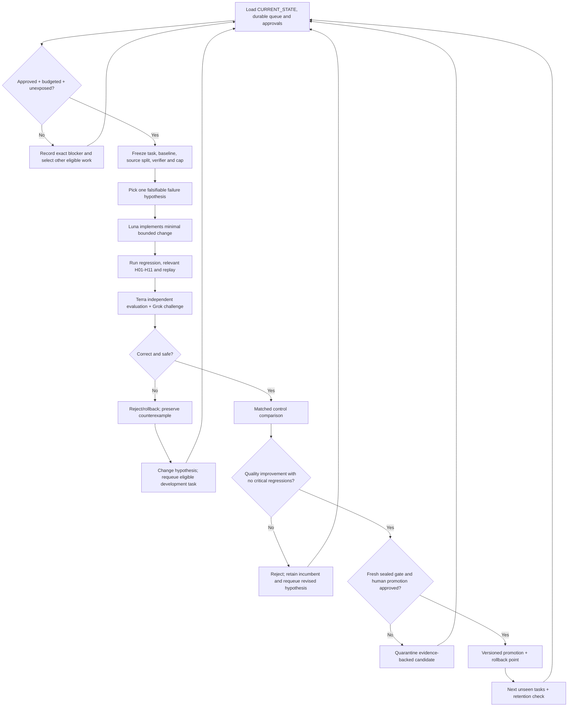

# HIVE — New Build Path: dev4 → Verified Self-Learning Prototype

**Prepared:** November 21, 2026 (PST)  
**Primary executor:** Astra coding overseer  
**Agents:** Sol (research/control policy), Luna (implementation), Terra (independent verification), Grok (adversarial review), NVIDIA/Nemotron (optional cost/benchmark assistance)  
**Project:** [MOM Inc HIVE](https://mominc.online/hive/)  
**Operating mode:** Execute all permitted work in one coordinated build campaign, with durable, bounded build–test–review loops.

> **Evidence boundary:** The live MOM Inc website could not be fetched during this review. This plan is anchored to the latest previously documented release, **`v0.3.0.dev4`**, and its published test/evidence summaries, not a new live-source audit. Astra must confirm the actual deployed version, checkout commit and hashes as its first action. Any newer live build overrides this baseline *only after* source and test receipts are reconciled. Do not confuse this project with the unrelated public `aden-hive/hive` repository.

## 1. The decision

**Do not build another HIVE framework. Finish demonstrating that the framework already built can perform real work, safely learn from verified feedback, and transfer that improvement to new tasks.**

The next release should be judged by **external task success and independently verified learning**, not by passing more self-authored integration tests.

**Recommended milestone path:**

| Milestone | Name | Required outcome | Allowed to claim |
|---|---|---|---|
| M0 | Reproducible dev4 | Source/runtime/manifest hashes match and full offline battery replays | Integration readiness, only |
| M1 | Fresh Level A acceptance | At least **10 independently accepted outputs / 12 genuinely new tasks**, six video and six code, plus existing R1–R8 and A1–A6 gates | Working narrow prototype, if all gates pass |
| M2 | Bounded improvement candidate | New P2 control policy is measured against strongest unchanged controls on development tasks; failures attributable, replayable and reversible | Development candidate, **not** self-learning proof |
| M3 | Independent Level B study | **At least 24 source-disjoint, matched, previously unseen tasks** across two waves, demonstrated quality advantage, transfer and retention without critical regressions | Evidence of useful learning in tested scope, if study passes |
| M4 | Extension pilots | Reuse accepted controller for video production, then limited live-supervisor and haunt/game workflows, each with its own safety and acceptance tests | New capability only for each validated domain |

**Important distinction:** M1 is real-task acceptance. M3 is evidence of learning. Neither can be replaced by synthetic fixtures, a route-change demonstration, a dashboard, or a larger Python test count.

## 2. What the most recent documented build actually provides

**Documented `v0.3.0.dev4` checkpoint:**

- **342 tests passed**, **2 explained skips**.
- **7 CLI journeys** passed.
- **11 synthetic pressure paths** passed.
- **Zero new model calls** in the dev4 readiness campaign.
- R1–R8 classified **INTEGRATION_TESTED** rather than Level A/B accepted.
- Shared video/code controller with persistent Store and resource ledger.
- Narrow isolated Python `json_function_v1` worker in a digest-pinned Linux Docker image; trusted host-side verification and constrained resources/permissions.
- Replay, STOP/resume, recovery/rollback, evidence tamper and budget-path tests, multi-arm development comparison scaffolding, durable build queue.

**Historical discriminating failure:** in an earlier actual six-call development exercise, a candidate produced an inventory count of **42,073** when the verified exact-tool result was **41,907**. The system correctly rejected the worse candidate. That is evidence of a functioning rejection path, **not** proof that it already learns better solutions.

**Documented immediate block:** Level A had no approved task inventory (`tasks: []`), `model_calls_authorized: 0`, and `source_inventory_approved: false`. Earlier 30-call and six-call allocations were already spent. Permission is not implied by this build plan.

**Possible documentation drift:** previously reviewed homepage/status content still described dev2 while detailed readiness records documented dev4. One canonical release pointer is needed.

**Known dev4 identity for initial comparison, *not* assumed current:**

```text
release:        v0.3.0.dev4
runtime commit: b66efb0ba074bf8c6f6a8c0f0bc4761aa3e65739
runtime SHA256: e711d1c3e7eb4dbd23b95f3027f5d97627b1f6880a2c252e2cefea8c522e817b
source checkout: D:/Repos/hive-ai
reported branch: build/working-prototype
```

Runtime, published ZIP, packaging, Docker and model hashes are distinct identities; do not interchange them.

## 3. One-shot build workstreams

Run eligible tasks in parallel **without changing frozen acceptance criteria or bypassing approval boundaries**. Complete each milestone with durable evidence rather than stopping after the first failure.

### Workstream A — State reconciliation and release integrity (M0; no inference)

**Owner:** Astra + infrastructure implementer. **Independent sign-off:** Terra.

1. Inspect the current local checkout, deployment manifest, release ZIP, runtime module, Docker image and recorded evidence; compare exact commits and content hashes.
2. Create or update `CURRENT_STATE.md` with last verified release, local HEAD, published hash, image digest, available local model artifacts, test command results, true gate states, budget balance, exposure/holdout ledger and unverified claims.
3. Reproduce offline doctor, exported receipts, complete Python suite, seven CLI journeys, isolated code/video/combined mission demo, and all H01–H11 synthetic pressure cases. Docker/FFmpeg/Git requirements are prerequisites where stated; missing prerequisites mean `BLOCKED`, not `PASS`.
4. Fix stale homepage/status references to a single canonical `CURRENT_RELEASE` and `LATEST_VERIFIED` source, including download checksum and explicit evidence class (`synthetic`, `development`, `acceptance`, `sealed-study`).
5. Preserve the frozen release and its rollback artifact. Do not silently upgrade dependencies or overwrite prior failure receipts.

**Exit:** A separate tester can reproduce the same run from a clean extracted package, with checksums and explicit unexplained differences = 0.

### Workstream B — Build the real acceptance dataset (M1 prerequisite)

**Owner:** Astra + source curator. **Verifier:** Terra, with private labels separated from implementers.

Prepare `experiments/plans/readiness-level-a.json` using the **existing plan schema**, and add an operator-reviewable inventory:

- **6 unused independent video source groups**, each with source hash, permitted use, baseline editorial expectations, caption correctness rubric and independent clip-usefulness review. Six different cuts of the same recording are **not** six independent sources.
- **6 unused independent code/repository snapshots** restricted to the presently supported `json_function_v1` Python contract, each with expected behavior and privately held executable tests.
- Per item: source provenance, exposure history, task family, immutable hash, route eligibility, source permissions, model/policy/verifier versions, acceptance rubric, allowed attempts, per-task cap, aggregate cap, reviewer and required human decisions.
- Keep labels, answer keys and evaluator fixtures **outside** model-visible workspaces, public release ZIPs and retrievable test prompts.

**Approval checkpoint:** Real model calls and fresh task execution requiring external authorization begin **only after** a responsible operator has approved source inventory, caps and model budget in the real authorization mechanism. Do not infer approval from a Markdown document or create one by changing JSON fields.

**If source approval is unavailable:** continue Workstreams A, C and D on permitted deterministic/development data. Record the precise `BLOCKED` item and required approval without inventing tasks or billing model inference.

### Workstream C — Implement P2, an explicitly quarantined learnable routing policy (M2)

**Owner:** Sol specifies; Luna implements; Terra adversarially validates.

**First falsifiable hypothesis:** On tasks where a permitted deterministic tool can produce an independently verifiable exact result, HIVE should **prefer the exact tool or abstain** instead of selecting an unvalidated model answer. On tasks without an eligible exact tool, HIVE may use small specialists, a bounded collaborating team, a larger model, or abstention based on verified evidence and costs.

Add **versioned policy P2** next to existing P0/P1; preserve incumbent behavior and all prior receipts. Integrate with the existing controller—**no parallel orchestration framework**.

**Implementation requirements:**

1. A typed `TaskContract` containing outcome, permitted actions, source/label sensitivity, deadlines, budgets, verification method and task-family tags.
2. Route eligibility evaluation **before** quality/cost scoring: permission, exact-tool feasibility, model capability, verifier presence, budget and safety. Ineligible routes cannot win a numeric ranking.
3. Evidence-producing `PolicyDecision` with policy version, eligible routes, rejected routes/reasons, selected model/tool, estimated cost, confidence provenance and abstention rationale.
4. Outcome-to-feedback record using **independent verdicts**, source-level provenance, failure taxonomy and per-route cost. Incorrect answers must not become positive memories because the model was confident.
5. Bounded policy update proposals from development feedback; checkpoints, replay and rollback. Keep model weights unchanged in this first cycle. This tests **controller/skill learning**, not foundational-weight training.
6. Separate memory partitions and route-specific skill records, with source provenance and permission gates; prevent cross-contamination across specialists and sealed tests.
7. Make it easy to compare fixed routing, adaptive routing, memory-on/off, team-on/off, verifier-on/off, using the *same* task inputs and complete charged costs.

**Required counterexamples:** exact-tool result versus plausible model guess; changed/ambiguous ground truth; missing verifier; tool unavailable; stale memory; failed resumption; duplicate side effect; false-positive acceptance; budget exhaustion; exposed holdout; and worse candidate than incumbent.

**Exit:** P2 creates a replayable candidate, independent reviewer verdict and direct matched-budget comparison. A rejection counts as a successful *safety loop*, but **does not** count as learned quality improvement.

### Workstream D — Independent controls, pressure, and recovery (M0–M3)

**Owner:** Terra. **Adversarial review:** Grok. **Cost review:** optional NVIDIA agents.

Baseline arms on the **same authorized tasks and source splits**:

1. Strongest exact/deterministic tool, where applicable.
2. Best fixed specialist.
3. Fixed two-component team, including cost of **both** specialists and arbitration.
4. HIVE with improvement disabled.
5. Candidate adaptive P2 policy.

Do not compare a learned multi-model system against only a weak random route. Account for verifier passes, retries, tool calls, controller latency, tokens, resource usage and failed attempts across every arm.

Use the existing H01–H11 fixture suite for mechanical pressure, **not** scientific efficacy proof. Specific research pressures to examine include moving success criteria, adversarial competitors and tournament selection, as well as model outages, crash/resume, corrupted logs, resource ceilings, false-verifier acceptance, distribution shift, forgetting and cross-agent correlated failure. Preserve the repo's official test IDs; labels here are design categories, not claims about every existing fixture name.

**Hard fail conditions:** unauthorized call or action; private label leakage; missing independent verification treated as success; impossible replay; irreversible duplicate action; STOP override; budget counter reset; or critical regression masked by lower average cost.

**Exit:** Frozen comparison design and adversarial tests, reproducible source-level traces and genuine independent sign-off.

### Workstream E — Fresh Level A run (M1)

**Owner:** Astra dispatches; Terra evaluates; operator reviews editorial output.

1. Freeze source inventory, source-group split, policy, model digests, verifier identities, task budgets and exact pass/fail rubric **before the first real acceptance call**.
2. Dispatch **12 distinct approved tasks** through the real shared controller: 6 video and 6 isolated narrow-code tasks. Use real local-model execution only within newly authorized caps.
3. Verify code using independent private tests outside the candidate container. Independently assess actual video excerpts, captions and clip-usefulness—not just schema validity.
4. Exercise real STOP/resume, unavailable routes, crash recovery and resource failure; log all attempts and failure/review states without dropping them from the denominator.
5. Output acceptance report by family, source, verifier, accuracy, critical errors, attempts and total cost.

**Gate:** **≥10 / 12 accepted across both families**, **all R1–R8 and A1–A6 mechanical gates**, clean provenance, no critical acceptance/security failures. Do not infer that a score of 10/12 automatically satisfies every gate. If missed, repair using development inputs and reserve genuinely new inputs for another frozen acceptance campaign.

### Workstream F — Level B learning study (M3; requires separate approval)

**Owner:** Sol pre-registers; Terra holds sealed evaluation; Astra coordinates eligible tasks.

**Do not start Level B by reusing Level A answers or tuning on sealed data.**

- Use **≥24 previously unused source-disjoint matched tasks**, with **two chronological waves**: wave 1 establishes learning, wave 2 tests transfer to new sources and retention on previous families.
- Hold models, resource budgets and source-group access as comparable as possible; freeze evaluator and gold rules before test exposure.
- Report paired quality advantage against the **strongest applicable unchanged control** and all other controls, source-group uncertainty, critical regressions, incremental compute expense, verifier overhead and retained older-task quality.
- Pre-register a practically meaningful minimum gain **before** inference. An illustrative target is a ≥10 percentage-point absolute acceptance improvement; the exact threshold, uncertainty method and sufficient sample size must be fixed by the evaluation owner before seeing study outcomes. The 24-task minimum may be underpowered; uncertainty is `INCONCLUSIVE`, not proof.
- Include ablations isolating routing policy, persistent experience, specialized memory, extra agent collaboration and consolidation to attribute effects. Never claim weight-learning when only the controller changed.

**Promotion rule:** positive independently verified quality improvement, no preregistered critical failures, acceptable prior-family retention, respected authority and budgets, replayable receipts, plus **explicit human approval**. Any other result means `REJECT`, `QUARANTINE` or `INCONCLUSIVE`, and preserve P0/P1 as appropriate.

### Workstream G — After proof, three domain pilots (M4)

Do not block M1–M3 by building every downstream product now. Once a policy passes:

| Pilot | First narrowly testable outcome | New boundary to implement |
|---|---|---|
| Video production/posting | From approved raw clip to verified highlights, captions, editor-approved shot list | Media QA, human editorial approval, export/publish dry-run |
| Live supervisor/call interaction | Time-bounded suggestion or response grounded in live inputs with uncertainty/abstention | Real-time latency, privacy, interrupt/STOP controls, human approval |
| Horror-haunt/game | One bounded multi-agent scene event with recoverable shared state | Game-state isolation, side-effect idempotency, event observability |

Keep specialist processes, model weights, training datasets, memory and permissions isolated behind typed gateways. Linux/WSL2/Docker remains an execution/isolation layer; **do not replace the working host controller or rebuild HIVE as a Linux desktop** merely to pursue these pilots.

## 4. Runtime work loop Astra should execute



**Work selector:** Filter out unauthorized, unsafe, over-budget, exposed or unverifiable jobs **first**. Among eligible work, prioritize estimated decision-value per total compute, reviewer and implementation cost. A larger raw test count or token throughput is not itself higher priority.

```text
priority(job) = expected_decision_value × expected_uncertainty_reduction
                × test_discriminativeness / estimated_total_cost

quality = independently_accepted_outputs / all_attempted_tasks
Δquality = quality(candidate) - quality(strongest_applicable_control)
regressions = critical_failed_tasks / all_attempted_tasks
retention = quality_on_old_families_after_update
```

These are *proposed measurement rules*, not claimed mathematically validated HIVE governing laws. Different task families may ultimately require different scoring rules and organizational forms.

**Never stop the project on the first unsuccessful test.** Stop or quarantine **that candidate**, classify its failure, preserve traces and select the next authorized hypothesis. If the same fix fails twice, require a different mechanism or a dissenting review, not the third near-identical retry. Continue independently eligible offline engineering while an approval-gated study is blocked.

**Unconditional stops:** operator STOP; revoked permission; safety or data boundary breach; depleted compute/time cap; holdout leakage; irreversible external side effect pending review. No agent may self-approve more calls, reset counters or fabricate evidence to continue.

## 5. Exact outputs required from each loop

```text
CURRENT_STATE.md
CURRENT_RELEASE                 # canonical deployed/verified pointer
experiments/plans/readiness-level-a.json
experiments/plans/readiness-level-b.json
experiments/runs/<run_id>/manifest.json
experiments/runs/<run_id>/trace.jsonl
experiments/runs/<run_id>/independent-verdict.json
experiments/runs/<run_id>/comparison.json
experiments/runs/<run_id>/decision.md
experiments/runs/<run_id>/rollback-reference.json
reports/LEVEL_A_ACCEPTANCE.md
reports/LEVEL_B_LEARNING_STUDY.md
reports/NEXT_WORK_ITEM.md
```

These are **required deliverable interfaces**, not assertions that every named path already exists; reuse current repo names/storage contracts where appropriate instead of duplicating stores.

Each `decision.md` must contain: hypothesis; task/source family; measured expectation and actual result; exact failure/counterexample; change diff; policy/model/verifier hashes; baseline comparison; uncertainty; cost; independent reviewer; authorization; `PROMOTE / REJECT / QUARANTINE / INCONCLUSIVE / BLOCKED`; rollback pointer; next eligible queue job.

**Status hygiene:** `INTEGRATION_TESTED`, `LEVEL_A_ACCEPTED`, `LEVEL_B_GAIN_VERIFIED`, `PRODUCTION_APPROVED` are separate labels. A demo result must not become a sealed-study result through documentation edits.

## 6. First executable commands for Astra

In the **verified dev4 checkout or extracted package**, use the existing build's documented commands and adapt only for actual repository structure after discovery.

```powershell
# PowerShell — offline, zero new model inference
$env:PYTHONPATH = "$PWD\src"
python -m hive doctor --offline
python scripts/replay_integration_export.py
python scripts/replay_readiness_exports.py
python -m pytest -q
npm run test:e2e

# Requires working Git, FFmpeg/ffprobe and the documented Docker worker
# Pin digest exactly; do not substitute latest.
docker pull python@sha256:07d4824036af339fa1b6ef769cc99d9c10a141769538b52b3b597c84f7a7b535
python scripts/readiness_demo.py --work .hive/operator-demo

# Run all documented pressure fixtures without inference
$tests = python -m hive pressure list | ConvertFrom-Json
foreach ($test in $tests) {
    python -m hive --store .hive/pressure-all pressure run --test $test.test_id --mode fixture --output ".hive/pressure-all/$($test.test_id)-export.json"
    if ($LASTEXITCODE -ne 0) { throw "Pressure test failed: $($test.test_id)" }
}
python -m hive --store .hive/pressure-all pressure report
```

When locally documented commands disagree with this handoff, do **not** force guessed CLI options. Inspect the actual CLI/help, record the discrepancy, correct the runbook, and independently reproduce the result.

**Do not run real model/Level A/Level B campaigns under the spent old 30-call/six-call authorizations.** For real development, follow the actual `paired-development-v1` manifest and fresh authorization in the repository's `docs/RUN_HIVE.md`.

## 7. Copy/paste execution directive for Astra

> You oversee the existing MOM Inc HIVE codebase. Work from the newest **verified and reconciled** release. The previously documented checkpoint is `v0.3.0.dev4`, not proof of the currently deployed website. Do **not** rebuild orchestration, launch an unrelated framework or substitute superficial tests for independent acceptance.
>
> Execute Workstreams A–D in parallel on already authorized offline/development resources. Produce `CURRENT_STATE.md` and a consistent public release manifest first. Prepare a genuinely unused 6-video/6-code Level A task inventory and its private, independent acceptance rubrics. Implement versioned quarantined policy P2, protecting exact tools against unverifiable model guesses. Run deterministic regressions, H01–H11 fixtures, recovery/STOP/budget negative tests, matched strongest controls and independent replay. Keep source/model/memory/worker boundaries isolated.
>
> If Level A source approval or new inference allocation is missing, continue independent eligible no-inference engineering; explicitly report `BLOCKED` for real-model stages. Never fabricate approval or relabel synthetic evidence. When approval is present, run the twelve-task Level A campaign through the **existing** shared controller, including editorial verification, and report every attempt. After Level A acceptance and separate study approval, preregister Level B and run a ≥24-task source-disjoint learning/retention comparison. Promote only after independent evidence and explicit human approval.
>
> After every candidate, produce the hypothesis, exact failure source, counterexample, minimal code change, regression suite, strongest-control comparison, reviewer decision, cost, rollback and next eligible job. A failed test is the start of the next engineering hypothesis, not an excuse to stop the build. STOP, security, budget and sealed-data constraints always win. Finish with one working prototype demonstration, evidence report, versioned artifacts, and a succinct `NEXT_WORK_ITEM.md`.

## 8. Final acceptance checklist

- [ ] Current website, checkout and source ZIP reconcile to one recorded release identity.
- [ ] Offline doctor, all existing unit/integration tests, CLI journeys and H01–H11 fixtures replay cleanly (or precisely documented blockers).
- [ ] Real Level A inventory contains six genuinely independent video groups and six independent narrow-code tasks, with frozen private verifiers and authorized compute.
- [ ] Level A meets ≥10/12 independently accepted plus all required R/A gates.
- [ ] P2 outperforms or is correctly rejected against the strongest unchanged control; no route-only gains mislabeled as learning.
- [ ] Level B, if approved, uses ≥24 sealed source-disjoint tasks, two waves, paired controls and forgetting/transfer checks.
- [ ] Zero unauthorized actions, leaked labels, false verifier acceptance, budget resets or irreversible duplicate side effects.
- [ ] Any promoted version has independent acceptance, explicit approval, retained rollback and documented cost/quality difference.
- [ ] Public status explicitly distinguishes engineering integration from real acceptance and proven generalization.

## 9. Source map for the coding agent

These are the previously documented MOM Inc project locations and **must be rechecked locally if unavailable live**:

- [HIVE main site](https://mominc.online/hive/)
- [Readiness evidence](https://mominc.online/hive/notes/READINESS/)
- [Integration history](https://mominc.online/hive/notes/INTEGRATION/)
- [Working video alpha](https://mominc.online/hive/notes/WORKING/)
- [Next work item](https://mominc.online/hive/implementation/readiness-dev4/docs/NEXT_WORK_ITEM.md)
- [Level A manifest](https://mominc.online/hive/implementation/readiness-dev4/experiments/plans/readiness-level-a.json)
- [Level B manifest](https://mominc.online/hive/implementation/readiness-dev4/experiments/plans/readiness-level-b.json)
- [CLI/runbook](https://mominc.online/hive/implementation/readiness-dev4/docs/RUN_HIVE.md)
- [Independent readiness verdict](https://mominc.online/hive/implementation/readiness-dev4/experiments/results/readiness-20261121/terra-final-verdict.md)
- [Failure register](https://mominc.online/hive/implementation/readiness-dev4/docs/READINESS_FAILURE_REGISTER.md)

**Bottom line:** The next HIVE build should turn a promising **mechanically integrated** multi-model controller into a **verifiably useful** learning system. The fastest defensible route is **freeze → fresh real tasks → independent judgments → bounded learning candidate → matched controls → sealed transfer/retention study**, using what already exists.
