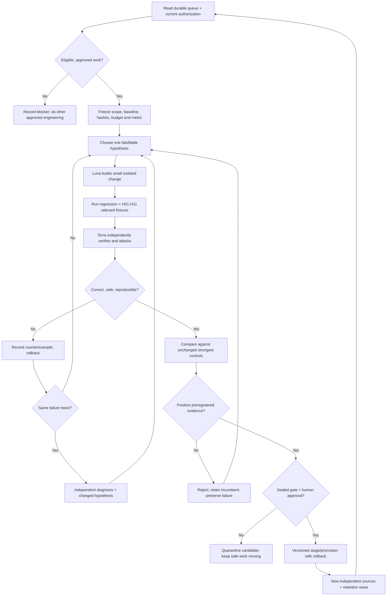

# HIVE v0.3.0.dev4 — Next Build Path and Continuous Learning Loop

**Prepared:** 2026-11-21 (America/Los_Angeles)  
**Audience:** Astra coding overseer, Sol/Luna/Terra/Grok/NVIDIA reviewers, HIVE implementers  
**Scope:** The publicly documented HIVE build at https://mominc.online/hive/; this handoff is a plan, not a claim of having run the source locally.

## 0. Executive decision

**Do not redesign HIVE or start a second orchestration framework.** Treat v0.3.0.dev4 as the frozen engineering baseline. The next decisive achievement is **new-task acceptance followed by independently verified useful learning**.

The proposed operating pattern is:

```text
FROZEN BASELINE
    -> FRESH AUTHORIZED WORK
    -> INDEPENDENT EVALUATION
    -> FAILURE ATTRIBUTION
    -> ONE BOUNDED CHANGE
    -> MATCHED CONTROL COMPARISON
    -> HOLDOUT / RETENTION GATES
    -> PROMOTE WITH APPROVAL OR ROLLBACK
    -> NEW, UNSEEN TASK DISTRIBUTION
    -> repeat
```

Failures should create the next well-defined engineering hypothesis rather than cause the coding team to stop; **STOP, exhausted spending authorizations, security violations, and sealed-test exposure remain hard stops**. The authorized engineering queue may continue with other eligible, non-inference work while a research task is blocked.

## 1. Verified published changes

| Stage | Published evidence | Meaning and limit |
|---|---|---|
| Earlier v0.2.1 | 136 tests passed; local feedback affected routing; stronger deterministic-tool control won | Routing changed, but no general gain established |
| v0.3.0.dev2 | 235 passed; 3 CLI journeys; 28.32-second video excerpt, captions and clip proposals, durable replay | Real video engineering alpha; edited source, not fresh acceptance |
| v0.3.0.dev3 | One task -> execution -> verifier -> feedback -> P1 comparison -> rejection -> P0 recovery path; actual six-call local-model development demonstration | Integrated adaptation **and correct rejection**; candidate's inventory count was wrong (42,073 vs 41,907) |
| **v0.3.0.dev4** | **342 passed, 2 explained skips, 7 CLI journeys, 11 synthetic pressure paths, 0 new model calls** | **READY_FOR_PRESSURE_TESTS**, not accepted Level A or Level B |

New dev4 capabilities: a shared controller for video and narrow isolated Python function work; digest-pinned Docker/Linux execution; trusted host-side code verification; read-only curated source input; network, filesystem, privilege, memory/CPU/process/time/output constraints; same Store and resource ledger across a code-to-video task graph; fresh-process evidence replay; STOP, failure, budget and tamper negative tests; multi-arm *development* comparison plumbing; a durable build queue.

The release classifies all R1–R8 **INTEGRATION_TESTED**. Its independent assessment explicitly does not claim model/team superiority, broad learning, production promotion, or a completed sealed study.

**Operational warning:** the site homepage/status text encountered in this review still features dev2 as the latest milestone, while `/notes/READINESS/` and associated pages document dev4. Publish one canonical `CURRENT_RELEASE` / `LATEST_VERIFIED` pointer and make homepage, status, release history and download hashes agree.

**Frozen published runtime identity:** `v0.3.0.dev4`, runtime commit `b66efb0ba074bf8c6f6a8c0f0bc4761aa3e65739`, runtime SHA-256 `e711d1c3e7eb4dbd23b95f3027f5d97627b1f6880a2c252e2cefea8c522e817b`. The latest published ZIP and packaging receipts have separate hashes: never mix runtime, packaging and prior dev3 identities.

## 2. Prioritized work packages

### WP0 — Reproduce, freeze and show true status (no model inference)

1. In the existing checkout (`D:/Repos/hive-ai`, documented branch `build/working-prototype`), compare HEAD/runtime bytes with the **current** published manifest. Preserve earlier source commits and experiment receipts without rewriting history.
2. Run offline doctor, exported receipt replayers, all Python tests, all seven CLI journeys, separate/combined mission demo, and H01–H11 synthetic fixtures. The code mission requires the pinned Docker Linux image and daemon; if unavailable, label the relevant gate **BLOCKED**, not passed.
3. Produce `CURRENT_STATE.md` with: commit, file hash, runtime identity, Docker digest, model digest/availability, verified tests/skips, remaining R/A/B gates, source exposure and remaining **authorized** budgets.
4. Fix the public homepage/status mismatch as a *documentation release*; do not count that as new learning.

**Exit:** Exact baseline is reproducible from a clean package, source and evidence hashes reconcile, and one status page shows the current milestone and non-achievements.

### WP1 — Obtain the real Level A corpus (the immediate blocker)

Populate `experiments/plans/readiness-level-a.json` **before exposing answers or dispatching models**:

- **6 distinct unused video sources**: ideally independent footage/source groups with operator-reviewed caption correctness and editorial clip usefulness; recuts of one stream do **not** create independent groups.
- **6 independent unused code snapshots**: approved repository/source snapshots that fit the existing **narrow Python `json_function_v1`** contract, with independent expected outcomes and protected test/verifier data. Do not silently substitute arbitrary shell execution or count synthetic demonstration code as fresh data.
- For every task: immutable source/input hashes; exposure history; applicable routes; permissions; pinned config/model/policy/verifier hashes; success criterion; reviewer; editorial requirement; task/resource caps and an aggregate capped allocation.
- Keep fresh acceptance inputs, private labels and evaluator files out of the public ZIP and out of model-visible workspaces.

**Approval boundary:** The published Level A plan has `tasks: []`, `model_calls_authorized: 0`, and `source_inventory_approved: false`. Only an authorized operator can complete approval and grant a new allocation; no agent may synthesize permission by changing a budget ID. The old 30-call and six-call allocations are spent.

**Exit:** Twelve eligible, independent, preregistered task records and approvals exist with no leakage.

### WP2 — Execute Level A genuine task acceptance

1. Run the **existing shared controller** on the approved twelve tasks, not a rewritten demo harness.
2. Include actual local-model dispatch *only within newly approved caps* and the real bounded Docker code worker. Capture source/job/config/route/policy/model/verifier identities, output hashes, cost/time and exact attempt state.
3. Independently score outputs using frozen references and human editorial checks for video; a structurally valid caption/clip proposal alone is not an editorial pass.
4. Exercise STOP/resume, model/tool unavailability, interrupted work, corrupted evidence and budget exhaustion with independent validation. Avoid using genuine acceptance data to tune the candidate during this test.
5. Count all attempted tasks. Record failures, abstentions and editorial pending separately; do not exclude them from the denominator or relabel them as success.

**Acceptance gate:** **At least 10 independently accepted results from 12 genuine attempts**, across six video source groups and six independent code snapshots, **plus all R1–R8 and A1–A6 mechanical gates**. Passing 10/12 alone is insufficient. If these fail, Level A remains unaccepted; diagnose the failure on development data and reserve unused future inputs for a new, properly frozen acceptance campaign.

### WP3 — Build one measurable improvement, not just a different route

Use development sources only to evaluate a high-value, falsifiable first hypothesis:

> **Exact-tool protection hypothesis:** Where a permitted, verifiable deterministic tool can compute an exact answer, exploratory routing must not replace it with an unvalidated model. For tasks lacking that exact tool, eligible pinned specialists may still participate or abstain.

This follows the actual dev3 failure (model returned 42,073 where exact tool returned 41,907).

Implementation: add a **versioned experimental policy P2** with an eligibility-first exact-tool preference, source-conditioned route attribution, and complete counterexample tests. Do not overwrite P0 or change the expected result. Preserve disputed alternatives as comparison arms.

Compare matched development inputs using:

- incumbent / strongest permitted deterministic tool;
- best fixed specialist;
- fixed two-component team with *both components charged*;
- learning-disabled HIVE;
- adaptive experimental policy.

Use the same frozen source-group split and approved total resource caps. Require independent verifier reports, no critical regression and quality better than the strongest applicable control. A mere route change, a tie, or lower cost without the required quality improvement is **not** evidence of beneficial learning.

Run ablations separately for routing, memory/experience, verifier, team arbitration and consolidation; never attribute a gain to all mechanisms at once. Preserve earlier wrong labels and failed verdicts. Resolve future ambiguous classification labels **prospectively** with a separate curator, not by editing the historical gold answer.

**Exit:** A candidate is either rejected with replayable evidence and a better hypothesis, or staged as a gain candidate for sealed study. It is **not** production-promoted automatically.

### WP4 — Level B: independent transfer + retention experiment

After Level A and additional approval, preregister a **separate** study with **at least 24 source-disjoint matched, previously unused holdout tasks**. Compare the frozen adaptive policy with the strongest deterministic tool, fixed specialist, fixed team and learning-disabled controller under comparable caps and task access.

- A separate independent evaluator controls sealed labels and one-use exposure.
- Run **two chronological waves**; revisit old task families for forgetting/regression and introduce genuinely new families for transfer.
- Measure accepted-task quality first, then total model/tool calls, generated tokens, end-to-end latency, verifier burden, recovery cost and quality change by source family. Track uncertainty at the source-group level.
- Protect against **all** critical false acceptance, answer leakage, unauthorized action, irreversible duplicate effect or unverified output.
- Predefine required practical quality gain and uncertainty decision before spending; statistical ambiguity means **INCONCLUSIVE**, not a scientific success. This minimum-24 study may still be underpowered for a strong generalization claim.

**Exit:** only an independently accepted positive quality gain, preserved retention, no critical regressions and explicit operator promotion approval can justify an experimental deployment. Otherwise retain P0 and record the next discriminating study.

### WP5 — Only then widen use cases

After acceptance and a verified positive learning result, expand incrementally from local video + narrow Python code to (a) real video editing workflows, (b) live supervisor/call tasks, and (c) horror-haunt/game orchestration. Each new family needs its own adapters, scope controls, benchmarks and fresh acceptance inventory. Broader language or shell support requires a separate reviewed isolated worker and adversarial tests. Do **not** add multiple controllers or force a wholesale Linux migration: the existing host orchestration plus pinned Linux Docker worker already supplies the validated isolation boundary.

## 3. The operational loop for Astra and agents



**Continuous means continuous within permissions, time and resource budgets—not infinite autonomous model calls.** Engineering can run unattended with permission-limited local deterministic work, but new inference allocations, sealed-holdout consumption, external changes and promotion require matching authorization.

### Work selection formula (proposed; do not confuse with a validated HIVE formula)

For **authorized** queue jobs, prioritize the expected reduction in decision uncertainty per marginal cost:

`priority = (expected_decision_value × uncertainty_reduction × test_discriminativeness) / (estimated_time + priced_compute + reviewer_cost)`

Hard eligibility is checked **before** scoring: safety, approval, correct verifier, source integrity, permitted routes and remaining budget. Use empirical results to recalibrate these priority terms; do not optimize an unmeasured score by assuming the outcome.

For a candidate policy, report separate observed quantities:

- `Q = independently_accepted_outputs / all_scheduled_attempts`
- `ΔQ = Q(candidate) − Q(strongest_applicable_fixed_control)` on paired, source-disjoint tasks
- `C = total charged compute + tools + verifier/retries + controller overhead`
- `R = critical regressions / attempted tasks`
- `T = previous-family retention after the chronological update`

**Promotion is a hard-gated decision, not a weighted average**: provenance/authorization/replay pass, `R=0` for the preregistered critical classes, positive required quality gain, acceptable retention/uncertainty and explicit approval. Cheap but wrong cannot compensate for critical correctness failures.

### Agent responsibilities

| Role | Ownership | Must not do |
|---|---|---|
| **Astra** | Queue, dependency management, integration, authorized work budgets, evidence report | Self-authorize new inference, open sealed answers or promote its own candidate |
| **Sol** | Hypothesis and formula design, evaluation plans, policy comparison, decision criteria | Change criteria after seeing holdout results |
| **Luna** | Implementation, module contracts, deterministic tests, controlled repair | Edit independent gold labels or test validators to pass |
| **Terra** | Independent acceptance, negative/adversarial tests, replay, code/container boundaries | Train or grade the same candidate without separation |
| **Grok** | Counterexamples, alternate designs, critical review | Treat advisory critique as an approval |
| **NVIDIA/Nemotron agents** | Optional cost/scheduling/statistical review and model benchmarking | Grant unapproved compute access or claim proof from simulation |
| **Operator** | Approves new inputs, budgets, editorial decisions and promotion | — |

### Each completed loop must leave durable artifacts

1. `CURRENT_STATE.md` — latest frozen source/runtime versions, current experiment and real gate statuses.
2. `experiments/runs/<id>/manifest.json` — task/source/policy/model/verifier SHA identities, split, budget and authority.
3. `experiments/runs/<id>/trace.jsonl` — immutable event/job/feedback chain and spending.
4. `experiments/runs/<id>/independent-verdict.json` — source-level acceptance, critical errors, reviewer identity and evidence links.
5. `experiments/runs/<id>/comparison.json` — all matched arms and charged costs, source-group counts and uncertainty.
6. `experiments/runs/<id>/decision.md` — PROMOTE / REJECT / QUARANTINE / INCONCLUSIVE / BLOCKED, why, and next falsifiable hypothesis.
7. A frozen rollback checkpoint and a public-safe summary, redacting private labels, operator credentials and source secrets.

Use the **existing Store and build queue** as the underlying state. Paths above are a deliverable layout suggestion, not claims that those paths already exist. Build queue continuation must never clear STOP, reset counters, change a previously approved scope or silently consume exposed inputs as fresh.

## 4. Immediate executable commands (no model inference)

From a verified extraction of the published **dev4** package in Windows PowerShell:

```powershell
$env:PYTHONPATH = "$PWD\src"
python -m hive doctor --offline
python scripts/replay_integration_export.py
python scripts/replay_readiness_exports.py
python -m pytest -q
npm run test:e2e
```

With an available pinned Docker image, Git and FFmpeg/ffprobe, exercise the separate/combined synthetic mission:

```powershell
docker pull python@sha256:07d4824036af339fa1b6ef769cc99d9c10a141769538b52b3b597c84f7a7b535
python scripts/readiness_demo.py --work .hive/operator-demo
```

Run all eleven fixture paths using the **documented** local synthetic mode (zero inference):

```powershell
$tests = python -m hive pressure list | ConvertFrom-Json
foreach ($test in $tests) {
    python -m hive --store .hive/pressure-all pressure run --test $test.test_id --mode fixture --output ".hive/pressure-all/$($test.test_id)-export.json"
    if ($LASTEXITCODE -ne 0) { throw "Pressure case failed: $($test.test_id)" }
}
python -m hive --store .hive/pressure-all pressure report
```

For approved real development campaigns, follow the explicit `paired-development-v1` manifest and allocation template in `docs/RUN_HIVE.md`; **do not copy fixture commands and reinterpret them as real Level A or Level B evidence**.

## 5. What Astra should do next without stopping

1. **Immediately:** verify dev4 locally, reconcile release identity, rerun all authorized offline/synthetic gates, update release pointer and readiness report.
2. **In parallel:** prepare an operator-reviewable sheet of 6 genuine video source groups + 6 code snapshots, with no exposure and no calls. Mark unapproved entries **BLOCKED**, not fabricated.
3. **While waiting for approved Level A inputs:** implement and test the P2 exact-tool preference on **development** data and add counterexample tests for ambiguous labels, changed output, missing verifier, recovery and candidate regression. Keep policy quarantined.
4. **When approvals are actually granted:** run Level A once according to frozen manifests and caps, preserve all failures, obtain independent human/automated decisions.
5. **After Level A:** preregister and execute Level B only if separately approved. The goal is repeatable performance improvement over the strongest useful baseline, **not just a higher test count**.

**Non-negotiable instruction to the overseer:** Never conclude a loop by reporting only “some tests failed.” Report the exact failing hypothesis, source/task identity, counterexample, scoped fix or alternative, prior checkpoint, independent verifier result, authorization status, and next ready queue item. If no authorized ready work exists, publish `BLOCKED` with the minimal unblock request; do not invent new approvals.

## 6. Authoritative public evidence and specifications

- Current engineering assessment: https://mominc.online/hive/notes/READINESS/
- Integrated dev3 history: https://mominc.online/hive/notes/INTEGRATION/
- Historical video alpha: https://mominc.online/hive/notes/WORKING/
- Current next-work directive: https://mominc.online/hive/implementation/readiness-dev4/docs/NEXT_WORK_ITEM.md
- Level A inventory: https://mominc.online/hive/implementation/readiness-dev4/experiments/plans/readiness-level-a.json
- Level B inventory: https://mominc.online/hive/implementation/readiness-dev4/experiments/plans/readiness-level-b.json
- Exact runbook: https://mominc.online/hive/implementation/readiness-dev4/docs/RUN_HIVE.md
- Independently reviewed readiness: https://mominc.online/hive/implementation/readiness-dev4/experiments/results/readiness-20261121/terra-final-verdict.md
- Failure and repaired-regression register: https://mominc.online/hive/implementation/readiness-dev4/docs/READINESS_FAILURE_REGISTER.md
- Main site (some summary sections lag newer milestone): https://mominc.online/hive/

**Evidence qualification:** This review inspects live published documentation, source hashes, test receipts and acceptance plans; it does not independently execute the user's local repository, Docker worker or new model inference. Reproduction is WP0, not already accomplished here.
