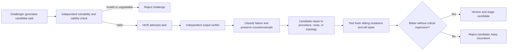
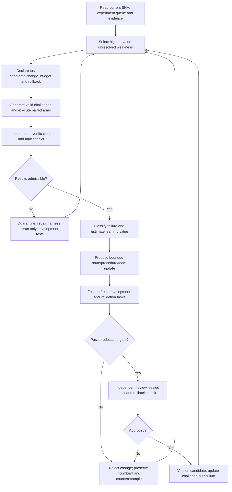

# HIVE — Evolutionary Pressure Testing and Accelerated Self-Improvement

> **Handoff to Astra and the HIVE coding agents.** Turn testing into a controlled engine for improvement. Rather than stopping when a test fails, classify the weakness, generate an actionable candidate change, verify it independently on fresh tasks, retain the incumbent if the change fails, and continue the *bounded, authorized* research queue. **Do not call a failed or underpowered experiment proof of self-improvement.**

## 0. Objective and evidence boundary

**Primary objective:** Minimize the time and compute required to demonstrate a repeatable HIVE learning cycle in which verified failure drives a persistent improvement that transfers to a previously unseen task.

**Two related hypotheses:**

1. **Specialist evolution:** HIVE improves individual skills, procedures, tool use, retrieval, and eventually model adapters or weights.
2. **Organizational evolution:** HIVE improves routing, specialist choice, topology, staffing, verification, communication, and memory access **without** changing frozen model weights.

Test organizational evolution first: it is cheaper to isolate, easier to revert, and may deliver prototype value before retraining. Distinguish **functional adaptation** (HIVE successfully changes behavior) from **verified beneficial learning** (the changed behavior outperforms strong fixed baselines on unseen tasks).

**Current-build caveat:** The prior HIVE handoff reported v0.2.1 with 136 passing tests/one skip, and a historical small comparison of 3/6 direct-model cases versus 5/6 learned cases, plus a 6/6 tool route. Those are previously *reported* results, **not** evidence verified anew by this document. Astra must read the actual current checkout, commit, publication manifests, latest local-model run, and real test logs before beginning. A six-case smoke comparison is not proof of transfer or compounding learning.

## 1. Why pressure may help—and why more pressure is not always better

Traditional testing asks, *Did it pass?* An adaptive testing system asks, *Which failure is most instructive, what change follows, and does that change generalize?*

Productive challenge generation should balance four things:

- **Solvability:** a valid reference path exists; impossible tasks give weak or misleading feedback.
- **Frontier difficulty:** problems are near the current capability boundary rather than uniformly trivial or impossible.
- **Diversity:** alternative task families prevent rote memorization and overfitting to one test generator.
- **Credible feedback:** objective checkers, source evidence, sealed evaluation sets, and rollback gates prevent reward hacking.

**Working thesis:** The fastest useful improvement is likely to come from a curriculum that preferentially selects *informative, solvable weaknesses* while maintaining novel and old-task checks. This is a **HIVE hypothesis to test**, not a universal result.

## 2. Established approaches worth adapting

| Priority for HIVE | Research family | Applied pressure | HIVE translation | Main failure mode |
|---|---|---|---|---|
| 1 | ACCEL / Prioritized Level Replay | Mutate informative tasks, replay productive challenges | Escalate verified tasks and revisit failure families | Training on leaked or repeatedly memorized examples |
| 2 | PAIRED / unsupervised environment design | Challenger creates solvable adversarial problems | Challenge agent targets weaknesses; separate verifier checks validity | Challenger generates impossible tasks or games scoring |
| 3 | Population-Based Training (PBT) | Selection and mutation across competing candidates | Evolve frozen-model routing, team composition, and procedure policies | Selection bias, unequal budgets, noisy tournament results |
| 4 | MAP-Elites / POET | Diversity, novelty, and transfer between niches | Keep several successful specialist configurations for different task types | Expensive exploration without held-out gains |
| 5 | Chaos engineering / fault injection | Dependency failures and system disruptions | Remove tools/models, corrupt returns, interrupt execution | Measuring mere resilience, not persistent improvement |
| 6 | Continual-learning evaluation | Distribution shift and old-task retention | Evaluate whether improvements survive new families and old tasks | Catastrophic forgetting or hidden benchmark overlap |

**Recommended first experimental stack:** An ACCEL-style challenge mutator + prioritized failure replay + small competition among *organizational* policies + independent verification. Compare this combination with simpler fixed-curriculum and random-search controls before claiming that added complexity helps.

### Relevant reading

- [ACCEL — Adversarially Compounding Complexity by Editing Levels](https://accelagent.github.io/)
- [PAIRED — Unsupervised Environment Design through Adversarial Reinforcement Learning](https://arxiv.org/abs/2012.02096)
- [Population Based Training — DeepMind overview](https://deepmind.google/blog/population-based-training-of-neural-networks/)
- [POET — Open-Ended Deep Learning](https://www.uber.com/us/en/blog/poet-open-ended-deep-learning/)
- [MAP-Elites / Quality-Diversity research (original paper search)](https://scholar.google.com/scholar?q=MAP-Elites+Mouret+Clune+2015)
- [SkillLearnBench — external feedback and skill learning evaluation](https://cxcscmu.github.io/SkillLearnBench/)

These sources motivate candidate methods. They **do not** show that any method has already improved HIVE.

## 3. Proposed pressure-testing suite

| ID | Experiment | Challenge / pressure | Independent variable | Key success metric |
|---|---|---|---|---|
| **H01** | Moving Frontier | Increasing task complexity near competence boundary | Curriculum policy | Examples/compute to fresh-task competence |
| **H02** | Adversarial Challenger | Valid, increasingly targeted counterexamples | Challenge generation policy | New-variation correctness after repair |
| **H03** | Evolution Tournament | Competing organizational candidates | Routing/team/procedure config | Held-out quality and verified cost |
| **H04** | Amputation | Disable or remove a model, tool, specialist, or coordinator | Fault type and recovery policy | Recovery quality, time, duplicate effects |
| **H05** | Contaminated Knowledge | Conflicting, stale, or false evidence in shared memory | Memory boundary / provenance policy | False belief propagation; correction time |
| **H06** | Resource Famine | Reduce tokens, compute, latency, memory, or tool availability | Resource caps / choice policy | Correct completions per unit resource |
| **H07** | Split Brain | Independent specialists return incompatible answers | Voting vs evidence checking vs escalation | Objective correctness and coordination overhead |
| **H08** | Forgetting Cycle | Alternate task families, later revisit old ones | Rehearsal / consolidation policy | Retention and forward transfer |
| **H09** | Novel Recombination | Require previously separate skills in one task | Dynamic staffing / composition policy | Held-out cross-skill task success |
| **H10** | False Reward Trap | Misleading feedback and exploitable score proxies | Verification / promotion policy | Invalid candidate promotion rate |
| **H11** | Real-Work Gauntlet | Genuine local video, code, evidence, and later haunt tasks | Integrated controller and learning policy | Verified useful work, recovery, cost |

**Requirement for every experiment:** Declare task families, variants, model digests, fixed tool access, baseline policies, budget, verifier, negative controls, success threshold, regression threshold, rollback, and data split **before** running the decisive evaluation.

## 4. First three tests: executable designs

### H01 — Moving Frontier

**Hypothesis:** A solvable, learning-progress-based curriculum yields faster transfer than random or fixed task order.

**Seed task ladder** (each rung has multiple variants):

| Level | Example challenge | Objective check |
|---|---|---|
| L1: Basic | Select a correct tool for one well-specified data transform | Golden output/schema |
| L2: Dependency | Chain parse → transform → validate with intermediate artifacts | Output plus dependency trace |
| L3: Misleading | Tool returns misleading “success”; artifacts disagree | Checker detects incorrect success |
| L4: Disrupted | Appropriate tool unavailable; alternative exists | Safe recovery or justified abstention |
| L5: Novel | New schema/task composition not present in development set | Fresh-family objective check |

**Arms:** (A) fixed order, (B) uniform random, (C) learning-progress selection. Keep model weights, total calls, task pool eligibility, verifier, and tools matched. Challenge generation can mutate format, complexity, dependencies, and tool conditions, but not silently alter the true acceptance rule.

**Protocol:** Establish baseline; give each arm the same training budget; evaluate at predetermined checkpoints on *unseen generator seeds and source clusters*; measure (a) competence at a predeclared quality threshold, (b) area under held-out learning curve, (c) resource consumption, (d) regression on old tasks.

**Promotion criterion:** Learning-progress curriculum exceeds the strongest simpler arm by a predeclared practical margin, with uncertainty and retention reported. Otherwise retain the simpler arm.

### H02 — Adversarial Challenger

**Hypothesis:** Independently generated, solvable adversarial tasks expose weaknesses that ordinary tests systematically miss.



**Task mutations:** conflicting source documents, deceptive tool status, ambiguously named functions, changed arguments, broken dependencies, irrelevant distractors, reordered steps, stale cache, and mixed objective/subj. criteria. Do **not** allow the challenger to change gold answers, choose inaccessible hidden information, or judge its own challenges alone.

**Baseline:** static challenge pool and random valid mutations, under identical task counts and compute budgets.

**Success:** A repaired policy handles fresh sibling mutations and a separate holdout family better than the incumbent, without contamination or a critical regression.

### H03 — Evolution Tournament

**Hypothesis:** A population of small organizational variations can discover better configurations than a universal fixed orchestration policy.

**Initial eight configurations:**

1. Central controller, one specialist at a time.
2. Distributed specialist delegation.
3. Hybrid central constraints plus local autonomy.
4. Deterministic-tool-first routing.
5. Selective verification/escalation.
6. Redundant independent checking.
7. Context-aware selective memory retrieval.
8. Exploratory router with bounded bandit selection.

These are **candidates to instantiate only where supported by the current code**. Do not build eight full systems. Use one common controller interface with versioned configurations and shared specialist endpoints.

**Tournament:** Run paired tasks under matched budgets; preserve multiple high-quality, different candidates rather than selecting only a global winner; mutate **one mechanism per candidate**; reevaluate on fresh variants; compare against (A) strongest fixed config, (B) random configuration search, and (C) adaptive selection disabled.

**Measurements:** verified success, cost per correct completion, latency, catastrophic failures, source-family transfer, old-task retention, and overhead from coordination.

**Promotion criterion:** New configuration materially outperforms the actual incumbent on fresh cases or improves cost while meeting quality non-inferiority, with no safety violations. Selection is provisional pending independent review.

## 5. Remaining pressure tests: minimum implementation contracts

| Test | Injection example | Necessary control | What counts as learned improvement |
|---|---|---|---|
| H04 | Kill worker after tool executes but before checkpoint | Fixed retry + idempotency policy | New recovery strategy prevents duplicate effects and generalizes to unseen failure timing |
| H05 | Inject stale but plausible note into shared store | No-sharing and unrestricted-sharing controls | Selective typed/provenance storage lowers false propagation on unseen tasks |
| H06 | Halve token budget or remove high-cost route | Same budget static fallback | HIVE switches to efficient valid route while preserving correctness |
| H07 | Two specialists provide different numerical claims | Single agent, majority vote, independent checker | Evidence-checked arbitration yields more correct answers per cost |
| H08 | Learn family B after mastering family A | No replay, random replay, prioritized rehearsal | HIVE retains A and improves on genuinely new B/C tasks |
| H09 | Pair caption repair with source-backed clip extraction or code+schema repair | Fixed team vs adaptive team | Composes capabilities on previously unseen combinations |
| H10 | A tool says “tests passed” while test artifacts fail | Trust-self-report control | Verifier blocks promotion despite apparently high reward |
| H11 | Batch of real local media/code/retrieval tasks | Best frozen task-specific tool workflows | HIVE completes new, useful tasks more reliably or cheaply |

H10 and H04 are **safety gates**, not an invitation to relax control in pursuit of high scores. Critical false promotions, unauthorized actions, leaked holdout data, or duplicate irreversible effects stop promotion immediately.

## 6. The self-improving challenge-selector hypothesis

HIVE should eventually learn **which pressure types are worth applying next**, not simply maximize task difficulty.

A *candidate*, unvalidated challenge-priority heuristic:

\[
P(c)=\frac{S(c)\,[\alpha L(c)+\beta R(c)+\gamma N(c)]}{\widehat C(c)+\epsilon}
\]

- **S(c):** calibrated probability that challenge *c* is solvable and valid.
- **L(c):** estimated marginal improvement from similar prior challenges.
- **R(c):** estimated recoverable performance gap/regret.
- **N(c):** challenge novelty relative to previous cases.
- **Ĉ(c):** predicted test/development cost; epsilon keeps the denominator nonzero.
- **α, β, γ:** preregistered or development-tuned weights, never tuned on sealed holdout scores.

**Important:** This equation is a design hypothesis, **not** a scientific law or established HIVE implementation. Each term needs an operational measurement. Compare it to uniform random, fixed progression, and a simpler learning-progress-only selector. Track actual cost and calibration error, and do not allow high novelty to crowd out retention checks.

The meta-hypothesis is that HIVE can improve the *sample efficiency of its own learning curriculum*. That is separate from proving that a particular policy learned a given task.

## 7. Measurement: what evidence constitutes learning?

### Primary research metrics

**Fresh-task transfer** (paired, matched-budget):

\[
\Delta_{transfer}=Q_{adaptive,new}-Q_{strongest\ fixed,new}
\]

**Learning efficiency:**

\[
E_{learning}=\frac{\Delta Q_{fresh}}{\text{measured training compute or cost}}
\]

**Retention:**

\[
R_{retention}=Q_{old,after}-Q_{old,before}
\]

Report these **separately**, together with: abstentions, false successes, reliability, wall-clock, model calls, tokens (where measured), energy or GPU time where measured, and task-family-specific results. A single weighted reward must never conceal critical failures.

### Comparable arms

- Strongest applicable deterministic-tool-only workflow.
- Direct frozen local model with permitted tools.
- Best fixed model-plus-tools procedure.
- HIVE controller with learning disabled.
- HIVE controller with learned policy frozen **before** evaluation.
- Later: ablations isolating memory, verifier choice, topology, and dynamic staffing.

**Dataset rules:** Group train/validation/test by source, repository, content family, generator, and chronological episode—not merely by randomly shuffled row IDs. Keep gold answers inaccessible to policy search and to challenger agents. Run sealed holdouts only when the candidate is frozen. If the holdout leaks, invalidate the claim and generate new independent source material.

**Statistical rule:** A 20–30-case paired pilot per condition may reveal broken instrumentation or very large effects; it is not automatically enough to establish a generalization advantage. Preregister practical-effect thresholds, number of independent source clusters, repeats, confidence intervals, and resource budgets for the decisive comparison. If uncertainty is too large, label the result **inconclusive**, not pass.

## 8. Autonomous experiment and repair loop



**Engineering loop stays alive** even when a candidate fails; **an individual run remains bounded**. Stop a run on explicit STOP, budget exhaustion, unavailable approvals, evaluator compromise, or unsafe external side effects. Persist its exact restart point and open the next authorized work item. Never increase budget automatically, modify the score to force a pass, or treat a proposed patch as deployed.

**Failure diagnosis codes:**

| Failure type | Mandatory response |
|---|---|
| `TOOL/SCHEMA` | Minimize failing example; repair adapter or schema; run regression suite |
| `ROUTE` | Compare choices and eligibility, propose one route-policy change |
| `VERIFIER` | Halt promotions, repair independent checker, invalidate affected evidence |
| `LEAKAGE` | Quarantine benchmark, replace sealed holdout, document exposure |
| `REGRESSION` | Reject candidate, restore incumbent, preserve counterexample |
| `NONTRANSFER` | Retain functional capability; test narrower hypothesis or new diverse tasks |
| `RECOVERY` | Inspect event journal and idempotency; fix exactly-once/reconciliation logic |
| `BUDGET/SAFETY` | Stop current mission with checkpoint and explicit next permitted action |

## 9. Minimal data contracts and file structure

Reuse current HIVE code if already present; **inspect before creating duplicates**. Require a compact experiment record with:

```yaml
experiment_id: H01-0001
hypothesis: "Learning-progress curriculum improves fresh-task efficiency"
status: proposed
current_release_sha: "REQUIRED_AT_RUNTIME"
model_digest: "REQUIRED_AT_RUNTIME"
fixed:
  - tool_permissions
  - specialist_model_weights
  - evaluation_budget
  - evaluator_version
arms: [fixed_curriculum, random_curriculum, adaptive_curriculum]
source_splits: [development, validation, sealed_test, chronological]
primary_metric: fresh_family_quality_per_training_compute
secondary_metrics: [retention, wall_time, cost_per_correct, abstention, false_promotion]
challenge_validity: independent_solvability_check
promotion_rule: preregister_before_run
rollback_target: "REQUIRED_AT_RUNTIME"
result: null
```

Recommended records/artifacts (directory names are proposals):

```text
experiments/pressure/
  README.md
  hypotheses.yaml
  challenge_generators/
  challenge_validators/
  curricula/
  runners/
  baselines/
  fault_injection/
  negative_controls/
  results/
  failures/
  candidate_registry/
  sealed_manifest/      # access-restricted to evaluator
  reports/
```

A single challenge record should include `challenge_id`, `family_id`, source and generator digest, seed, difficulty features, parent mutation, solvability evidence, verifier ID/version, permission envelope, budget, data split, and artifact hashes. A promotion record should include original policy, proposed diff, new policy digest, paired comparison, uncertainty, old-task regression results, reviewer decision, and rollback pointer.

## 10. First campaign: compressed path to evidence

| Stage | Work | Completion gate |
|---|---|---|
| **0 — Verify actual build** | Audit newest checkout, local model inventory, existing experiments and verifier | Reproducible SHA, hashes, tests, known capabilities; no assumed current version |
| **A — Validate challenge harness** | Seeded problem mutation, solvability checks, property checks, negative-control cases, safe fault injection | Reliable labeling; sealed data protected; no false success on intentional broken cases |
| **B — Prove one adaptive cycle** | Run H01 plus a minimal H03 comparison on frozen local models | Failure → versioned policy change → fresh-case comparison → rollback or independent acceptance |
| **C — Test generality** | Add H02, H04, H05, H08 and H09 as independent challenges | New-family transfer; retention; recoverable failures; no critical regression |
| **D — Real work** | Video repair/metadata, isolated code-test repair, source-conflict validation; haunt-game canary later | Genuine useful output with independent acceptance and replayable evidence |

Use the practical local workflows already identified for HIVE. Keep the initial prototype a **thin end-to-end mission** rather than building an enormous test lab before any real output works.

### First executable mission for Astra

1. Verify repository state; record git SHA, versions, model digest, current tests, and last *real* local-model run.
2. Identify the existing controller, learner, experiment runner, verifier, and checkpoints; reuse them where functional.
3. Implement one deterministic, seeded H01 task family with a separate answer/solvability checker, plus two simple curricula.
4. Record a baseline run on frozen local model weights and a strong fixed/tool route.
5. Introduce one bounded organizational learning change (e.g., which route to use after a verified failure).
6. Test the changed route on new mutations, then on an untouched source family; compare to the incumbent and fixed control.
7. Run rollback and an intentionally false-feedback negative control.
8. Publish exactly what improved, failed, or remains inconclusive, and enqueue the next bounded experiment.

### Ownership

| Role | Responsibility |
|---|---|
| **Astra (overseer)** | Priorities, immutable experiment queue, caps, independent acceptance and release records |
| **Sol** | Organizational learner, candidate policies, measurement formulas |
| **Luna** | Challenge generators, orchestration, local-tool/model integration |
| **Terra** | Validity checks, fault injection, independent regression and reproducibility |
| **Grok** | Adversarial challenge design and competing hypothesis review when available |
| **NVIDIA Nemotron** | Independent calibration/result critique when available |
| **Local models** | Frozen experimental subjects; change weights only in explicitly separate later studies |

Agent availability must be verified; no listed model or service is assumed operational until checked locally. The proposer cannot approve its own result or access sealed gold labels.

## 11. Acceptance gates

### Level A — Functional adaptive test prototype

- [ ] One reproducible offline command runs a real task through routing, execution, independent checking, recording, and checkpointing.
- [ ] Intentional tool, verifier, and restart faults are caught; no duplicate irreversible effects.
- [ ] A verified development failure changes a versioned policy and the reason for the change is inspectable.
- [ ] The original policy can be restored and a bad candidate rejected.
- [ ] Results show full provenance, budget usage, artifact hashes, and limitations.

### Level B — Verified transferable self-improvement

- [ ] The evaluation is preregistered and source-disjoint, with sealed answers unavailable to policy search.
- [ ] The frozen learned policy beats the strongest applicable fixed comparator by a declared useful margin **or** reduces cost while maintaining a declared non-inferior quality level.
- [ ] The advantage holds on at least two chronologically new evaluation waves or otherwise meets the preregistered generalization criterion.
- [ ] Previously learned performance remains within stated forgetting bounds.
- [ ] Independent review, verifier negative controls, checkpointing and rollback succeed.

**If Level A passes and Level B does not:** ship a **functional prototype**, clearly label generalizing self-improvement as unproven, and continue testing competing hypotheses. Do not force a learning claim to succeed by changing the evaluator or replaying the same holdout.

## 12. Core principle

> HIVE's first genuine self-improvement milestone is **not** a higher score on repeated questions. It is a reproducible process in which an independently verified failure leads to an auditable, persistent change that produces better results on unfamiliar tasks, without unacceptable regressions or extra hidden resources.

**The longer-term research target:** A system that learns not only **how** to solve problems, but also **which challenges, tools, organizational structures, and feedback experiences most efficiently expand its future capabilities**.

---

*Research design and handoff only. No tests were run, no current repository commit was verified, and no implementation was altered in preparing this document.*
