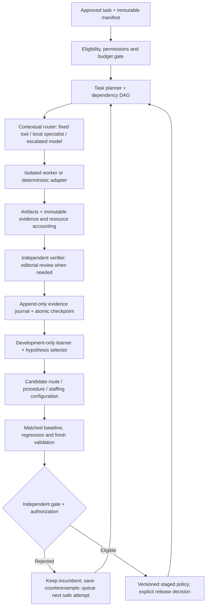

# HIVE — One-Shot Build From Current State to Test-Ready Prototype

> **PASTE THIS FILE INTO ASTRA AS THE TOP-LEVEL BUILD DIRECTIVE.** Work against the newest *actual* HIVE checkout. Preserve implemented infrastructure, replace missing wiring rather than creating a second framework, ship the entire runnable vertical slice in one integrated development campaign, and keep safe engineering work moving after failed tests. Do not declare learning proved without independent held-out evidence.

## 0. Readiness verdict and evidence status

**Assessment:** **NOT CERTIFIED TEST-READY** for the planned H01–H11 self-improvement studies. The most recent *documented* checkpoint (v0.3.0.dev2) is a functioning foundation, not a complete verified adaptive system. An attempted audit of `https://mominc.online/hive/` on November 21, 2026 could not retrieve the live page. **The actual live version, commits, new changes, and present test results are unknown.** This is a provisional gap assessment, **not** a claim that the live site still has the older deficiencies.

### Historical reported starting point — must be revalidated locally

| Evidence item | Previously documented | What it **does not** prove |
|---|---|---|
| Build | `v0.3.0.dev2` | That today's checkout or published site remains on dev2 |
| Unit/integration suite | 235 passed, 0 failed, 2 Windows symlink skips | Real task acceptance, safety of arbitrary generated code |
| CLI | 3 demonstrated journeys | Complete cross-domain orchestration |
| Video mission | Two structurally verified outputs, one local-model call; replay and STOP/resume demo | Editorial acceptance or fresh real-task generalization |
| Model/tool router | Earlier narrow routing experiments, including deterministic tool superiority | Beneficial learned routing on unseen tasks |
| Policies/checkpoints | Versioned policy and state machinery present | Verified feedback causing a **later executed** choice and surviving restart |
| Self-improvement | Not independently established | Improvement, retention, transfer, or compounding learning |
| Level A | Not accepted | Functional prototype completion |
| Level B | Not run/accepted | Generalizable adaptive performance |
| H01–H11 | Defined as experimental designs | Passing scientific evidence or full implementation |

**Last documented release identifiers (historical comparison only):** source commit `2347e6add52542ef5516f680ac77b06e10f08ba2`; source SHA-256 `e8dc974bf4e71f44879bd0a5dfe4194f09d97cd29c9c19c77be11a6be0a6631c`. Do not hard-reset to this commit. The reported Windows checkout is `D:\Repos\hive-ai` and branch `build/working-prototype`; discover the actual checkout/branch first.

**Readiness vocabulary:** `NOT_INSTALLED`, `PRESENT_UNVERIFIED`, `UNIT_TESTED`, `INTEGRATION_TESTED`, `REAL_TASK_DEMONSTRATED`, `INDEPENDENTLY_ACCEPTED`, `RESEARCH_PROVEN`, `DEPLOYED`. No one-word “done” statuses without a receipt.

### Three separate gates — do not conflate them

1. **R — H01–H11 *test-ready***: all eleven named tests have registered, executable, deterministic/simulated smoke paths and independent objective validators or explicit human-review boundaries; real model routes are wired; unsafe conditions fail closed; no benchmark leak. This authorizes future research once fresh budgets/permissions are approved. It **does not** mean all H01–H11 hypotheses have passed.
2. **A — Functional working prototype**: true video + isolated-code missions through one controller; independently verified feedback changes a subsequent executed development choice, persists across restart, and can be rolled back; 12 genuinely new real tasks (6 video source groups + 6 independent code snapshots) with **at least 10 independently accepted** and all mechanics/recovery gates. Editorial work requires real operator review.
3. **B — Beneficial transferable self-improvement**: pre-registered matched-budget study versus strongest fixed baseline and learning-off ablation; unseen source-disjoint holdouts, chronological retention waves, uncertainty and critical-regression checks. **Gate B is research, not a one-shot coding deliverable.** Report `UNTESTED`, `INCONCLUSIVE`, or a defensible result; never invent a pass.

## 1. One-shot objective

**Single integration target:** An operator can hand HIVE one bounded real task; HIVE decomposes if needed, evaluates route eligibility, chooses deterministic software/local specialists, works in an isolated context, obtains independent evidence, stores a fully auditable trace, learns only from trusted development feedback, changes a later permitted decision, restores state after restart/crash, compares alternative procedures against robust fixed baselines, and offers the next experiment without bypassing approval or budget rules.

**Reject these detours:** rebuilding HIVE as a second orchestrator; broad model-weight training; scaling model size/agent count to mask design gaps; creating an attractive site instead of working execution; re-running exposed holdouts; auto-editing verifiers to manufacture a pass; treating an LLM judge as sole truth; spending new model budget without authorization.

**Success = executable integration and honest readiness evidence, not more architecture notes.**

## 2. Source-of-truth audit (mandatory first action, not a separate planning cycle)

Astra + Terra inspect the *live local worktree* and latest public release artifacts:

- Read `AGENTS.md`, `docs/CURRENT_STATE.md`, `docs/NEXT_WORK_ITEM.md`, `docs/PROTOTYPE_ACCEPTANCE.md`, `docs/V03_EXPERIMENT_DESIGN.md`, and current CLI `--help` if present.
- Record git branch/commit/dirty files, source/config/verifier/model digests, installed versus **running** local endpoints, exact previous run receipts and current approvals/budget ledgers. Preserve dirty user work. **Do not revert newer working modules simply because this directive describes dev2.**
- Discover and run the repository's existing test and CLI commands from its own docs; reproduce zero-inference replay from clean checkout/package; mark unexplained skips and failures.
- Audit existing components and give each missing requirement a concrete ownership and file path. If a capability is already implemented **and evidence-backed**, keep it and write only an integration or regression test.
- Attempt the live-site check from the local operator environment; establish site release manifest SHA versus actual source SHA. If unavailable, report `SITE_UNVERIFIED`; do not stall engineering work.

**Write:** `docs/CURRENT_STATE.md` with a current, reproducible evidence table and a machine-readable `build/readiness-baseline.json` (or adapt existing directory). This audit **must not consume** E0's spent model-call allocation or create new inference missions without approval.

### Prefer the reported existing modules, after verifying they still exist

`src/hive/orchestrator.py`, `task_spec.py`, `storage.py`, `verifier.py`, `learning_policy.py`, `benchmark_registry.py`, `checkpoint_manager.py`, `review_gate.py`, `adapters/ollama.py`, `cli.py`, and `video_mission.py`.

**Rule:** Integrate through existing interfaces/events and preserve existing compatibility; do not instantiate new parallel state/policy/ledger subsystems. Add small adapter modules only when a true gap exists.

## 3. Target running pipeline and governing boundaries



**Hard separation:** Input/source content is untrusted; candidate model output is untrusted; deterministic trusted tools and independent test harnesses are separate; immutable sealed answers/verifier fixtures never enter candidate context; all external actions require explicit permission scopes. The *developer/build work queue* can continue; each *execution mission* has finite resources and stops on hard boundaries.

### Non-negotiable event and identity contract

Every task and result must be attributable to exact `task_id`, `source_group`, `source_sha`, `input_sha`, `config_sha`, `model_digest`, `policy_sha`, `verifier_sha`, `split`, `attempt_id`, `job_id`, `permissions`, `budget_id`, `route`, `output_sha`, and `verdict`. Store actual measured model calls, tokens where exposed, wall time, CPU/GPU usage where measurable (else `unknown`), and irreversible side-effect IDs if any.

Use typed records; suggested *logical* schemas (map to existing schema, don't duplicate):

```yaml
TaskSpec:
  task_id: string
  family: video | code | retrieval | synthetic
  source_group: string
  source_digest: string
  split: development | validation | sealed_test | chronological
  allowed_routes: [route_id]
  allowed_actions: [action_id]
  verifier_id: string
  budget_id: string
  requires_editorial_acceptance: boolean

OutcomeEvent:
  job_id: string
  attempt_id: string
  route_id: string
  output_sha256: string
  objective_verdict: pass | fail | blocked | abstain
  editorial_verdict: accepted | rejected | pending | not_applicable
  verified_by: independent_checker_id
  evidence_receipt: path_or_id
  feedback_eligible: boolean

PolicyCandidate:
  parent_sha256: string
  candidate_sha256: string
  triggering_verified_events: [event_id]
  allowed_contexts: [family_or_stratum]
  promotion_state: quarantined | staged | approved_canary | rejected
  rollback_target_sha256: string
```

Feedback must be idempotent; changing evaluator/source/model/config identities must invalidate incompatible resume and comparisons. Preserve proposed changes even when not eligible for deployment.

## 4. ONE integration campaign: implementation work packages

### WP-A — Finish the execution spine and deterministic controls

**Lead:** Luna; **contracts:** Sol; **verification:** Terra.

- One public HIVE mission entry point/CLI supports task manifests and routes video, code, and (if already practical) retrieval through existing orchestration, storage, policy, review, and checkpoint APIs.
- Task planning supports a minimal dependency DAG: stage IDs, prerequisites, retry limits, state transitions, cancellation/STOP, tool pre/postconditions, and provenance of every delegated action. Do **not** build complex free-form autonomous planning first.
- Capability registry returns available, **eligible** deterministic tools and local model endpoints based on health, supported I/O, cost, permission envelope, resource caps, privacy boundary, and whether the task has an objective verifier.
- **Default to strongest proven fixed tool path where applicable.** Use a local specialist when objective quality warrants it; escalate to larger/external providers only if configured, permitted and budgeted. All paths emit identical receipts.
- Add one seeded deterministic, zero-inference fixture for each supported family; never treat these as real-task acceptance or scientific generalization.

**Exit:** One controller, one event journal, two runnable task families, observable route eligibility, abort behavior, and reproducible receipts.

### WP-B — Add the missing isolated repository code/test mission (critical path)

**Lead:** Luna; **red-team:** Terra; **contracts:** Sol. Reuse the existing video mission as a pattern, not as a separate framework.

Proposed modules **only if absent**: `src/hive/code_mission.py`, `src/hive/adapters/isolation.py`, and `src/hive/code_verifier.py` (or extensions of the existing verifier). Deliver tests under existing repo conventions, e.g. `tests/integration/test_code_mission.py`, `tests/adversarial/test_code_isolation.py` and CLI E2E coverage.

**Input:** approved frozen sample repo/commit, issue, allowlisted patch paths, allowlisted trusted commands/tests, root/reference hashes, objective expected behavior, resource budget, task/source-group ID.

**Worker:** disposable repo copy/worktree in *verified OS-enforced isolation*; network off by default; read-only inputs and secret-free mounts; writable output confined to scratch; CPU, memory, wall, process-tree, file/artifact limits. Use configured container/VM isolation appropriate for the Windows host. **Windows Job Objects are not by themselves a hostile-code sandbox.** Never execute arbitrary generated commands on the host; model may propose a patch but cannot authorize shell commands, rewrite trusted tests, see sealed answers, or grant its own permissions.

**Verifier:** independent test runner on clean patched copy; diff allowlist and source hash; objective test artifacts, expected vs actual, negative/regression suite, repeatability, source/patch/test/evaluator identity. Distinguish unit test passes from business/task acceptance.

**Outputs:** `patch.diff`, `test-report.json`, `verdict.json`, `trace.jsonl`, usage metrics, hashes, replay token/receipt. **Never write candidate changes into the user's original repo.**

**Fault proof:** reject symlink/junction traversal, submodule mount tricks, path escapes, secret-path access, repo prompt injection, modified test scripts, forged test output, stale/corrupt cache; kill worker mid-execution and resume without duplicate non-idempotent effects or fake completion. If trustworthy sandbox unavailable, mark `BLOCKED_SANDBOX`, keep mock fixtures passing and block untrusted code execution.

**Exit:** one actual approved code-repair task yields a defensible patch, trusted tests and independent verdict; restart/replay reconciles effects. This development demo is *not* a fresh Level A acceptance task.

### WP-C — Implement the observable self-learning mechanism

**Lead:** Sol; **implementation:** Luna; **independent verifier:** Terra.

**Learning target first:** *organizational/procedural adaptation with frozen model weights*, not training the language model. Learn which tool/model/team/procedure/memory policy works for different task contexts.

- Version at least three viable routing baselines: deterministic-tool-first, best fixed model/specialist, and contextual adaptive policy. Add learning-disabled ablation; optional multi-specialist configuration is one policy variant, not another system.
- Integrate an objective, trusted observation into the existing `learning_policy.py` versioned state. Filter observations by split, task lineage, verifier identity, and confidence; only **development** data may update policy.
- Demonstrate two eligible actions in one context: (a) parent chooses route X, (b) a real independently verified development failure/success updates candidate preference, (c) a **later executed, distinct** development task chooses route Y *because of that event*, (d) fresh process loads the exact candidate hash and makes the same choice, (e) restoring parent reinstates X. Record a causal decision trace with evidence IDs.
- Inject a deliberately regressing candidate and false feedback; it must be rejected without contaminating the incumbent. If evidence legitimately does **not** support a changed choice, record `NO_POLICY_CHANGE`, not a forced success.
- Learn from failures by classifying them (task parsing, route, tool, verifier, memory contamination, budget, nontransfer, recovery, unknown) and generate a *different* bounded candidate repair/test. Don't repeat the same failed seed under a new name.

**Minimal experimental route formula (not an approved promotion rule):**

\[
\mathcal A(x)=\{a:\text{permissions, capability, verifier and budget pass}\}
\]

\[
\mathrm{score}(a\mid x)=\widehat{P}(\mathrm{verified\ correct}\mid x,a)-\lambda_C\widehat{C}(a)-\lambda_T\widehat{T}(a)-\lambda_R\widehat{R}(a)+\beta\widehat{U}(a)
\]

Route among `a ∈ A(x)` only. `U` may be a conservative uncertainty/exploration term during approved *development* runs; never let utility override hard gates or promote an experimental route on the strength of scoring alone. Compare simpler policy variants instead of assuming the formula is optimal across all procedures.

**Exit:** independently checked *executed* before/after/restore demonstration and no unverified/self-certified learning input. This proves the mechanism, **not** beneficial generalization.

### WP-D — Durable recovery, side effects and anti-stall work controller

**Lead:** Terra tests; **Luna fixes; Astra integrates.**

- Append-only journal + atomic checkpoint (transaction where possible), monotonic event IDs, idempotency tokens, immutable input/artifact hashes, reliable reconstruct/replay.
- Operator STOP pre-dispatch or in-flight, crash immediately before/after artifact commit, crash after feedback before policy commit, stale/wrong-job return, missing evaluator, malformed output, unavailable model, exhausted budget, changed config/digest, and corrupted cache all have explicit states.
- No uncontrolled redispatch on resume; reconcile ambiguous external side effects. Do **not** claim strict exactly-once execution where a third-party tool cannot guarantee it; prove idempotency or flag for human reconciliation.
- Work queue and overseer state survive restart, preserve next eligible task and blocked dependencies. Queue may continue repairing other **authorized** tasks while one mission is stopped; do not auto-renew budget, bypass stop, generate production writes, or approve your own changes.
- At most two unchanged attempted fixes per identical failure signature. Then independent diagnosis and a *changed falsifiable hypothesis* or `BLOCKED` dependency; never terminate entire project merely because one test failed.

**Exit:** each injected fault produces a reproducible, independently verified recovery or safe stop, across both video and code paths.

### WP-E — Deliver a REAL H01–H11 pressure-test runner (not a collection of descriptions)

**Lead:** Sol designs experiments; Luna implements; Terra owns independent validators; Grok challenges when available; Nemotron reviews measurement design when available.

Build `hive pressure list`, `hive pressure validate`, `hive pressure run --test Hxx --manifest ...`, `hive pressure compare ...`, and `hive pressure report ...` (CLI spelling can follow existing conventions; document exact final flags). All commands must work with **zero-inference synthetic fixture mode**; real-model mode additionally enforces explicit mission approval/budget.

Suggested *logical* folders, conform to existing repo layout:

```text
experiments/pressure/
  contracts/                 # versioned hypotheses and task/validator schemas
  fixtures/dev/              # shareable, repeatable, not evidence of novel learning
  generators/                # seeded mutations; validity/solvability check
  validators/                # trusted, independent, access-restricted
  arms/                      # incumbent fixed, random, learning-off, adaptive
  campaigns/                 # pre-registration, budget and data lineage
  results/                   # event receipts, matrices, paired source-group metrics
  quarantine/                # misleading or leaked benchmark material
  reports/                   # PASS/FAIL/INCONCLUSIVE with evidence paths
```

#### Required H01–H11 executable contracts

| ID | Pressure scenario built into test runner | Required independent observation |
|---|---|---|
| **H01 Moving Frontier** | Seeded L1–L5 solvable challenge ladder; fixed, random, learning-progress curricula | Untouched task/source variants, matched budgets, learning-curve area, transfer and forgetting |
| **H02 Adversarial Challenger** | Challenger mutates ambiguous inputs, tool failures, dependencies, distractors; separate challenge-validity gate | Invalid/impossible challenges rejected; new sibling mutations used after repair; no challenger-controlled gold labels |
| **H03 Evolution Tournament** | Compare central, distributed/hybrid, deterministic-first, selective verifier, memory-aware and exploratory *configurations* on common controller | Paired quality/cost; diverse winning niches preserved; regression against strongest fixed config checked |
| **H04 Amputation** | Remove a model, tool, process or specialist mid-task; kill before/after commit | Recovery/abstention, no duplicate effect, persistent policy effects tested separately |
| **H05 Contaminated Knowledge** | Insert stale and contradictory memory/source evidence; allow selective/provenance memory policy | Factual contamination rate, source identity, correction, nonpropagation into future unrelated tasks |
| **H06 Resource Famine** | Cut token, time, tool, RAM/GPU route budget and disable costly options | Correct completions within hard budget; comparison with fixed fallbacks, no auto-reset |
| **H07 Split Brain** | Specialists disagree on an objectively testable fact/output | Evidence-based reconciliation vs single agent and vote, measured correctness/overhead |
| **H08 Forgetting Cycle** | Learn family A, then B, revisit A and new C across chronological waves | Old-task retention, transfer, replay/control comparison, actual policy versions |
| **H09 Novel Recombination** | Combine caption+clip or code+schema/retrieval capabilities in *new* mixes | Held-out composition accuracy and dependency traces vs fixed workflow |
| **H10 False Reward Trap** | Tool claims success while trusted file/check fails; inject fabricated reward and poisoned summary | **Zero invalid promotions or fabricated successes**; trusted evaluator blocks changes |
| **H11 Real-Work Gauntlet** | Genuine video, isolated code, later retrieval/haunt mission tasks | Operator usefulness where needed, independent correctness, receipts, real model/tool costs, recoverability |

**Important:** Making every test executable is **R (test-ready)**, not scientific proof that HIVE can learn from all eleven. H04/H10 integrity failures are hard-stop promotion blockers. H01/H02/H03 are highest priority for first beneficial-learning experiments after Level A is working.

**Experiment manifest fields:** `hypothesis_id`, `test_id`, baseline arm(s), one-variable candidate delta, source_family_ids, lineage/split/seed, worker-model digests, source/config/evaluator hashes, challenge solvability evidence, task permissions, fixed budget, metric, practical improvement margin, adverse event definitions, analysis plan, evaluator identity, rollback SHA and reviewer. Seal decisive holdout answers *before* policy adaptation; treat leakage as invalidation.

**Ready-for-tests CI proof:** each Hxx has a fixture generator, independent check, one positive test, one deliberate negative control, report contract, replay and budget test. These synthetic cases do not count as real acceptance or Level B evidence.

### WP-F — Run actual Level A acceptance, then prepare separate Level B study

**Lead:** Sol freezes task contracts; Terra seals evaluations; Astra manages approvals and execution; operator handles editorial acceptance.

**A acceptance inventory:** minimum 12 *previously unused, approved* real tasks from **6 independent video sources** and **6 independent code repositories/snapshots**. No recutting the same stream into six nominal source groups; old dev2 edited video and synthetic checks are ineligible. Freeze and hash task/source provenance, answer exposure, evaluator identity and allowed budget before running. Acceptance decision is **≥10 independently accepted/12 attempted**, plus every A1–A6 mechanical/recovery gate. Count attempts, failures, abstentions, blocked cases, editorial-pending outputs and source groups separately. If approvals/source materials are missing, record the blocker and prepare all runnable evidence, **not** a fake 10/12.

**B study (separate authorization):** build the protocol and shell/test infrastructure now; do *not* run unapproved new inferences. Compare frozen local model/direct, strongest fixed deterministic workflow, best fixed team, HIVE learning-disabled, and learned policy under matched cases/resources. Use source-disjoint, one-use held-out cases and two chronological waves for retention. Current previously documented production promotion gate requires **at least 24 matched holdout tasks** and strict independently verified quality gain over the strongest applicable incumbent, no critical regression and explicit operator approval. New optional cost-only noninferiority promotion requires its own reviewed contract change; cannot be assumed. Insufficient samples/intervals => `INCONCLUSIVE`, not success.

**Core difference:** a verified route change on development data shows adaptation machinery; outperformance on previously unseen independent families with retention and acceptable cost is the first credible claim of beneficial learning.

### WP-G — Package/release and evidence publication

**Lead:** Astra; **review:** Terra.

- One clean-checkout/bootstrap path, one operator demo script and CLI `doctor`; exact commands in `docs/RUN_HIVE.md`.
- `hive mission run` for video and isolated code; `hive pressure ...` commands; dashboard/site may display evidence but cannot substitute for runtime receipts.
- Preserve private media, passwords, sealed answers, external tokens and evaluator secrets **outside** published ZIP/site. Public docs display non-sensitive hashes, status and aggregate results only.
- Publish truthful readiness and experiment results to established `mominc.online/hive` release mechanism only with authorized access; never silently overwrite existing evidence/releases.
- Deliver `build/readiness-report.md`, `build/readiness-report.json`, `build/coverage-matrix.csv`, `build/evidence-index.json`, `docs/CURRENT_STATE.md`, `docs/NEXT_WORK_ITEM.md`, and release ZIP or equivalent using repo conventions.

## 5. Build ownership and safe parallelism

| Role | Workstream | Separation of duties / handoff |
|---|---|---|
| **Astra** | Integrator/overseer, approval ledger, branch merges, work queue, checkpoints, release | Owns readiness decision; does not equate self-reports with independent verifier receipts |
| **Luna** | Code mission, adapters, runner, CLI, integration wiring, repair loop | Owns implementation branches; cannot authoritatively accept its own test output |
| **Sol** | Policy math, task schemas, benchmarks, preregistered hypotheses, robust fixed baselines | Freezes rules before decisive evaluation; not the sole evaluator |
| **Terra** | Isolated tests, poisoned feedback, chaos, negative controls, clean-package reproduction | Owns independent verdicts and adversarial failure receipts |
| **Grok** | Additional independent adversarial/security review if actually available | Records concrete reproducible issues, not a ceremonial approval |
| **NVIDIA Nemotron** | Additional review of statistical validity/causal attribution if actually available | Reviews paired-family independence and uncertainty; not evidence of execution |
| **Local models** | Frozen test subjects and specialist workers | Always log actual endpoint/model digest/limits; never judge themselves |

**Parallel plan:** WP-A + WP-B integration branch (Luna), WP-C formula/contract + benchmarks (Sol), WP-D fault tests & WP-E independent verifier fixtures (Terra) start together after WP0 interface audit. Astra merges against one main controller and resolves contracts in one integration cut; WP-F and WP-G depend on the integrated engine. Avoid each subagent creating new unrelated frameworks or editing each other's sealed tests.

**Unavailability:** No agent/model/GPU/FFmpeg/Windows sandbox is assumed operational merely because listed in an inventory. Record readiness and switch to permitted deterministic fixtures for infrastructure work; mark blocked *real inference* honestly.

## 6. Failure-driven build loop — continue coding, not uncontrolled inference

```python
# Pseudocode: reuse existing queue/journal and authorization mechanics.
while authorized_build_items():
    item = next_unblocked_highest_impact_item()
    baseline = pin_real_sha_models_configs_budgets_verifiers(item)
    candidate = implement_one_bounded_diff(item, baseline)
    evidence = run_permitted_tests_with_hard_caps(candidate)
    verdict = independent_verify(evidence)

    if verdict.integrity_or_safety_failure:
        quarantine(candidate, evidence)
        stop_affected_execution()  # preserve global authorized engineering queue
        enqueue_specific_safe_repair(verdict)
    elif verdict.passed_preregistered_gate:
        snapshot(candidate, evidence)
        request_required_review_before_any_promotion()
        complete_item_and_enqueue_next_dependency()
    else:
        preserve_counterexample(candidate, evidence)
        revert_candidate_or_keep_parent()
        enqueue_changed_hypothesis_and_discriminating_test(verdict)

    persist_full_queue_status_next_command_and_all_limits()
```

**Do not:** alter holdout labels after seeing failures, remove failed cases from denominator, change objective pass rules without review, recycle spent inference allocations, escalate to unapproved providers, or mutate model weights without a separate training protocol. **Do:** minimize failures, classify root cause, patch one suspected mechanism, rerun regressions, and create new authorized development variants. Hard stops are respected.

Failure classifications: `SCHEMA`, `ROUTE`, `MODEL_UNAVAILABLE`, `ISOLATION`, `VERIFIER`, `LEAKAGE`, `FEEDBACK`, `MEMORY`, `RECOVERY`, `REGRESSION`, `NONTRANSFER`, `BUDGET`, `UNAUTHORIZED`, `EDITORIAL_PENDING`, `UNKNOWN`. Two identical unsuccessful fixes trigger an independent review and alternate hypothesis.

## 7. Acceptance matrix — what the agent must prove before saying READY

| Gate | Exact observable proof | Pass condition |
|---|---|---|
| **R1** | `doctor` and manifest from actual checkout | Source/model/config/evaluator hashes, approved budgets/permissions, accurate health |
| **R2** | Shared mission controller, video + isolated code smoke | Same storage/verifier/policy/review/checkpoint pipeline, reproducible artifacts |
| **R3** | Executed later-task route decision after verified feedback | Parent vs learned trace + exact event cause + restart reload + parent restore |
| **R4** | Fault matrix across both families | Wrong-job/corrupt/STOP/kill/feedback crash/budget and isolation fail safely |
| **R5** | H01–H11 fixture-mode runner + contracts | All 11 executable; 11 positive and 11 negative tests, independent evaluators where objective |
| **R6** | Strong-baseline and learning-off comparison runner | Fixed tool/model/team controls, same budgets, correct task/source grouping |
| **R7** | Sealed evaluator and exposure protection | Labels inaccessible to workers; benchmark leakage flagged/invalidated |
| **R8** | Clean package/README/receipt replay | Fresh-process reproduction with no unintended model calls or secret leakage |
| **A1–A6** | Functionality and 12 fresh-task report | Both task types, genuine independent acceptance ≥10/12, editorial review where necessary |
| **B1–B5** | Separately preregistered E1/E2 evidence | Strict valid held-out gain, retention, regression controls, independent approval; otherwise **not proven** |

**Release phrases are constrained:**

- **`READY_FOR_PRESSURE_TESTS`** only if **R1–R8** pass. This status does **not** require discovering positive self-improvement.
- **`LEVEL_A_ACCEPTED`** only if **R1–R8 + A1–A6** pass, including fresh 12-task acceptance and human editorial decisions.
- **`LEVEL_B_VERIFIED`** only with independently reproduced full B evidence and explicit approval; never set from synthetic smoke, learned-route flip or the old 3/6 vs 5/6 study.
- **`BLOCKED` / `NOT_READY`** if any gating requirement remains missing. Include exact file, failing command, evidence, remediation and next authorized action.

## 8. Deliverable tree — minimum complete handoff

```text
docs/
  CURRENT_STATE.md                   # exact real state (overwrite only after reading)
  RUN_HIVE.md                       # actual operator commands
  NEXT_WORK_ITEM.md                 # next safe task, not a dead-end status
  PROTOTYPE_ACCEPTANCE.md           # preserve/extend existing original
  V03_EXPERIMENT_DESIGN.md          # separate new-authorization B study
build/
  readiness-baseline.json
  readiness-report.md
  readiness-report.json
  coverage-matrix.csv
  evidence-index.json
  one-shot-integration-diff.md
src/hive/
  [existing orchestration/store/learning/verifier/checkpoint/CLI modules]
  code_mission.py                   # if absent
  adapters/isolation.py             # if absent
  code_verifier.py                  # if absent or extend verifier.py
experiments/pressure/
  [H01-H11 executable manifests, generators, validators and fixture-mode tests]
  results/
    readiness-smoke-<run-id>/        # protected, replayable evidence
    level-a-acceptance-<run-id>/     # only if real fresh task approval exists
tests/
  [integration tests for two task types, recovery, leakage, H01-H11, isolation]
```

**Required final machine-readable report:** actual checkout SHA; source/config/model/verifier hashes; capability status per gate; exact unit/integration/E2E counts and skipped reasons; executed CLI commands; concrete outputs; 0-model fixture proof; real-model receipts only if authorized; ready/not-ready flags; 12-task acceptance results if run; Level B `UNTESTED` unless executed; current blockers, fixes, next action, approval state and remaining budgets.

## 9. Single prompt to Astra (copy as-is)

> **ASTRA — EXECUTE THE HIVE ONE-SHOT INTEGRATION BUILD.**
>
> Your target is an **actual, runnable, test-ready self-improvement research prototype** based on the newest HIVE checkout, not a rewrite or a planning report. First audit current source and live release identity. Reuse the existing orchestrator, event store, verifier, learning policy, checkpoints and video mission. In one coordinated implementation campaign, finish the isolated code/test mission, unify routing/decomposition/eligibility, implement independently verified feedback changing a later executed route and surviving restart, harden STOP/recovery/budget/integrity, install executable H01–H11 pressure-test contracts with sealed verifiers and strong baseline arms, and package a clean reproducible operator entry point. Divide implementation to Luna, policy and experimental design to Sol, adversarial tests/independent acceptance to Terra; use Grok and NVIDIA Nemotron for named review only if they are operational and authorized; local models are frozen test subjects.
>
> Do not stop the engineering queue on failed tests. Record each failure, minimize its cause, propose a bounded different fix, rerun independent regressions, and continue other authorized work. Individual missions stop on safety, budget or missing approval; never self-authorize model spending or edit validators to pass. Preserve dirty user work and valid newer code. Run a real 12-task/≥10-accepted Level A campaign only on previously unused approved sources; do not label operator-pending media accepted. Never claim Level B transferable improvement unless a separately authorized, preregistered sealed study actually proves it against strongest fixed controls.
>
> **Your final deliverable is merged runnable code + all reproducible receipts + exact readiness matrix + a truthful public evidence update if permitted.** `READY_FOR_PRESSURE_TESTS` requires R1–R8; `LEVEL_A_ACCEPTED` and `LEVEL_B_VERIFIED` have their own stricter gates. Continue until those gates are met, blocked by real external dependency, or hard caps/approvals require operator action. If blocked, hand off exact smallest next action—not another vague roadmap.

---

## 10. Prior project evidence to inspect (links are historical pointers, not newly verified content)

- Live HIVE hub: https://mominc.online/hive/
- Reported status notes: https://mominc.online/hive/notes/STATUS/
- Reported working prototype notes: https://mominc.online/hive/notes/WORKING/
- Experimental notes: https://mominc.online/hive/notes/V03/
- Prior public release manifest: https://mominc.online/hive/implementation/working-prototype-dev2-publication.json
- Previous acceptance contract: https://mominc.online/hive/implementation/working-prototype-dev2/docs/PROTOTYPE_ACCEPTANCE.md
- Previously documented repo starting point: `D:\Repos\hive-ai` (must verify)
- Related design materials in prior project files: `HIVE_Next_Build_Loop_v0.3_dev2_to_Working_Prototype.md`, `HIVE_Working_Prototype_Build_Test_Plan.md`, `HIVE_Evolutionary_Pressure_Testing_and_Self_Improvement_Research.md`.

**The first HIVE milestone is not a larger network of models. It is independently verified failure → persistent organizational change → better performance on unfamiliar tasks, with no hidden resource advantage or unacceptable regression.**
