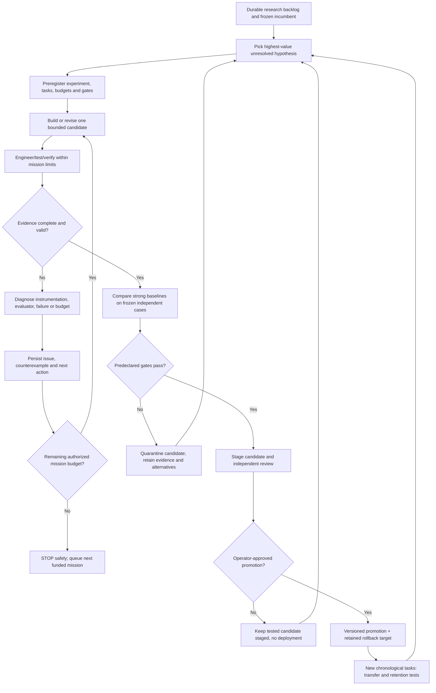

# HIVE v0.3 — Next Agentic Build Loop and Research Path

**Prepared:** 2026-11-21  
**Owner / handoff:** Astra build overseer  
**Engineering agents:** Sol, Luna, Terra; Grok adversarial reviewer; NVIDIA Nemotron mathematical/statistical reviewer; local models as experimental subjects  
**Objective:** Evolve the working HIVE controller into a **verified, repeatably improving organization** that transfers learned changes to unfamiliar tasks while preserving regressions, alternatives, provenance, resource discipline, and rollback.

> **Astra's mandate:** Continue the *engineering and research decision process* after unsuccessful experiments. Do not stop at a failed benchmark and call the project finished. Diagnose the failed hypothesis, preserve the evidence, propose a different bounded intervention, test it, review it, and queue the next experiment. Each individual execution mission still has hard budgets, STOP conditions, and independent release gates. **Never silently replenish a budget, reuse a consumed holdout, or deploy a candidate merely because it improved on a weak baseline.**

## 0. Evidence and current state — do not conflate releases

The statements below come from the publicly published HIVE implementation/research records and the reported v0.2.1 handoff. This document does **not** claim an independent execution of the downloadable source or access to the private evaluator data.

| Record | What was actually shown | What was **not** shown |
|---|---|---|
| **v0.2.1 controller** | 136 passing tests, one Windows symlink test skipped, and two end-to-end CLI journeys; repairs for budget pause, model identity drift, cleanup ownership, feedback isolation, and atomic wall accounting. | A fresh equivalent **real-model** campaign on the post-review v0.2.1 code. |
| **v0.2.0 real run** | 30 real local-model calls; direct **3/6**, learned greedy **5/6**, a **4/6** regressor rejected, tool-only **6/6**; 36 observations reverified in another process. | Independent unseen-family advantage or superiority to the strongest deterministic route. |
| **Separate v0.1 campaign** | 108 real model calls, 162 observations; direct **12/24**, greedy/UCB **23/24**, deterministic tools and fixed model+tool **24/24**; learned policy quarantined. | General compounding learning, parameter updates, or a defensible production promotion. |
| **Earlier caption pilot** | Deterministic rule-only achieved **24/24** held-out; a proposed procedure failed to outperform this simple control and was rejected. | A reason to increase model size or claim learning from a weaker comparison. |
| **Current hardware/model record** | Local Ollama, `myr5-hold-local:latest` (Qwen 9B Q4_K_M) and RTX 5070 Ti were reported for real-model runs. | Guaranteed current runtime readiness; check again with `doctor` and model digest. |

**Key inference:** HIVE has moved beyond a mock architecture: it can operate a bounded selection loop, record verifiable evidence, survive selected failures, and avoid some bad promotions. It has **not yet demonstrated that previous experience makes it better at future unfamiliar problems**. The strongest fixed baseline wins the published narrow suites. The v0.2.1 patch and v0.2.0 experimental evidence must remain separately attributed.

**Release anchors to pin before coding:**

- [Current implementation status](https://mominc.online/hive/notes/STATUS/)
- [Adaptive controller v0.2/v0.2.1 evidence](https://mominc.online/hive/notes/CONTROLLER/)
- [v0.2.1 publication manifest](https://mominc.online/hive/implementation/adaptive-v021-publication.json) — source/runtime version, hashes, and explicit `policy_deployed: false`
- [Current v0.2.1 source ZIP](https://mominc.online/hive/downloads/HIVE_Adaptive_Controller_v0.2.1.zip)
- [v0.2.0 real-model report](https://mominc.online/hive/implementation/adaptive-v02/experiments/results/adaptive-real-model.json)
- [v0.1 local prototype and comparisons](https://mominc.online/hive/notes/PROTOTYPE/)
- [Explicit preceding next actions](https://mominc.online/hive/implementation/autonomous-v01/docs/NEXT_ACTIONS.md)
- [Adaptive organization / governing formulas](https://mominc.online/hive/notes/ADAPTIVE/)
- [Coder directions revision 0.4](https://mominc.online/hive/notes/CODER/)
- [Known gaps and research decision ledger](https://mominc.online/hive/notes/GAPS/) · [Ledger](https://mominc.online/hive/notes/LEDGER/)

## 1. The next build decision

**Build v0.3 as a generalization-and-compounding-learning laboratory, not as another autonomous-agent wrapper.**

### Priority order

1. **P0 — Reproduce and instrument the patched v0.2.1 runtime.** Verify its corrected behavior in a new *bounded* real-model mission while pinning exact source/config/digest. Never relabel the old v0.2.0 measurements.
2. **P0 — Build genuinely new task families and an independent evaluation boundary.** Existing six synthetic families are too correlated, and deterministic routes saturate them. Add model-requiring but objectively checkable tasks while retaining deterministic controls.
3. **P0 — Run repeated, chronological learning experiments.** Demonstrate that a change learned in cycle A helps unseen tasks in B/C **without being re-tuned from those answers**. Compare to a learning-disabled branch and the strongest fixed strategy.
4. **P1 — Make the governing formulas first-class, versioned, testable components.** Learn *when to use* a formula/policy under which task conditions; do not invent a single HIVE intelligence score.
5. **P1 — Compare procedure/memory/routing learning separately.** Establish which layer caused any gain before attempting neural weight changes or dynamic topology.
6. **P2 — Only after measurable success:** test organization changes (groups, topologies, verification depth), real-world work, then model adapters/fine-tuning, sleep/consolidation, pruning, and larger pools of experts.

**Explicitly out of scope for the first v0.3 gate:** 100–10,000 experts, larger resident models, unrestricted generated-code execution, autonomous production promotion, new weight training, and claims of consciousness or general intelligence.

## 2. Three nested loops, with bounded execution



### Loop A — Task execution (fast)

Task → choose eligible route → execute model/tool/specialists → independent check → recover, abstain or record result. Existing `orchestrator.py`, `storage.py`, `verifier.py` and checkpoint facilities are the starting point.

### Loop B — Learning/research (slow)

Cluster failures → write a falsifiable hypothesis → propose **one specific change** → evaluate against unchanged alternatives → accept *experimentally*, reject or quarantine → publish an evidence ledger. A failed result is an input to the next hypothesis, **not permission to alter the answers or success definition**.

### Loop C — Build overseer (durable, across missions)

Astra keeps the issue graph, ownership, next experiment, dependency state, blocked reason and candidate lineage alive even when the executable worker stops. **On budget exhaustion, save the exact next action and wait for an explicitly authorized new mission; do not auto-start unlimited inference.** On normal technical failure within budget, generate a repair task and continue.

## 3. Agent responsibilities and separation of duties

| Agent | Primary responsibility | Cannot approve alone |
|---|---|---|
| **Astra** | Overseer: dependency graph, mission budgets, job assignment, checkpoint review, continuation policy and report publication. | Its own promotion or cap increase. |
| **Sol** | Scientific lead: questions, independent-family benchmark design, controls, hypotheses, preregistration, learning-curve and transfer analysis. | Validation answer edits after preregistration. |
| **Luna** | Runtime builder: candidate generation, policy/recipe registry, evaluation runner and operational glue, with small tested changes. | Its own evidence/production acceptance. |
| **Terra** | Independent verifier and recovery specialist: wrong-tool negative controls, false evidence, crash/restart, memory leakage, tool boundary and corruption tests. | Overriding unsafe failures. |
| **Grok** | Read-only adversarial code and experiment review; supply minimal reproducible counterexamples and challenge baseline choice. | Merge or deployment. |
| **NVIDIA Nemotron** | Mathematical reviewer: estimands, clustering, uncertainty, baselines, test power, prior sensitivity, cost and formula validity. | Turning a descriptive result into a proven gain. |
| **Local model(s)** | Frozen experimental subjects/workers. Log actual digest/quantization/prompt/seed/decoding and tools. | Writing evaluators, seeing sealed answers, modifying budgets or promoting themselves. |

If a named provider is unavailable, record `review_unavailable` and assign an explicitly independent substitute; do not claim that an agent reviewed work it did not inspect. At least one reviewer must be independent of the candidate author, and executable verifier checks must not be model self-ratings alone.

## 4. Ordered work packages — implement in this sequence

| WP | Deliverable | Primary owners | Exit gate |
|---|---|---|---|
| **WP0: Freeze and verify** | Import/check v0.2.1 manifest, source SHA-256, CLI/test state, Ollama digest; preserve v0.2.0/v0.1 evidence read-only; verify v0.2.1 real inference separately. | Astra, Terra | Clean tested checkout, source/fixture hashes, new-run evidence, no mixed release labels. |
| **WP1: Benchmark v2** | Source-disjoint task family registry, public development cases, reusable validation, **new sealed one-use holdout**, incorrect-tool controls, case genealogy. | Sol, Terra | Frozen spec and labels with documented independent creation, baseline non-saturation where model contribution is hypothesized. |
| **WP2: Independent evaluation** | Stronger deterministic evaluators, untrusted result quarantine, negative controls, calibration; safer isolated code-repair fixture runner where authorized. | Terra, Luna | False claims/tool responses cannot pass silently; evaluator version cannot be rewritten by candidates. |
| **WP3: Formula/policy registry** | Pluggable `eligibility`, reliability, selection, exploration, verification-depth, value-of-check, promotion and rollback policies with contexts and version IDs. | Luna, Nemotron | Deterministic unit tests, confidence/calibration diagnostics, matched-policy replays. |
| **WP4: Learning workbench** | Dev-only failure clustering → bounded proposed **procedure, memory or routing** candidate → frozen candidate → independent test. | Luna, Sol | A learned correction changes later actions; ablations identify which mechanism changed. |
| **WP5: New preregistered campaign** | Paired fixed baselines vs learned alternatives across independent families; actual inference, per-family uncertainty, same resource envelope. | Sol, Astra, Terra | Complete attributable experiment; clear pass/reject/inconclusive decision and strongest-baseline comparison. |
| **WP6: Compounding test** | Chronological A→B→C learning waves, untouched future tasks, frozen/no-learning controls, retention and forgetting checks. | Sol, Luna | Repeated retained gain or a rigorously diagnosed failure; no cross-wave answer leakage. |
| **WP7: Organization ablations** | Optional 1-model+tools vs fixed team vs dynamically composed 2–3-specialist team; compare verification depth and information sharing. | Luna, Terra, Nemotron | Each addition shows or fails to show marginal value net of extra coordination/compute. |
| **WP8: First real workflow + report** | One measurable video/SRT or isolated code-repair pipeline; exact artifacts, regressions, implementation links, reproducible report, new decisions. | Astra, Sol | Evidence-backed useful result; public milestone explicitly distinguishes measured, rejected, quarantined and released. |

### Likely existing modules to extend, not rewrite

Use the release manifest to locate and inspect the exact current implementation before editing:

- `src/hive/adaptive.py`, `adaptive_metrics.py`, `learning_policy.py`, `metric_engine.py`: learning selection, comparison and metrics.
- `src/hive/experiment_runner.py`, `lab.py`, `task_spec.py`, `verifier.py`: registered experiments, fixtures and independent results.
- `src/hive/candidate_generator.py`, `failure_triage.py`, `checkpoint_manager.py`, `review_gate.py`: proposal → diagnosis → checkpoint → gate.
- `src/hive/orchestrator.py`, `storage.py`, `adapters/ollama.py`, `model_registry.py`: durable execution and real local inference.
- `configs/adaptive.json`; `tests/integration/test_adaptive.py`; `tests/adversarial/test_grok_counterexamples.py`; `tests/regression/test_review_gates.py`.

These are **published snapshot paths**, not a claim that all proposed interfaces already exist. Prefer additive migration, stable record schemas and targeted test changes; preserve earlier public artifacts and hashes.

## 5. Benchmark design: stop learning the answer to one small exam

### Required task families

Keep historical cases strictly as regression tests. Create independent sources for new cases, including:

| Family | Purpose | Strongest necessary comparison |
|---|---|---|
| Real SRT/video caption diagnosis, edits and metadata validation | Tool-rich practical workflow, cases simple rules cannot fully handle | Deterministic rule/ffprobe; model+tool; adaptive policy |
| Isolated real-repository bug repair | Synthesis with executable unit tests; **sandbox required before running model-authored patches** | Scripted fix, single model+tests, fixed coding workflow |
| Evidence retrieval with source conflict, outdated claims or missing answer | Verified citation, correction and abstention | Retrieval-only and deterministic extraction; model+retrieval |
| Incorrect-tool and malicious/false-result controls | Detect confident but wrong tool output, unavailable tools, stale caches | Fixed verification rule, double-check, adaptive verification |
| Multi-step coordination with dependency failures | Determine whether teams/watchdogs add measurable value | Single agent+tools; fixed team; adaptive team |
| Newly created held-out adaptation rules | Does router/procedure generalize to a **new generator/process**, not just altered constants? | Strongest fixed tool/model policy |

**Important:** Do not make a benchmark artificially impossible for a deterministic tool simply to produce a HIVE win. Include tasks where tools are sufficient **and** tasks requiring contextual judgment. Preregister a mix and retain the tool-only scores. For the latter, specify exactly what is outside the fixed tool's declared capability; let reviewers challenge whether the task is authentic.

### Split / integrity policy

1. **Development:** observable to learner; may update router/procedure/memory.
2. **Validation:** used for candidate selection/diagnostics; repeat use turns it into development evidence, **not a new held-out proof**.
3. **One-use sealed holdout:** sourced independently, disjoint by underlying task generator/repository/source rather than only by ID. Candidate code/model/controller does not receive reference answers or per-case failure hints.
4. **Future chronological wave(s):** unused families created or reserved independently for measuring retained learning on later tasks.
5. Every group records `family_id`, `generator_or_source_id`, `split`, `creation_time`, `fixture_hash`, `gold_verifier_version`, `exposure_status` and `consumed_at`.
6. Store private labels only inside the evaluator's allowed access boundary. The earlier local single-user logical separation is not security against OS owner/untrusted Python; isolate evaluators and untrusted code when this threat is in scope.
7. Use independent reviewer-defined negative controls before looking at results; no changing pass thresholds after inspection.

**Sizing:** Sol/Nemotron must perform a cluster-aware precision/power calculation **before setting the final number of independent families, tasks, repeats and budget**. A six-family, one-case-per-family comparison is diagnostic only. Start with a cheap pilot for pipeline correctness, then perform one newly authorized, adequately specified evaluation mission. Do not pretend correlated template variations are independent samples.

### Control arms to preregister

- **B0:** best applicable deterministic-only workflow.
- **B1:** direct frozen local model.
- **B2:** strongest fixed **single-model + tools** pipeline.
- **B3:** fixed 2–3-specialist pipeline only if that topology fits the task.
- **B4:** learning-disabled / fixed routing with identical capability access.
- **C1:** learned router, frozen before held-out evaluation.
- **C2 (separate ablation):** learned bounded procedure or retrieval memory.
- **C3 (later):** adaptive verification or dynamic topology, same underlying worker models.

Match the allowed resources and access between comparison arms; also report **actual** requests/tokens/seconds/VRAM, not just quotas. Show the Pareto frontier of quality versus actual cost. If the best fixed arm still saturates, record that outcome as a valid result and investigate a **new independently motivated workload**, not a retuned holdout.

## 6. Formula registry — formulas are hypotheses, not magic constants

Each formula version has: `formula_id`, `decision_type`, `task_context`, `inputs`, `constraints`, `assumptions`, `parameters`, `calibration_data_ref`, `training_split`, `version_hash`, `baseline_ref`, `limitations`, `owner`.

### G0 — Hard eligibility (always first)

```text
eligible(route, task) = schema_ok AND permitted AND compatible
                        AND budget_available AND model_identity_pinned
                        AND evidence_boundary_intact
```

No weighted utility may overrule a failed hard gate.

### F1 — Smoothed reliability, by task context

For a clearly defined binary verified outcome and defensible family/condition group:

\[
 p_{a,f} \sim \operatorname{Beta}(\alpha_0+s_{a,f},\;\beta_0+n_{a,f}-s_{a,f})
\]

Use only admissible **development** feedback, with priors and calibration explicitly reported. Treat correlated outputs appropriately; naive event counts are not independent evidence. For multi-level outcomes, use a different appropriate estimator.

### F2 — Context-dependent selection (descriptive until calibrated)

\[
 U(a\mid x)=\mathbb{E}[Q(a,x)]-\lambda_C\mathbb{E}[C(a,x)]-\lambda_T\mathbb{E}[T(a,x)]-\lambda_R\,\mathrm{Risk}(a,x)
\]

This is **not** a release score. Report each raw component separately. Optimize different priorities for high-risk correctness tasks versus low-risk throughput tasks. Compare greedy, UCB/contextual-bandit candidates and simple heuristic controls; retain the simpler one when equally good.

### F3 — Whether another check/specialist is worth calling

\[
 \mathrm{VOC}(check)=\mathbb E[\text{value after check}]-\text{value now}-\mathrm{cost}(check)
\]

Use conservative uncertainty when value is not calibrated. This controls optional extra review, retrieval, tool use or second specialist; do not assume more agents help.

### F4 — Research experiment selection

\[
 V(e)=\mathbb E[\Delta Q_{\mathrm{future}}\mid e]-\lambda_C C(e)-\lambda_F F(e)-\lambda_R R(e)
\]

Compare this candidate with simpler strategies: highest failure frequency, highest measurable uncertainty, or highest expected information gain. Track **whether the experiment actually changed a decision**; otherwise the formula is not validated.

### F5 — Promotion gate (conjunctive, not a weighted average)

```text
stage_experimental(candidate) :=
    source_and_evidence_valid AND
    quality_improves_on_predeclared_comparison AND
    no_critical_regression AND
    budget_and_recovery_gates_pass

production_eligible(candidate) :=
    stage_experimental AND
    independent_holdout_valid AND
    strongest_applicable_baseline_benefit_supported AND
    retention_and_transfer_gates_pass AND
    independent_review_complete AND
    rollback_target_verified

production_promote := production_eligible AND explicit_operator_approval
```

For a sufficiently powered held-out study, use a **family-aware lower confidence bound** on the preregistered improvement and a predeclared margin; do not treat a positive point estimate or a utility-only score as proof. Allow `inconclusive` as an honest result when the sample is insufficient. Production promotions stay operator-gated.

### F6 — Compounding learning vs mere caching

- `Q_t(f)` = verified quality on **new tasks** from family `f` after learning cycle `t`.
- `TransferGain_t` = candidate's quality minus frozen/no-learning control quality on unseen future families.
- `TrialsToThreshold_t` = independently counted experiences/calls to reach a predefined quality threshold on novel tasks.
- `Forgetting_t` = retained-incumbent quality on earlier families minus current policy quality on those families.

A claim of **compounding** requires an improvement trend in future unseen tasks and/or sample efficiency over multiple separately held-out waves, while old capabilities remain within preregistered forgetting bounds. Repeatedly re-running the same six tasks, faster cache hits, or a larger store alone do not count.

## 7. The first actual v0.3 experiment — run it in stages

### E0 — Patched-runtime real-model verification

- Pin published v0.2.1 source SHA, model manifest digest, evaluation version, config and hardware.
- Execute the patched STOP→resume, budget exhaustion, identity-drift and recovery paths using simulated fault cases first.
- Execute a **small new real-inference smoke mission** under explicit caps. Confirm v0.2.1 behavior; record fresh run separately from v0.2.0.
- Exit: stable evidence and no discrepancy in version attribution. Do **not** claim generalization from E0.

### E1 — Generalization and strongest-baseline study

**Hypothesis:** A frozen policy learned from verified development feedback improves on the strongest applicable fixed route on independently sourced tasks under comparable actual resources, and rejects a known incorrect-tool result.

- Preregister task sources, stratification, rubric, safety exceptions, fixed controls, budget, statistical analysis and critical-regression definition.
- Build only from development data, and freeze the selector before fresh validation/holdout.
- Compare the full control set. Include errors/costs and one **incorrect-tool** negative control family.
- Report per-family paired wins/losses, calibration, reliability and resource use. Use family-aware uncertainty and openly state limits.
- Exit `PASS` only with predeclared evidence; otherwise `REJECT` or `INCONCLUSIVE`, preserve runner and begin a new hypothesis cycle **without modifying the consumed holdout**.

### E2 — Chronological learning / compounding test

```text
Frozen model(s) + common tools + initial controller P0
        |
Wave A: new development experience -> candidate P1
        |      compare P1 vs frozen P0 on new sealed B-family tasks
Wave B: new permitted development experience -> candidate P2
        |      compare P2 vs P1 vs frozen P0 on new sealed C-family tasks
Wave C: new permitted development experience -> candidate P3
        |      evaluate on a new D-family + retention suite
        v
Plot family-balanced quality, actual cost, failures, learning speed,
transfer, and old-family retention with independent-review notes.
```

The experimental condition must change **only the named learning layer** at a time (routing, procedure, or memory), holding model weights/tools constant. Use an unchanged no-learning control. For stochastic models run declared repeat seeds or report the inability to do so. At each wave, archive policy versions and immutable exposure records; never re-label already consumed data as fresh.

### E3 — Which mechanism helps?

Only after E1/E2, evaluate separate one-change-at-a-time ablations:

1. No memory vs scoped retrieval vs procedural memory.
2. Fixed verifier vs selective verification vs independent second checker.
3. Fixed pipeline vs conditional specialist recruitment/topology.
4. Online adaptation vs periodic consolidation/replay (with replay-only control).
5. If all above have meaningful failures addressable by parameters: isolated adapters/fine-tuning vs non-neural alternatives; check retention/forgetting and parameter lineage.

Do not bundle all five changes into a single “improved HIVE” and then claim which mechanism worked.

## 8. Failure-to-next-experiment routing — no more dead-end coder reports

| Observed failure | Required next action | What is prohibited |
|---|---|---|
| Strong deterministic baseline wins | Keep it incumbent. Test a genuinely new domain or a **cost** hypothesis; diagnose where model judgment is actually necessary. | Calling weak-baseline improvement a new intelligence capability. |
| Learned router loses on new family | Inspect source shift, train/validation leakage, family coverage, prior sensitivity; propose new contextual features or explicit abstention as a new candidate. | Editing the sealed family to make the router win. |
| Formula unstable or biased | Revert to simple known policy, recalibrate on development, prereg new study. | Claiming a meaningful “probability of success” without calibration. |
| Verifier false accept/false reject | Quarantine affected scores; fix verifier with independently labeled controls; rerun a **newly valid** comparison as appropriate. | Allowing candidate code to set its own gold label. |
| Worker crash/STOP/timeout | Resume exact mission using idempotent IDs; reconcile unknown external effects; run adversarial recovery test. | Double-charging or repeating uncertain real-world actions blindly. |
| Model digest or source changes | Pin new version, mark previous experiment interrupted/incomparable and start a new preregistration if needed. | Merging evidence from different unrecorded runtimes. |
| Candidate improves quality but regresses critical case | Quarantine and roll back; isolate failing capability/context; propose bounded exception or alternative. | Utility-only acceptance. |
| Token/compute/artifact budget exhausted | Atomically checkpoint, persist exact stop reason and next job, issue a concise funding/approval request if needed. | Automatically increasing caps or silently launching a fresh store. |
| No progress across repeated proposals | Change *hypothesis class*, task representation, verification strategy or benchmark source; commission independent diagnosis and return a measurable experiment. | More identical attempts under the same failed assumptions. |
| Untrusted patch fixture not sandboxed | Use read-only/finite fixtures or pause that lane until OS/process isolation exists. | Executing arbitrary model-authored code on the host. |

Every rejected candidate must leave: `what_failed`, `reproduction`, `suspected_cause`, `counterexample`, `new_hypothesis`, `owner`, `next_test`, `required_budget`, `rollback_ref`. **An end state with only “tests failed” is invalid.**

## 9. Mission contract and completion gates

### Example mission config — values must be deliberately set, not inherited blindly

```yaml
mission_id: hive-v03-e0-reproduction
base_release: v0.2.1
parent_source_manifest: implementation/adaptive-v021-publication.json
model_subjects:
  - pinned_local_ollama_model_digest_required
purpose: verify patched runtime, not promotion
permissions:
  modify_evaluator: false
  modify_sealed_holdout: false
  arbitrary_shell_from_model: false
  production_deploy: false
budgets:
  simultaneous_local_inference: 1
  local_requests: 40        # illustrative E0 ceiling; explicit approval required
  generated_tokens: null    # set an explicit numeric cap before running
  active_seconds: null      # set an explicit numeric cap before running
  artifact_bytes: null      # set an explicit numeric cap before running
  retries_per_failure: 2
stop_conditions:
  - explicit_STOP
  - depleted_budget
  - source_or_model_identity_change
  - evidence_or_evaluator_integrity_failure
  - uncontained_side_effect
  - reviewer_required
outputs:
  - source_and_config_hashes
  - durable_event_log
  - test_and_experiment_report
  - failures_and_next_hypotheses
  - candidate_decision_and_rollback_pointer
```

**Fill every `null` budget before authorizing the run.** E0 is a smoke/repro mission, not the statistical E1/E2 campaign. E1/E2 require separately estimated request/token/wall budgets based on their preregistered task × policy × repeat matrix. Track an **aggregate** spending ceiling across stores.

### Gate definitions

| Gate | Pass condition |
|---|---|
| **G0 Reproducible base** | Exact release/source/config/model/evaluator hashes; v0.2.1 unit/adversarial/CLI checks; documented fresh real inference. |
| **G1 Trustworthy study** | Independent sources, frozen one-use holdout, calibrated checker controls, correct experiment attribution, no leakage. |
| **G2 Strong-baseline benefit** | Preregistered quality/resource objective supported versus strongest applicable fixed route; no critical regressions. |
| **G3 Persistent learning** | Previously unseen family transfer, chronological learning/no-learning comparison, retention and repeatability evidence. |
| **G4 Reliable operation** | Durable STOP/resume/crash behavior; no duplicated side effects; tracked actual cost/latency; bounded resource use. |
| **G5 Governed release** | Independent review, complete diff/artifact lineage, quarantines recorded, restore tested, explicit human promotion decision. |

**First meaningful research milestone:** G0–G4 on a real new workload, even if G5 remains staged. A clean negative result with decisive evidence is valuable research progress but **not** evidence of the target self-improvement capability; it must create the next experiment rather than a false success claim.

## 10. Outputs to commit/publish after every completed bounded cycle

Under the existing repository conventions, create or update (use the actual existing paths rather than duplicate records):

```text
docs/CURRENT_STATE.md                # implemented vs unproven, exact release
 docs/EXPERIMENT_LOG.md              # hypothesis, arms, results, limitations
 docs/FAILURE_REGISTER.md            # counterexamples and repair plan
 docs/MATH_HYPOTHESES.md             # versioned formula comparisons
 docs/BUILD_ISSUES.json              # owners, priorities, dependencies, blockers
 docs/REVIEW_DECISIONS.md            # Grok/Nemotron review + disposition
 experiments/plans/v03-*.yaml        # frozen preregistrations
 experiments/results/v03-*.json      # public redacted aggregates
 experiments/results/v03-*.md        # readable comparison, failed arms
 tests/integration/*                 # new contracts / end-to-end behavior
 tests/adversarial/*                 # negative controls and crash integrity
 benchmarks/*                        # source IDs, split manifests, no public gold leaks
```

The names in `experiments/plans` and `results/v03-*` are **new proposed conventions**; adjust to the repository's verified structure. Do not publish sealed reference answers, private evaluator stores, tokens, personal data, API credentials or unsafe executable payloads. Every milestone report must say which version produced which real-model evidence, and whether its candidate is **experimental**, **quarantined**, **staged**, **approved**, or **deployed**.

### Required report dashboard

| Result | Required display |
|---|---|
| Per-family success | successes/attempts, task-family grouping, n independent sources |
| Learning curve | chronological tasks, verified quality, trials-to-threshold if estimable |
| Strong-baseline comparison | paired win/loss/tie, quality gain, family-aware uncertainty |
| Efficiency | generated/reserved tokens, calls, actual active time, median/p95 latency, resident/active models, resource caps |
| Reliability | critical regressions, false accepts/rejects, abstentions, crash/restart success and duplicated effects |
| Retention | previous-family regression, candidate lineage and rollback outcome |
| Decision | promote/quarantine/reject/inconclusive, independent reviewer, falsification and next test |

## 11. Exact starting order for Astra

1. **Read and verify the existing source** using the v0.2.1 publication manifest, published ZIP, current project checkout, local `AGENTS.md` and runtime docs. Confirm git status and existing `D:\Repos\hive-ai` or the real checkout path. Do not recreate HIVE from scratch.
2. **Run the test suite and negative controls**, then do E0: a fresh, explicitly budgeted local inference/recovery check on **v0.2.1**. Bind results to the current source and model digests.
3. **Assign Sol and Nemotron the new experiment design** while Luna builds benchmark-registration/evaluator interfaces; Terra builds incorrect-tool controls and evaluator-isolation/recovery tests. Grok reviews their interfaces without writing the gold answers.
4. **Freeze E1 before running it.** Publish the preregistration hash and budget; give candidate workers development-only views; keep sealed material independent.
5. **Run E1 and publish every arm**, including failures. Candidate review is adversarial; a higher weighted score is not sufficient to override a critical regression or best-baseline loss.
6. **If E1 fails**, open an auto-linked diagnosis issue, derive a different measurable hypothesis, and begin the next *authorized* finite experiment from existing infrastructure. **If E1 passes**, begin E2 to check sustained learning over separate waves.
7. **Do not add more models or changing weights as the default fix.** Prove whether organization, routing, verification or reusable procedures contribute first; increase complexity only for a measured shortfall.
8. **Keep the public HIVE record live after validated increments** with sources, results, counterexamples and next steps. Make every claim match its exact code version and test scope.

### Astra's task-done definition

> A research/build assignment is complete only when it produces **(a)** executable change or a justified no-change result, **(b)** independently inspectable evidence, **(c)** a pass/reject/inconclusive decision against the strongest relevant control, **(d)** an intact checkpoint, and **(e)** the next test or a documented reason no next test is justified. A failing experiment must not terminate the *research workflow*; it may terminate its safely bounded execution mission.

---

## Sources and limitations

This plan is derived from the live HIVE vault's **Implementation Status**, **Adaptive Controller**, **Autonomous Local Prototype**, **Known Gaps**, **Learning Progress**, **Adaptive Research Update** and published manifests/reports listed above, checked on **21 November 2026**. The original v0.1 and v0.2.0 real inferences and v0.2.1 test pass are **project-reported**, not newly re-run in this document's preparation. Source files and private evaluator cases were not executed/audited in this environment; proposed file edits, budgets and gate thresholds require on-machine verification and preregistration by the responsible agents.
