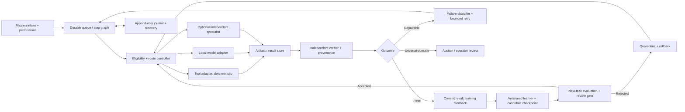
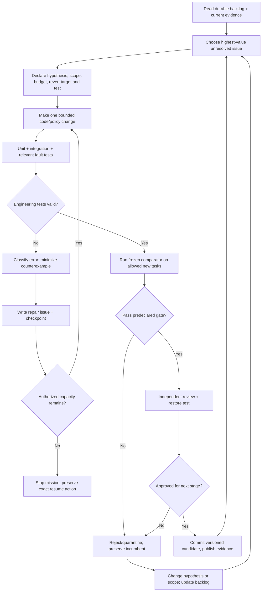

# HIVE — Build/Test Path to a Working Prototype

**Document:** Agentic implementation handoff / acceptance contract  
**Prepared:** 2026-11-21  
**Accountable overseer:** Astra  
**Builders/reviewers:** Sol, Luna, Terra, Grok, NVIDIA Nemotron; frozen local models as experimental subjects  
**Target:** A working local HIVE prototype that executes real tasks, validates results, learns from verified outcomes, survives failure, and can demonstrate what learning does—and does not—improve.

> **Instruction to Astra:** Execute this as a sequence of *working, evidenced milestones*, not an indefinitely expanding architecture study. Complete one thin, end-to-end vertical slice before introducing more agents, neural training, topology search, or a large UI. Keep the engineering work queue alive through failed experiments, but make every execution mission bounded and recoverable.

## 0. Evidence boundary and version check (mandatory)

**What can be stated from the last supplied build update:** HIVE v0.2.1 was reported published with 136 passing tests, one skipped, a persistent adaptive loop, checkpoints, rollback, restart recovery, and CLI/browser checks. The 30-call real-local-model comparison was reported as **3/6 direct → 5/6 learned**, with a **4/6 regression rejected** and a **6/6 tool route**. The previous v0.3 plan correctly distinguishes *v0.2.1 regression tests* from real-model measurements originating in the *v0.2.0* campaign. Unseen-family transfer and broad compounding gains remain unproven.

**Current verification limitation:** On 2026-11-21 the HIVE website and publication manifest could not be fetched in this environment; no subsequent release or new run is independently verified here. This is **not** a claim that there was no newer build. **WP0 below must discover the actual current commit/version and use it as the baseline.** Never overwrite or relabel older results.

### Authoritative inputs for Astra to reopen locally

- Live root/status: https://mominc.online/hive/ and https://mominc.online/hive/notes/STATUS/
- Controller notes: https://mominc.online/hive/notes/CONTROLLER/
- Latest-known v0.2.1 manifest: https://mominc.online/hive/implementation/adaptive-v021-publication.json
- Latest-known published source archive: https://mominc.online/hive/downloads/HIVE_Adaptive_Controller_v0.2.1.zip
- Historical v0.2.0 real-model report: https://mominc.online/hive/implementation/adaptive-v02/experiments/results/adaptive-real-model.json
- Previous handoff: `HIVE_v0.3_Next_Agentic_Build_Loop.md`
- Read the **actual local checkout**, existing `AGENTS.md`, active model/runtime inventory, and experiment store before changing anything.

**Version gate:** Produce `CURRENT_STATE.md` with `release/version`, `git SHA`, `clean/dirty status`, `config hash`, `model digest`, `test runner`, `actual passing/failing tests`, `last real-model run ID`, `known unproven claims`, `next gate`. If newer than v0.2.1, diff its changes against the items here and skip only gates backed by independently reproducible evidence. *Do not treat a release note alone as execution proof.*

---

## 1. Define two different meanings of “working”

| Level | Product behavior required | Evidence required | What cannot yet be claimed |
|---|---|---|---|
| **A — Functional HIVE prototype (first ship target)** | One local command/mission accepts a real goal; breaks it into bounded steps; routes to a tool/model/specialist; executes; verifies; retries or abstains; records feedback; checkpoints; restarts without duplicated side effects; returns a usable artifact and explanation. | A live demo on genuine input; integration tests; forced faults; full event log; one observable route/policy update based on verified feedback; replayable artifacts. | That learned routing beats the strongest fixed baseline or generalizes. |
| **B — Verified adaptive prototype (second ship target)** | A frozen adapted controller outperforms or meaningfully reduces cost versus applicable fixed policies on new tasks, survives chronological transfer/retention checks, and preserves old capabilities. | Predeclared independent benchmark, strong fixed baselines, held-out source isolation, uncertainty and actual resource measurements, independent review. | Broad intelligence, unrestricted self-modification, or neural weight learning unless separately tested. |

**Rule:** A working prototype can be released as **functional** if Level A is met while Level B is still `inconclusive`. Do not call it “verified self-improving” until Level B passes. Likewise, do not keep Level A hostage to a research hypothesis that fails honestly.

### Thin-slice prototype contract

**Input:** A task brief, available files or local sandbox path, desired output contract, permitted tools, deadline/compute caps, verification requirements.  
**Output:** One or more real artifacts, a verified/failed/abstained status, evidence and hashes, actual cost, selected route, and the exact next action if incomplete.  
**Persistence:** The same mission can be resumed after an interrupted process from a durable store.  
**Learning:** Verified results change a versioned *route/procedure preference* on allowed training examples, with a rollback target. No LLM self-rating is sufficient to update a policy.

**First real workload:** Use an offline, permissioned **video-production/post-production batch** with mixed deterministic and context-sensitive subtasks (e.g., subtitle alignment/repair plus content-aware clip/shot suggestions with timestamp evidence and metadata validation). This is a practical HIVE use case, but the old caption-only deterministic suite is **not** sufficient proof of adaptive advantage. Add an isolated **repository bug-fix/test-repair** workflow as the second independent task type, only in an execution sandbox. The first supports daily utility; the second supplies stronger objective verification. A third **evidence-retrieval/source-conflict** task type is for transfer testing. Live streaming and the haunt game are later canary integrations, not prerequisites.

---

## 2. Minimal architecture: preserve existing parts, fill missing seams



**Reuse, inspect and extend instead of duplicating:** previously published paths reportedly include `src/hive/orchestrator.py`, `storage.py`, `verifier.py`, `learning_policy.py`, `experiment_runner.py`, `checkpoint_manager.py`, `review_gate.py`, and `adapters/ollama.py`. **Treat paths as hints until WP0 confirms the current checkout.** New interfaces below are *proposed contracts*, not assertions that matching code exists.

Required contracts:

1. **TaskSpec** — `task_id`, `family_id`, input artifact hashes, output schema, risk/permissions, verifier ID, budget, evaluation split.
2. **RouteDecision** — eligible route candidates, policy version, selection reason, chosen model/tool digest, expected cost and constraints.
3. **StepEvent** — append-only `event_id`, `mission_id`, `step_id`, attempt, timestamp, predecessor, status, inputs/outputs hashes, actual usage, error class.
4. **VerificationRecord** — independent checker version, test/criterion IDs, pass/fail/uncertain, measured evidence, provenance.
5. **FeedbackRecord** — verifier-backed, with `source_split`; never update from a held-out score or unverifiable text.
6. **CandidateRecord** — single changed mechanism, parent policy, diff hash, rollback pointer, validation results, promotion status.
7. **RecoveryRecord** — checkpoint ID, committed effects, unfinished effects, safe replay decisions, last known budget, next action.

**Implementation rule:** Persist an event *before* a side-effecting tool call; use idempotency tokens where possible and reconcile unknown external outcomes before retrying. Artifact hashes and an append-only SQLite/JSONL event store are sufficient at MVP scale. Preserve whichever durable backend already exists if it meets these guarantees.

---

## 3. Critical-path build sequence and pass/fail gates

| Stage | Owner(s) | What to implement or prove | Exact exit evidence |
|---|---|---|---|
| **WP0 — Audit the newest checkout** | Astra + Terra | Locate current release, compare previous manifests, rerun actual unit/integration checks, check Ollama availability and model digest, read old failure ledger. | `CURRENT_STATE.md`, verified commit/hash, test report, runtime readiness, `continue/repair` decision. |
| **WP1 — One real task end-to-end** | Luna + Sol | Implement intake → deterministic tool → local model (if appropriate) → artifact → independent verification → recorded outcome. Avoid building a UI first. | At least one genuine file/task processed and a usable output artifact with complete trace; can reproduce from a second process. |
| **WP2 — Fault-tolerant execution** | Luna + Terra | Durable mission queue, event journal, crash/restart, step identity, budget enforcement, STOP, failure triage, no duplicate execution. | Forced-fault test matrix passes; interrupted task resumes or safely abstains; all costs reconciled. |
| **WP3 — Verified feedback and learning** | Sol + Luna | Two eligible route strategies; update routing preferences only from independent verified feedback; preserve incumbent and version candidate; test rollback and quarantine. | Real training example changes a policy version; failed candidate rejected; evaluator cannot leak answers or approve itself. |
| **WP4 — Real multi-family integration** | Sol + Luna + Terra | Wire video workflow + isolated code-repair + retrieval/source-validation tasks to same controller contracts; avoid hard-coded benchmark answers. | Repeatable end-to-end batch on three distinct families; independent verifier for objective criteria; human approval for subjective/real-world changes. |
| **WP5 — Strong-baseline and transfer experiment** | Sol + Nemotron + Grok | Freeze policy, prepare new-source holdout, compare to tool-only / direct model / fixed model+tool / learning-off, test a second chronological wave. | Per-family paired results, uncertainty, costs, ablations, `pass/fail/inconclusive` decision; no evaluator contamination. |
| **WP6 — Operator demo / prototype release** | Astra + Terra | Package a documented local launch, `doctor`/health check (or discovered equivalent), sample tasks, results viewer, rollback, and clear status. | Repeatable live demo, reproducible release manifest, signed-off Level A; Level B labeled truthfully. |

**Priority:** WP0–WP3 are the minimum meaningful prototype engineering slice. WP4 makes it useful rather than a one-benchmark trick. WP5 turns learning into a supportable scientific claim. WP6 ships.

### WP0: release inventory tasks (first thing Astra does)

- Find local project root, branch, SHA, most recent tag/manifest, source hash, and git working-tree modifications. Make a backup/branch; do not wipe unstaged work.
- Inspect and run the **repository's own documented commands**; only use `python -m pytest` if the checkout actually uses pytest. Do not invent `hive` CLI flags and report them as existing.
- Run reported regression suite and explicitly resolve any discrepancy with 136 passed / one skipped. Record Windows-only skip separately.
- Execute a small **fresh** real local-model smoke run using the current source; log the exact new version and model digest. The old 30 calls are historical—not evidence the new patch was run.
- Test cold restart, STOP/resume, tool side effects, model-identity drift and exhausted budget before letting learning continue.
- Output `docs/CURRENT_STATE.md` and `docs/NEXT_WORK_ITEM.md`. If the latest public update is unavailable, record `upstream_status=unverified` and continue from the verified local checkout.

### WP1: one complete mission

Proposed *test input* (adapt to a small real local batch, not benchmark labels):

```yaml
mission_id: demo-video-001
intent: "Correct this caption file and propose 2 source-backed short clips"
inputs:
  - path: samples/session001.mp4
  - path: samples/session001.srt
outputs:
  - path: out/session001.corrected.srt
  - path: out/session001.clip_proposals.json
  - path: out/session001.verification.json
permissions:
  shell: allowlisted_non_destructive_only
  network: off
  publish_or_upload: false
  host_file_writes: restricted_to_artifact_directory
verification:
  objective:
    - subtitle_syntax_and_monotonic_timestamps
    - clip_times_within_media_duration
    - every_clip_has_source_time_evidence
  subjective:
    - require_operator_approval_for_editorial_quality
```

The **actual validator** must be implemented using deterministic media probe/parser rules where feasible; a model cannot be trusted as the sole verifier of its own clip selection. A failed editorial-judgment check is recorded as human review, not an automatic success. For code repair, run tests only inside an appropriately isolated workspace with limited files, no secrets and blocked network unless explicitly approved.

### WP2: failure-recovery injection matrix

| Injection | Expected safe behavior | Pass evidence |
|---|---|---|
| Kill worker before tool dispatch | Step is re-eligible exactly once after resume. | One committed output; no lost task. |
| Kill immediately after tool execution, before event completion | Reconcile idempotency and output hash; do not blindly re-run external effects. | No duplicate side effect or charge. |
| Corrupt output/manifest | Verifier rejects or quarantines, requests regeneration from safe checkpoint. | No invalid promotion. |
| Wrong/stale model digest | Block/rescope candidate and log mismatch; old data remains attributed. | Zero silent model substitutions. |
| Incorrect tool result claiming success | Cross-check objective condition; mark checker conflict. | Rejected false evidence. |
| Budget depletion | Commit terminal checkpoint, pause, write next authorized action. | No extra model calls or silent budget reset. |
| STOP during long run | Flush/mark pending steps; resume safely only when explicitly authorized. | Correct stop/resume trace. |
| Broken/unavailable model/tool | Route to a safe permitted alternative if valid; otherwise abstain. | Failure classification and continuation issue. |
| Bad learned candidate | Compare to stored incumbent; quarantine, restore and regression-test. | Original behavior returns. |
| Secret/prompt injection in input | Treat content as data; restrict actions to TaskSpec permissions. | No unauthorized read/write/network call. |

**Non-negotiables:** No unbounded shell from a model, no arbitrary code executed on the host, no silent budget replenishment, and no auto-publication or irreversible external action without operator approval.

### WP3: simplest useful learner (no training weights required)

- Begin with **fixed model weights** and **one or two local models maximum** that are verified present. A deterministic route, a frozen local-model+tools route, and an adaptive selector give interpretable controls. The controller learns *which path to use*, not what answer a benchmark expects.
- Treat tool-only as a **first-class candidate**, especially for subtasks where it previously scored 6/6 and 24/24. Do not make HIVE call a model just so it looks more intelligent.
- Start with a simple, versioned family/context-conditioned success estimate; compare a fixed heuristic, greedy/UCB or Thompson-sampling *candidate* only if development evidence warrants it.
- After an objectively checked task, save outcome, cost, latency, abstention, verifier ID, and task family. Admit only `development` feedback to the learner.
- Propose one bounded change (route preference, selective checker, prompt/procedure recipe). Evaluate against the **actual current incumbent** on fresh development/validation cases; preserve the previous candidate.
- If a change regresses, mark `rejected`, store counterexamples, roll back and enqueue the next hypothesis **rather than stopping the engineering workflow**.

Minimal policy decision objective—illustrative, not a claim of calibrated parameters:

\[
U(a\mid x) = \mathbb{E}[Q(a,x)] - \lambda_C\mathbb{E}[C(a,x)] - \lambda_T\mathbb{E}[T(a,x)] - \lambda_R\operatorname{Risk}(a,x)
\]

Apply **hard permissions, source integrity and resource eligibility before** utility ranking. Report quality, cost, latency and risks separately; a weighted score cannot excuse a critical regression. If uncertainties are large, use a conservative fixed fallback. Use actual token/call/wall measurements, not guessed model-size proxies.

### WP4/5: the real adaptive test

**Frozen control arms** (all allowed the same applicable tools/resources):

1. Best applicable **deterministic** workflow.
2. Direct frozen **local model**.
3. Strongest **fixed model+tools** procedure.
4. **Learning-off** version of HIVE with the same capabilities.
5. **Learned routing** HIVE candidate, frozen before evaluation.
6. Later ablations only: adaptive verification, procedural memory, conditional specialist recruitment. Change one learning mechanism at a time.

**Benchmark integrity:** Group by underlying sources/generators/repositories, not merely shuffled IDs. Keep development, reusable validation, *one-use held-out*, and *later chronological* families separate. Store sealed answers and private artifacts away from the agent's workspace. Record exposure status. A run on six correlated synthetic cases is a smoke test, **not** a transfer claim.

**Wave structure:**

```text
T0: freeze model/tool roster and unchanged controller B0
Development wave A -> candidate policy P1
  evaluate P1 vs B0 on a new independent family set B
Development wave B (new permitted feedback) -> P2
  evaluate P2 vs P1 vs B0 on fresh set C
Development wave C -> P3
  evaluate P3 vs P2 vs B0 on fresh set D
  plus prior-family retention tests
Publish: quality + cost + resource + error + abstention + policy version
```

Sol/Nemotron must preregister primary quality metric, practical improvement margin, number of **independent** source clusters, inference repeats, per-task budgets, uncertainty method and power/precision calculation **before** revealing holdout. Pilot cheaply to confirm harness; then use one explicitly funded study. Treat any underpowered result as `inconclusive`, not `proof`.

---

## 4. Proposed acceptance gates: engineering versus research

Set exact targets in a preregistered test manifest **before** running. The numbers below are suggested **prototype engineering thresholds**, not already achieved results or guarantees of statistical significance.

### Level A: functional prototype — all required

- [ ] A1. Fresh start from documented checkout launches offline with available local model(s) and tools; no secrets hard-coded; `doctor` equivalent reports runtime/model/evaluator/permissions state.
- [ ] A2. Process **12 genuine, previously unused operator-approved demo tasks** across **at least 2 task types** (at least one video-production-type task and one isolated code/test workflow) through *one* controller. Target **at least 10 objectively correct/accepted outputs**; report abstentions separately rather than treating them as success.
- [ ] A3. At least **one verified model route** and **one verified deterministic-tool route** are used when appropriate; all actions and hashes appear in the event log. At least one decision must respond to an actual observed outcome, not a hard-coded demonstration trigger.
- [ ] A4. Inject and pass **two clean restart tests**, a budget/STOP test, incorrect tool output, and failed-candidate rollback. **Zero** duplicate irreversible effects, unauthorized actions or false-passed corrupted artifacts.
- [ ] A5. Policy preference/version changes after verifier-backed development feedback, survives restart, and can be restored; every learning action identifies its source and split. No claim that the policy is better yet.
- [ ] A6. A new operator can reproduce the complete demo using a documented command or script and see artifacts, verified status, failing cases, time/costs, and the next work item without reading source code.

**If a task misses:** fix the failure or record an honest `abstain`/`blocked` state; do not hide it to satisfy the count. If the target is not met, the build may be a **functional alpha**, but not Level A accepted.

### Level B: verified adaptation — additional requirements

- [ ] B1. Evaluation plan and immutable source/hash manifest frozen before one-use holdout. Independent evaluator and negative controls passed; no gold leakage.
- [ ] B2. Matched, paired comparison to the **strongest applicable fixed baseline**, not direct-model alone. Report uncertainty by source family, actual tokens/seconds and failure categories. Support the preregistered practical gain (quality *or* efficiency under quality non-inferiority); otherwise `fail/inconclusive`.
- [ ] B3. Two or more **chronologically new** evaluation waves show a retained generalization or sample-efficiency benefit relative to learning-off; previously learned capabilities stay inside declared forgetting/critical-regression bounds.
- [ ] B4. Grok supplies adversarial review and Nemotron reviews calibration/analysis, **or** an explicitly documented independent replacement does. Verifier and release gates cannot be waived by the proposing agent.
- [ ] B5. The accepted candidate and old incumbent both have tested restore paths; human operator explicitly decides whether it may be the default. No automatic production promotion.

**Do not force B2/B3 to pass.** If no adaptive benefit appears, Level A remains useful; Astra must pivot the scientific hypothesis (new contextual feature, memory retrieval, selective verification, or new genuine task family) while retaining the fixed winner.

---

## 5. The ongoing agentic development loop



Astra's durable queue needs `work_item_id`, `problem`, `hypothesis`, `owner`, `dependencies`, `source SHA`, `attempts`, `test command`, `expected observation`, `budget_remaining`, `status`, `next action`, `checkpoint ref`, `artifact refs`, and `review required`.

**Failure types and mandatory response:**

| Failure | Next authorized move | Do not do |
|---|---|---|
| Tests fail | Minimize repro, identify responsible layer, fix once, rerun narrow then broad tests. | Halt with only “failed.” |
| Model accuracy weak | Inspect task grouping, input schema, prompts/route decision; try one bounded intervention. | Change verifier answer to make model look correct. |
| Deterministic tool wins | Keep tool as incumbent; assess contextual/non-tool tasks or efficiency hypothesis. | Claim adaptive improvement over an irrelevant weak baseline. |
| Holdout contamination | Invalidate affected claim; refresh independently sourced one-use benchmark. | Retest same revealed gold as unseen. |
| False checker acceptance | Freeze promotions; repair verifier, negative-control test, invalidate exposed scores. | Let the same model approve itself. |
| Worker/system stops | Resume idempotently or produce actionable `blocked` state and evidence. | Blindly reissue unknown external effects. |
| Progress stalls for 2 comparable cycles | Independent Grok/Terra diagnosis; revise hypothesis class or cut scope to one real failing case. | Run identical prompts indefinitely. |
| Budget/external permission exhausted | Atomic checkpoint and explicit stop; queue next authorized mission. | Auto-replenish caps, spend silently or deploy. |

**Boundary:** Continuous progress means *persistent research/build state and automatic repair within approved limits*. It does **not** mean an unlimited runaway task that ignores STOP, spends without bounds, or auto-merges unverified code.

---

## 6. Agent division and parallel schedule

| Role | Parallel work | Final responsibility / separation |
|---|---|---|
| **Astra (overseer)** | WP0 release audit; issue graph; sequence gates; coordinate reviews and update website only after verified changes. | Owns mission budget and acceptance report, **not** sole approver of its own changes. |
| **Luna (runtime engineer)** | WP1/2 implementation: tool/model adapters, mission interface, event journal, idempotent recovery, package/demo. | Cannot certify its own safety or benchmark outcomes. |
| **Sol (learning/science)** | Define task families, strong controls, learner update path, source split, experiment plan and fidelity checks. | Cannot edit held-out gold after preregistration. |
| **Terra (independent verification)** | Test harness, negative controls, fault injection, sandbox guardrails, event replay, source and verifier integrity. | Can block release on critical integrity failure. |
| **Grok (adversarial review)** | Challenge escape paths, prompt injection, stale evidence, biased benchmarks, reward hacking, rollback. | Reports counterexamples and code review; do not count its agreement as ground truth. |
| **NVIDIA Nemotron (math review)** | Audit utility/regret/uncertainty, independent-family count, power, actual cost metrics, promotion estimand and ablations. | Reject unsupported “self-learning gains” claims. |
| **Frozen local model subjects** | Run actual tasks and provide outputs/trace; at most safe constrained tools. | Cannot rewrite evaluator, unlock split, or set budgets. |

**Concurrency:** Luna builds core while Terra builds faults and Sol develops independent task fixtures. Astra integrates in gated branches. Heavy local inference should be serialized or resource scheduled if hardware contention changes measurements. If Grok or Nemotron is unavailable, mark the review as unavailable and assign a genuinely independent available substitute; do not fabricate it.

---

## 7. Test hierarchy and reporting

| Test level | Runs when | Examples |
|---|---|---|
| Unit/property | Every small code change | Schema validation, route eligibility, budget arithmetic, idempotency tokens, feedback split filtering, policy math. |
| Component/integration | Every merge candidate | Real Ollama adapter on pinned model; actual deterministic tool; isolated event store; artifact hash verification. |
| Fault/adversarial | Every recovery/promotion change | Crash injection, stale model, wrong-tool response, prompt injection, poisoned evidence, duplicate effects. |
| End-to-end real tasks | At WP1, WP4, and release | Video task output; isolated bug fix with tests; sourced retrieval/abstention. |
| Learning experiment | WP3 onward | Fixed vs learned policy on fresh examples, rollback failed policy, chronological transfer. |
| Release reproducibility | Every release candidate | Fresh checkout, documented startup, exact manifests and hashes, demo script, restore test. |

**Always report per run:** `task_family`, `source_group`, `route`, `model/tool version`, `pass/fail/abstain`, `checker ID`, `real calls`, `input/output tokens`, `actual runtime`, `retries`, `faults`, `policy SHA`, `checkpoint`, `artifact digest`, `split`, `review status`. Report both **attempted** and **verified** totals—never count an abstention as a success. Include failures and the strongest fixed control in the dashboard, not just the headline success rate.

### Operator dashboard: minimal, not a new platform rewrite

The first usable UI may simply be a terminal/TUI or small read-only local page. It must show:

```text
HIVE PROTOTYPE STATUS
  Running release / commit / frozen local model digest
  Current mission, step, route and last verified action
  Quality per family and best fixed baseline
  Verified successes / failures / abstentions / critical rejects
  Model calls, tokens, real elapsed time, queue / budget
  Current policy and parent, latest candidate, rollback pointer
  Crash/restart status, blocked reason, next authorized action
  Exact paths to artifacts and audit log
```

Do not divert WP1–WP4 into aesthetics, dashboards, a new graph database, or 100-agent routing. A CLI with auditable files is enough for prototype acceptance.

---

## 8. Controlled demo script for the prototype review

The demonstration must be repeatable and should be performed *live* on unused, real inputs; do not hard-code expected outputs in the controller.

1. **Fresh launch:** Run documented startup/health command. Show exact release, model digest, local tooling and budget.
2. **Deterministic task:** Supply media metadata/caption syntax check. HIVE chooses tools without wasting a model call; verifier confirms output.
3. **Contextual task:** Ask for two source-backed potential clips from an unfamiliar real recording; model may draft but times/provenance must check; operator can judge editorial quality.
4. **Different task type:** Give an isolated sandboxed code-repair task or equivalent objectively checkable repository problem; return patch and test evidence without touching host repo.
5. **Forced wrong answer:** Make a tool or model return an incorrect but plausible result; show verifier catching it and HIVE retrying/safely abstaining.
6. **Crash/recovery:** Kill the worker between steps, restart from a new process and show no lost state or duplicate external effect.
7. **Learning event:** Apply independently verified development feedback, show policy version and routing preference change, and show the previous version remains restorable.
8. **Bad candidate:** Introduce a development-only regressor; show a rejected proposal and intact incumbent.
9. **Blind comparison:** Run previously unexposed task(s) through frozen learned and frozen fixed routes. Present actual results—even when the fixed route wins. This is a demo, **not** a statistically supported Level B claim.
10. **Handoff:** Open human-readable report, audit trace, artifact folder, failure register and next scheduled work item. No hidden steps.

**Success outcome:** HIVE is a genuine local system doing useful work with a measurable adaptive controller, independently verified results, safe continuation, and reproducible operator controls. Research confidence about its generality is labeled separately.

---

## 9. Proposed repository outputs (adapt to existing structure)

```text
docs/CURRENT_STATE.md                  # observed release and evidence
 docs/PROTOTYPE_CONTRACT.md            # output/schema/permission contract
 docs/BUILD_BACKLOG.json               # durable prioritized tasks, dependencies
 docs/FAILURE_REGISTER.md              # categorized errors and next hypotheses
 docs/PROTOTYPE_DEMO.md                # repeatable live demo sequence
 docs/PROTOTYPE_ACCEPTANCE.md          # signed A/B gate decision
 docs/REVIEW_DECISIONS.md              # independent reviewer dispositions
 configs/prototype-mission.example.yaml
 experiments/plans/prototype-*.yaml    # preregistered, versioned missions
 experiments/results/*                 # machine-readable full results
 tests/integration/*                   # real adapter/mission/verification tests
 tests/adversarial/*                   # crash, injection, spoofed output tests
 benchmarks/manifests/*               # provenance, split, exposure (no gold leak)
 artifacts/demo-*                      # outputs + hashes (safe/non-sensitive)
```

These are *suggested* locations. Preserve existing naming conventions, migration history, stored checkpoints, and the project website's record; do not create duplicate libraries if corresponding modules already exist.

### Report template after each accepted work package

```yaml
work_package: WPn
release_sha: REQUIRED
model_digest: REQUIRED_IF_USED
change_scope: ...
tests:
  passed: 0
  failed: 0
  skipped: 0
real_tasks:
  verified: 0
  failed: 0
  abstained: 0
baseline_comparison: "not yet run | results link"
critical_regressions: 0
resource_usage: {calls: 0, tokens: 0, wall_seconds: 0}
evidence_refs: []
rollback_ref: ...
independent_review: "approved | rejected | pending"
next_work_item: ...
decision: "pass | fail | inconclusive | blocked"
```

---

## 10. Cut list: do **not** block the prototype on these

- Hundreds of local experts, broad live topology search, hot-swapping neural weights or training foundation models.
- Changing programming language for its own sake; a C++/Rust fast path must have a measured bottleneck and clean boundary before implementation.
- New UI, website redesign, graph database, or large-scale knowledge-vault restructuring.
- Unbounded autonomous internet actions, code execution outside sandboxes, auto-merging and auto-publishing.
- A single universal “HIVE intelligence score.” Track distinct metrics and mechanisms.
- Proving AGI, consciousness, or generalized multi-agent emergence. The goal is a bounded *working* controller plus honest evidence.

Research candidates such as Optuna, AutoResearch-style experiment loops, GEPA, OpenEvolve, Agent Lightning, and Avalanche may be evaluated **after** the main loop works. None is a prerequisite to WP1–WP4, and no third-party library should silently control the production promotion gate.

---

## 11. Ready-to-paste Astra build-overseer directive

> You are the HIVE prototype build overseer. **Do not restart the project**. Audit the exact most recent local/published source and distinguish it from earlier test results. Work from the HIVE prototype contract in this document. Complete WP0, then build WP1–WP3 as the first working vertical slice before expanding. Reuse tested implementations, require independently checkable outputs, and persist mission state across crashes. Use Sol for learning/benchmarks, Luna for implementation, Terra for independent verification, Grok for adversarial review, and NVIDIA Nemotron for mathematical/statistical review; local models are frozen experimental subjects. Keep each change bounded and testable. On failure, produce a minimal reproduction, rollback or quarantine, root-cause hypothesis, changed repair plan and queued next task; **do not terminate the broader engineering backlog merely because a test fails**. Do stop the current mission on explicit STOP, budget exhaustion, unsafe side effects, evaluator compromise, or missing approval. Never falsify evidence, expose sealed answers, automatically increase limits, or claim a policy was deployed when it was only tested. Deliver a working local demo and source-backed Level A acceptance first, then pursue Level B controlled experiments. Publish precise versioned evidence and the next action after every completed gate.

**First command/action:** Inspect repository and latest release; populate `docs/CURRENT_STATE.md`; reproduce the documented tests; verify a new local inference bound to the *current* version; then create a concrete PR/patch for WP1 with a passing end-to-end mission. Do not write a new general architecture plan in place of that first executable step.

---

## 12. Final decision matrix

| Observed result | Status | Action |
|---|---|---|
| Real tasks, verification, restart/rollback, reproducibility all work; adaptive benefit not yet proven | **Level A: Functional prototype** | Ship as functional with honest research limitation; run preregistered Level B experiments. |
| All Level A requirements plus strong-baseline transfer/retention evidence | **Level B: Verified adaptive prototype** | Stage for operator acceptance and broader canary pilots. |
| Technical loop works but real tasks fail or are unverified | **Engineering alpha, not accepted** | Diagnose and repair WP1/WP4; avoid scope expansion. |
| Real tasks work but verifier is unreliable or recovery duplicates effects | **Not safe to release** | Stop promotion; repair WP2/verification first. |
| Strong fixed/tool pipeline beats learning on independent tasks | **Learning claim fails or is inconclusive** | Keep fixed incumbent; research narrower contexts/efficiency/new mechanisms without rewriting gold. |

### End state

> HIVE's prototype is complete when **one machine can receive a real task, choose a bounded combination of models and software, produce a useful artifact, verify it independently, learn from admissible feedback, survive interruption, and show precisely why its next choice changed**—all with reproducible source, policies, logs, budgets and rollback. Proof that adaptation *generalizes* is a separate, explicitly measurable upgrade, not an assumption.

**Source note:** Grounded in the supplied v0.2.1 screenshot and the previous `HIVE_v0.3_Next_Agentic_Build_Loop.md` handoff. The website/current source could not be reopened here as of 2026-11-21; all project-path, current-version and runtime assumptions require WP0 verification in the actual checkout. All WP/thresholds/contracts above are **proposed work and tests**, not completed results.
