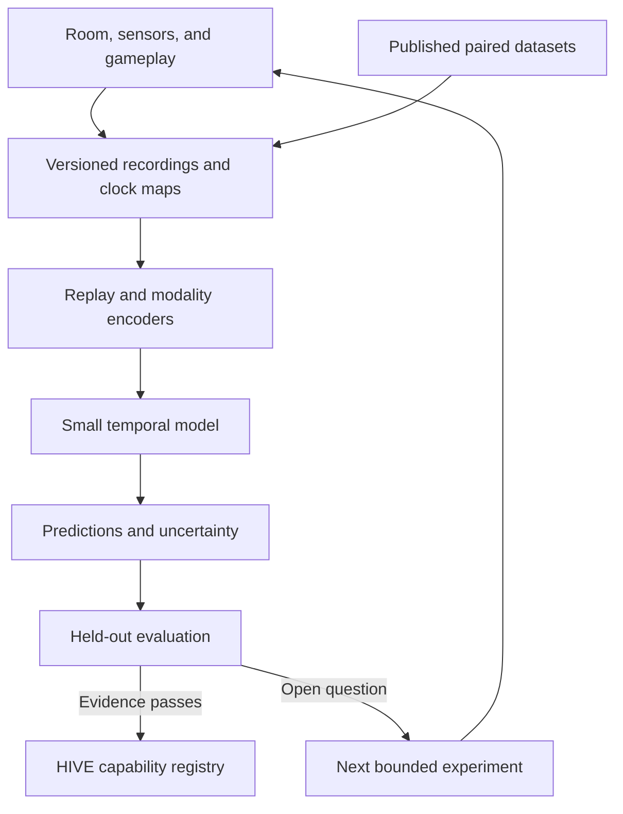

# HIVE — Learning from Measurable Reality

## Multimodal research plan, source acquisition roadmap, and sensor catalog

**Prepared:** November 23, 2026, America/Los_Angeles.  
**For:** Ian Myers; Claude research/integration lead; Nemotron source-adaptation workers; independent evaluator.  
**Deliverable:** A research and acquisition plan. Published sources and manufacturer documentation were examined; the large dataset archives, local PC, and current HIVE checkout were not inspected or benchmarked for this report. Model sizes, prices, and dataset properties are sourced; proposed architectures, budgets, experiments, and acceptance thresholds are research recommendations.

> Human language is an interface to intelligence, not the boundary of intelligence. HIVE should be capable of acquiring knowledge directly from measurable reality, integrating new sensory modalities, discovering relationships independently, and validating its understanding through observation and experimentation.

## 0. Recommended direction

Build a **sensory learning research branch** around three things: trustworthy synchronized recordings, small predictive models, and independently evaluated experiments. Use the four existing room cameras, multiple microphones, and gameplay capture as the initial observation environment. Add inexpensive numerical sensors before committing to specialized equipment.

The first demonstrable result should be narrow and useful:

**On previously unseen recording sessions, does an added physical sensor let a small model distinguish or predict something better than the strongest camera-only, audio-only, or sensor-only baseline?**

A strong first task is distinguishing a real desk impact from similar sounds played through a speaker or produced inside a game. Camera, microphone, and desk acceleration provide complementary evidence; the experiment can deliberately vary speaker placement, headphones, visible motion, and the game being played.

### Immediate research priorities

1. Establish one session format and replay interface for existing datasets and future room recordings.
2. Audit small samples from **STARSS23**, the **Dortmund ADL multisensor dataset**, and **InspecSafe-V1**.
3. Compare two small-model routes: frozen visual features plus compact sensor/audio/temporal modules; and a controlled reproduction of **LeWorldModel (LeWM)** before adapting its action-conditioned architecture.
4. Add desk acceleration, light, temperature/humidity, and CO₂. Keep the core cameras/audio/gameplay channels present across sessions.
5. Use simple statistical and physical models alongside neural models. An interpretable predictive relationship can be a valid HIVE discovery.
6. Expand into thermal, depth, force, radar, acoustic geometry, radio, and radiation only through individually testable branches. Preserve these branches even when they are not selected for the first prototype.

The shopping list is the final section of this document. It identifies direct USB devices, modules requiring an interface, meaningful outputs, limitations, and checked price examples.

## 1. Connection to the earlier LeCun research and HIVE decisions

The earlier visual-cortex discussion identified **Yann LeCun** and **JEPA**, not training on recordings from a biological visual cortex. The relevant engineering direction is learning representations from observations and predicting future states or action consequences. The prior addendum already identified LeWM as a small experimental reference. [Earlier HIVE LeCun addendum](https://chatgpt.com/library?file_id=libfile_fde3_f-24c6facc7dd0819191e22dd8bd1c1502_08dd7e10f8d081918b684a802f5b489c&account_id=personal); [LeWM paper](https://arxiv.org/abs/2603.19312).

Treat this document as an **additive research branch**. Preserve the previously selected decision vector:

`D1=D; D2=C; D3=C; D4=E; D5=A; D6=B; D7=B; D8=C; D9=C; D10=C; D11=C.`

Preserve the existing Governor, Executor, Registry, Store, model gateway, ContextPolicy, independent verification, lineage, baseline, and rollback. The sensory worker should use the existing control plane. Locate actual source symbols before changing contracts; the names here describe logical responsibilities, not newly verified repository paths.

**Recommended handoff timing:** give this research packet to the coding lead at the next normal checkpoint so the branch and compatible observation metadata can be registered. Literature review, metadata inspection, and bounded offline pilots can proceed within existing resource policy. Changes to live routing or model promotion should follow the current HIVE milestone and acceptance sequence described in the earlier addendum; this packet does not reorder that sequence.

### What “understanding” means in this research

Measure progress as observable capabilities:

- Identifying the same event across different sensors.
- Predicting a measured quantity or event on a later, unseen recording.
- Remaining useful when one channel is missing or an object is occluded.
- Distinguishing physical-room events from digital game events and speaker playback.
- Predicting consequences of explicitly recorded interventions.
- Discovering a relationship that survives new sessions, altered initial conditions, and relevant controls.
- Recognizing when the available observations do not determine the answer.

A microphone does not reveal every silent object; a thermometer measures a location; a camera can miss an occluded action. More sensors improve observability for some tasks, but do not make every hidden state identifiable. A useful model should represent these limits instead of filling them with confident guesses.

## 2. Research architecture



### 2.1 Preserve native measurements

Keep video frames, sound waveforms, acceleration, temperature, and other measurements in their original forms. Small modality encoders transform them into numerical features. A temporal model combines relevant features and predicts selected outputs. Language can explain the result, name an experiment, or communicate with the user.

A sensor is an input channel, not an individual model weight. Offline training changes the model parameters using recorded examples. During ordinary inference, incoming observations change the current internal state without requiring a parameter update after every sample.

Keep both **shared representations** and **modality-specific outputs**. A common embedding is useful for matching a visible impact to its sound. A separate calibrated numerical head is necessary for a temperature forecast. Do not force a radiation count, temperature value, and image into identical semantic information when their measurements contain different facts.

### 2.2 First compact model

Proposed starting design, subject to profiling:

| Component | Initial design | Reason |
|---|---|---|
| Vision | Frozen DINOv2 ViT-S/14; initially one selected camera view per example | Establish a modest visual baseline and cache embeddings |
| Audio | Small convolutional encoder over spectrograms; retain raw audio | Learn events without a large language/audio model |
| Fast physical signals | Small temporal convolution or MLP for acceleration, force, and contact signals | Preserve transients and physical units |
| Slow environment | Separate history for temperature, humidity, CO₂, and pressure | Avoid treating minute-scale dynamics as frame-scale events |
| Fusion | Compact GRU or small causal transformer, explicit modality masks and sample age | Keep the first trainable temporal core around 1–5M parameters as a design target |
| Heads | Event classification, future sensor values, matching, uncertainty | Score each capability separately |
| Interface to HIVE | Typed prediction record and evidence/artifact references | Keep large recordings outside language-agent context |

DINOv2's released small backbone is roughly 21M parameters; its code and standard pretrained weights are Apache-2.0. These frozen parameters still count toward the total model footprint. A 1–5M temporal core is not a claim that the complete system has only 1–5M parameters. [Official DINOv2 repository](https://github.com/facebookresearch/dinov2).

Begin with frozen feature extraction, cached features, and simple fusion. Compare late fusion against joint temporal attention only if the simpler baseline leaves a specific performance gap. Add multi-view fusion after one-view experiments work. Label camera identity, geometry, and calibration; four views do not automatically provide calibrated 3D reconstruction.

### 2.3 Separate action-conditioned learning

LeWM is the lead small action-conditioned reference. Its authors describe approximately 15M parameters and single-GPU experiments; those results do not establish training time or memory usage on Ian's computer. Its predictor uses actions along with observations. [Project and paper](https://le-wm.github.io/); [MIT code](https://github.com/lucas-maes/le-wm).

Use its supplied benchmark first. For room recordings, log deliberate actions such as lamp switch changes or object placement. For gameplay, retain actual controller/mouse/keyboard inputs and available game telemetry. Saved gameplay frames alone do not recover exact actions. Human motion inferred from a camera is an observation, not an independently recorded intervention.

Keep a passive observation model available for recordings without actions. Adding zero-valued placeholder actions does not constitute a faithful reproduction of an action-conditioned method.

## 3. Hardware and resource plan

The latest message specifies an RTX 5070 for training and a future RTX 2070/second computer for coding. An earlier HIVE hardware record describes an RTX 5070 Ti with 16 GB VRAM and 64 GB RAM. Resolve that naming difference with a local inventory during implementation. For this plan use a conservative **12 GB desktop RTX 5070 profile**, and allow a **16 GB 5070 Ti profile** if the inventory confirms it. NVIDIA lists these desktop capacities separately. [NVIDIA specifications](https://www.nvidia.com/en-us/geforce/graphics-cards/50-series/rtx-5070-family/); [earlier hardware record](https://chatgpt.com/library?file_id=libfile_fde3_f-001f6628c4e88191b908c65dcc5521f1_08dd7e10f8d081918b684a802f5b489c&account_id=personal).

| Resource | Proposed use | First measurement |
|---|---|---|
| RTX 5070 / confirmed 5070 Ti | One exclusive training or feature-extraction job | Peak allocated/reserved VRAM, available memory, throughput, temperature, and time |
| RTX 2070 / second computer | Coding, lightweight inference, dataset preparation, and capture where practical | Verify actual GPU, RAM, disk, ports, and encoder capabilities |
| CPU/RAM | Decode, align, index, and sample recordings | Loader utilization and data starvation |
| Local SSD | Active sessions and compact feature cache | Sustained write/read rate and free space |
| Durable recording storage | Original recordings, calibration, manifests, checkpoints | Checksums and recoverable session inventory |

Two computers do not automatically combine their VRAM into one model's memory. Splitting coding from training is useful because it removes competing jobs, rather than because it creates a larger single GPU.

### Proposed pilot limits

- One GPU job at a time; begin with a peak-memory target at or below about 80% of measured available VRAM.
- Start with 4–8 frame histories for the custom baseline, modest images, and small microbatches. Use repository-compatible inputs for a pretrained encoder before changing its preprocessing.
- Cache frozen features once per data/encoder/preprocessing version. Do not repeatedly decode four full-resolution camera streams for every ablation.
- Run a short smoke test, then a 30–60 minute pilot. Expand a candidate to a few hours only after its data and memory checks pass. These are proposed experiment caps, not expected convergence times.
- A full reproduction of LeWM's published recipe may need changes. The paper uses a larger batch and batch-dependent regularization. Gradient accumulation increases the optimizer's effective batch size but does not automatically reproduce per-forward BatchNorm or SIGReg/VICReg distribution statistics. Report every deviation. [LeWM full paper](https://arxiv.org/html/2603.19312v3).
- Validate the installed PyTorch/CUDA/driver combination on the actual Blackwell GPU. Avoid copying old CUDA pins from a research repository without a device smoke test. PyTorch introduced Blackwell support in 2.7, and its release matrix has subsequently changed. [PyTorch release information](https://pytorch.org/blog/pytorch-2-7/); [current compatibility matrix](https://github.com/pytorch/pytorch/blob/main/RELEASE.md).

### Storage arithmetic

Size the capture system by measured bitrate. For compressed video:

`decimal GB/hour = aggregate megabits/second × 0.45`.

For example, four camera streams at an assumed 8 Mb/s each plus gameplay at an assumed 15 Mb/s total 47 Mb/s, or **21.15 GB/hour** before audio and other data. Eight channels of 48 kHz, 24-bit PCM audio add about **4.15 GB/hour**. These are calculated examples, not predictions of the user's encoder settings. Keep training derivatives small while retaining the original selected sessions.

## 4. Open-source and research reuse map

Each row is an alternative or incremental experiment. Do not combine every framework into one initial implementation.

| Branch | Primary sources and reuse status | What to examine or adapt | First decision experiment |
|---|---|---|---|
| **A. Compact predictive world model** | [LeWM](https://github.com/lucas-maes/le-wm), MIT; [official PushT checkpoint](https://huggingface.co/quentinll/lewm-pusht) | Encoder/predictor contract, action encoding, next-embedding objective, SIGReg, training configuration | Reproduce a bounded supplied task; measure local resources; compare action-conditioned and observation-only forecasts |
| **B. Frozen visual baseline** | [DINOv2](https://github.com/facebookresearch/dinov2), standard code/weights Apache-2.0 | Small image encoder and feature extraction; keep trainable heads compact | Does adding sensor/audio features improve held-out results over frozen vision alone? |
| **C. Temporal visual encoder** | [V-JEPA 2/2.1](https://github.com/facebookresearch/vjepa2), mainly MIT with identified Apache components | Masking, frozen video features, temporal evaluation; current 2.1 table includes an 80M ViT-B encoder | Compare frozen short-clip features to framewise DINO at a matched resource budget |
| **D. Cross-modal alignment** | [ImageBind](https://github.com/facebookresearch/ImageBind), noncommercial license; [LanguageBind](https://github.com/PKU-YuanGroup/LanguageBind), mixed code/data/weight terms | Modality encoders, projection heads, matched-event objectives | Match impact audio, acceleration, and video; test hard negatives and timing-shuffled inputs |
| **E. Representation collapse and missing sensors** | [VICReg](https://github.com/facebookresearch/vicreg), MIT; [MultiMAE](https://github.com/EPFL-VILAB/MultiMAE), CC BY-NC 4.0 | Regularization and masked-modality ideas | Does an ablated model remain useful when a channel disappears? Compare simple heads, SIGReg, and VICReg independently |
| **F. Scientific relationship discovery** | [PySINDy](https://github.com/dynamicslab/pysindy), MIT; [Tigramite](https://github.com/jakobrunge/tigramite), GPL-3.0 family | Sparse dynamics; time-lagged dependence and causal-discovery methods with explicit assumptions | Predict cooling/force/vibration dynamics on new initial conditions; test hypothesized influences with interventions |
| **G. Continual adaptation** | [Avalanche](https://github.com/ContinualAI/avalanche), MIT | Replay baselines and forgetting evaluation | Add a sensor or new session without losing earlier capabilities |
| **H. Active experimentation and control** | [TD-MPC2](https://github.com/nicklashansen/tdmpc2), MIT; [DreamerV3](https://github.com/danijar/dreamerv3), MIT | Small model configurations, latent dynamics, action evaluation | Start in a simulator; compare predicted and measured outcomes before proposing physical experiments |
| **I. Spatial hearing** | [Pyroomacoustics](https://github.com/LCAV/pyroomacoustics), MIT; [STARSS23 baseline](https://github.com/sony/audio-visual-seld-dcase2023) | Localization, beamforming, known-array baselines | Locate a sound source in a known region; evaluate transfer to the room and new microphone placement |
| **J. Acoustic simulation** | [SoundSpaces](https://github.com/facebookresearch/sound-spaces); [Habitat audio documentation](https://github.com/facebookresearch/habitat-sim/blob/main/docs/AUDIO.md) | Simulated room impulse responses and acoustic/visual geometry | Use controlled simulated scenes to test a hypothesis, then validate on measured recordings |
| **K. Gameplay grounding** | [VPT](https://github.com/openai/Video-Pre-Training), MIT code; [MineRL](https://github.com/minerllabs/minerl) | Paired screen/action loaders and behavioral-cloning examples | Predict screen changes with true game actions; keep digital and physical scene state distinct |
| **L. Alternative cortical organization** | [Monty](https://github.com/thousandbrainsproject/tbp.monty), MIT | Modular sensorimotor learning and object representations | Isolated alternative after the recording/evaluation interface works; it is a distinct research lineage from LeCun |
| **M. Later visual comparisons** | [DINOv3](https://github.com/facebookresearch/dinov3), custom license; [LeVJEPA](https://github.com/MLO-lab/LeVJEPA), mixed licenses | Newer small backbones or video pretraining methods | Revisit only for a measured accuracy/efficiency gap |

### Source acquisition rules

For each selected project, record the upstream URL, full commit, selected files/symbols, license/NOTICE, dependencies, local modifications, and one smallest runnable example. Check **code, checkpoint, and dataset terms independently**. A public GitHub repository does not make every associated asset unrestricted.

Specific distinctions found during research:

- I-JEPA and MultiMAE have noncommercial terms; they are not interchangeable licensing substitutes for LeWM or V-JEPA 2.
- ImageBind's README and LICENSE disagree in the exact noncommercial Creative Commons variant. Resolve the selected revision's terms before reuse; do not silently treat it as MIT. [ImageBind license](https://github.com/facebookresearch/ImageBind/blob/main/LICENSE).
- DINOv3 uses its own license and an access-acceptance flow. DINOv2 remains the simpler initial baseline.
- LanguageBind describes generated depth/thermal modalities. Generated channels cannot serve as independently measured physical ground truth. [LanguageBind repository](https://github.com/PKU-YuanGroup/LanguageBind).
- LeVJEPA distinguishes MIT portions from noncommercial legacy files and released weights. Preserve that file/asset distinction.
- Read the actual checkpoint-loading code and use verified official downloads. A successful README example on an old GPU is not an installation or runtime guarantee for this PC.

### Independent discovery without excessive model size

Use a progression: detect a repeatable time relationship; fit a simple predictor; propose a competing explanation; change one relevant condition; evaluate on fresh recordings. PySINDy can supply an interpretable dynamics model. Tigramite can help prioritize candidate time relationships, but its causal methods have assumptions about stationarity, hidden variables, and conditional independence. A statistical edge remains a hypothesis until the experiment warrants a stronger claim. [Tigramite assumptions](https://github.com/jakobrunge/tigramite#overview).

HIVE can register a bounded finding such as “desk acceleration adds reliable information for these impact events under these mounting conditions.” It should not generalize that finding into an unsupported universal law. Store the conditions, effect size, uncertainty, counterexamples, and links to independent evidence with every discovery.

## 5. Recorded datasets: what to acquire first

**Three working sample loaders are the first milestone.** The three datasets below cover complementary tasks. They are not measurements of one shared event and must not be concatenated into fictional simultaneous observations.

### 5.1 First three

| Dataset | Recorded modalities | Access and practical scale | HIVE use and necessary check |
|---|---|---|---|
| **STARSS23 v1.2.0** | Spatial microphone audio, synchronized 360° room video, event times/directions/distances; some clips lack video | MIT; release totals 16.3 GB. Development MIC audio about 3.4 GB + development video about 4.1 GB + small metadata. Select MIC or FOA instead of duplicating both formats. | Initial room audio/vision correspondence and localization benchmark. Preserve array geometry and missing-video masks. [Release](https://zenodo.org/records/23735039); [license](https://zenodo.org/records/23735039/files/LICENSE?download=1) |
| **Dortmund ADL multisensor dataset** | Five nodes with audio, vibration, low-resolution thermal arrays, light and environmental measurements | CC BY 4.0; 4.6 GB, divided into activity archives with loaders | Strong first vibration/environment adapter source. **No RGB video; temperature/humidity/pressure and similar environmental fields are averaged per activity.** They are episode context, not frame-level thermometer targets. [Data](https://zenodo.org/records/7937591); [paper](https://www.mdpi.com/2306-5729/9/12/144) |
| **InspecSafe-V1** | RGB/thermal video, audio, point clouds and sensor logs including gas, temperature and humidity; combinations vary by platform | CC BY 4.0; 23.6 GB shown, train archive about 17.9 GB and test about 5.75 GB | Closest candidate to the requested recorded video plus real scalar-temperature replay. Audit actual log cadence, units, timestamps, missing channels and short-clip coverage. [Data card/files](https://huggingface.co/datasets/Tetrabot2026/InspecSafe-V1); [paper](https://www.nature.com/articles/s41597-026-07796-x); [loader](https://github.com/liuzy0708/InspecSafe/blob/main/dataset_loader.py) |

These source pages and loader descriptions were checked. The large archives were not downloaded; successful release-page verification is not proof that every record has every advertised channel. InspecSafe's online preview currently reports a generation error; that does not establish corrupt archives, but the local loader must be validated independently. For InspecSafe, check inspection-point/site grouping before adopting its supplied split: different frames from the same location can leak scene identity across train and test.

### 5.2 Preserved dataset branches

| Dataset | What it adds | Acquisition/reuse constraint | First bounded use |
|---|---|---|---|
| [SpeakingFaces](https://github.com/IS2AI/SpeakingFaces) | Paired visual/thermal facial sequences and speech | Data CC BY 4.0; code MIT; full collection is very large. Thermal face imagery is not room-air temperature; verify radiometry of selected exports. | A few subject/trial recordings for audio/thermal/vision alignment |
| [Ego-Exo4D](https://docs.ego-exo4d-data.org/) | First-person and external views, audio, IMU, gaze, and spatial data | Custom accepted license; access via Lab22. Default recommended download is roughly 14 TiB, so select individual takes/parts. | Multi-view correspondence and movement; no general room-temperature channel |
| [MM-Fi](https://ntu-aiot-lab.github.io/mm-fi) | RGB/depth, LiDAR, radar, Wi-Fi CSI and pose/action information | CC BY-NC 4.0; image routes differ by release. Near-IR imagery is not necessarily thermal. [Toolbox](https://github.com/ybhbingo/MMFi_dataset) | One environment/subject subset before purchasing RF sensing hardware |
| [OpenPack](https://github.com/open-pack/openpack-dataset/blob/main/docs/DOWNLOAD.md) | IMU, depth/keypoints, IoT events, wearable measurements including wrist temperature | Non-RGB sources CC BY-NC-SA; RGB has a separate academic-only agreement. Wrist temperature differs from air temperature. | Heterogeneous sampling, missing sensors, activity dynamics |
| [ObjectFolder-Real](https://www.objectfolder.org/objectfolder-real-download) | Object impact sound/video/contact force; tactile contact video and object geometry | Confirm Real-specific reuse terms. Some modalities are separate recordings linked by object/location. | Select the impact audio/video/force subset; do not invent simultaneous tactile measurements |
| [Touch and Go](https://touch-and-go.github.io/) | Egocentric RGB with GelSight tactile video and frame timestamps | Project presents CC BY 4.0; retain archive terms. Tactile imagery is not automatically calibrated force. | A few contact sequences for visuotactile prediction |
| [UTD-MHAD](https://personal.utdallas.edu/~kehtar/UTD-MHAD.html) | RGB, depth, skeletons, acceleration and gyro | Small benchmark; an explicit reuse license was not found on the official page. Check permission before adopting. | Simple video/IMU fusion; represent changes in sensor placement |
| [RH20T](https://rh20t.github.io/) | Robot RGB/depth, force/torque, audio and actions | Scene-dependent licenses: commercial-compatible and noncommercial portions differ; API terms are separate. | A few contact-rich robot episodes for action/outcome research |
| [VPT](https://github.com/openai/Video-Pre-Training) / [MineRL backup](https://zenodo.org/records/12659939) | Gameplay with recorded keyboard/mouse or action channels | VPT code MIT; recordings and game-related rights require their own audit. Old dependencies need modernization. | Screen/action loader and a small prediction baseline |
| [SoundSpaces](https://github.com/facebookresearch/sound-spaces) | Simulated acoustics tied to 3D scene geometry | Simulation and scene licenses; not measured room audio | Test localization hypotheses under controlled geometry before real-world transfer |

### 5.3 Research plan for finding more scientific recordings

Search by **measurement combination and acquisition method**, not just “multimodal AI.” Start with author-maintained repositories linked from Scientific Data, Data in Brief, NeurIPS Datasets and Benchmarks, Zenodo, university labs, and official Hugging Face dataset organizations. Trace a paper to the actual downloadable files and license.

| Search lane | Example search concepts | Evidence required |
|---|---|---|
| Environment + audiovisual | synchronized video audio temperature humidity sensor logs; industrial inspection multimodal | Real scalar units, sensor position, timestamp cadence and available archive |
| Physical contact | impact audio video force dataset; visual tactile timestamps | Same-contact vs same-object association; calibrated force vs tactile image |
| Dynamics | vibration video accelerometer machine condition monitoring | Sampling rate, anti-alias filtering, hardware clock, operating states |
| RF sensing | RGB depth mmWave Wi-Fi CSI synchronized dataset | Raw IQ/CSI vs processed targets; hardware configuration and antenna geometry |
| Thermodynamics | RGB radiometric thermal contact temperature time series | Radiometric values, emissivity/calibration, contact/air distinction |
| Embodied control | observation action force audio robot demonstrations | Recorded actions, actual outcomes, calibration and episode identity |
| Gameplay | screen video input actions game telemetry | Exact input timing and event/state records; virtual-world provenance |

For each candidate, create a one-page evidence card: paper, data URL/version, code URL/commit, license by asset, actual modalities, pairing category, timestamp precision, physical units, calibration, duration/subjects/sites, missingness, download size, smallest subset, intended prediction task, and one disqualifying risk.

Stop pursuing a candidate when it has no accessible measurements, no usable rights, unresolved temporal relationships for the proposed task, or download/integration cost disproportionate to its research value. Keep its citation in the future-branch registry with the reason.

## 6. Replaying recorded reality correctly

The user's central idea is sound: training can pair a recorded frame with the physical measurement captured at the corresponding original time. The experiment can be replayed days later and at arbitrary playback speed. The physical relationship comes from **the original acquisition timeline**, not from the wall clock during playback.

### Pairing categories

| Relationship | Example | Valid training use |
|---|---|---|
| Same event, time-aligned | Camera/audio/vibration of one impact | Event matching, localization, temporal prediction |
| Same recording, slower channel | One temperature reading every few seconds alongside video | Multi-rate inference with sample age and uncertainty |
| Episode-level context | ADL averaged environmental values | Context conditioning; not rapid temperature forecasting |
| Same object, separate encounter | Some ObjectFolder modality combinations | Object/material representation and retrieval |
| Same task, separate performance | Human and robot demonstrations | Task alignment or imitation |
| Simulation/generated observation | Simulator audio or generated thermal-like frames | Auxiliary training, clearly labeled; not measured validation ground truth |

An arbitrary thermometer log cannot be attached to unrelated video as if both described the same experiment. Such a pairing can be an intentional negative control, but not positive physical evidence.

### Replay rules

1. Index every modality in a shared session time while retaining original device timestamps.
2. Record time corrections and their residual uncertainty; do not overwrite the evidence needed to revise alignment.
3. Keep slow channels at their native rates. Repeating one reading across video frames does not create new independent observations.
4. Label sample age, missingness, validity and whether a value was measured, aggregated, interpolated or generated.
5. For a forecast issued at time `t`, provide only samples available by `t`. A centered interpolation that uses a reading at `t+1` leaks future information.
6. Save discontinuities, device resets, reconnects, dropped samples and camera frame gaps.
7. Distinguish temperature of ambient air, a contact probe, skin, and radiometric surfaces. Treat colorized thermal footage as imagery unless physical values and calibration are retained.
8. Make real-time playback, accelerated replay and offline window sampling consumers of the same underlying session contract.

### Required sample and stream metadata

The implementation can choose a compatible schema, but it must preserve these meanings:

```yaml
session_id: unique_recording_id
stream_id: desk_accelerometer
modality: acceleration_xyz
measurement_kind: measured  # measured / aggregated / derived / simulated
source_clock_id: device_clock
source_timestamp: original_value
session_time_ns: mapped_acquisition_time
host_receive_time_ns: receive_time
clock_map_version: alignment_artifact_id
time_uncertainty_ms: measured_or_estimated_uncertainty
sample_interval_or_exposure: recorded_interval
units: m_per_s2
coordinate_frame: sensor_mount_frame
placement_and_orientation: calibration_artifact_id
calibration_version: calibration_artifact_id
valid: true
missing_reason: null
quality_flags: []
payload_ref: immutable_data_reference
provenance: dataset_or_device_and_version
rights_ref: applicable_terms
```

Do not fill unknown fields with invented precision. Include hardware serial/model, firmware, acquisition software, filtering, warm-up, full-scale range, physical response time and axis conventions in the stream descriptor rather than repeating them per sample.

## 7. The room recording system

### 7.1 Keep independent sources

Record the four original camera views separately from the final broadcast composition. Save gameplay video and direct game audio separately from room microphones. Retain raw or minimally processed microphone channels in addition to the processed stream mix. Preserve known gain, automatic gain, noise suppression and echo-cancellation settings.

OBS supports assigning separate audio sources to recording tracks. Independent camera-source recording may require an audited plugin or a separate capture process; standard audio track support does not imply that one OBS recording already contains four independent video tracks. [OBS audio guide](https://obsproject.com/kb/multiple-audio-track-recording-guide); [Source Record project listing](https://obsproject.com/forum/resources/source-record.1285/).

Capture game-scoped actions or game-provided telemetry when available. Retain `room`, `game`, and `playback` as explicit source domains. An explosion in gameplay, the sound emitted by a real speaker, and a real object striking the desk are related but different events.

Record camera calibration and placement changes. For early classification, approximate locations may suffice. For metric geometry, measure camera intrinsics/extrinsics and microphone geometry; mark which claims require that calibration.

### 7.2 Synchronization and recording tools

| Tool | Recommended role | Boundary |
|---|---|---|
| [Lab Streaming Layer](https://labstreaminglayer.org/) + [LabRecorder](https://github.com/labstreaminglayer/App-LabRecorder) | Capture low-bandwidth sensor/event streams and preserve clock-offset information in XDF | Software synchronization does not undo undocumented device buffering or turn unrelated audio devices into one sample clock |
| [LSL timing documentation](https://labstreaminglayer.readthedocs.io/info/time_synchronization.html) | Establish monotonic clock mapping, offline correction and raw timestamp retention | Non-LSL camera/media clocks need their own measured mapping |
| [MCAP](https://mcap.dev/) | Typed timestamped interchange and replay where useful | MCAP is a container, not a clock-synchronization mechanism; preserve source acquisition time in the message schema |
| Existing HIVE Store + immutable artifacts | Session manifests, checksums, provenance and experiment evidence | Reuse existing durable authority instead of starting another competing database |
| Video/audio files + Parquet/array stores | Efficient native media and numerical access | A common session index links them; forcing every video byte through a language model or one logger is unnecessary |

Select one canonical session manifest. A practical first implementation can retain media files plus XDF sensor recordings, then expose a replay adapter. MCAP export can follow when it solves a real integration problem. Avoid maintaining two conflicting canonical logs.

LSL records clock-offset information for later correction; hardware or software mappings are still needed for non-LSL clock domains. MCAP's `log_time` and `publish_time` have specific meanings and should not silently stand in for unknown exposure times. [LSL timing](https://labstreaminglayer.readthedocs.io/info/time_synchronization.html); [MCAP specification](https://mcap.dev/spec).

### 7.3 Synchronization validation

At the beginning and end of a session, and periodically during a long session, record a recognizable event across relevant channels: a visible light pulse with an electrical event marker; a visible tap with microphone and acceleration response; or a common trigger where supported. Check offsets and drift rather than assuming the start timestamps remain aligned.

Set tolerances by task. One video frame may be sufficient for coarse activity matching; impact timing may need much better alignment. Audio direction estimation from arrival differences needs shared-clock channels or carefully demonstrated sample alignment. A collection of independent USB microphones is useful for coarse events, but does not automatically constitute a phase-coherent microphone array.

The capture report should show measured offset, drift, residual error, loss rate, and the effect on the task. If alignment cannot support an experiment, downgrade to a coarser task or improve acquisition.

### 7.4 Expand without breaking the dataset

Keep a stable core of camera/audio/gameplay channels. Add one experimental sensor to several varied sessions rather than recording it once. Include overlap sessions between new sensors when the scientific question requires their interaction. Learning through shared visual/audio anchors is a hypothesis to evaluate; it is not a replacement for direct simultaneous recordings of the required relationship.

Check USB-controller bandwidth and storage writes with all intended cameras active. A powered hub supplies power but does not create additional host-controller bandwidth. Record sensor placement and mounting changes as experimental conditions.

## 8. Experiment program

These are proposed experiments, not published HIVE results. Begin with short, deliberately varied sessions, then use ordinary streams for additional experience.

| ID | Question and design | Essential controls | Main measures |
|---|---|---|---|
| **E0 — Timing and replay** | Record visible taps/light markers and replay all streams | Start/end markers, drift, reconnect and dropped-frame cases | Alignment residuals; reproducible event ordering; complete provenance |
| **E1 — Added vibration** | Classify real desk impacts, typing, chair movement and similar speaker/game sounds | Same sound under different physical conditions; new sessions and mounting; shuffled acceleration | Event/macro F1; improvement over strongest single-modality baseline |
| **E2 — Missing information** | Remove a camera/audio/sensor channel or occlude a visible event | Deliberate missingness, broken sensor values, changes in illumination | Performance retention, uncertainty calibration, appropriate abstention |
| **E3 — Thermal dynamics** | Record a naturally cooling object with a contact probe; add radiometric thermal if available | Different initial temperatures, object positions and sessions; persistence/linear dynamics baseline | Forecast MAE in physical units; interval coverage; held-out dynamics |
| **E4 — Light and exposure** | Switch a lamp and vary occlusion while recording lux and camera exposure state | Auto-exposure changes; covered camera/light sensor; unseen lamp positions | Lux change/event prediction and uncertainty |
| **E5 — Gameplay and physical room** | Separate on-screen events, direct game audio, speaker playback, and physical movement | Different games; game audio muted; headphones vs speakers; repeated physical actions | Domain attribution; false physical-event alarms; generalization |
| **E6 — Object contact** | Place objects on a calibrated load-cell platform while recording vision/audio | Hold out object identities and placing styles; remove weight-correlated labels | Contact timing, mass-change error, robustness |
| **E7 — Active hypothesis test** | Predict effects of an explicitly logged lamp/fan/object-placement action, then observe | Randomized action order, repeat trials, alternative explanations | Action-conditioned forecast gain; replicated effect; uncertainty reduction |
| **E8 — New modality without forgetting** | Add a sensor or a new recording day, then rerun earlier tests | New-adapter-only vs joint updates vs replay | Earlier-task regression, new-task gain, update cost |
| **E9 — Null and count-rate controls** | Include independently generated noise and deliberately broken temporal pairings; optionally study ambient radiation separately | Matched distributions and session-held-out evaluation; appropriate count-rate baseline for radiation | No fabricated gain for independent noise; calibrated count uncertainty and investigation of any repeatable real association |

Speaker playback can itself cause real structural vibration. Vary speaker mounting/location and volume in E1; do not let the model substitute a simplistic vibration-present rule for source attribution. Ambient radiation counts are also not a guaranteed null: real rates can change with environmental conditions. Independent synthetic noise supplies the clean null; radiation requires a count-rate model and its own experiment.

### 8.1 Define the prediction task precisely

Separate three objectives:

- **Matching/classification:** which channels describe the same current event? Do not call this future prediction.
- **Missing-channel inference:** estimate a withheld channel from available channels. Specify whether earlier readings from the target sensor are allowed; remove all prohibited target information.
- **Forecasting:** estimate `y(t+h)` from information available by `t`. Report the horizon and reject any preprocessing that looks ahead.

For a slow channel, use a longer history and compare against persistence. Predicting nearly constant room temperature to a small error is not useful evidence unless it improves on simply repeating the latest reading. Exact temperature may not be recoverable from RGB at all; that is an identifiable limitation, not necessarily failed training.

### 8.2 Evaluation gates

1. Split complete sessions/days/sites before generating overlapping windows. Keep every view and derivative of the same event in the same split.
2. Use train-only normalization and preprocessing fitting. Keep the test set out of representation tuning and repeated research selection. For forecasting, every input embedding's video/audio window and receptive field must end by the forecast issue time; a frozen bidirectional encoder can still leak future observations through a centered clip.
3. Include simple baselines: majority/mean, last-value persistence, linear autoregression, event thresholds and applicable physical models.
4. Compare vision only, audio only, numerical sensors only, and correctly aligned fusion.
5. Deliberately time-shift/shuffle a modality while preserving its distribution. Investigate unchanged fusion performance: the model may ignore that modality or exploit another shortcut.
6. Remove label overlays, visible sensor readouts and filename/session-ID shortcuts from prediction inputs. Do not let the target appear in screen capture or captions.
7. Score on held-out sessions, sensor placements, relevant object identities and, where feasible, another room arrangement. Report the generalization boundary.
8. Give finalists multiple seeds and session-grouped uncertainty estimates. Count independent events/sessions, not correlated frames, as the evidence units.
9. Check uncertainty and missing-modality behavior. A prediction interval should widen when necessary information disappears.
10. Record resources: training time, peak VRAM/RAM, energy if measured, bytes processed, inference cost and additional sensor cost.
11. For learned latent representations, monitor embedding variance/effective rank and an independent downstream probe. A low prediction loss can be trivial if different observations collapse to nearly identical representations.

**Proposed advancement criterion:** predeclare one main task metric and a practically useful gain before opening the held-out results. A pilot might target a 10% relative forecast-error reduction or 5 percentage-point event-score gain over the strongest baseline, with repeatable direction across sessions. These are suggested starting thresholds, not universal scientific standards. Reject improvements caused by leakage, invalid alignment, or unexplained regression even when the average score increases.

### 8.3 Discovery records

Store each learned relationship as a versioned claim with scope, input requirements, predicted outcome/horizon, effect size, uncertainty, supporting sessions, withheld evaluation, competing explanation, and replication result. Distinguish `observed association`, `predictive relationship`, `intervention-supported effect`, and `unsupported` states.

Choose future experiments by expected reduction in a specific uncertainty or expected measurable capability gain, with a budget. Repeatedly unpredictable noise should not win simply because it produces high prediction error. The system must be able to conclude that an added sensor is unhelpful for a particular task.

## 9. Phased research and acquisition sequence

The sequence below is a research order rather than a dated schedule. Advance by evidence gates and measured resource use.

| Phase | Research work | Reviewable output | Exit gate |
|---|---|---|---|
| **R0 — Inventory and questions** | Verify GPU/VRAM/RAM/storage, camera/mic interfaces, existing capture formats, exact first prediction question | Hardware/capture inventory and one-page experiment contract | Known resource envelope and available channels |
| **R1 — Source and dataset audit** | Inspect the first three dataset releases, LeWM, DINOv2, synchronization tools and required licenses | Three dataset cards; code reuse manifest; smallest-sample plan | At least one usable, licensed sample with defensible pairing |
| **R2 — Recording/replay proof** | Implement one dataset adapter and one room-session adapter; validate clocks and missingness | Reproducible replay, schema report and timing plots | E0 passes for the selected task |
| **R3 — Baselines** | CPU/simple models, frozen-feature predictor, initial vibration experiment | Baseline scorecard with grouped splits and shuffled controls | A trustworthy baseline, even if no fusion gain occurs |
| **R4 — Small-model comparison** | LeWM supplied-task pilot; passive multimodal predictor; optional frozen V-JEPA comparison | Measured GPU profile and comparable experiments | Select one useful route within budget |
| **R5 — Scientific discovery loop** | Interpretable dynamics and logged interventions; proposed experiments | Replicated bounded finding and failed-hypothesis records | Prediction or intervention-supported benefit on new sessions |
| **R6 — New sensors and retention** | Add one sensor at a time, test missingness and forgetting | Incremental-value and regression report | Benefit justifies acquisition/integration cost |
| **R7 — HIVE integration** | Register a qualified advisory capability through existing controls | Versioned worker contract, verifier evidence and rollback | Current HIVE promotion and regression gates pass |

### First six recording sessions

An initial collection sequence can be brief and deliberate:

1. Existing cameras/mics/gameplay only: verify independent tracks and timing markers.
2. Add acceleration: real desk contacts, speaker playback, typing, no-contact controls.
3. Repeat acceleration on a different day/placement and with different game audio.
4. Add light sensing: lamp changes, occlusion, camera exposure variation.
5. Add contact temperature or environmental measurements: longer slow-change recordings with meaningful variation.
6. Record overlap plus missing-sensor conditions; reserve this session for evaluation before training decisions are made.

Ordinary streams then add coverage. Keep a short planned experiment segment in each recording so the data contains varied, labeled, informative events. Hours of nearly unchanged scenery are not equivalent to hours of independent physical experiments.

## 10. Context-window and token-cost management

This section is a standing requirement for every HIVE coding/research packet and loop.

### Worker responsibilities

| Role | Bounded responsibility | Required output |
|---|---|---|
| Claude lead | Select architecture/experiment, preserve approved HIVE contracts, integrate evaluated changes | Decision record and next task packet |
| Nemotron source worker | Inspect or adapt one pinned component/loader with limited scope | Reuse manifest, patch or design, exact source references and verification |
| Dataset worker | Audit one dataset/subset and pairing semantics | Dataset evidence card and sample validation |
| Hardware worker | Establish one sensor's export/interface/timing/calibration chain | Complete BOM and sample-stream contract |
| Independent evaluator | Hold splits/criteria, run baselines and ablations, check leakage/regression | Evidence-based pass/fail/unknown |

### Proposed context policy

- Start each worker with a 2–4k-token task packet containing its objective, relevant contracts, selected source sections and acceptance criteria. Retrieve additional content only for a concrete unresolved question.
- Keep a stable, small invariant prefix. Reference large documents, recordings, logs and previous results by immutable artifact ID/hash instead of pasting them into every prompt.
- Produce a roughly 300–600-token rolling checkpoint: current state, decisions, evidence paths, unresolved issue and next action.
- Hand work to a fresh bounded context after a milestone or around half the working context budget. Preserve evidence in artifacts rather than continuously expanding the conversation.
- Count uncached input, cache creation, cache reads, output, retries, tool output and summarization overhead separately. Cached reads have a cost; cache hit rate alone is not a success metric.
- Set per-task token, dollar, GPU-hour and wall-time caps in the task contract using the actual provider rates and existing HIVE policy. No repeated retry without a changed hypothesis or explicit remaining budget.
- Report cost per **accepted** discovery/change, tokens per evaluated experiment and cost per completed dataset audit. Include unsuccessful research branches in total research cost.
- Do not send raw video frames, full sensor arrays, or hours of transcripts to every language agent. Tools perform numerical analysis and return compact evidence, plots, metrics and selected examples.

The complete document is a coordinator reference. A worker receives the relevant section and current task state, not every historical HIVE handoff.

## 11. Copy-ready research coordinator handoff

```text
Register an additive HIVE sensory-grounding research branch under the current
master build path. Preserve D1-D11, existing milestones, the Governor, Executor,
Registry, Store, model gateway, ContextPolicy, independent verifier, and rollback.

Objective: determine whether a compact local model can acquire useful predictive
relationships from synchronized room video, audio, gameplay, and physical sensors.
The first success criterion is an independently verified gain from one additional
physical sensor on held-out recording sessions.

First work packet:
1. Inspect the actual GPU/VRAM/RAM/storage and capture interfaces. Plan for 12 GB
   unless the previously documented 5070 Ti / 16 GB is confirmed. Keep one GPU job.
2. Audit small samples and separate code/data/weight rights for STARSS23, Dortmund
   ADL multisensor data, and InspecSafe-V1. Do not download full large collections
   by default. Distinguish exact alignment, slow channels, and episode averages.
3. Design one versioned session manifest and replay contract preserving original
   clocks, correction maps, uncertainty, units, calibration, missingness, domain,
   provenance, and immutable media references. Reuse HIVE's durable store.
4. Compare frozen DINOv2-small features plus compact audio/sensor/temporal modules
   with a separately reproducible LeWM supplied-task pilot. Do not assume passive
   video supplies action labels or that a paper's GPU result matches this PC.
5. Specify E0 timing/replay and E1 real-impact versus speaker/game sound. Include
   single-modality baselines, session-held-out splits and shuffled-stream controls.
6. Prepare the complete acquisition chain for temperature/humidity, acceleration,
   light and CO2. Log samples and placement, not only vendor dashboards.
7. Assign Claude the integration/decision role, Nemotron bounded source/loader work,
   and a separate evaluator the acceptance decision. Pin upstream revisions.
8. Use bounded context packets, compact checkpoints, relevant retrieval only,
   explicit token/cache/dollar/GPU budgets, and fresh-agent handoffs.

Return: hardware report; dataset/source cards; proposed schemas; pilot/BOM; baseline
and ablation plan; cost envelope; unresolved assumptions; first executable packet.
Keep live predictions advisory and candidate models versioned until the existing
HIVE qualification and regression gates are met.
```

## 12. First research review checklist

A reviewable first milestone contains:

- A verified hardware and capture inventory, including the 5070 vs 5070 Ti resolution.
- Three dataset cards with usable sample paths, rights, true modalities and temporal semantics.
- At least one demonstrably replayable paired sample with original timestamps and missingness.
- A sensor acquisition manifest that distinguishes hardware capability from proposed logging settings.
- A compact-model architecture with total/frozen/trainable parameters separated and a measured memory plan.
- One predeclared experiment with meaningful simple baselines, whole-session splits and shuffled controls.
- A record of all source code/weights/data that would be reused and their independent terms.
- A bounded cost/context plan and an independent evaluation owner.

The evidence target is a reproducible prediction improvement or a well-supported negative result. Merely ingesting more channels, producing plausible descriptions, or displaying a live dashboard does not establish learned physical understanding.

## 13. Sensor acquisition catalog

The final catalog below prioritizes measurements that can answer concrete questions in the existing room. Prices are checked examples in USD as of November 23, 2026, before tax, shipping, cables and mounting. They are not complete-system quotes. Suggested logging rates are starting experimental settings unless explicitly identified as manufacturer specifications. Purchase availability can change.

### 13.1 First acquisitions: inexpensive, useful measurements

| Measurement | Concrete device and price example | Complete PC connection | What to record and first use |
|---|---|---|---|
| **Air temperature, humidity and touch** | [Adafruit SHT45 Trinkey with PTFE, 6260](https://www.adafruit.com/product/6260), **$18.95** | Direct USB-A; preprogrammed serial/COM CSV; Windows/Linux USB CDC | Start near 1 reading/s. Record temperature, humidity, touch, placement and read times. Use an extension away from PC exhaust; manufacturer notes self-heating. |
| **Desk/chair/floor acceleration** | [Phidgets MOT0100_0](https://www.phidgets.com/?prodid=1269), **$40.00** | Direct USB and Phidget22 API; optional VINT connection is another route | Three axes and timestamps. Manufacturer maximum 250 samples/s, sensor bandwidth 60 Hz. Good for taps and movement; not high-frequency acoustic vibration. |
| **Light intensity** | [Adafruit VEML7700, 4162](https://www.adafruit.com/product/4162), **$4.95** | I²C breakout plus USB bridge or MCU | Lux and integration/gain settings; start 5–10 readings/s if settings support it. Useful alongside camera auto-exposure changes. |
| **Actual CO₂** | [Adafruit SCD41, 5190](https://www.adafruit.com/product/5190), **$49.95**; [Sensirion specifications](https://sensirion.com/products/catalog/SCD41) | I²C plus bridge/MCU | Direct photoacoustic CO₂ ppm, temperature and humidity. Normal periodic output is about every 5 seconds; physical response is slower. Study occupancy/ventilation over minutes. |
| **Shared digital-sensor bridge** | [Adafruit MCP2222, 6559](https://www.adafruit.com/product/6559), **$10.95** | USB-C to I²C/SPI/UART/GPIO; PC Python/Blinka workflow | Use for SCD41 and VEML7700 via compatible QT cables. It has **no ADC/DAC**, so it is not a piezo waveform recorder. [Setup](https://learn.adafruit.com/adafruit-mcp2222-breakout?view=all). |
| **Contact/object temperature** | [DS18B20 waterproof probe, 381](https://www.adafruit.com/product/381), **$9.95** | 1-Wire probe plus suitable USB MCU and serial firmware; not direct USB and not an I²C plug-in | Start about 1 Hz; retain probe identity, contact method and lag. Maximum-resolution conversion can take 750 ms. Useful for a cooling-object experiment. |

**Recommended first package:** SHT45 Trinkey + MOT0100 + VEML7700 + SCD41 + MCP2222 = **$124.80 in listed hardware**, plus cables, mounting, shipping and tax. This is a calculated subtotal, not a claim of simultaneous stock or a complete checkout quote. The two direct-USB sensors alone total **$58.95** before accessories.

The older MCP2221A was listed at $6.50 but out of stock during verification; the MCP2222 is the current alternative examined here. Its digital interfaces are suitable for the two I²C sensors, but it is not a feature-for-feature replacement for an analog acquisition circuit.

**Integration detail:** with the MCP2222 path, Python executes on the PC and the host initiates reads. Log monotonic read-start/read-end times and sequence numbers. These are read intervals, not exact physical conversion timestamps. Check sensor conversion timing and assign an honest time uncertainty. For precisely timed high-rate acquisition, use an MCU that timestamps samples at acquisition and transmits batches.

### 13.2 Next acquisitions: geometry, heat, contact and spatial hearing

| Measurement | Concrete device and price example | PC connection and usable data | Research caveat |
|---|---|---|---|
| **Weight and contact force changes** | [SparkFun OpenScale](https://www.sparkfun.com/sparkfun-openscale.html), **$34.95 board**, plus load cell and mount | USB-to-serial board includes HX711 ADC and MCU; calibrate the installed cell | Output cadence and 10/80 Hz hardware modes depend on configuration. A scale is not automatically a high-bandwidth impact-force sensor. [Interface guide](https://learn.sparkfun.com/tutorials/openscale-applications-and-hookup-guide/interface-specifications) |
| **Radiometric thermal images** | [PureThermal 3](https://groupgets.com/products/purethermal-3), **$119.99**, plus [Lepton 3.5](https://groupgets.com/products/flir-lepton-3-5), **$172.00**; subtotal **$291.99** | Carrier supplies USB-C/UVC; Lepton is a separate module. Preserve numerical radiometric frames with compatible acquisition software | 160×120, about 8.7 Hz. Record calibration, emissivity assumptions and shutter/FFC events. Colored webcam footage alone may discard temperature values; surface radiometry is not air temperature. |
| **Depth, RGB and IMU** | [RealSense D455](https://www.realsenseai.com/products/450-series/), **$499.00** | USB peripheral; SDK exposes depth maps, imagery and IMU | Start with a supported 15–30 fps profile and benchmark alongside four cameras. Depth is valuable for geometry, but no guarantee of full reconstruction under occlusion/reflections. [Setup](https://www.realsenseai.com/get-started-depth-camera/) |
| **Common-clock microphone array** | [ReSpeaker XVF3800 USB 4-Mic Array](https://www.seeedstudio.com/ReSpeaker-XVF3800-USB-Mic-Array-p-6488.html), **$54.90** listed; confirm availability | USB; documented six-channel 16 kHz firmware/routing can expose four raw microphone streams plus two processed outputs | Select the USB variant and correct firmware. The separate 48 kHz two-channel mode is not four raw mics at 48 kHz. Use raw channels for timing/level research. [Routing](https://github.com/respeaker/reSpeaker_XVF3800_USB_4MIC_ARRAY/blob/master/python_control/readme.md) |
| **High-frequency contact vibration** | [Piezo transducer example](https://www.adafruit.com/product/1739), **$0.95 element only** | Protected high-impedance buffer/input and suitable ADC/audio interface required | The cheap element is not a complete instrument. Preserve waveforms, mounting response and calibrated limits. A binary vibration switch loses most waveform information. |
| **Light spectrum/flicker features** | [AS7341 breakout](https://www.adafruit.com/product/4698), **$18.95** | I²C via bridge/MCU; multiple optical bands | Channels are multiplexed and integration-dependent. This can replace the initial lux sensor for a richer experiment; it need not be bought in addition. |
| **Rotation and magnetic field** | [Phidgets spatial family](https://www.phidgets.com/?prodid=1269), including MOT0110_0 listed at **$105.00** in the family comparison | Choose the exact USB-capable SKU and verify API: acceleration, gyro and magnetometer are different fields | Optional replacement/extension to acceleration. Calibrate orientation and local magnetic distortions; do not treat nearby-metal effects as universal environmental knowledge. |

The miniDSP UMA-8 is another documented raw-array reference, but its manufacturer page reports it out of stock with a replacement version expected. Do not make it a prerequisite. The existing microphones remain sufficient for initial event-classification work. [UMA-8 product/status](https://www.minidsp.com/products/usb-audio-interface/uma-8-microphone-array).

### 13.3 Broader sensing branches

| Measurement | Concrete acquisition path | What HIVE can receive | Priority and limitations |
|---|---|---|---|
| **VOC-response patterns and barometric pressure** | [BME688 breakout](https://www.adafruit.com/product/5046), **$19.95**, plus I²C/SPI interface; [Bosch documentation](https://www.bosch-sensortec.com/en/products/environmental-sensors/gas-sensors/bme688) | Gas resistance, temperature, humidity, pressure; derived outputs depend on additional software | Later. Useful constrained response patterns; not universal smell, chemical identity or an actual CO₂ meter. Keep raw measurements distinct from vendor indices. |
| **Particulate matter** | [Sensirion SEK-SPS30](https://sensirion.com/products/catalog/SEK-SPS30), obtain distributor quote | Evaluation kit explicitly includes SPS30 and UART-to-USB adapter; particle concentration estimates | Later environmental branch. Bare sensor and complete kit differ. Log the sensor's own fan operation because it can affect sound/vibration. |
| **Combined air measurements** | [SEK-SEN66](https://sensirion.com/products/catalog/SEK-SEN66) plus **separately required SEK-SensorBridge**, obtain complete quote | PM size bins, temperature/humidity, VOC/NOx indices and CO₂ | Alternative to several separate environmental devices. Kit by itself is not a complete USB package; indices are not a chemical inventory. |
| **Device power consumption** | [Shelly Plug US Gen4 API](https://shelly-api-docs.shelly.cloud/gen2/Devices/Gen4/ShellyPlugUSG4/), verify current product price | Local Wi-Fi RPC/MQTT/WebSocket numerical power telemetry; not USB | Useful for equipment on/off and load changes. Start with read-only telemetry. Power summaries are not raw voltage/current waveforms. |
| **Low-cost radar-derived presence/motion** | [Seeed MR60BHA2 kit](https://www.seeedstudio.com/MR60BHA2-60GHz-mmWave-Sensor-Breathing-and-Heartbeat-Module-p-5945.html), **$26.90 list** example | UART/MCU integration and selected vendor-derived outputs | Separate research branch. Confirm each requested field; firmware/algorithms are proprietary and generic raw radar/3D clouds are not implied. [Protocol/integration limitations](https://wiki.seeedstudio.com/getting_started_with_mr60bha2_mmwave_kit/) |
| **Research radar / raw ADC** | [TI IWR6843ISK](https://www.ti.com/tool/IWR6843ISK); add [DCA1000EVM](https://www.ti.com/tool/DCA1000EVM) for raw ADC capture; quote full setup | Point-cloud route over USB; raw capture requires additional hardware and configuration | Later, after MM-Fi experiments justify it. Point clouds, range/Doppler products and raw ADC are distinct data products. |
| **Radio-frequency IQ** | [RTL-SDR Blog V4L](https://www.rtl-sdr.com/rtl-sdr-blog-v4l-lite-now-available-for-purchase/), compatible antenna and current drivers; check current store price | USB raw complex radio samples from a selected frequency band | Later controlled RF experiments. Not all radio bands at once, not Wi-Fi CSI, and not direct room geometry. The older V4 is end-of-line according to the vendor. |
| **Radiation counts** | [GQ GMC-500](https://gqelectronicsllc.com/comersus/store/comersus_viewItem.asp?idProduct=5629), **$108.00** listed; [protocol/software](https://gqelectronicsllc.com/comersus/store/download.asp) | USB protocol and timestamped logging; preserve counts and exposure intervals | Later long-duration experiment. Background counts are noisy; evaluate a count-rate baseline and uncertainty before claiming links to room events. |
| **Gamma-energy spectrum** | [Radiacode 103](https://radiacode.com/products/radiacode-103), **$319 list**; a lower promotional price was also displayed; [software](https://radiacode.com/downloads) | Scintillation spectrum and count measurements; USB-C and Windows export | A spectrometer is different from a Geiger tube. Confirm automated spectrum export before choosing it as a live Python source; spectra accumulate over time. |

### 13.4 Purchase sequence and complete connection checks

**First:** preserve the existing camera/microphone/gameplay sources; acquire the inexpensive temperature/humidity, acceleration, light and CO₂ package if its complete connection chain fits the setup.

**Second:** choose the sensor that answers the next demonstrated gap: load cell for contact/mass, thermal for heat, depth for geometry, or a common-clock array for sound direction. Do not buy every second-stage option before the first experiment is informative.

**Third:** use dataset results to decide whether radar, RF, chemistry, particulate, power or radiation adds worthwhile evidence. Radiation is supported as a branch, but it is unlikely to be the fastest route to understanding ordinary streaming actions.

Before purchasing any unfamiliar device, verify numerical export, the complete sensor-to-PC interface, OS/driver support, actual output cadence and bandwidth, acquisition-time semantics, calibration/units, and the experiment it will enable. Include power, cables, mounts, bridges, enclosures and software requirements in the quote. A display-only consumer gadget does not necessarily expose measurements suitable for training.

The products span open firmware, public protocols, vendor SDKs and proprietary processed outputs. Record which category each stream belongs to. HIVE can evaluate their information value while preserving the distinction between independently measured signals and vendor-generated interpretations.

**First buying target: the $124.80 core hardware example, followed by one additional modality selected from measured experimental need.**

