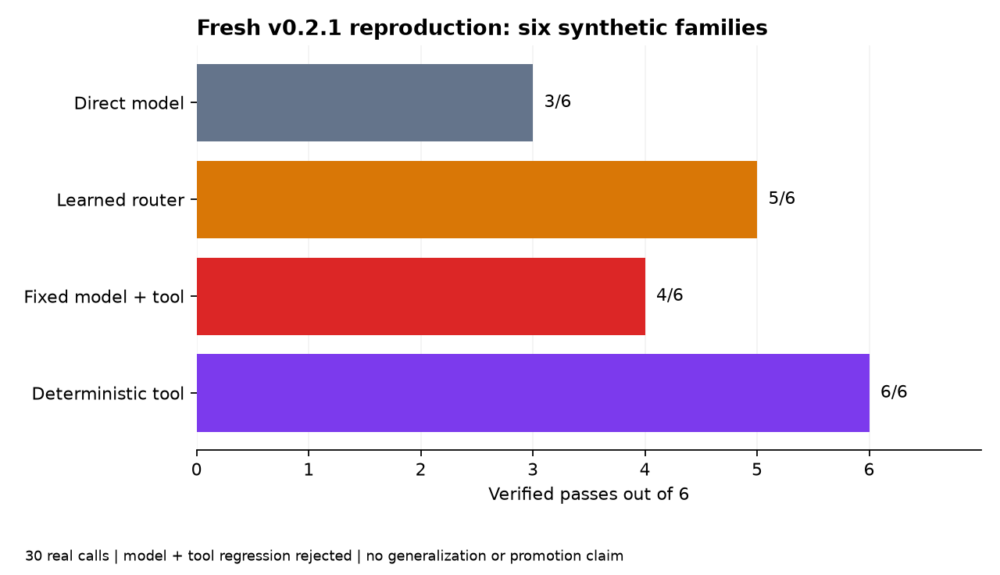

# E0: fresh reproduction of published v0.2.1

Date: 2026-11-21. Decision: **COMPLETED_WITH_STATUS_OBSERVABILITY_DEFECT**.
This mission used the original published v0.2.1 source and a fresh seed. It is
separate from both the older v0.2.0 measurements and the later v0.3 repair.
The model digest and source/config/evaluator hashes are in `v03-e0-decision.json`
and the immutable `../plans/v03-e0.json`. Ian explicitly approved its finite caps.

| Validation arm | Passes | Local calls | Generated tokens | Sum inference/tool latency |
| --- | ---: | ---: | ---: | ---: |
| Direct model | 3/6 | 6 | 264 | 3.109 s |
| Learned router | 5/6 | 6 | 170 | 2.219 s |
| Fixed model + tool | 4/6 | 6 | 156 | 2.188 s |
| Deterministic tool | 6/6 | 0 | 0 | Below timer resolution |

Development used 12 additional model calls. Total: **30 calls**, **1,008 generated
tokens**, **3,840 reserved tokens**, **23.125 active seconds**, **36 observations**,
approximately **0.45 MiB** local artifacts. Caps were 30/3840/600s/64MiB with one
inference at once and zero retries. Median model latency 0.313s; nearest-rank p95
1.203s. Peak VRAM was not sampled. Values are measured, except timer-resolution
and artifact-size rounding. Call and token caps are fully consumed; no new store
or inferred allowance may restart inference.

| Synthetic family | Direct | Learned | Fixed model + tool | Tool |
| --- | ---: | ---: | ---: | ---: |
| Math | 1/1 | 1/1 | 0/1 | 1/1 |
| Finite patch fixture | 0/1 | 1/1 | 1/1 | 1/1 |
| Tool routing | 0/1 | 1/1 | 1/1 | 1/1 |
| Coordination | 1/1 | 1/1 | 1/1 | 1/1 |
| Evidence / hallucination | 0/1 | 0/1 | 1/1 | 1/1 |
| Constant-rule adaptation | 1/1 | 1/1 | 0/1 | 1/1 |

Learned vs direct: two paired wins, zero losses, four ties. Learned vs strongest
tools: zero wins, one loss, five ties. Fixed model+tool vs the learned incumbent:
one win, two critical losses, three ties, so the controller rejected it and kept
the incumbent before evaluating tools. The final experimental incumbent is the
deterministic tool route; the production checkpoint remains empty.

There are **zero independently sourced new families**. These six finite synthetic
families were already known; only the execution and generated instances are
fresh. No family-aware inference interval, transfer, learning-speed trend,
calibration or retention claim is justified. E1 and E2 remain unexecuted.

STOP produced a durable pause with zero calls. Resume completed the same mission.
Fresh-process replay rechecked all evidence/decisions and spent no additional
calls. The top-level status reason still read `kill switch` after the campaign
finished; its own campaign reason correctly said the schedule completed. The
raw report and first automated receipt are preserved. The superseding gate
decision records this observation defect. The v0.3 finalizer repair passes a
synthetic STOP/resume regression; it has no fresh real-model evidence of its own.

Next test: keep deterministic tools as the reference, integrate the dev-only
candidate/evaluator boundary with zero-inference checks, inventory independent
authentic sources, and calibrate wrong-tool/known-good controls before requesting
a separately capped E1 diagnostic pilot. Do not retune these reused families or
claim the learned route beat the strongest baseline.
