# HIVE minimum executable architecture

This extends the existing pilot instead of replacing it. The initial task family is strict caption validation: a real local file, deterministic software, optional explicitly enrolled local-model transport, independent checking, durable evidence, and a bounded procedure experiment.

```mermaid
flowchart LR
  T[TaskSpec + input hash] --> E[Hard eligibility]
  E --> R[Versioned routing policy]
  R --> A[Enrolled adapter]
  A --> W[Isolated fixed worker]
  W --> V[Independent checker]
  V --> S[SQLite experience + immutable artifacts]
  S --> D[Development-only failure proposal]
  D --> F[Frozen baseline/candidate evaluation]
  F --> G[Evidence recomputation and separate gates]
  G -->|reject| S
  G -->|eligible + operator action| P[Persistent local policy]
  P --> R
  P --> B[Rollback to prior policy]
```

## Modules and decisions

| Module | Responsibility and reason |
|---|---|
| `runtime.py` | Task validation, admission, actual routing/dispatch, artifact persistence and active policy replay. One local call/control mutation at a time prevents uncontrolled contention. |
| `adapters.py`, `worker.py` | A small manifest/health/execute protocol; existing rules and ffprobe are wrapped rather than rewritten. Fixed worker, private temporary input, no shell interpolation, bounded calls and timeout cleanup. |
| `checker.py` | Separate SRT parser computes expected validity without importing the executor. Benchmark additionally compares with separately supplied frozen labels. |
| `evaluation.py` | Operator-owned dataset enrollment before execution; source groups/content must be disjoint. Known exposed inputs cannot be relabeled fresh. |
| `cycle.py` | Development controls, best-control selection, existing failure-driven `probe-guard` proposal, frozen candidate, interleaved evaluation and replay, release decision and rollback rehearsal. |
| `governor.py` | Recompute eligibility from stored run artifacts and pinned criteria; never accept a caller's success flags. Local activation is a separate operator action, persists, and affects the next task. |
| `audit.py` | Verify event chain, input/output hashes, replay routes, independently recompute verdicts and verify attribution. Rebuilding a hash chain around a forged verdict does not make it pass. |
| Existing `core.py` | Reused event store, decision formulas and tested memory partitions. Original ledger-only release helpers remain for compatibility; use the v2 governor for actual runtime state. |

The candidate changes only a selected pre-enrolled procedure. It cannot submit arbitrary Python, alter permissions, change the verifier, or supply its own acceptance thresholds. The proposer receives development failures only; it does not receive the full manifest or held-out labels. Dataset enrollment and the evaluator are outside that proposer interface. Baseline selection happens on development outcomes before held-out execution.

The default benchmark reuses the original 48 development / 24 evaluation inputs. Those evaluation inputs have already been exposed, so promotion's holdout-integrity gate fails even if an attractive score appears. New independently held datasets can be enrolled with a pinned manifest digest and explicit operator provenance reference. That reference is an assertion with provenance, not proof that an operator never read the files. Fresh data is not manufactured from a new random seed and called real-world evidence.

Promotion requires benefit, retention, safety, memory compatibility, budgets, output/status replay, holdout integrity and rollback evidence separately. The current candidate class does not alter memory. The loop can reject automatically; an eligible candidate still requires an explicit `governor.promote` call with its exact hash and approval reference. Repeated activation is rejected when the original parent is no longer active. The rollback gate independently audits an isolated test-only activation of the exact candidate, execution after restart, and restored baseline execution after another restart. There is no production, network publishing, model-weight update or model-loading command.

Evaluation overrides require an enrolled contract and exact frozen task membership. The audit checks active routes against the policy preceding them in the event stream. Capability manifests record the ffprobe binary digest/version; changes during evaluation or after activation invalidate the frozen release. Source hashes cover executable Python modules. New release records bind both code and capability identities.

## Model adapter scope

The Ollama adapter accepts only a literal loopback HTTP origin, disables proxies/redirects, checks residency and uses bounded structured output. It implements the documented [running-model discovery](https://docs.ollama.com/api/ps) and [chat endpoint](https://docs.ollama.com/api/chat). The local service has no resident model, so the actual model arm is unavailable. A loopback test server exercises the real subprocess/HTTP path; it is transport evidence, not model-quality evidence. A model response is checked by the same independent verifier as a software response.

An adapter can be registered without dispatcher edits. New adapters/policies are evaluated explicitly before activation. Existing production studio/model workloads are not changed. A model server may race with residency checking, and request timeout does not prove server-side inference cancellation; inference is therefore not a hard GPU/resource isolation guarantee.

## Evidence and limitations

SQLite is append-only with a verifiable hash chain. This is audit integrity for trusted local callers, not protection against the machine's owner. The same owner can edit databases, code or attestations. An authenticated remote operator service and OS-enforced sandbox are not implemented.

The fixed adapter worker receives only one input and trusted descriptor. Temporary-directory/process separation does not prevent malicious code from reading arbitrary filesystem paths; arbitrary candidate code is not admitted. Input/output size limits are bounded read/admission checks, not filesystem quotas. RAM measurements cover the worker process on Windows; hard RAM caps and full child/GPU attribution remain unproven. Custom in-process adapters must honor their timeout contract; only the built-in worker boundary enforces process termination.

The independent parser is a second implementation of the same rubric, not independently collected human truth. Benchmark labels catch disagreements on the frozen corpus. Future verifier calibration needs representative human-labelled cases. Compounding learning, learned routing, weight training, transfer to streaming/horror workflows, and real-model quality remain unproven.

## Alternatives preserved

- Existing rules/probe/combined/probe-guard arms and their rejected result remain available.
- The original NumPy learning and scheduling ZIP, all originals and prior research branches remain unchanged. A separate overlay adds the `RUNTIME2` research node and links; the supplied graph export stays byte-identical.
- Laya, Ruflo, AgentDB, model fine-tuning and multi-expert organizations remain possible adapters/experiments; they are not prerequisites for this measured vertical slice.
- A stronger code sandbox or orchestration service should be introduced when a measured workload requires untrusted code or concurrent GPU scheduling.

## Learning-acceleration extension

[LA-001](LEARNING_ACCELERATION.md) adds closed experiment contracts, conservative effect reconciliation, normalized invocation/outcome events and optional recipe search. Optuna is isolated behind a development-summary proposal API. It does not own the runtime, verifier, memory, deployment governor or task permissions. Recipe execution and all baseline tests remain available with the optimizer disabled. Search is separate from operational activation; current evidence cannot authorize a release.
