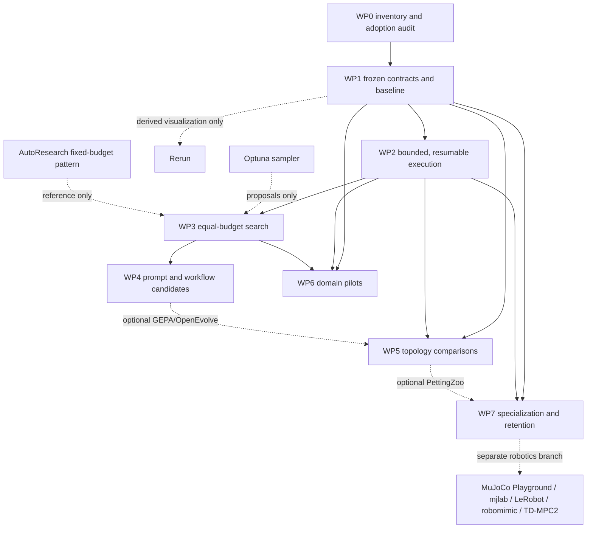

# Learning acceleration adoption audit

**Audit date:** 2026-11-21 UTC
**Scope:** WP0 repository suitability review for the 14 requested upstream projects; WP3 Optuna pilot recommendation. Upstream pins are captured in [`research_repo_pins.json`](research_repo_pins.json). This is research evidence, not an implementation or benchmark result.

## Decision

Keep the HIVE-owned runtime, evaluator, event store, and promotion authority as the system of record. WP0–WP2 must establish frozen task/evaluator contracts, bounded execution, recovery, and cost measurement first. Optuna 5.1.0 is the only near-term adapter candidate: it is a CPU-capable search library that can propose values to an existing objective without owning task execution or evaluation. The parent reports that the active Python has none of the reviewed packages installed, the RTX 5070 Ti is occupied, and no model is resident. This audit found no matching top-level project directories under `D:\Repos` or `D:\External Tools`.

Do not install or wire the remaining projects into the HIVE runtime. Keep the AutoResearch loop as a design pattern, Rerun as optional derived visualization, and the other systems deferred to the later work packages. “Ready for spike” means a small isolated integration is suitable after WP1/WP2 gates; it does not mean the package is installed, the pilot is runnable now, or that HIVE has demonstrated learning acceleration.

## Repository suitability

| Project (pinned source) | License; Python / OS / accelerator evidence | Setup and integration cost | HIVE fit and classification |
|---|---|---|---|
| [Optuna](https://github.com/optuna/optuna/tree/aee308aaee8ef65e32143158d1acdddaa85ff950) — v5.1.0 | MIT; Python ≥3.10; ordinary CPU objective is sufficient; no CUDA requirement. Core package has NumPy, SQLAlchemy, Alembic, tqdm, colorlog, PyYAML dependencies. [Install and TPE docs](https://optuna.readthedocs.io/en/stable/installation.html) | Low in a separate CPU venv; moderate HIVE adapter work to constrain search space, persist trials, and bind proposals/results to HIVE records. No model or GPU required. | **WP3, `ready_for_spike`** after WP1/WP2. Treat as a proposal sampler for allowlisted routing/recipe parameters. HIVE owns objective, executor, frozen split, metrics, budgets, and promotion. Compare static, heuristic, seeded random, and Optuna arms under equal trials and resource limits. |
| [karpathy/autoresearch](https://github.com/karpathy/autoresearch/tree/228791fb499afffb54b46200aca536f79142f117) — no release | GitHub API reports no license metadata; do not reuse source until licensing is clarified. Python ≥3.10+, `uv`, one NVIDIA GPU (README says tested on H100), downloaded data/tokenizer, and fixed five-minute training runs. [README](https://github.com/karpathy/autoresearch/blob/228791fb499afffb54b46200aca536f79142f117/README.md), [program contract](https://github.com/karpathy/autoresearch/blob/228791fb499afffb54b46200aca536f79142f117/program.md) | High for its native training problem; poor fit for occupied GPU and HIVE's CPU deterministic task loop. Avoid copying code because licensing is unclear and its edit/evaluate harness is specific to nanochat training. | **WP3, `reference_only`**: borrow the fixed-budget propose→run→score→keep/reject pattern only. Do not adopt its trainer or treat its upstream benchmark as HIVE evidence. |
| [OpenEvolve](https://github.com/algorithmicsuperintelligence/openevolve/tree/73448d715968b3578d8458b16295e827edd2b6bf) — v0.4.1 | Apache-2.0; Python ≥3.10; no GPU requirement stated; requires an LLM endpoint/key for normal evolutionary runs. Base install includes OpenAI client, PyYAML, NumPy, tqdm, Flask, and dacite. [Quick start](https://github.com/algorithmicsuperintelligence/openevolve/blob/73448d715968b3578d8458b16295e827edd2b6bf/README.md) | High: provider setup, iterative candidate generation, evaluator integration, and safe execution boundary. Candidate code must not access evaluator, holdout, permissions, or promotion rules. | **WP4/WP5, `deferred`**. Later compare diversity search against random/grid/rule candidates in an isolated, bounded candidate format. Preserve nondominated alternatives; never make it a core runtime dependency. |
| [GEPA](https://github.com/gepa-ai/gepa/tree/8b0ce6cd99a234f6b74daf37558a2ac0ce18f975) — v0.1.4 | MIT; released package requires Python ≥3.10 and <3.15; base core has no runtime dependencies, but practical optimization needs a callable model/evaluator or optional integration extras. No CUDA requirement for callable-model use. [README](https://github.com/gepa-ai/gepa/blob/8b0ce6cd99a234f6b74daf37558a2ac0ce18f975/README.md) | Moderate/high: prompt/instruction candidate plumbing, evaluation budget, evaluator secrecy, and held-out/retention controls. Active local model availability is absent per parent runtime inventory. | **WP4, `deferred`**. Scope to prompt/instruction text; compare against fixed and simple search baselines. It is not weight learning and must not control criteria. |
| [Microsoft Agent Lightning](https://github.com/microsoft/agent-lightning/tree/cbc56e41e0eab643aa71d195e92e5bba652fa683) — v1.0.3 | MIT; Python ≥3.12. The v1 quick start requires a one-machine A100 and the VERL/vLLM GPU stack; local runner is not supported on native Windows (use Linux/WSL). Package stack includes FastAPI, Uvicorn, Hydra, Pydantic, and Kubernetes client. [Quick start](https://github.com/microsoft/agent-lightning/blob/cbc56e41e0eab643aa71d195e92e5bba652fa683/docs/01-quick-start.md), [package metadata](https://github.com/microsoft/agent-lightning/blob/cbc56e41e0eab643aa71d195e92e5bba652fa683/pyproject.toml) | Very high: GPU trainer, vLLM/VERL, rollout orchestration, Linux environment, and training/evaluator design. Current GPU is occupied. | **WP7, `deferred`**. Revisit only after trustworthy task/reward lineage, retained-task evaluation, and an available isolated GPU lane. |
| [Avalanche](https://github.com/ContinualAI/avalanche/tree/b34abe5c93adb0cfd5a38aaf9e2bb22144a8c3aa) — v0.6.0 | MIT; PyTorch continual-learning library; installation guide describes native Python on multiple OSes but the exact current Python floor was not established from the consulted install page. CUDA is optional through the selected PyTorch build. The `[all]`/`[extra]` installs can constrain PyTorch below 2. [Install guide](https://github.com/ContinualAI/avalanche/blob/b34abe5c93adb0cfd5a38aaf9e2bb22144a8c3aa/docs/gitbook/getting-started/how-to-install.md) | High: PyTorch compatibility and task-stream/retention benchmark setup; avoid the all-extras install. | **WP7, `deferred`**. Use only for an actual continual parameter-learning/forgetting study, not HIVE's current procedure/router pilot. |
| [PettingZoo](https://github.com/Farama-Foundation/PettingZoo/tree/7221e4b15873a8b16555fda038a77a6ae595e88d) — 1.27.0 | MIT; Python ≥3.11,<3.15; official support is Linux and macOS, not Windows. Core API needs NumPy/Gymnasium; each environment family has separate optional dependencies. No GPU required for the core API. [Basic usage](https://github.com/Farama-Foundation/PettingZoo/blob/7221e4b15873a8b16555fda038a77a6ae595e88d/docs/content/basic_usage.md) | Low/moderate package install, but moderate experiment design and environment-specific setup. Current task family has no multi-agent game environment. | **WP5, `deferred`**. Use as a controlled adapter for cooperation/competition and topology hypotheses; do not infer software-agent transfer from game rewards. |
| [Rerun](https://github.com/rerun-io/rerun/tree/34815abfa3e54faf377d2e1386ede1550ed7ead3) — 0.43.2 | Apache-2.0; Python SDK package is `rerun-sdk` (module `rerun`). No GPU requirement for recording/viewing. The repository uses Pixi for source builds; Windows source builds require Visual Studio 2022, while package installation avoids that source-build path. [Python SDK](https://github.com/rerun-io/rerun/blob/34815abfa3e54faf377d2e1386ede1550ed7ead3/rerun_py/README.md), [build guide](https://github.com/rerun-io/rerun/blob/34815abfa3e54faf377d2e1386ede1550ed7ead3/BUILD.md) | Low/moderate as an optional viewer; meaningful event conversion and UI integration still cost work. It must consume exported traces and remain non-authoritative. | **WP1/WP2, `reference_only`**. Optional replay/visualization only. SQLite, JSONL, and content hashes remain authoritative. |
| [dora](https://github.com/dora-rs/dora/tree/668e59f2bbae38378f7e3d06226881ff37caabf6) — v1.1.0 | Apache-2.0; Rust CLI (`cargo install dora-cli`) plus Python API (`pip install dora-rs`, includes PyArrow). Official quick start does not establish a Windows support guarantee or require CUDA. [Python quick start](https://github.com/dora-rs/dora/blob/668e59f2bbae38378f7e3d06226881ff37caabf6/guide/src/getting-started/quickstart.md) | High: introduces Rust runtime/coordinator/dataflow lifecycle and a second event/message bus. Consider only if measurements show process coordination is a bottleneck. | **WP2, `deferred`**. Typed dataflow can reduce structural integration errors; it cannot establish truth or replace the HIVE event ledger. |
| [MuJoCo Playground](https://github.com/google-deepmind/mujoco_playground/tree/084e7957842792725d70866ee840d8fd79f17bbe) — v1.0.1 | Apache-2.0; docs provide CPU setup for macOS/Linux and GPU setup for CUDA 12/13. JAX-based simulation/training; no Windows support claim was established in the consulted setup docs. [Quick start](https://github.com/google-deepmind/mujoco_playground/blob/084e7957842792725d70866ee840d8fd79f17bbe/README.md), [environment docs](https://github.com/google-deepmind/mujoco_playground/blob/084e7957842792725d70866ee840d8fd79f17bbe/mujoco_playground/docs/index.rst) | High: simulator, JAX/CUDA environment, robotics tasks, and GPU contention. | **WP7, `deferred`**. Separate robotics laboratory after OS/GPU compatibility and a concrete embodied-learning hypothesis are approved. |
| [mjlab](https://github.com/mujocolab/mjlab/tree/11ffee9816e1d0644e538854bfb8dd8acb82ebba) — v1.6.1 | Apache-2.0; Python ≥3.11,<3.15. NVIDIA GPU required for training; macOS evaluation only. Dependencies include PyTorch ≥2.14, Warp, MuJoCo Warp, rendering/viewer packages, and RSL-RL. [README](https://github.com/mujocolab/mjlab/blob/11ffee9816e1d0644e538854bfb8dd8acb82ebba/README.md), [metadata](https://github.com/mujocolab/mjlab/blob/11ffee9816e1d0644e538854bfb8dd8acb82ebba/pyproject.toml) | Very high and GPU-specific. `uvx ... demo` is an upstream convenience launcher, not a pinned/reproducible HIVE setup. | **WP7, `deferred`**. Do not install while the sole GPU is occupied; revisit only for justified simulation-throughput experiments. |
| [LeRobot](https://github.com/huggingface/lerobot/tree/410c095eacc0011d998a73383eb94abed2715af0) — v0.7.0 | Apache-2.0; Python ≥3.12. Core is PyTorch-based; workflow extras add dataset/video, training, visualization, or robot-hardware dependencies. Current Linux default PyTorch CUDA wheels require NVIDIA driver ≥580.65; Windows virtualenv instructions exist, while WSL hardware use needs extra Linux device support. [Install guide](https://github.com/huggingface/lerobot/blob/410c095eacc0011d998a73383eb94abed2715af0/docs/source/installation.mdx) | Very high for robot workflows: select CUDA wheel, ffmpeg/TorchCodec, datasets, device drivers, robot-specific packages, and physical hardware. | **WP7, `deferred`**. Demonstration/data formats may be studied later, but no hardware or training dependency is justified now. |
| [robomimic](https://github.com/ARISE-Initiative/robomimic/tree/ae5799f0fae05c4559ee1f9645b0f77eb5251929) — v0.5.0 | MIT; Docker example uses Python 3.9, Miniconda, robosuite, and PyTorch; CPU/GPU container modes are documented. Current getting-started examples depend on robosuite v1.5.1 and datasets. [README](https://github.com/ARISE-Initiative/robomimic/blob/ae5799f0fae05c4559ee1f9645b0f77eb5251929/README.md), [getting started](https://github.com/ARISE-Initiative/robomimic/blob/ae5799f0fae05c4559ee1f9645b0f77eb5251929/docs/introduction/getting_started.md) | High: older Python stack, simulator, demonstration datasets, and PyTorch. | **WP7, `deferred`**. Later imitation-learning comparison if a robotics demonstration dataset and compatible isolated environment exist. |
| [TD-MPC2](https://github.com/nicklashansen/tdmpc2/tree/332f19e4aba4bffe2dc736f45ea7f7bdc585903a) — no release | MIT; Python version floor not explicit in the consulted README. PyTorch/CUDA RL: README specifies GPU, ≥12 GB RAM for single-task online RL, ≥128 GB RAM for multi-task offline data, ≥8 GB GPU for common single-task evaluation, and ≥24 GB GPU for 317M training. [README](https://github.com/nicklashansen/tdmpc2/blob/332f19e4aba4bffe2dc736f45ea7f7bdc585903a/README.md) | Very high: Conda/Docker, MuJoCo/DMControl and other domain setup, large datasets/checkpoints, and GPU. | **WP7, `deferred`**. Valuable robotics dynamics baseline, but not a direct software-agent routing or recipe-learning component. |

“Not established” above is deliberate: the audit does not infer Python or OS support from a successful install elsewhere. Exact queried GitHub head SHAs, latest release tags, release commit SHAs, and API metadata are captured in the companion JSON.

## WP0–WP7 adoption map

| Work package | Existing build intent | Adoption finding from this audit |
|---|---|---|
| WP0 — Map existing build | Inventory code, models, hardware, graphs, runtime, and tests. | Add this matrix and pin manifest; directory-name scan found no local top-level equivalents. The absent-package/GPU facts are parent-provided runtime inventory. No blind installs. |
| WP1 — Contracts and baseline | Freeze task, evaluator, metrics, permissions, budgets, and repeatable baseline. | Prerequisite. Bind every trial to evaluator/version, split and candidate lineage before allowing search. Rerun can visualize these traces but cannot be the source of truth. |
| WP2 — Bounded coordination | Typed events, isolated/resumable runs, watchdog and safe effect recovery. | Prerequisite. Keep HIVE-owned execution and event ledger. Dora is deferred unless measured coordination costs justify a separate dataflow runtime. |
| WP3 — Reuse configurations | Compare static, rule-based, random, and Optuna choices under equal budgets. | Only integration spike now eligible: optional Optuna TPE/random sampler behind a HIVE-owned interface. Fixed and heuristic baselines stay in the comparison. |
| WP4 — Consolidation/skill audit | Compare memory/skill candidates with held-out and retention checks. | GEPA (prompt/instruction candidates) and OpenEvolve (bounded workflow/code candidates) remain optional and deferred until evaluator isolation and candidate sandboxing are credible. |
| WP5 — Alternative organizations | Compare topologies and fault-tolerant coordination. | PettingZoo is a possible controlled environment; OpenEvolve may search versioned graph specs later. No game-to-software transfer claim without direct tasks. |
| WP6 — Three real pilots | Video workflow, streaming supervisor, horror-haunt game. | Keep domain-specific pilots on existing roadmap. Select only frozen, non-destructive candidates; shadow/canary and independent checks before routine use. None of the robotics packages is required. |
| WP7 — Learned specialization | Test adapters/weights, retention, and later embodied learning. | Agent Lightning and Avalanche are deferred until lineage/retention and GPU capacity exist. LeRobot, robomimic, MuJoCo Playground, mjlab, and TD-MPC2 form a separate later robotics branch. |

## WP3 Optuna pilot boundary

First complete WP1/WP2 and preserve an unchanged baseline. Then expose Optuna only to an allowlisted configuration space such as selected specialist, escalation threshold, retry cap, verification trigger, and concurrency mode. A HIVE-owned objective executes and scores each trial; Optuna receives only the approved scalar or multi-objective metrics and bounded feedback. Do not pass evaluator source, holdout labels, permission files, or incumbent state to a candidate generator.

Compare at the same declared trial count, per-trial wall/compute budgets, data split, and seed policy:

1. Static incumbent.
2. Existing hand-authored rules/heuristic.
3. Seeded random search.
4. Optuna search, using a pinned sampler and storage configuration.

Record every trial—including timeout, failure, abstention, and no-improvement results—with proposal, config, task IDs/split version, objective version, measured cost, and terminal status. Use sequential trials for the first CPU pilot; parallelism changes contention and can change TPE proposal order. Freeze the evaluator and candidate space before any held-out access. Select a winner on development data only, then run the frozen candidate once against a fresh, independently controlled holdout and a retention regression set. Promote only through the existing independent governor; report rejected/inconclusive outcomes equally. If Optuna does not beat or match the strongest baseline at equal resource cost, keep the incumbent.

This pilot tests search efficiency over recipes/thresholds. It does not demonstrate new model capability, autonomous code improvement, sample-efficiency gains, or compounding learning. The pinned upstream Optuna release is v5.1.0 at commit [`aee308a`](https://github.com/optuna/optuna/commit/aee308aaee8ef65e32143158d1acdddaa85ff950); upstream documents Python ≥3.10 and `TPESampler` as a search sampler, not as an evaluator or execution governor.

## Dependency sketch

## Evidence and limits

- GitHub REST API supplied default branches, head SHAs/dates, SPDX metadata, and latest release tags. Release tag refs were resolved to commit SHAs. The queries were made on 2026-11-21 UTC; see [`research_repo_pins.json`](research_repo_pins.json).
- Official project READMEs/install guides were used for Python, operating-system, accelerator, and launch assumptions. Claims marked “not established” are left unknown rather than inferred.
- The local directory-name scan covered only immediate directories under `D:\Repos` and `D:\External Tools`; it found no name matches. It did not inspect their contents.
- Package absence, RTX 5070 Ti occupancy, and no resident model are from the parent’s active-runtime inventory, not a fresh environment probe in this research-only pass.
- All classifications are proposals. No library was installed or run, no benchmark was executed, and no HIVE benefit has been measured.
