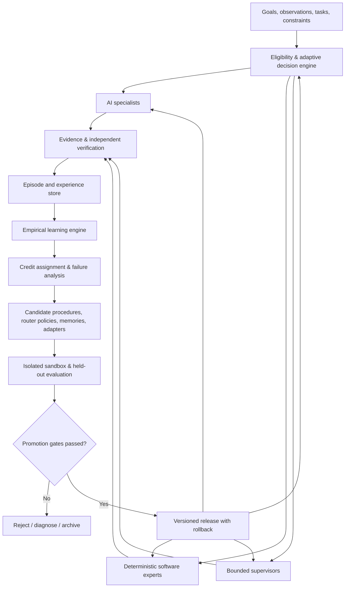

# HIVE — Architecture Gap Audit and Agent Change Plan

**Document type:** Implementation handoff / agent change specification  
**Prepared:** 2026-11-20  
**Target:** HIVE architecture, research vault, experiment system, learning infrastructure, and public HIVE documentation  
**Entry point:** https://mominc.online/hive/  
**Status:** Proposed changes — verify against the actual repository and local environment before editing.

---

## 0. Instructions to the Implementing Agent

You are tasked with turning HIVE from a primarily research- and architecture-driven project into a **measurable, incrementally self-improving modular AI system**. Preserve useful existing work; do not perform an indiscriminate rewrite.

**Your first actions:**

1. Inspect the actual source repository, project structure, running services, available models/tools, local documentation vault, test suite, and deployed HIVE website. **Do not assume public website pages reflect the full implementation.**
2. Map this document's requirements to real modules and files. Where paths are unknown, discover them rather than inventing them.
3. Identify what already exists, what is partially implemented, and what is missing. Produce a short `CURRENT_STATE.md` with evidence: file paths, tests, commands, and observed behavior.
4. Propose the smallest safe implementation sequence that creates an **end-to-end validated learning cycle**. Execute within granted permissions; for destructive or production-impacting changes, request approval.
5. Preserve existing research, links, alternative hypotheses, and experiment history. Prefer additive, reversible migrations with compatibility checks.
6. Record all decisions, changes, test commands, benchmark artifacts, failures, and blockers in an agent change log. Do not report a feature as implemented until exercised by a reproducible test.

**Critical constraints:**

- Do **not** claim that planned architecture is implemented, or that archived simulation results validate full-scale real-model operation.
- Do **not** autonomously deploy experimental neural weights, routing policies, changed permissions, or high-impact code changes into production.
- Do **not** train on hidden evaluation examples or allow the candidate's evaluator to rewrite success criteria.
- Do **not** optimize only for a single combined score. Enforce authorization, correctness, safety, and resource limits as independent gates.
- Do **not** delete research branches that disagree. Mark their evidence and status instead.
- Prioritize operating on the user's existing local software and hardware where verified available; avoid adding infrastructure merely for architectural elegance.

---

## 1. Executive Decision

### Problem

HIVE has a strong body of research on specialist systems, protected memories, adaptive routing, verification, organizational alternatives, and sleep-inspired consolidation. Its key deficiency is **the lack of a verified, integrated system that demonstrably improves future performance by learning from previous work**.

The site describes architecture and experiments, but documentation explicitly distinguishes plans from implementation. Historic small NumPy simulations and scheduling experiments are useful preliminary evidence, **not** substitutes for reproducible real-model benchmarks.

### Recommended change

Make an **Empirical Learning Engine** the central development priority. It should collect episodes, evaluate outcomes, assign credit, propose limited changes, test them against unchanged baselines, and promote changes only through controlled gates.

**Shift in development logic:**

- **Current emphasis:** Research → Architecture → Build → Learning
- **Proposed emphasis:** Measure → Build → Learn → Test → Adapt → Measure again

**First milestone:** A complete task → execution → independent evaluation → failure diagnosis → candidate improvement → held-out evaluation → promotion/rollback cycle, demonstrated on an actual local workflow.

---

## 2. What to Preserve

Do not replace the following simply because this plan modifies the priority order:

1. Modular, specialized AI and deterministic software components.
2. Independent verification and evidence-based conclusions.
3. Explicit separation of research, source code, execution, and model/adapter artifacts.
4. Multiple candidate organizational designs that can compete experimentally.
5. Segmented memory, provenance, replay, and regression awareness.
6. Human- or policy-controlled permissions, deployment, and high-consequence decisions.
7. The existing research graph and historical reasoning, including disagreements and failed experiments.
8. Reusable software adapters; a calculator, parser, database query, or media probe should be preferred over an LLM where it is more accurate and efficient.

---

## 3. Priority Gap Register

A **gap** below means no publicly demonstrated end-to-end mechanism or insufficiently specified behavior in the reviewed documentation. Verify the code before marking it absent.

| ID | Priority | Gap | Required agent change | Proof of completion |
|---|---|---|---|---|
| G01 | P0 | No proven end-to-end learning loop | Create a bounded episode-to-improvement pipeline | A failed example results in a candidate correction that improves held-out performance or is rejected with evidence |
| G02 | P0 | Governing formulas uncalibrated | Implement configurable, logged decision functions with measured inputs | Reproduce routing decisions from stored evidence and configuration |
| G03 | P0 | No unified real-model/tool benchmark record | Build a benchmark runner and capability registry | Results include task, configuration, accuracy, latency, resource use, and artifacts |
| G04 | P0 | Compounding learning not demonstrated | Benchmark learning efficiency across successive task distributions | Learning curves include uncertainty and compare against unchanged controls |
| G05 | P1 | Credit assignment not operationally validated | Compare components through ablations/counterfactual tests | Identified improvements persist when the purported contributor is used and disappear or diminish in a suitable control |
| G06 | P1 | Adaptive organization not learned from results | Begin fixed, then train a contextual router | Router beats a static policy on held-out workload without breaking constraints |
| G07 | P1 | Feedback-to-training pipeline not demonstrated | Create an event store and curated dataset builder | Provenance-aware validated examples are exportable and auditable |
| G08 | P1 | Research graph confused with runtime capability graph | Introduce a separate operational capability/dependency registry | Each operational component exposes executable contract, health, restrictions, and evidence |
| G09 | P1 | Hardware scheduling not empirically optimized | Track actual load, VRAM/RAM use, startup cost, latency, and queueing | Scheduler makes reproducible, budget-constrained decisions |
| G10 | P1 | Memory correction/expiry lacks integrated proof | Add provenance, invalidation, correction, isolated partitions, retrieval tests | Contradictory or stale memories are flagged, do not silently overwrite truth, and can be rolled back |
| G11 | P1 | Checker reliability not calibrated | Track verifier false acceptance, false rejection, and verification cost | Calibration curves and comparison against independent labels |
| G12 | P2 | Broad research may not resolve build decisions | Prioritize research by expected experimental impact | Research queue links hypothesis → deciding experiment → decision record |

### Explicit unknowns

- The public site's stated research-page counts and other counters are documentation metadata, not implementation KPIs.
- Historical references to approximately 360 NumPy learning runs and 1,440 scheduling simulations are archival claims; inspect original artifacts before relying on them.
- The local repository, hardware configuration, model readiness, and available tests have **not** been independently inspected by this handoff. Inventory before choosing components or committing to performance targets.

---

## 4. Target Architecture



### Architectural boundaries

- **Task/goal layer:** Defines inputs, success criteria, constraints, permissions, and budget.
- **Adaptive decision engine:** Selects authorized configurations; may use a deterministic policy before a learned one.
- **Specialist execution:** Invokes interchangeable models, adapters, tools, and monitors with observable contracts.
- **Independent verification:** Uses rule-based checks, independent models where justified, ground-truth comparisons, or human judgments. A checker must not be assumed accurate merely because it is a second model.
- **Experience store:** Captures complete evidence/provenance without mixing raw observations with approved reusable knowledge.
- **Learning engine:** Proposes updates to procedures first, then routing/memory, then model weights when supported by evidence.
- **Promotion governor:** Applies immutable approval and regression criteria; promotion is separate from proposal generation.

**Separation-of-duties rule:** An experimental agent cannot both modify its acceptance gates and approve deployment of its own changes.

---

## 5. Five Governing Deciders to Implement

Implement these as **separate, composable policies**. Record all inputs, assumptions, policy versions, scores, and rejection reasons. Avoid treating their initial mathematical forms as proven or universally optimal.

### D1 — Eligibility (hard gate)

Construct the feasible action set:

\[
F(x) = \{a : \text{authorized}(a,x) \land \text{compatible}(a,x) \land \text{withinBudget}(a,x) \land \text{safe}(a,x)\}
\]

This is **not** a weighted preference: an option violating a hard constraint must be ineligible regardless of estimated quality.

### D2 — Task-conditioned routing

\[
a^* = \arg\max_{a\in F(x)} [\hat p(a\mid x)V(x) - \lambda_C C(a,x) - \lambda_T T(a,x) - \lambda_R R(a,x)]
\]

Variables:

- `x`: task context and constraints.
- `a`: configuration (models + tools + workflow + checker depth).
- `p_hat`: calibrated estimate of verified task success, conditional on context.
- `V`: measured or defined value of success.
- `C`: projected compute/resource cost.
- `T`: projected latency.
- `R`: measurable residual risk **after mandatory safeguards**.
- `lambda_*`: task-context-specific trade-offs; determine through experiments, not arbitrary permanent constants.

Initial policy: use constrained, transparent heuristics; record counterfactual alternatives. Train a contextual selector only after enough quality-controlled examples exist.

### D3 — Verification value

Request another check only when its **expected improvement in decision quality** exceeds its additional cost, subject to compulsory checks.

\[
\operatorname{EVI}(v\mid x) = \mathbb E[U\mid\text{result of }v,x] - U(\text{current decision}\mid x) - C(v)
\]

Keep mandatory verification regardless of calculated EVI. Compare whether extra checks improve outcomes or simply add latency/false alarms.

### D4 — Learning / experiment priority

\[
\operatorname{EV}(e) = \frac{P(\text{valid improvement}\mid e)\cdot \mathbb E[\Delta Q_{\text{future}}\mid e] - \text{cost}(e) - \text{risk}(e)}{\text{scarce resource usage}(e)}
\]

Treat this as a **candidate ranking heuristic**, not an objectively known quantity. Estimate uncertainty and prioritize experiments that could change an upcoming decision. Retain low-confidence competing hypotheses for testing.

### D5 — Promotion / release gate

A candidate can advance only if all required conditions pass:

- Held-out quality improves enough to matter **or** achieves an independently specified cost reduction without meaningful quality loss.
- No unacceptable regression on safety, prior capabilities, memory integrity, or required tasks.
- Resource and latency budgets remain within limits.
- Evidence and artifacts are reproducible, including versions and seeds where possible.
- The approving policy/human has authority to promote this class of change.
- A rollback path is available and tested.

Prefer confidence intervals, repeated trials, and practical effect sizes to a single pass/fail score. Track variance across tasks and seeds.

### Learning-speed indicator

For a predefined fixed performance threshold:

\[
G_{\text{learn}} = 1 - \frac{N_{\text{HIVE}}}{N_{\text{baseline}}}
\]

`N` is the number of examples or trials needed to reach that threshold. A positive value indicates improved **sample efficiency**, *not* necessarily superior final capability. Separately measure total compute, wall time, generalization, retention, and catastrophic forgetting.

---

## 6. Data and Interface Requirements

Do not introduce a major database solely because a graph seems useful. Use the simplest viable durable implementation; make the schema portable.

### Required records

| Record | Required fields |
|---|---|
| `TaskSpec` | `task_id`, `task_type`, `input_ref`, `success_criteria_version`, `permissions`, `resource_budget`, `split_id`, `created_at` |
| `Capability` | `capability_id`, `kind`, `version`, `endpoint/adapter`, `supported_tasks`, `constraints`, `health`, `provenance` |
| `Config` | `config_id`, `component_versions`, `routing_policy_version`, `tool_graph`, `checker_policy_version`, `limits` |
| `Episode` | `episode_id`, `task_id`, `config_id`, `input_hash`, `trace_refs`, `output_refs`, `timings`, `resources`, `status`, `errors` |
| `Verification` | `episode_id`, `checker_id`, `checker_version`, `criteria_version`, `result`, `confidence_if_calibrated`, `evidence_refs`, `label_source` |
| `FailurePattern` | `pattern_id`, `episode_refs`, `hypothesis`, `severity`, `provenance`, `status` |
| `ChangeCandidate` | `candidate_id`, `parent_version`, `change_type`, `diff_or_artifact_ref`, `hypothesis`, `training_data_refs`, `scope` |
| `Experiment` | `experiment_id`, `candidate_id`, `control_config_id`, `task_split_versions`, `metrics`, `seed`, `result_artifacts`, `decision` |
| `Release` | `release_id`, `candidate_id`, `approval_ref`, `gate_results`, `deployed_version`, `rollback_ref`, `timestamp` |
| `MemoryItem` | `memory_id`, `partition`, `content_ref`, `source_refs`, `confidence`, `validation_status`, `created_at`, `expires_at`, `supersedes`, `access_policy` |

### Implementation essentials

- Every task execution produces an append-only, inspectable episode/event trace; sensitive payloads require appropriate redaction or protected storage.
- Keep `raw_observations`, `inferred_claims`, `validated_facts`, and `deployable_procedures` separate.
- Prevent train/test contamination using versioned splits, data lineage, and immutable holdouts.
- Version policy definitions and rubric definitions separately from specialist weights and procedures.
- Store component compatibility, resource requirements, dependencies, and health in the operational capability registry.
- Maintain cross-links to the existing research graph, but do not make research pages executable authorities.
- Add clean, replaceable adapters so services can be swapped without rewriting the controller.

---

## 7. Change the Build Order

### Phase 0 — Reconnaissance and baseline (required)

**Tasks:**

1. Inventory actual repository/files, model availability, services, tests, runtime endpoints, GPU/CPU/RAM/VRAM, and current vault structure.
2. Locate existing experiment artifacts; identify which can actually be rerun.
3. Map existing functionality against G01–G12 and classify each `implemented / partial / planned / unsupported`.
4. Select a first target workflow with deterministic checks and non-destructive outputs.
5. Run a fixed baseline and save raw outcomes and reproducible commands.

**Deliverables:** `CURRENT_STATE.md`, `CAPABILITY_INVENTORY.md`, `BASELINE_RESULTS.md`, and machine-readable run artifacts.

**Exit gate:** At least one real workflow, one runnable baseline, and documented independent success criteria.

### Phase 1 — Minimum empirical organism (P0)

**Tasks:**

1. Implement task specs, capability registration, execution traces, resource telemetry, and independent checkers.
2. Create a simple constrained router with explicit tool/model compatibility and budget gates.
3. Add an event store with provenance and repeatable test fixtures.
4. Implement one complete deterministic/LLM-assisted workflow with graceful timeouts and failure recording.
5. Add a replayable benchmark runner with control configurations.

**Exit gate:** Run the same task set across at least three configurations; produce comparable quality, cost, latency, and failure metrics without hand-entered results.

### Phase 2 — First verified learning cycle (P0)

**Tasks:**

1. Find a repeated failure in the task outcomes.
2. Generate a **bounded procedure-level change** (for example, a tool invocation rule, validated template, recovery path, or checker addition).
3. Evaluate the candidate on development tasks, then frozen held-out tasks.
4. Compare against the unchanged control and detect regressions.
5. Pass through explicit promotion approval and versioning; verify rollback.
6. Measure whether similar future tasks require fewer corrections/trials.

**Exit gate:** The complete cycle is automated except for any defined approval boundary, and an accepted *or rejected* candidate has fully inspectable evidence. Accepted candidates must show meaningful held-out benefit. Rejection is a valid scientific outcome but not evidence of learning improvement.

### Phase 3 — Learn organizational choices (P1)

**Tasks:**

1. Evaluate static routing versus data-conditioned routing under identical resource limits.
2. Compare one specialist, multiple independent specialists, and structured specialist/tool groups.
3. Run ablations: remove one expert/checker/tool at a time and measure actual contribution.
4. Add optional contextual bandit/learned router with exploration bounds and off-policy evaluation where appropriate.
5. Train and test specialist-selection policies on genuinely different task conditions; guard against overfitting.

**Exit gate:** Learned organization yields reproducible held-out improvements over the best simple baseline, not merely over a deliberately weak comparator.

### Phase 4 — Specialist and memory learning (P1/P2)

**Tasks:**

1. Compare retrieval, reusable procedures, and adapter fine-tuning before modifying core model weights.
2. Test isolated training, shared adapters, replay, distillation, pruning, and checkpoint swapping where technically feasible.
3. Measure interference, forgetting, startup cost, and deployment overhead.
4. Introduce sleep-inspired consolidation only as a testable job type (deduplication, memory replay, model update evaluation), not a biological metaphor without a mechanism.
5. Keep all model updates inside immutable checkpoints with separated staging and production.

**Exit gate:** A justified learning method improves capability or efficiency while passing retention, provenance, privacy, and rollback tests.

---

## 8. First Experiment: Video Production Workflow

This is the **recommended initial experiment**, not a claim that all required software is currently working. Validate local readiness first.

### Candidate tasks

- Inspect media and extract reliable metadata.
- Validate captions/subtitle timing or formatting against reference checks.
- Propose edit segments and produce non-destructive cut lists/EDLs.
- Produce draft title/description options under defined constraints.
- Validate output formats and run a **dry-run** publishing queue (no autonomous posting).

### Pilot design

- Development set: **40–60** representative tasks.
- Frozen held-out set: **20–30** representative tasks.
- Initial configurations: **3** (deterministic tools alone; one model + the same tools; specialist-assisted combination).
- First learner update: **one bounded reusable procedure**.
- Include easy, difficult, and adversarial/edge-case tasks; stratify the held-out split by source and task type.
- Treat proposed sample sizes as a *pilot starting point*, not a statistically validated power calculation.

### Scorecard

Report at least:

1. Verified success and error categories by task type.
2. Quality of independent checker against ground truth or human reference labels.
3. End-to-end latency and startup/load latency.
4. VRAM/RAM/CPU utilization and resource-time cost.
5. Model/tool calls, retries, and human interventions.
6. Retention on previously solved tasks.
7. Improvement on frozen held-out tasks after the correction.
8. Confidence intervals or uncertainty estimates where justified.
9. Transfer performance on a related but unseen task family when feasible.

**Comparison rule:** Keep task definitions, checker criteria, and budgets consistent across configurations; record where deterministic-only approaches are inapplicable rather than penalizing them unfairly.

**Follow-on evaluation:** After the pilot demonstrates a repeatable learning loop, test transfer to the live streaming supervisor and horror game workflows. Do not prematurely optimize all three at once.

---

## 9. Website / Vault Changes

**Goal:** Make the public HIVE website distinguish **research**, **specification**, **implementation**, and **experimental evidence** at a glance.

### Add or expose the following views

| View | Purpose | Minimum content |
|---|---|---|
| `Implementation Status` | Show what runs today | Components, readiness, links to tests/artifacts, last verified date |
| `Experiment Registry` | Make studies reproducible | Hypothesis, controls, task splits, metric definitions, results, artifacts, status |
| `Capability Registry` | Describe executable components | Models, software adapters, supported tasks, resource profiles, health, versions |
| `Learning Progress` | Show whether HIVE compounds | Baselines vs updated variants, sample efficiency, quality, cost, retention, uncertainty |
| `Decision Ledger` | Preserve competing designs and why choices were made | Alternatives, evidence, decision, reviewer, confidence, reevaluation trigger |
| `Known Gaps` | Keep important unknowns visible | Gap owner, experiment needed, status, dependencies, evidence |
| `Change / Release History` | Make improvement traceable | Candidate, tested diff, gates, approvals, release, rollback |

### Documentation conventions

- Add a status marker to research statements: `HYPOTHESIS`, `SPECIFIED`, `IMPLEMENTED`, `MEASURED`, `REPLICATED`, or `REJECTED` (a research claim may have multiple dimensions; keep definitions precise).
- Distinguish archival simulations from live-model benchmarks.
- Hyperlink hypothesis → proposed mechanism → code/tests → runs → results → decision.
- Preserve existing pages and outgoing links; avoid replacing long-form research with a dashboard.
- Do not publish credentials, private user content, local endpoints, proprietary files, or raw sensitive traces.
- Clearly label stale results and latest verified dates.

### Relevant public pages to cross-reference

- [HIVE home](https://mominc.online/hive/)
- [Framework](https://mominc.online/hive/notes/FRAMEWORK/)
- [Roadmap](https://mominc.online/hive/notes/ROADMAP/)
- [Adaptive Research](https://mominc.online/hive/notes/ADAPTIVE/)
- [History / previous experiments](https://mominc.online/hive/notes/HISTORY/)
- [Runtime contracts](https://mominc.online/hive/notes/B04/)
- [Benchmark plan](https://mominc.online/hive/notes/B06/)

Do not infer filesystem paths from URLs. Locate the actual source files during Phase 0.

---

## 10. Tests and Acceptance Criteria

### Tests to implement

- **Routing eligibility:** Unauthorized, incompatible, unavailable, or over-budget actions must never be selected.
- **Tool failure:** Missing service, malformed output, timeout, and resource exhaustion trigger bounded recovery or explicit failure—not infinite retry loops.
- **Trace completeness:** Each run is attributable to exact task and config versions, with verifiable output references.
- **Reproducibility:** Same frozen task set and config can be rerun; nondeterminism and seed variation are explicitly represented.
- **Independent evaluation:** The component being improved cannot control hidden test outcomes or modify frozen acceptance rubrics.
- **Contamination prevention:** Training examples and test cases are versioned and separated; leakage checks are part of evaluation.
- **Regression:** Prior tasks, tool compatibility, permissions, and budget adherence are evaluated before promotion.
- **Rollback:** Previous known-good configuration can be restored after a simulated bad release.
- **Memory safety:** Corrections/supersession are logged; contradictory claims are not silently merged; expired entries are not treated as current truth.
- **Scalability:** Track concurrent requests and contention empirically before scaling from a handful of components to hundreds.

### Minimum Definition of Done for first release

- [ ] Real local capability inventory checked and documented.
- [ ] At least one non-destructive task family executes end-to-end.
- [ ] Three baseline configurations can be benchmarked, or exclusions are technically justified.
- [ ] Structured episode, verifier, candidate, experiment, and release records exist.
- [ ] A candidate improvement can be generated from observed failure evidence.
- [ ] Held-out comparison and regression gates run without changing scoring rules.
- [ ] Candidate can be accepted or rejected with inspectable evidence.
- [ ] Versioning and rollback are proven in a test.
- [ ] At least one documented improvement in held-out performance exists before any **compounding learning achieved** claim is made.
- [ ] Public documentation accurately separates plans, partial builds, and demonstrated operation.

---

## 11. What **Not** to Build First

Unless specific experiments justify them, defer:

- Hundreds or thousands of active agents/models.
- A sophisticated learned master controller trained before quality data exists.
- A new graph database or bespoke inter-agent language as a prerequisite for baseline experiments.
- Unbounded autonomous weight rewrites or production hot-swapping.
- Infrastructure that cannot be tied to a measurable failure or bottleneck.
- Full real-time streaming/game automation before success on a reproducible non-destructive workload.

Preserve these as research hypotheses and alternatives; do not delete or dismiss them without testing.

---

## 12. Handoff Output Expected from the Implementing Agent

Provide these in the repository or designated HIVE workspace, adapting names to existing conventions:

```text
CURRENT_STATE.md               # Grounded audit of repository and services
CAPABILITY_INVENTORY.md         # Real model/tool availability and readiness
GAP_IMPLEMENTATION_MAP.md       # G01-G12 mapped to files, owners, and statuses
ARCHITECTURE_DECISIONS.md       # Choices and trade-offs, including rejected options
EXPERIMENT_REGISTRY.*           # Machine-readable experiment manifests/results
BASELINE_RESULTS.md             # First real benchmark with evidence links
LEARNING_LOOP_REPORT.md         # First candidate, test, decision, and rollback proof
CHANGELOG.md                    # Modified files and test commands
```

For every delivered change, report:

- **What changed** (specific file paths and behavior).
- **What was already implemented** and therefore left intact.
- **What was measured** (metrics and raw artifacts).
- **What failed or remains unknown** (do not fabricate results).
- **Which gates passed** and any blocked releases.
- **Next smallest experiment** that will reduce uncertainty.

### Final instruction

**Optimize for evidence of compounding learning, not architectural complexity.** The first proof of progress is that HIVE can use experience to improve its future work in a measured, reproducible, resource-aware way—without losing prior capabilities or silently promoting bad changes.
