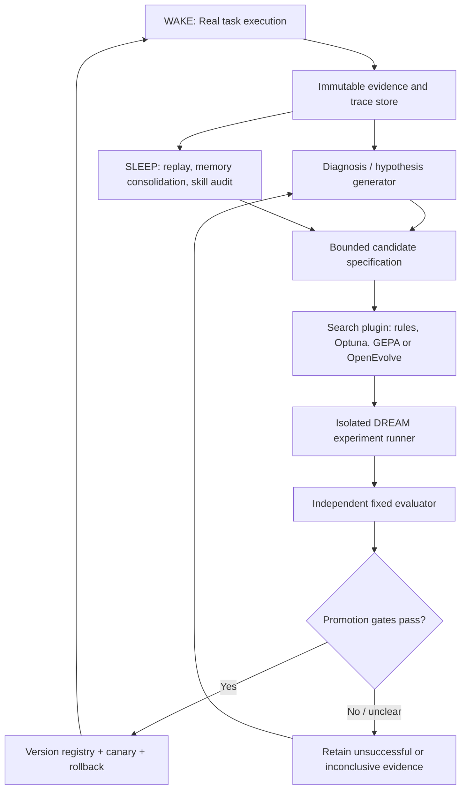

# HIVE — Build Path Update: Accelerating Machine and Robotic Learning

> **Instruction to the implementation agent:** Treat this as a **delta/addendum** to the existing HIVE build plan, **not** a rewrite, replacement runtime, or instruction to install every repository. Preserve existing code, decisions, research links, and the WP0–WP7 work-package sequence. First inspect the real repository and local runtime. All candidate improvements must pass independent evaluation before promotion.

## 1. Decision summary

**New finding:** Existing open-source research offers reusable components for automated experimentation, parameter search, quality-diversity evolution, agent reinforcement learning, continual-learning evaluation, multi-agent environments, and robotics simulation. HIVE can gain research speed by adapting these mechanisms **around its current core**.

**Recommended order**

1. **Immediate:** Build the independent benchmark/evidence layer and an AutoResearch-*style* bounded experiment cycle. Implement lightweight Optuna search after the baseline works. These accelerate the organizational-learning loop without requiring weight changes.
2. **Next:** Add OpenEvolve as an **optional candidate generator** for workflow/algorithm candidates, and GEPA for prompt/instruction alternatives. Compare against simpler random/grid/rule-based alternatives.
3. **After reliable demonstrations:** Explore Agent Lightning for a learnable small controller. Use Avalanche only when actual continual parameter learning is being tested.
4. **Separate research branch:** PettingZoo for controlled multi-agent organization tests; MuJoCo Playground or mjlab for embodied/robotics experiments after the GPU/OS stack is checked. Rerun is optional visualization/replay instrumentation, not the source of truth.

**Do not change:**

- Four distinct graphs: **research, code, execution, neural** (cross-link using stable IDs; don't conflate them).
- Four message channels: **Control, Task, Evidence, Teaching**, with scoped authority and provenance.
- Execution governor / learning governor / **independent** promotion authority.
- Replaceable specialist interfaces, runtime-managed state, recovery, versioned recipes, rollback, and competing organizational designs.
- Existing target of eventually scaling toward many specialist capabilities, **without** making 100 live agents, continual parameter changes, private languages, recursive communities, or biological analogies prerequisites.
- WAKE → SLEEP → DREAM → VALIDATE as an explanatory lifecycle; production service and experimental consolidation can be separate concurrent processes.

## 2. Direct edits to the established WP0–WP7 build sequence

| Work package | Keep the original deliverable | New insertion | Exit gate |
|---|---|---|---|
| **WP0 — Map existing build** | Inventory source, models, hardware, graph/vault, runtime readiness | Create a **dependency and suitability audit** for Optuna, AutoResearch concept, OpenEvolve, GEPA, Agent Lightning, Avalanche, PettingZoo, robotic sims; classify *reference*, *adapter candidate*, *deferred*, or *rejected* | Exact versions/commits, OS/CUDA assumptions, licenses, readiness, integration costs recorded; no blind installations |
| **WP1 — Contracts and baseline** | Registry, task records, four channels, one-model-with-tools baseline, trace/logging | Add `ExperimentSpec`, `TrialResult`, `MetricDefinition`, `PromotionDecision`, `DatasetSplit`, `ComputeBudget`, `CandidateLineage` schemas. Freeze an evaluator as read-only in experiment sandboxes | A fixed baseline can be rerun with same dataset/seed/config; all attempts have provenance and measured cost |
| **WP2 — Bounded coordination** | Small specialist group, typed translators, memory scopes, watchdog/recovery | Emit normalized worker events, model/tool usage, timeout/abstention signals, effect reconciliation; make trial execution resumable and isolated | Failed/stalled worker does not alter evaluator or incumbent; bounded exit/repair and repeatable runs |
| **WP3 — Reuse configurations** | Versioned workflow recipes, applicability checks | **First optimizer:** Optuna search over discrete choices and continuous thresholds. Add a simple *AutoResearch-style* fixed-budget propose→run→score→keep/reject loop. Compare to random search | Equal-budget tested recipes outperform or match static baseline with traceable measurements; otherwise keep baseline |
| **WP4 — Consolidation/skill audit** | Memory/skill candidates, held-out comparisons, rollback | GEPA for instruction/prompt alternatives (optional); OpenEvolve for bounded recipe/code candidate diversity (optional). Validate replay, skill transfer, forgetting, contamination | Skill/no-skill, memory/no-memory, and optimized/unoptimized ablations, independent held-out checks, rollback |
| **WP5 — Alternative organizations** | Compare central, hierarchical, peer, dynamic groups + fault injection | OpenEvolve optional diversity search over **versioned graph specifications**; PettingZoo optional controlled multi-agent test adapter. Preserve multiple nondominated candidates | Equal-opportunity topology results on quality, p95 latency, cost, coordination overhead, robustness and disagreement |
| **WP6 — Three real pilots** | Video production/posting; live-call/supervisor streaming; horror-haunt game | Run selected frozen candidates in shadow/canary mode before normal use; compare task-specific improvements, interaction delay and resource contention | Each pilot produces valid outputs; independently verified benefit or documented failure; no uncontrolled real-world side effects |
| **WP7 — Learned specialization** | Small specialist/adapters/weight update experiments | Agent Lightning **candidate** for controller RL; Avalanche **candidate** for forgetting/retention; LeRobot/Robomimic demonstrations and MuJoCo Playground/mjlab **later**, if embodied experiment is justified | Training-data lineage; held-out improvement; old-task retention; resource cost; adapter/backbone compatibility; rollback |

**Implementation boundary:** WP0–WP2 remain the **first executable slice**. Do not let optional search libraries become dependencies of the main runtime. WP3 is the first place to test actual learning acceleration.

## 3. Integrations: research candidates, not core dependencies

### P0 — Inspect and adapt soon

| Repository | Role in HIVE | Restriction / caveat |
|---|---|---|
| [Optuna](https://github.com/optuna/optuna) | Reproducible search over routing thresholds, retry policies, worker selection, concurrency, verification intensity, budgets | Optimize only declared variables; keep evaluation and held-out test split immutable |
| [AutoResearch](https://github.com/karpathy/autoresearch) | **Pattern reference** for bounded agent-authored edits → fixed-budget experiment → objective keep/reject | Upstream primarily runs a particular nanochat GPU training experiment; **do not copy it wholesale** as the HIVE orchestrator. Adapt the pattern first |
| [Rerun](https://github.com/rerun-io/rerun) | Optional visualization/replay of time-varying state and multimodal events | SQLite/JSONL/artifact hashes remain authoritative; visualization is derived |

### P1 — Compare after trustworthy trial execution

| Repository | Role in HIVE | Restriction / caveat |
|---|---|---|
| [OpenEvolve](https://github.com/algorithmicsuperintelligence/openevolve) | Quality-diversity candidate search for **explicitly bounded** recipes, algorithms, topologies; retain alternatives | Sandbox code execution; don't let candidates rewrite evaluators, test secrets, permissions, or promotion rules |
| [GEPA](https://github.com/gepa-ai/gepa) | Optimize prompts, workflow instructions, or agent-skill text | Compare against fixed instruction baseline on unseen tasks; do not confuse prompt optimization with weight learning |
| [PettingZoo](https://github.com/Farama-Foundation/PettingZoo) | Standardized multi-agent scenarios and controlled cooperation/competition benchmarks | Game-environment results aren't automatically transferable to HIVE's software agent tasks |

### P2 — Only after the requisite evidence/data exist

| Repository | Role in HIVE | Restriction / caveat |
|---|---|---|
| [Agent Lightning](https://github.com/microsoft/agent-lightning) | Candidate RL trainer for HIVE's bounded routing/coordination controller using execution feedback | Do not deploy until reward definition, trace attribution, offline evaluation, safe action space and verified examples are sufficient; check current v1 API |
| [Avalanche](https://github.com/ContinualAI/avalanche) | Continual-learning evaluation and retention experiments | Relevant when training actual model parameters; does **not** prevent forgetting just by being installed |
| [LeRobot](https://github.com/huggingface/lerobot) | Robotics demonstrations, datasets and imitation-style policy experiments | Embodied-data formats are informative but not a drop-in HIVE agent-trace dataset |
| [Robomimic](https://github.com/ARISE-Initiative/robomimic) | Demonstration-learning reference for robotics | Test demonstration quality/coverage before transferring its ideas to software workflows |
| [MuJoCo Playground](https://github.com/google-deepmind/mujoco_playground) | Parallel embodied learning environments | Verify currently supported OS, Python, CUDA, GPU and version first; robotics is **not** required for WP0–WP4 |
| [mjlab](https://github.com/mujocolab/mjlab) | Modular GPU-accelerated robotic RL experiments | NVIDIA GPU training stack required; separate environment and driver compatibility assessment |
| [dora](https://github.com/dora-rs/dora) | Optional typed distributed-dataflow comparison for inter-module transport | Evaluate only if existing local transport measurably bottlenecks; not a reason to replace HIVE contracts |

Do not treat vendor/readme performance numbers as evidence of HIVE improvements. Reproduce benchmarks on HIVE's machine and workloads. Record software versions and exact commits before adopting APIs.

## 4. Proposed acceleration loop (insertion behind existing learning service)



**Ownership rule:** Candidate generators may write candidate code/configuration, **never** benchmark answers, evaluator source, split assignments, policy/permission boundaries, deployment secrets, or incumbent versions. The independent promotion layer owns acceptance and rollback. HIVE's deterministic runtime always remains operable with optimizer plugins disabled.

## 5. Initial machine-readable contracts (proposals; adapt to existing schemas)

```yaml
experiment_spec:
  experiment_id: EXP-0001
  hypothesis: "Task-dependent routing saves tool/model cost without reducing verified quality"
  baseline_recipe_id: BASELINE-SINGLE-MODEL-V1
  candidate_kind: routing_config # other kinds: recipe, topology, instruction, memory, adapter, code
  candidate_source: optuna # or manual/rules/random/gepa/openevolve
  permitted_edit_paths: ["experiments/candidates/EXP-0001/**"]
  forbidden_edit_paths: ["evaluation/**", "contracts/**", "manifests/promoted/**"]
  dataset_manifest_id: DS-V1
  train_split: train
  tuning_split: dev
  final_split: holdout
  budget: {wall_seconds: 600, token_cap: 200000, max_tool_calls: 250, max_concurrent_gpu_jobs: 1}
  seeds: [11, 29, 47]
  required_checks: [artifact_validity, task_success, permissions, regression, forgetting, contamination]
  metrics: [quality, latency_p50, latency_p95, gpu_seconds, token_cost, recovery_rate]
  target_environment: simulated_tools
  promotion_mode: manual_approval

trial_result:
  experiment_id: EXP-0001
  trial_id: TRIAL-0001
  candidate_hash: sha256:REPLACE_ME
  code_commit: GIT_SHA
  exact_model_versions: []
  exact_tool_versions: []
  dataset_version: DS-V1
  seed: 11
  inputs_hash: sha256:REPLACE_ME
  output_artifacts: []
  verification_artifacts: []
  resource_log_ref: run://...
  results: {quality: null, latency_p95: null, gpu_seconds: null, token_cost: null}
  gate_results: []
  decision: inconclusive # promote/reject/inconclusive
  rollback_target: BASELINE-SINGLE-MODEL-V1
```

Use existing project IDs/types if already defined. `sha256:REPLACE_ME` and URI strings above are **illustrative placeholders**, not real artifact hashes. Costs should include inference, training, memory/translation, orchestration, verification, and idle-loaded models when relevant.

## 6. How we will measure actual acceleration

**Do not use a single universal score as the only selector.** Use hard safety/quality constraints and task-sensitive multiobjective/Pareto selection. For a fixed benchmark suite and equivalent budgets:

| Quantity | Definition | Why it matters |
|---|---|---|
| **Time-to-threshold** | Wall-clock time until a *held-out* quality threshold is achieved | Primary compounding-learning speed metric |
| **Verified gain per compute** | Change in verified task-quality measure divided by incremental compute cost | Separates research efficiency from raw throughput |
| **Sample efficiency** | Independent informative trials/examples needed to reach the threshold | Tests whether experience reuse actually accelerates learning |
| **Deployment efficiency** | Quality, p50/p95 latency, cost, VRAM/RAM and recovery under matched serving conditions | Prevents training gains from hiding runtime bloat |
| **Retention** | Change on previously mastered tasks after a learning update | Detects catastrophic forgetting and interference |
| **Generalization/transfer** | Gain on unseen task families and changed schemas | Distinguishes reusable understanding from benchmark overfitting |
| **Coordination overhead** | Messages, translations, retries, waits, redundant tokens, synchronizations | Tests value of extra specialists/parallelism |
| **Experiment yield** | Confirmed promoted improvements / total valid experiments, with uncertainty | Assesses optimizer productivity; cannot replace quality metrics |

**Suggested reporting:** paired case-level results; repeated seeds; median and tails; confidence intervals where feasible; full trial counts, including failures. Reserve hidden held-out tasks and rotate genuinely new unseen task families over time so the optimizer cannot simply memorize a static scorecard.

### Initial comparison arms (identical access and budgets)

- **B0:** deterministic tool route where relevant.
- **B1:** single strong model with tools and ordinary memory.
- **B2:** fixed specialist team and static router.
- **B3:** rule-selected adaptive team, no optimizer.
- **C1:** B3 with Optuna-tuned routing/thresholds.
- **C2:** B3 with bounded evolved recipes/topologies (OpenEvolve) — later.
- **C3:** B3 with learned RL controller (Agent Lightning) — WP7 only.

Measure *best effort with extra compute* in a separate column. Never compare a many-GPU learning run to a tiny baseline without recording the resource disparity.

### Falsification examples

- Optimized route improves development tasks but not held-out tasks → **no promotion**.
- Parallel agents solve tasks faster while total compute, memory contention, or external effects become unacceptable → keep as context-specific variant, **not** universal replacement.
- New memory skills improve one domain and spread a false claim into shared validated knowledge → **reject**, preserve failure trace.
- Controller training improves current work but forgets older skills → **hold/revert**, evaluate replay and isolation alternatives.
- Complex search fails to beat random/heuristic search on the same budget → prefer simpler implementation.

## 7. Concrete first engineering slice (what the coder implements now)

### Task A — WP0 audit

- Find HIVE's canonical repository, manifest layout, graph/vault paths, hardware limits, installed environments, and latest working baseline.
- Classify each research repo: `reference_only`, `ready_for_spike`, `requires_setup`, `deferred`, or `rejected`.
- Inspect existing Optuna/OpenEvolve/GEPA equivalents **before** introducing duplicates.
- Record commit hashes, licenses, Python/CUDA requirements, Windows/WSL/Linux constraints, GPU memory, rollback risks and launch instructions.
- Output `docs/research/learning_acceleration_adoption_matrix.md` and a dependency graph linked into the Obsidian research graph.

### Task B — WP1 and WP2 instrumentation

- Add schemas through the existing `contracts/` boundary; **do not rename established message channels**.
- Extend `evaluation/` with a deterministic evaluator, held-out dataset manifest, regression/failure fixtures and immutable result artifacts.
- Extend `runtime/` with bounded experiment jobs and worker watchdog integration. Use an explicit `outcome_unknown` state when tool side effects cannot be reconciled; don't replay blindly.
- Record all run data under the existing `experiments/` and SQLite/artifact store. Provide a simple command to replay one baseline.

### Task C — WP3 first discovery experiment

1. Use the **video-production metadata/captioning subworkflow** for the first constrained pilot because outputs can be inspected and compared cheaply.
2. Freeze the model/tool/worker versions, fixtures, budget, evaluation source, and permission set.
3. Create a three-arm test: static baseline vs rule-tuned controller vs Optuna-tuned controller.
4. Limit the first search space to a small list of clearly attributable variables: selected specialist, escalation threshold, retry cap, parallelism on/off, and verification trigger.
5. Run equivalent cases across arms, with repeat seeds where randomness matters.
6. Produce a machine-readable report and human-readable comparison, including losers and inconclusive trials.
7. Demonstrate promotion to a versioned recipe **only** after held-out and regression gates; demonstrate rollback and resumption.

**Do not implement neural weight updates, private communication languages, dynamic communities, or robotics environments as part of this first vertical slice.**

## 8. Suggested repository insertion paths

These are *proposed placements*, not assertions that directories already exist. Inspect and align with the existing tree.

```text
contracts/
  experiment.py                 # proposed schema extension
  metric.py                     # proposed schema extension
runtime/
  experiment_executor.py        # isolation, budgets, checkpoints, watchdog events
learning/
  candidate_sources/
    manual.py
    random_search.py
    optuna_search.py            # WP3 adapter
    gepa_search.py              # WP4 optional
    openevolve_search.py        # WP4/5 optional
    agent_lightning.py          # WP7 deferred
  candidate_registry.py
  promotion_gate.py             # validation and authority boundary
  replay_policy.py              # WP4; optional
experiments/
  datasets/
  candidates/
  runs/
  reports/
evaluation/
  fixtures/
  immutable_evaluator.py
  heldout_manifest.py
  regression_suite.py
environments/
  software_tasks/              # first priority
  multiagent_pettingzoo/        # later
  robotics_mujoco/              # later
manifests/
  adoption_matrix.yaml
  research_repo_pins.yaml
docs/research/
  learning_acceleration_adoption_matrix.md
  learning_acceleration_findings.md
```

Existing registry/learning/evaluation functionality takes precedence over creating these example files. New third-party dependencies must sit behind HIVE-owned interface adapters.

## 9. Coding agent division of labor (retain prior ownership, adjust to actual agent access)

| Owner | New work in this update | Required proof |
|---|---|---|
| **SOL — integration lead** | Review audit, preserve architectural boundaries, define experiment spec, arbitrate WP sequencing, accept or reject integration | Signed design decision + reproducible local end-to-end run |
| **Grok — software/adapters** | Prototype Optuna search behind existing contracts; trial executor integration; optional library wrappers | Contract tests + side-by-side baseline evaluation |
| **NVIDIA Nemotron — schemas/test support** | Metric/dataset lineage schemas, reproducibility tests, failure injection, resource instrumentation and reports | Test fixtures, verified datasets, reproducible regression report |
| **Independent verifier / human authority** | Control holdout, inspect actual artifacts, promotion and rollback | Test results and permission-aware approval, not candidate's self-assessment |

Do not infer that any named model or coding agent can currently run on the local machine; verify access as part of WP0.

## 10. Research branch: robotics and biological analogies (not a blocker)

Use robotics as a **controlled second laboratory** for HIVE concepts rather than attempting to fuse robotics into the first controller runtime.

| Hypothesis | Candidate testbed | What we learn | Boundary |
|---|---|---|---|
| More parallel simulation produces cheaper informative trials | MuJoCo Playground, mjlab | Environment steps/sec, sample efficiency, GPU contention | Robotics tasks are not automatically agent workflow benchmarks |
| A learned dynamics model improves choice of actions | TD-MPC2 ([repo](https://github.com/nicklashansen/tdmpc2)) | Prediction/replanning benefits in partially observed environments | Latent dynamics modeling may not transfer to software tool outcomes |
| Demonstrations can bootstrap small specialist learning | LeRobot, Robomimic | Imitation vs trial-and-error, coverage of demonstrations | Requires trustworthy trace semantics and action equivalence |
| Agent collectives learn cooperation and resilience | PettingZoo | Cooperation, reward allocation, local vs central policy | Game success does not prove general intelligence |
| Typed isolated computation graphs prevent semantic/technical interference | dora | Throughput, resilience, type errors, failure containment | Typed interfaces reduce structural bugs, not false beliefs |

Before any robotics install, establish current GPU/OS/Python/CUDA compatibility and test in a dedicated isolated environment. Avoid simultaneous changes to routing, memory, model weights and simulator settings during a causally attributed experiment.

## 11. Required acceptance tests for the update

- [ ] A coder can identify the unchanged incumbent HIVE runtime and exact current state from the inventory.
- [ ] One fixed baseline task completes and produces an attributable artifact, verifier output, resources, and version references.
- [ ] An optimizer can change only allowlisted candidate parameters/code and cannot write evaluation/test/permission files.
- [ ] Optuna and random/heuristic search are compared under the same trials, budget, seeds and data splits.
- [ ] Failed/inconclusive trials are retained with reasoning and cost; no cherry-picking of only winners.
- [ ] A candidate can be tested with optimizer disabled, showing it is a normal versioned HIVE recipe.
- [ ] Novel task families and older skills are included in the holdout/regression suite.
- [ ] A bad candidate fails promotion, a good candidate is only promoted by independent authority, and rollback works.
- [ ] Retries of stateful tools use idempotency/reconciliation; unsafe double actions are not silently issued.
- [ ] Strong generalist, fixed team, heuristic adaptive team and optimizer-assisted team are fairly compared.
- [ ] The three real pilots remain on the original roadmap and retain task-specific safety/resource limits.
- [ ] All new notes link to the research graph, candidate source code, experiments, and unresolved disagreements using stable IDs.

## 12. Immediate next action for the coder

**Run WP0 audit first. Then implement WP1/WP2 instrumentation if missing. If those gates are already met, implement the WP3 Optuna pilot, not the full tool catalog.** The one deliverable is a reproducible report answering:

> **Does a bounded optimizer discover a better HIVE routing/recipe configuration than the fixed and heuristic baselines, on held-out tasks and at the same resource budget, without worsening retention or recovery?**

Record both positive and negative results. A failed test is useful evidence if its environment, controls, limits and measurements are preserved.

---

## Source and implementation references

Primary repo pages to pin and re-audit during WP0:

- AutoResearch — https://github.com/karpathy/autoresearch
- Optuna — https://github.com/optuna/optuna
- OpenEvolve — https://github.com/algorithmicsuperintelligence/openevolve
- GEPA — https://github.com/gepa-ai/gepa
- Agent Lightning — https://github.com/microsoft/agent-lightning
- Avalanche — https://github.com/ContinualAI/avalanche
- PettingZoo — https://github.com/Farama-Foundation/PettingZoo
- Rerun — https://github.com/rerun-io/rerun
- dora — https://github.com/dora-rs/dora
- MuJoCo Playground — https://github.com/google-deepmind/mujoco_playground
- mjlab — https://github.com/mujocolab/mjlab
- LeRobot — https://github.com/huggingface/lerobot
- Robomimic — https://github.com/ARISE-Initiative/robomimic
- TD-MPC2 — https://github.com/nicklashansen/tdmpc2

**Existing local baseline reference:** `Ian-AI-Generation-and-Game-Design-Software.pdf`, inventory snapshot 2026-11-15. Includes existing coding agents, Python/uv, Ollama, Obsidian, Docker and prepared components; installation/readiness and GPU training compatibility must be rechecked, not presumed.

**Evidence classification:** Repository features above are based on public project descriptions. Integration tasks, placement, schemas, priorities and expected benefits are **proposals, not implemented capabilities or measured HIVE results**.
