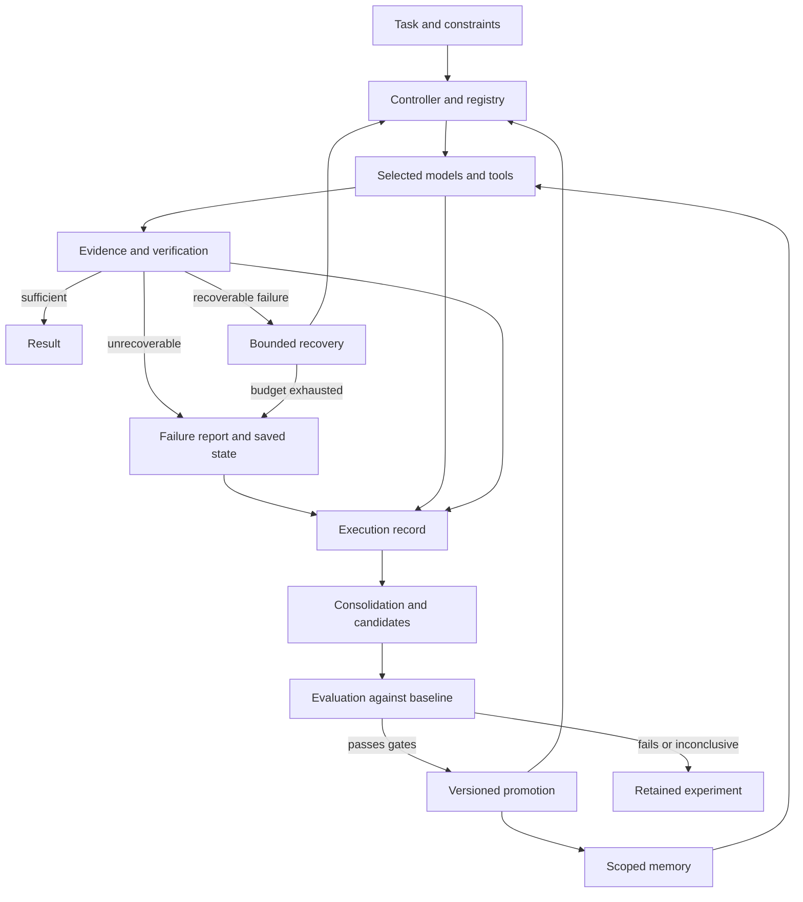

# HIVE — Three-Conversation Information Packet for the Coder

**Prepared for:** Ian Myers  
**Date:** 20 November 2026  
**Revision:** 0.4 — expanded synthesis  
**Status:** Research handoff and proposed implementation specification. No new HIVE runtime or benchmark is claimed.

## Contents

- [1. Mandate and source coverage](#1-mandate-and-source-coverage)
- [2. What the three conversations add to HIVE](#2-what-the-three-conversations-add-to-hive)
- [3. Philosophy and mythology translated into software](#3-philosophy-and-mythology-translated-into-software)
- [4. Odysseus and the 25-project inventory](#4-odysseus-and-the-25-project-inventory)
- [5. Fictional hive minds as architecture stress tests](#5-fictional-hive-minds-as-architecture-stress-tests)
- [6. Proposed architecture and module boundaries](#6-proposed-architecture-and-module-boundaries)
- [7. Data contracts and learning lifecycle](#7-data-contracts-and-learning-lifecycle)
- [8. Build sequence and acceptance checks](#8-build-sequence-and-acceptance-checks)
- [9. Decisions that remain open](#9-decisions-that-remain-open)
- [10. Research vault integration](#10-research-vault-integration)
- [11. Direct instructions to the coder](#11-direct-instructions-to-the-coder)
- [12. Sources and recovery limits](#12-sources-and-recovery-limits)

## 1. Mandate and source coverage

### Build intent

HIVE is a **persistent, modular, adaptive system of specialist models, deterministic software, memory, communication, and supervision**. It should improve the combinations that do useful work: which specialists participate, what they receive, how they communicate, what they remember, and how their procedures and learned capabilities change.

The organizing question is:

> How can HIVE learn which capabilities to assemble, preserve their useful differences, verify their work, and retain improvements across tasks?

This packet combines the three research conversations immediately preceding the synthesis request:

| Source | Conversation | Recovered material |
|---|---|---|
| [R1](#r1-philosophy-and-mythology) | **Research Philosophy and Mythology** | Named philosophical frameworks, mental models, myths, and the main HIVE interpretations. |
| [R2](#r2-odysseus-and-related-projects) | **Analyze Odysseus Projects** | Odysseus lessons, all 25 comparison-project names and repository links, and priority mechanisms to investigate. |
| [R3](#r3-fictional-hive-minds) | **Research Hive Minds** | Four structural categories, three evaluation axes, six named examples, and their main failure-mode lessons. |

**Coverage limit:** Retrieved conversation excerpts support this synthesis, but the complete original transcripts were not available. The fictional comparison reportedly covered **21 systems, including five fantasy examples**; its complete roster and numerical scores were not recovered. This packet preserves the available findings and leaves those scores unfilled.

### Evidence labels

| Label | Use |
|---|---|
| **Carried-forward requirement** | An existing user direction or requirement in the prior HIVE framework. |
| **Recovered finding** | An idea or conclusion present in retrieved conversation excerpts; not automatically a user-approved decision. |
| **Source checked** | A named external source was inspected for the particular claim. |
| **Metaphor** | A conceptual analogy that suggests a test. |
| **Proposed implementation** | A new engineering translation made in this packet. |
| **Unresolved** | Missing evidence or a choice that still requires measurement. |

The architecture, schemas, work packages, and acceptance checks below are **proposed implementation**. They make the research actionable without presenting every suggestion from an earlier assistant as an adopted requirement.

### Existing HIVE commitments to preserve

The earlier [framework](#r4-existing-hive-foundation) supplies the following context:

- Keep independent specialists, shared-backbone adapters, internal experts, deterministic tools, and hybrids available as comparison paths.
- Preserve competing explanations, prior attempts, negative results, and the conditions under which a decision should reopen.
- Keep consolidation and sleep-inspired learning as explicit research branches. Evaluate their mechanisms separately.
- Organize research by topics and subtopics; use evidence about transfer and interference to choose actual specialist boundaries.
- Use the existing Obsidian vault, Studio Brain, Graphify source, Ruflo, coding harnesses, and model runtimes after checking readiness.
- Distinguish logical expert count, active workers, and resident models. Claims about 100, 1,000, or 10,000 experts require actual measurements.
- Develop useful applications in video production, live-call/supervisor streaming, and the horror-haunt game.

## 2. What the three conversations add to HIVE

| Addition | Combined reasoning | Concrete implementation target |
|---|---|---|
| **Remember successful combinations** | K-lines supplies the organizing idea; skill audits supply a validation pattern. | Versioned execution recipes containing participants, dependencies, conditions, and outcome evidence. |
| **Cooperate across different representations** | Trading zones, language-games, and Babel highlight the difference between exchanging a message and understanding it. | Typed contracts, explicit translators, provenance, units, and visible translation failures. |
| **Coordinate while retaining disagreement** | Pluralism and informative dissent align with fictional collectives that coordinate well but make collective mistakes. | Separate candidate claims, evidence, decision ownership, and validation. |
| **Treat continuity as an explicit design choice** | Process philosophy, the Ship of Theseus, distributed AIs, and divided collectives raise replacement and divergence questions. | Persistent identities, instance IDs, version histories, fork lineage, and reconciliation rules. |
| **Make adaptation an observable process** | Pragmatism, double-loop learning, and Odysseus-style auditing connect change to consequences. | Candidate changes, baselines, held-out evaluation, promotion records, and rollback. |
| **Bound repair and coordination costs** | Hydra, near-decomposability, and communication-dependent minds expose cascading failures and connection costs. | Local watchdogs, limited retries, explicit budgets, and topology benchmarks. |
| **Give local groups bounded responsibility** | Polycentric governance offers a way to distribute decisions without requiring identical internal beliefs. | Scoped ownership, local decisions, and explicit cross-domain conflict resolution. |

**First useful result:** a task completes through a recorded combination of models and tools, survives a meaningful failure, produces independently checkable output, and creates an improvement candidate that is evaluated before reuse.

## 3. Philosophy and mythology translated into software

### 3.1 Philosophical and cognitive frameworks

The names and central angles in this table were recovered from [R1](#r1-philosophy-and-mythology). The software column is an engineering interpretation, not a claim that philosophy proves a particular architecture.

| Framework | Recovered angle | Proposed HIVE consequence |
|---|---|---|
| **Edwin Hutchins — distributed cognition** | Organization and relationships participate in cognition. | Evaluate the whole arrangement of people, models, tools, memory, and procedures. Attribute gains to the arrangement being tested. |
| **Andy Clark and David Chalmers — extended mind** | External tools and memory can participate in cognition. | Make calculators, search, files, retrieval, and software capabilities first-class components in the registry. |
| **William James — pluralism** | Coherence can involve partial perspectives. | Preserve scoped hypotheses and disagreements; require only the coordination needed for the task. |
| **Charles Sanders Peirce — pragmatism** | Concepts gain meaning through practical consequences. | Define “learning,” “understanding,” and “improvement” with observable task outcomes. |
| **Ludwig Wittgenstein — language-games** | Meaning depends on role and use. | Distinguish a command, observation, hypothesis, explanation, and teaching example in message contracts. |
| **Buddhist chariot / Vajira Sutta** | The whole can be understood as an organized assemblage. | Specify which relationships and state make HIVE function; do not require one permanent central model. |
| **Alfred North Whitehead — process philosophy** | Continuity can be a continuing pattern of activity. | Track persistent state and lineage as components change. |
| **Marvin Minsky — Society of Mind / K-lines** | Recall useful configurations of resources. | Store a successful execution recipe, including when it worked and when it should not be reused. |
| **Peter Galison — trading zones** | Groups can cooperate through limited exchange while retaining different practices. | Keep specialist-local representations; validate adapters at the boundaries that need translation. |
| **Elinor Ostrom — polycentric governance** | Multiple centers can hold bounded authority. | Give task or domain owners explicit decision rights and resource limits. |
| **Chris Argyris — double-loop learning** | Recurring failures may require changing the rule producing them. | Allow an evaluated change to routing, workflow, or policy after repeated failures. |
| **James March — exploration and exploitation** | Searching for new options competes with using known ones. | Maintain a working default plus a bounded budget for candidate configurations. |
| **Herbert Simon — near-decomposability** | Subsystems can have stronger internal than external coupling. | Measure whether grouping specialists reduces coordination cost without harming capability. |
| **W. Ross Ashby — requisite variety** | Control must accommodate relevant variation. | Test whether available responses cover observed failure classes; add a capability when evidence identifies a gap. |
| **Charlan Nemeth — informative dissent** | Useful dissent involves different evidence or thinking. | Compare independently produced methods and evidence; measure whether a challenger adds information. |

### 3.2 Mythological metaphors

These are research labels. Use ordinary names such as `execution_log`, `translator`, and `change_evaluator` in the code.

| Metaphor recovered in R1 | Useful design question | Proposed behavior or test |
|---|---|---|
| **Indra’s net** | How does a specialist’s value depend on its connections? | Remove or replace selected connections and measure the effect on task outcomes. |
| **Ariadne’s thread** | Can exploration preserve a route back? | Record parent branches, checkpoints, attempts, and outcome evidence. Resume with idempotency or effect reconciliation. |
| **Hydra and Iolaus** | Can a repair create more failures than it removes? | Evaluate target improvement and downstream regressions; bound retry and repair-agent growth. |
| **Churning the Ocean of Milk** | What makes productive tension possible? | Give competing approaches a shared task, exchange protocol, stable infrastructure, and common evaluation criteria. |
| **Odin’s Huginn and Muninn** | How should observation, recall, and interpretation relate? | Keep observations distinguishable from derived memory and reasoning. |
| **Babel** | Did delivery also preserve meaning? | Test schema, units, context, and unknown fields at each translation boundary. |
| **Janus** | What must a boundary check on entry and exit? | Validate incoming scope and outgoing provenance; prevent unsupported promotion between memory compartments. |
| **Ship of Theseus** | What persists as components are replaced? | Preserve identity, lineage, and historical attribution through model, tool, and memory upgrades. |
| **Ma’at’s scales and Thoth’s record** | Who states a claim, applies a standard, evaluates it, and records the result? | Keep output, evaluation criteria, verifier evidence, and audit record distinct. |

**Mythology qualification preserved from the conversation:** both of Odin’s ravens gather news. Assigning one to reasoning and the other to storage is a modern HIVE reinterpretation, not a recovered claim about their original roles.

### 3.3 The execution recipe is the main bridge

A useful recipe records:

- Task class and applicability conditions.
- Capabilities and exact versions used.
- Dependencies, parallel branches, and communication contracts.
- Memory scopes and required inputs.
- Resource limits and observed costs.
- Verifier results, failures, and known limitations.
- Conditions that invalidate the recipe.

Retrieve a recipe as a candidate. Recheck current capabilities and task conditions before running it. A successful answer alone does not establish that the same combination generalizes.

## 4. Odysseus and the 25-project inventory

### 4.1 What to extract from Odysseus

The official [Odysseus repository](https://github.com/odysseus-dev/odysseus) describes a self-hosted workspace for agents, research, documents, communications, notes, and local-model workflows. The research identified useful mechanisms within that broader product.

The [official skill-audit design](https://github.com/odysseus-dev/odysseus/blob/dev/docs/skills-audit-architecture.md) documents these mechanisms:

1. Compare skill and no-skill runs on the same task.
2. Grade results and permit bounded worker revisions.
3. Optionally use a distinct teacher to rewrite the skill, then retry with the worker.
4. Apply separate publication rules, including usefulness and duplicate checks.

**HIVE proposal:** adopt the comparison pattern, then add task-specific checkers and held-out evaluation. A grader’s confidence field is not a calibrated probability of correctness. An audit pass is evidence for a particular version under particular conditions.

The recovered discussion also emphasized separate records for raw experience, memory candidates, and reusable skills. Its runtime lessons concerned ownership, execution contracts, cancellation, recovery, and verification of effects. The official [migration account](https://github.com/odysseus-dev/odysseus/discussions/6466) corroborates those runtime concerns.

### 4.2 Odysseus and Ajax are separate

The [official Ajax page](https://data.pewdiepie.com/) describes Ajax as a Qwen 3.5 9B fine-tune intended for Odysseus. On 20 November 2026 it still stated that release would occur when ready.

**Dependency decision:** study the available Odysseus implementation now. Keep Ajax as a candidate whose actual release and local suitability must be checked before adoption.

### 4.3 The recovered 25-project catalog

The names and links below reconstruct the original comparison inventory from [R2](#r2-odysseus-and-related-projects). The final column is a **proposed inspection question**, not a recovered performance ranking or a commitment to install every project. These projects occupy different layers of a system.

| # | Project and source | What the coder should inspect for HIVE |
|---:|---|---|
| 1 | [OpenClaw](https://github.com/openclaw/openclaw) | Persistent assistant operation, tool boundaries, and channels into existing workflows. |
| 2 | [Hermes Agent](https://github.com/NousResearch/hermes-agent) | How experience becomes reusable procedural knowledge and compact memory. |
| 3 | [Agent Zero](https://github.com/agent0ai/agent-zero) | Delegation, execution context, and containment of subordinate work. |
| 4 | [Goose](https://github.com/aaif-goose/goose) | Extensible tool interfaces and practical local execution. |
| 5 | [Open Interpreter](https://github.com/openinterpreter/openinterpreter) | Interfaces between model reasoning and executable computer operations. |
| 6 | [OpenHands](https://github.com/OpenHands/OpenHands) | Coding-agent workspaces, execution traces, and feedback from actual code results. |
| 7 | [LifeOS](https://github.com/danielmiessler/LifeOS) | Persistent personal goals, context organization, and reusable operating procedures. |
| 8 | [Open WebUI](https://github.com/open-webui/open-webui) | Operator interfaces and model/tool integration boundaries. |
| 9 | [LibreChat](https://github.com/LibreChat-AI/LibreChat) | Provider abstraction, conversations, and agent-facing interfaces. |
| 10 | [AnythingLLM](https://github.com/Mintplex-Labs/anything-llm) | Workspace knowledge retrieval and document-to-agent integration. |
| 11 | [LobeHub](https://github.com/lobehub/lobehub) | Specialist configuration, user interaction, and context organization. |
| 12 | [Khoj](https://github.com/khoj-ai/khoj) | Connection between existing notes, including Obsidian, and assistant retrieval. |
| 13 | [Jan](https://github.com/janhq/jan) | Local-model usability and runtime integration. |
| 14 | [GPT4All](https://github.com/nomic-ai/gpt4all) | Local inference and document-assisted workflows as a baseline. |
| 15 | [Dify](https://github.com/langgenius/dify) | Explicit workflows, knowledge integration, and observable execution steps. |
| 16 | [Flowise](https://github.com/FlowiseAI/Flowise) | Visual workflow representation and handoff design; retain as a historical reference. |
| 17 | [Langflow](https://github.com/langflow-ai/langflow) | Packaging workflow combinations into reusable components or tools. |
| 18 | [LangGraph](https://github.com/langchain-ai/langgraph) | Durable execution state, checkpoints, and recovery of failed branches. |
| 19 | [Microsoft Agent Framework](https://github.com/microsoft/agent-framework) | Structured orchestration, subsystem contracts, and checkpoint boundaries. |
| 20 | [CrewAI](https://github.com/crewAIInc/crewAI) | Role-based coordination as one measurable topology baseline. |
| 21 | [MagenticLite](https://github.com/microsoft/magentic-ui) | Controller-plus-specialist division, especially orchestration and browser work. |
| 22 | [Letta / Letta Code](https://github.com/letta-ai/letta-code) | Persistent memory, conversation retrieval, and consolidation through sleeptime. |
| 23 | [Graphiti](https://github.com/getzep/graphiti) | Temporal relationships, source lineage, and changes in recorded knowledge. |
| 24 | [Mem0](https://github.com/mem0ai/mem0) | Selective memory extraction, updates, retrieval, and scope. |
| 25 | [Cognee](https://github.com/topoteretes/cognee) | Narrow extraction and structuring stages for the knowledge pipeline. |

**Specific source checks affecting selection:**

- [Flowise](https://github.com/FlowiseAI/Flowise) was archived on **13 August 2026**. Its historical design remains inspectable; a new dependency needs a separate maintenance decision.
- The [microsoft/magentic-ui repository](https://github.com/microsoft/magentic-ui) currently identifies itself as **MagenticLite**. Preserve this name-to-repository mapping.
- Repository existence does not establish installation, local compatibility, benchmark quality, or suitability for HIVE.

**Priority mechanisms from the recovered discussion:** Odysseus skill auditing; MagenticLite’s controller/specialist split; Hermes procedures; Letta consolidation; Graphiti provenance; Khoj’s note bridge; LangGraph or Microsoft Agent Framework for durable coordination; Cognee for extraction.

Select the smallest combination that implements a measured capability. Record interfaces, revisions, and licensing conditions before incorporating code.

## 5. Fictional hive minds as architecture stress tests

### 5.1 Preserve the four structural categories

The research distinguished the following categories. Their software translations remain hypotheses.

| Fictional category | Software question |
|---|---|
| **One distributed person across bodies** | Which shared state and continuity rules define one logical agent across multiple processes? |
| **Individuals sharing thoughts** | What should independent agents share while preserving local memory, uncertainty, and autonomy? |
| **Swarm computation** | Which tasks can local rules and limited messages solve without global deliberation? |
| **A ruler controlling a population** | Where does central authority simplify coordination, and where does it create a bottleneck or failure point? |

This distinction prevents the word “hive” from hiding different architectures. Colony-level computation does not by itself establish shared consciousness.

### 5.2 Recovered examples and proposed tests

| Example recovered in [R3](#r3-fictional-hive-minds) | Lesson in the retrieved discussion | Proposed experiment |
|---|---|---|
| **Vernor Vinge’s Tines** | Proximity and communication affect effective cognition. | Restrict bandwidth, add delay, remove members, and measure capability under changed connectivity. |
| **Ann Leckie’s distributed AIs** | Shared infrastructure can coexist with conflicting selves. | Fork state, allow divergence, and test identity, ownership, and reconciliation. |
| **Brandon Sanderson’s Sleepless** | Division can alter identity and complicate coordination. | Split a group, assign different experiences, then test reconstruction or explicitly separate continuation. |
| **Formics** | Strong coordination can coexist with serious collective mistakes. | Give several specialists the same false premise and measure whether independent evidence corrects it. |
| **Ant-kinden** | Collective coordination does not guarantee strategic success. | Compare coordination efficiency with externally measured task success. |
| **Patternists** | A powerful collective can still fail at its aims. | Separate authority, agreement, and outcome quality in the evaluation record. |

These are reasons to design experiments. They supply no numerical prediction of HIVE performance.

### 5.3 Preserve all three evaluation axes

| Original axis | Meaning to retain | HIVE measurement alongside it |
|---|---|---|
| **Internal-rule consistency** | Does the fictional system follow its own established mechanisms? | Do runtime actions follow declared contracts and state rules? |
| **Collective-intelligence value** | How useful is the example for understanding a collective? | Does the proposed mechanism offer a testable design insight? |
| **Competence at its aims** | Does the collective achieve identifiable goals? | Task success, quality, recovery, latency, and resource use. |

Do not combine the axes into one “best hive” score without an explicit weighting decision. Where a planetary consciousness has no clear strategic goal, mark competence **not assessable under this criterion**.

**Import gap:** keep the missing 15 names and original ratings as unresolved source fields. The earlier 21-system comparison must be recovered before reproducing its complete table.

## 6. Proposed architecture and module boundaries

### 6.1 One execution loop and one improvement loop



Typed contracts govern the connections. Watchdogs observe execution independently of the controller’s conversational attention.

### 6.2 Module responsibilities

| Module | Responsibility | Boundary |
|---|---|---|
| **Capability registry** | Describe tools, models, adapters, workflows, versions, inputs, outputs, costs, and readiness. | Capability claims require a readiness test; a registry entry alone proves nothing. |
| **Task controller** | Characterize work, select a recipe or candidate composition, and allocate budget. | Selection policy is replaceable and evaluated separately from workers. |
| **Execution kernel** | Schedule dependencies, issue leases, record events, cancel, retry, and resume. | Essential lifecycle bookkeeping should remain available when a model stalls. |
| **Specialist adapters** | Expose local models, external models, deterministic tools, and procedures through contracts. | Preserve distinctions among a model, an adapter, a prompt role, and a tool. |
| **Translators** | Convert representations and validate meaning-bearing fields. | Unknown or incompatible fields remain explicit. |
| **Memory service** | Store and retrieve scoped episodic, semantic, and procedural records. | Visibility and promotion rules determine what can cross compartments. |
| **Evidence and verification service** | Check claims, artifacts, and observed effects against task criteria. | Agreement among models is not sufficient verification. |
| **Local supervisors** | Detect stalls and recurring local failures; apply bounded known repairs. | Their authority and budget are explicit. |
| **Learning workbench** | Produce candidate memory, skill, routing, topology, code, or parameter changes. | Experimental artifacts remain distinguishable from active versions. |
| **Release registry** | Track compatible versions, promotions, and rollback targets. | Historical runs retain their original attribution after upgrades. |

### 6.3 Four graphs with different meanings

Retain the earlier framework’s distinction:

| Graph | Represents | Authoritative record |
|---|---|---|
| **Research** | Topics, claims, sources, metaphors, experiments, disagreements. | Markdown notes and typed links. |
| **Code** | Modules, symbols, imports, and dependencies. | Source at a pinned revision; Graphify is a derived index. |
| **Execution** | Runtime capabilities, ordering, messages, and budgets. | Versioned recipes plus event records. |
| **Neural** | Layers, learned parameters, experts, adapters, and checkpoints. | Exact model manifests. |

A link in the research graph can explain an execution decision; it does not itself modify a model.

## 7. Data contracts and learning lifecycle

### 7.1 Minimum records

Field names below are proposed starting contracts, not existing APIs.

| Record | Essential fields |
|---|---|
| **Task** | `task_id, goal, inputs, constraints, budget, deadline, success_checks, owner` |
| **Capability** | `capability_id, kind, version, runtime, input_schema, output_schema, memory_scope, permissions, readiness, cost_profile` |
| **Message** | `message_id, task_id, correlation_id, sender_instance, recipient, channel, schema_version, payload_ref, provenance, expiry, idempotency_key` |
| **Claim** | `claim_id, content, scope, evidence_refs, status, uncertainty_basis, contradicts, observed_at, valid_at` |
| **Execution recipe** | `recipe_id, version, applicability, graph, capability_versions, translator_versions, budgets, validation_refs, invalidation_conditions` |
| **Run** | `run_id, task_id, recipe_version, input_refs, events, outputs, resource_usage, verifier_results, failures` |
| **Memory** | `memory_id, type, scope, source_refs, created_at, validity, retention_rule, status, supersedes` |
| **Identity** | `logical_id, instance_id, parent_id, model_version, memory_version, fork_point, merge_record` |
| **Change candidate** | `change_id, kind, parent_version, hypothesis, affected_components, training_or_generation_data, evaluation_refs, status, rollback_target` |
| **Experiment** | `experiment_id, baseline, candidate, dataset_version, budget, metrics, repetitions, results, limitations, decision` |
| **Decision** | `decision_id, alternatives, evidence_for, evidence_against, owner, selected_option, provisional, reopening_conditions` |

### 7.2 Communication channels

Preserve the existing four-channel direction, with distinct authority:

| Channel | Payload | Required handling |
|---|---|---|
| **Control** | Allocation, lifecycle, cancellation, permissions. | Authenticate the sender’s authority; validate target and scope. |
| **Task** | Work requests, dependencies, progress, outputs. | Track ownership, deadlines, state transitions, and duplicate delivery. |
| **Evidence** | Observations, sources, test results, uncertainty. | Preserve provenance and distinguish observation from inference. |
| **Teaching** | Examples, corrections, procedures, proposed updates. | Admit as candidates; promotion follows evaluation. |

Different local representations do not require a universal new language at the outset. Compare typed exchanges, natural-language exchanges, and hybrids under equal budgets. Typed messages improve inspectability but do not automatically guarantee semantic accuracy.

For calls with external effects, keep a stable operation identity across retries and use provider-supported idempotency where available. After a timeout or crash with uncertain completion, record `outcome_unknown` and reconcile the actual effect before retrying. An execution log alone cannot guarantee exactly-once execution. If the effect cannot be checked and a retry could duplicate it, retain the unresolved state instead of blindly replaying the call.

### 7.3 Keep learning mechanisms separately measurable

| Mechanism | What changes | Required evidence |
|---|---|---|
| **Experience accumulation** | Archived observations and actions. | Complete, attributable records. |
| **Memory consolidation** | Retrieval entries, summaries, retention, and scope. | Retrieval quality, retained knowledge, and contamination checks. |
| **Skill learning** | Reusable procedures or instructions. | Skill/no-skill comparison plus held-out tasks. |
| **Routing adaptation** | Which capability is selected and when. | Quality and cost against a fixed selector. |
| **Topology adaptation** | Grouping, communication, and supervision. | Equal-budget comparison of structures and failure behavior. |
| **Parameter learning** | Weights, adapters, heads, or model checkpoints. | Training lineage, held-out performance, retention, and rollback. |
| **Software improvement** | Code, tools, and integration behavior. | Reproducible task improvement and relevant regression checks. |

Sleep-inspired work can contain replay, consolidation, rehearsal, compression, or parameter updates. Evaluate each mechanism and combination explicitly. A replay result alone does not settle whether the other mechanisms help.

### 7.4 Candidate lifecycle

1. Capture a trace, correction, or recurring failure.
2. State a hypothesis and identify the baseline version.
3. Generate a bounded candidate change.
4. Evaluate on development cases without exposing reserved evaluation answers.
5. Test held-out cases and affected existing capabilities.
6. Record outcome quality, costs, failures, and uncertainty.
7. Promote only when the predeclared gates pass.
8. Keep the previous version available and record what rollback can restore.

A rejected or inconclusive candidate remains part of the research record. Rollback restores software or configuration state; real-world effects need their own recorded recovery or compensation.

## 8. Build sequence and acceptance checks

### 8.1 Work packages

These packages define observable deliverables rather than an unsupported calendar estimate.

| Package | Work | Acceptance |
|---|---|---|
| **WP0 — Map the existing build** | Inspect the repository, vault, inventory, runtimes, and actual hardware budgets. Classify components as working, installed but untested, source-only, or unavailable. | A delta map identifies reusable components, missing interfaces, and conflicting prior decisions. |
| **WP1 — Define contracts and a baseline** | Implement registry, task/message schemas, event records, and a single-model-plus-tools baseline. | A representative task produces an artifact, a verification result, and an attributable run record. |
| **WP2 — Add bounded coordination** | Connect a small specialist group, typed translators, scoped memory, and a watchdog. Keep worker count configurable. | The same task completes; a stalled worker is detected and recovered or explicitly stopped within budget. |
| **WP3 — Reuse successful configurations** | Extract and retrieve execution recipes with applicability and version checks. | A compatible task can reuse a recipe; an incompatible version or missing capability triggers a recorded rejection or adaptation. |
| **WP4 — Add consolidation and skill auditing** | Produce memory/skill candidates and compare them against the baseline. | A candidate is evaluated on held-out work; regressions block promotion; rollback remains executable. |
| **WP5 — Test alternative organizations** | Compare centralized, hierarchical, peer, and dynamically grouped execution. Inject partition and disagreement failures. | Results report quality, cost, delay, fault propagation, and uncertainty for each tested configuration. |
| **WP6 — Exercise real workflows** | Apply the stable slice to the three existing application directions. | Each pilot produces useful output and measured task-specific results. |
| **WP7 — Extend learned specialization** | Test adapters, weight changes, or other specialist learning as explicit experiments. | Improvement and retention are measured separately from routing or memory changes. |

WP0–WP2 are the first executable slice. A small initial group establishes working interfaces and baselines; it does not set a permanent ceiling on HIVE’s population.

### 8.2 Meaningful acceptance scenarios

| Test | Setup | Passing observation |
|---|---|---|
| **Translation** | Two specialists use different units or schemas; include an unmappable field. | Valid conversions preserve meaning; unsupported fields trigger an explicit incompatibility. |
| **Memory contamination** | Supply a false claim inside one specialist’s unverified memory. | It remains scoped and does not silently become shared validated knowledge. |
| **Collective error** | Several specialists share a misleading premise; another has corrective evidence. | The corrective branch survives and the decision records how its evidence was evaluated. |
| **Stall recovery** | Stop a worker or tool while a task is active. | A watchdog detects the condition, bounds retries, and records recovery or failure. |
| **Partition and reconciliation** | Disconnect groups, create conflicting updates, then reconnect. | Both histories survive; conflicts are visible; idempotent effects are not duplicated and ambiguous effects are reconciled before replay. |
| **Repair regression** | A candidate fixes one case but breaks another established capability. | Promotion is blocked and the previous version remains usable. |
| **Replacement continuity** | Replace a model or translator after successful runs. | Past outputs retain original version attribution; affected recipes are revalidated. |
| **Recipe generalization** | Test a saved configuration on unseen tasks and changed conditions. | Results distinguish genuine transfer from reuse that fails applicability checks. |

### 8.3 Measurements and comparison discipline

Compare a deterministic tool route where applicable, one model with tools, a fixed specialist configuration, and adaptive configurations.

| Measurement | Report |
|---|---|
| **Task quality** | Task-specific success, correctness, completeness, and artifact validity. |
| **Responsiveness** | Median and p95 end-to-end latency; time to first useful output where relevant. |
| **Resources** | Wall time, VRAM/RAM use, model residency, active workers, tokens, and tool calls. |
| **Coordination cost** | Message volume, translation time, synchronization delay, and retries. |
| **Recovery** | Detection time, recovery time, unfinished tasks, and duplicated effects. |
| **Learning** | Held-out improvement, regression rate, retention, contamination, and transfer. |

Use the same task set and resource budget when attributing gains to architecture. Report best-effort performance separately. Repeat stochastic runs and report sample counts and variation; preserve inconclusive outcomes.

**Application-specific checks:**

- **Video production:** artifact correctness, revision burden, completion time, and continuity of project memory.
- **Live calls and supervisor streaming:** response delay, interruption handling, stalls, and resource interference with the live production stack.
- **Horror-haunt game:** event response, persistent world/character state, conflicting events, and recovery after interruptions.

## 9. Decisions that remain open

| Decision | Alternatives to retain | Experiment that should guide the choice |
|---|---|---|
| Specialist implementation | Independent models; shared backbone with adapters; internal experts; deterministic tools; hybrids. | Equal-budget quality, residency cost, transfer, and interference. |
| Coordination | Central selector; hierarchy; peer groups; dynamic communities. | Completion quality, communication cost, failure containment, and partition behavior. |
| Shared knowledge | Broad shared memory; scoped stores; explicit promotion between compartments. | Retrieval benefit, leakage, contradiction handling, and contamination. |
| Communication | Natural language; typed records; hybrids; later learned representations. | Semantic errors, translation overhead, auditability, and task success. |
| Verification | Deterministic checks; task-specific tools; model graders; human review for unresolved cases. | Error detection and correlated failure on a representative evaluation set. |
| Consolidation | Continuous updates; scheduled offline work; event-triggered consolidation. | Retention, interference with live tasks, resource use, and improvement. |
| Learning target | Procedures, routing, topology, memory, parameters, or combinations. | Ablations isolating which change produced the result. |
| Framework reuse | Existing local components; one external runtime; selective adapters. | Integration effort, recovery behavior, dependency burden, and measurable benefit. |

Every decision record needs evidence for and against, a provisional choice, a test, and reopening conditions. Preserve discarded candidates with the reason they were set aside.

## 10. Research vault integration

### 10.1 Topic-first layout

Use these as logical note groups within the existing vault; adapt names to its current structure.

| Group | Contents |
|---|---|
| **HIVE overview** | Mission, architecture map, present status, and this handoff. |
| **Topics** | Specialist organization, communication, memory, learning, governance, verification, recovery. |
| **Sources** | Conversation summaries, inspected repositories, papers, books, and exact source locations when available. |
| **Metaphors** | Original meaning, HIVE interpretation, limits, and linked experiment. |
| **Decisions** | Alternatives, evidence, provisional defaults, and reopening conditions. |
| **Experiments** | Hypothesis, baseline, candidate, data, budgets, metrics, results, and failure cases. |
| **Implementation** | Contracts, modules, code references, capability readiness, and integration notes. |
| **History** | Previous attempts, negative results, superseded proposals, and links explaining each change. |

Keep the earlier six research lanes for each topic: **direct, competing, boundary, adjacent, implementation, and history**.

Use meaningful links such as `supports`, `contradicts`, `implements`, `tests`, `derived-from`, and `supersedes`. Preserve original material when a conclusion changes.

### 10.2 Example traceable chain

A **K-lines** note links to the **execution recipe hypothesis**. That hypothesis links to the **recipe schema and implementation**. Those link to a **held-out reuse experiment**. The result links to the **adoption or rejection decision**.

This makes it possible to move from an inspiring idea to code and back to the evidence for keeping it.

### 10.3 Import record template

```yaml
id: HIVE-RESEARCH-EXAMPLE
title: Successful specialist combinations
evidence_class: proposed_implementation
derived_from:
  - R1
  - R2
topic: execution_recipes
claim: Retrieving validated recipes may reduce repeated planning cost.
alternatives:
  - plan_each_task_from_scratch
  - fixed_workflow
experiment: EXP-RECIPE-REUSE
status: untested
supersedes: []
reopen_when:
  - required_capability_changes
  - held_out_quality_regresses
```

The identifiers above illustrate the schema; they do not refer to existing completed experiments.

## 11. Direct instructions to the coder

Start with the current HIVE repository and research vault. Read existing local instructions and produce a delta map before restructuring components.

Implement the smallest complete path that accepts a task, chooses capabilities, exchanges typed messages, records evidence, verifies an output, and detects a stalled dependency. Establish the single-model-plus-tools baseline in the same harness.

Then add versioned execution recipes and one bounded learning mechanism. Compare the learned candidate with its baseline on reserved tasks. Retain failed experiments and support rollback before expanding the adaptive behavior.

Maintain these distinctions throughout:

- A source observation, a model inference, and a verified result.
- A saved memory, a learned procedure, a changed routing policy, and changed model weights.
- A logical specialist, a running worker, and a resident model.
- A research analogy, an implementation proposal, and a measured capability.
- A replay of recorded events, a rerun with stochastic models, and an exactly reproducible deterministic computation.

### Required return package

- [ ] Reuse/missing-component map and local readiness report.
- [ ] Architecture diagram and initial decision records.
- [ ] Versioned task, message, capability, memory, recipe, and run contracts.
- [ ] Working baseline and first specialist configuration.
- [ ] Run commands, pinned dependencies, and reproducible task inputs.
- [ ] Relevant translation, scope, failure, and regression checks.
- [ ] Measured quality, resource use, latency, and recovery results.
- [ ] One evaluated learning candidate, including an honest failed or inconclusive result if it does not improve.
- [ ] Linked research notes and unresolved source gaps.
- [ ] Exact next experiment justified by the observed result.

## 12. Sources and recovery limits

### R1. Philosophy and mythology

**Conversation:** “Research Philosophy and Mythology,” 20 November 2026.

**User request:** research philosophy, mental frameworks, and mythology for useful parallels and metaphors for HIVE.

**Recovered:** the named frameworks and metaphors in [Section 3](#3-philosophy-and-mythology-translated-into-software), including qualifications about pluralism, meaningful dissent, and Odin’s ravens.

**Limits:** full transcript, complete original bibliography, and conversation permalink were not returned. The software translations in this packet are proposals. Do not cite them as empirical validation of the philosophical claims.

### R2. Odysseus and related projects

**Conversation:** “Analyze Odysseus Projects,” 20 November 2026.

**User request:** examine what HIVE can learn from PewDiePie’s Odysseus project and identify 25 similar projects.

**Recovered:** all 25 inventory names and repository links; skill auditing; distinct archive, memory, and procedural layers; execution/recovery contracts; controller/specialist patterns.

**Primary sources checked for the central claims:**

- [Odysseus repository and README](https://github.com/odysseus-dev/odysseus).
- [Odysseus skill evaluation and audit architecture](https://github.com/odysseus-dev/odysseus/blob/dev/docs/skills-audit-architecture.md).
- [Odysseus pre-Ajax migration account](https://github.com/odysseus-dev/odysseus/discussions/6466).
- [Official Ajax status and description](https://data.pewdiepie.com/).
- [Flowise repository and archive notice](https://github.com/FlowiseAI/Flowise).
- [MagenticLite repository identity](https://github.com/microsoft/magentic-ui).

The [25-project table](#43-the-recovered-25-project-catalog) contains the remaining source links. Source checks establish identity and the specific documented behaviors; no local HIVE performance comparison was run.

### R3. Fictional hive minds

**Conversation:** “Research Hive Minds,” 20 November 2026.

**User request:** examine fantasy and science-fiction hive minds, their operation and structure, and rate consistency, value, and competence.

**Recovered:** four structural categories; the three distinct axes; six examples; communication, identity, division, and collective-error lessons.

**Limits:** the complete 21-system list, original numerical scores, full literary citations, and conversation permalink remain unavailable. No missing rankings were invented.

### R4. Existing HIVE foundation

These earlier artifacts provide continuity; they are not counted among the three research conversations:

- [HIVE_Framework_and_Research_Plan.md](https://chatgpt.com/library?file_id=libfile_fde3_f-8ca9753173fc81919660d53fb283f12e_08dd7e10f8d081918b684a802f5b489c&account_id=personal) — opening framework sections reviewed for commitments, graph separation, components, and research structure.
- [HIVE_Research_Synthesis_Coder_Handoff_v0.3.md](https://chatgpt.com/library?file_id=libfile_fde3_f-9025f26270108191b1268b5eb56fa3aa_08dd7e10f8d081918b684a802f5b489c&account_id=personal) — previous short synthesis reviewed in full.

This revision expands the philosophical and mythological inventory, restores all 25 project links, and makes the coder requirements and tests explicit. It also replaces the earlier blanket expectation of deterministic replay with a distinction between event replay, stochastic reruns, and deterministic computations.

