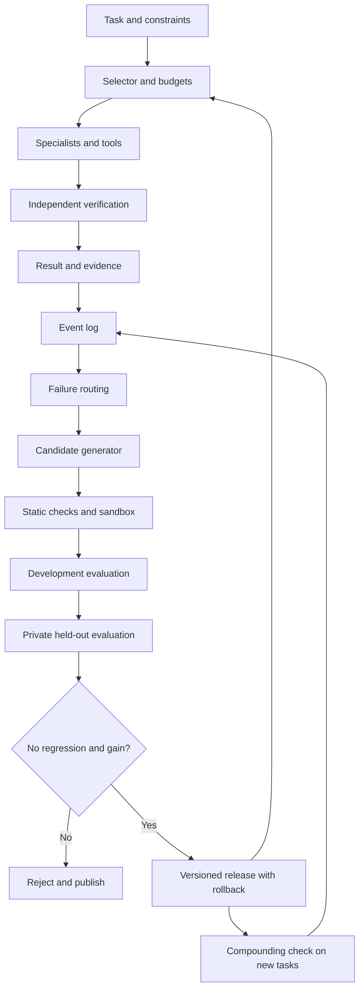

# HIVE — Integrated Design Map

**Purpose:** Place each external part from [the external landscape update](/hive/notes/LANDSCAPE/) into the HIVE design as one whole. This is a **design proposal**. Nothing here is implemented or measured. It does not change coder directions 0.4, approve any experimental policy or weights, or authorize new model calls. Existing alternatives and open decisions stay open.

Sources of the HIVE side: [the framework](/hive/notes/FRAMEWORK/), [the adaptive addendum](/hive/notes/ADAPTIVE/), [the gap and change plan](/hive/notes/GAPPLAN/), [known gaps](/hive/notes/GAPS/) and [implementation status](/hive/notes/STATUS/).

## 1. The whole in one picture

HIVE already has two loops. The external parts fit into the slow loop and around the gate. The fast loop needs little from outside.

Where the external parts sit:

| Box | HIVE name | External part | Stance |
|---|---|---|---|
| Event log | Evidence service, restart replay | Regimes / ActiveGraph event sourcing | Study, compare |
| Failure routing | Credit assignment | Regimes failure-to-seam taxonomy | Adapt |
| Candidate generator | Learning workbench | GEPA, ACE-style edits, skill extraction | Adopt behind the gate |
| Static checks, sandbox, development, held-out | Decider D5 | Regimes four-stage gate | Already aligned; compare |
| Private held-out evaluation | Evaluator isolation | MELD private evaluators, HIVE-AI seeded variants | Adapt |
| No regression and gain | Promotion governor | RELAI-VCL no-regression constraint | Adopt as a rule |
| Versioned release | Release registry | Git for non-parameter layers (Letta) | Adopt |
| Compounding check | Gap G04, EXP-05 | Two-phase protocol | Adopt as an experiment |
| Selector and budgets | Deciders D1, D2 | Nothing new needed | Keep |
| Specialists and tools | Execution kernel | Aden Hive, Ruflo | Study only |

## 2. Stance on each external part

Four stances: **adopt** (use as is), **adapt** (take the idea, build to HIVE contracts), **study** (compare before deciding), **decline** (does not fit now).

| Part | Stance | Why |
|---|---|---|
| Two-phase compounding protocol | Adopt | Closes G04 with a published design. Small. Needs no new architecture. |
| No-regression rule inside candidate search | Adopt | The only method that compounded in that study. Matches D5. |
| Git-versioned L1/L2/L3/L5/L6 artifacts | Adopt | Diff, rollback and audit for text-shaped changes at no build cost. |
| GEPA as candidate source | Adopt behind the gate | Removes hand-built candidate code. Overfits when unguarded. |
| Regimes gate order and event shape | Study, then adapt | Nearest reference implementation of the governor. |
| Failure-to-seam routing | Adapt | Tells the workbench which layer a failure belongs to. |
| Private evaluators outside the workspace | Adapt | Addresses the open evaluator-isolation gap. |
| Seeded held-out variants | Adapt | Cheap protection against memorized fixtures. |
| Open skill file format for L2 | Adapt | Makes HIVE procedures readable by other harnesses and theirs by HIVE. |
| ACE incremental edits | Adapt | Guards against context collapse in L1 and L2. |
| Sleep-time consolidation (Letta) | Study | One more arm for EXP-06 and [D03](/hive/notes/D03/); not a replacement for the existing sleep research paths. |
| Topology search (AFlow, ADAS, MaAS) | Study | Baselines for EXP-01 and L5. Use as comparison arms first. |
| Agent Lightning trace capture | Study | Useful once an L4 experiment is justified. |
| Doc-to-LoRA, Text-to-LoRA | Study, later | Cheapest L4 route, but only after a non-parameter promotion succeeds. |
| Aden Hive as kernel | Study | Overlaps the least novel part of HIVE. Compare on one mission before any commitment. |
| Ruflo learning features | Study with caution | Reported stubs; verify each feature before relying on it. |
| DGM, Hyperagents (self-editing meta level) | Decline for now | Conflicts with the separation-of-duties rule unless the gate stays outside the editable surface. Keep as a research path under [D09](/hive/notes/D09/). |
| Hermes ungated skill edits | Decline | No test between an edit and its use. Take the format, not the policy. |

## 3. By learning layer

| Layer | Current HIVE state | Part to bring in | Gate before promotion |
|---|---|---|---|
| L1 memory | Local memory contracts with provenance, expiry, correction, rollback tests | Incremental edits (ACE); idle-time consolidation as a test arm | Retention and stale-error checks; EXP-04, EXP-06 |
| L2 procedures | One failure-to-procedure cycle exercised; candidate rejected | Skill file format; GEPA or skill extraction as source | D5; held-out tasks; no regression on prior procedures |
| L3 routing | Static router; learned router quarantined (P2) | No-regression search; failure-to-seam routing | Unused holdout, not reused validation |
| L4 parameters | No checkpoint | Trace capture; hypernetwork adapters | Only after an L2 or L3 promotion; separate approval for training |
| L5 topology | Proposed | Topology-search methods as comparison arms | EXP-01, EXP-07 with matched budgets |
| L6 communication | Four channels specified | Nothing external found that matches | EXP-04 |

## 4. By decider

- **D1 eligibility:** unchanged.
- **D2 routing:** unchanged. External routers are already in the catalog.
- **D3 verification value:** add seeded variants as a cheap verifier-robustness check.
- **D4 learning priority:** failure-to-seam routing gives D4 a layer to assign each failure to.
- **D5 promotion:** add an explicit no-regression condition evaluated during candidate search, not only at the end; add a compounding check after promotion. Both are proposals.

## 5. By experiment and decision

| HIVE item | External input | Effect |
|---|---|---|
| EXP-05 compounding future learning | Two-phase protocol and its four reported arms | Gives a ready design and reference numbers under a different setting |
| EXP-01 organization without weight changes | AFlow, ADAS, MaAS as arms | Stronger baselines than a static orchestration |
| EXP-06 rehearsal and consolidation | Idle-time consolidation; context-collapse control | One more arm; one more failure measure |
| Gap G04 | Same as EXP-05 | Moves from planned to specified |
| Gap: evaluator isolation | MELD, HIVE-AI | Concrete patterns to test |
| [D02](/hive/notes/D02/) where learning persists | Token-space-first argument (Letta); harness-then-weights (SIA) | Two external positions to record; neither settles it |
| [D09](/hive/notes/D09/) how far self-improvement may reach | Hyperagents | An example of the far end; keep the gate outside |
| [D11](/hive/notes/D11/) what constitutes verification | Regimes four-stage gate | A comparable definition |

## 6. Proposed build order

Ordered by return for effort. Each step has an acceptance condition. None is approved by this page.

1. **Compounding experiment on the existing harness.** Two task phases, a transfer score before re-optimizing, a final score, and a lifelong average, with an unchanged control. *Accept when:* the protocol runs end to end with frozen task sets and the result, positive or negative, is published.
2. **No-regression condition in the candidate loop.** *Accept when:* a candidate that improves the new slice and regresses a prior one is rejected by a test.
3. **Regimes comparison note.** Read its code and record where the HIVE event log and gate differ. *Accept when:* a decision record states borrow, keep or merge for each difference.
4. **Git registry for non-parameter artifacts.** *Accept when:* a promoted or rejected L2 or L3 artifact has a commit, a diff and a tested rollback.
5. **Evaluator moved outside the candidate workspace, with seeded variants.** *Accept when:* a candidate process cannot read labels or evaluator state, shown by a failing access test.
6. **External candidate generator behind the gate.** *Accept when:* generated candidates pass through the same D5 path as hand-built ones and at least one is rejected for overfitting.
7. **Skill file format for L2.** *Accept when:* one existing HIVE procedure round-trips through the format.
8. **Topology arms for EXP-01.** *Accept when:* at least one searched topology and one static baseline run under matched budgets.
9. **First L4 experiment.** Only after a non-parameter promotion. Needs separate approval.

Steps 1 to 5 need no new external dependency beyond reading one repository.

## 7. Invariants this map keeps

- An experimental agent cannot modify its own acceptance gates or approve its own changes.
- Private evaluator stores and per-case holdout labels and results stay out of public exports.
- Rejected candidates and failures are published with their scope.
- Proposal, implementation, execution, measurement and interpretation stay separate.
- The 100, 1,000 and 10,000 logical-expert paths and all competing organizations stay open.
- Nothing here authorizes model calls, training or promotion.

## 8. Open questions

- Does the HIVE event log already carry what Regimes relies on for deterministic replay, or is a cache of model responses missing?
- Which public benchmark, if any, should HIVE report on so results can be compared? Local models may be too weak for Terminal-Bench 2.0 as published.
- Is the kernel comparison (current kernel, Ruflo adapter, Aden Hive) worth a mission, given the kernel is not where HIVE differs?
- Naming: keep HIVE with a qualifier, or change it.

## 9. Inputs not included

Earlier HIVE research that exists only in chat and was not supplied as a file is not part of this map. Supply it and it can be merged under the existing merge rules.
