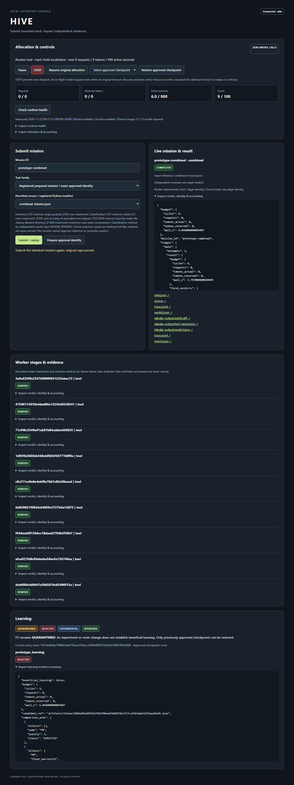

# HIVE operational workflow — 0.4.0.dev1

**READY_FOR_LIVE_DEMO.** The local console, typed data adapter, isolated Python workflow and bounded candidate comparison are implemented and verified. New local-model inference still needs the separate finite approval specified in the corrected dev6 handoff.

The frozen suite passed **488 tests**, with three Windows symlink-permission skips and zero failures. Seven serial CLI journeys passed. The existing twelve-task synthetic objective campaign passed, including fresh-process replay. The actual first-party source inventory, both Docker transformations and combined data → Python → independent review → report mission verified. A real-source exact-tool comparison tied, rejected the candidate and verified its distinct subsequent source. All engineering commands replayed with unchanged aggregate budget and **zero new HIVE model calls**.

[Download complete source](/hive/downloads/HIVE_Operational_Prototype_v0_4_0_dev1.zip) · [Publication manifest](/hive/implementation/prototype-v04-publication.json) · [Full measured report](/hive/implementation/prototype-v04/build/prototype-v04/public/prototype-report.md) · [Evidence index](/hive/implementation/prototype-v04/build/prototype-v04/public/evidence-index.json)

The screenshot is the actual local console running the frozen source. Desktop and 390 px mobile Chromium checks covered registered mission replay, independent stage verdicts, candidate rejection display, artifact download, local health, STOP/resume and process restart. This is browser emulation, not a physical-phone test. The public site serves documentation and source; it does not expose the runtime, tokens or evaluator stores.

The exact download was extracted into a fresh directory, checked against all 1,034 manifest entries, and used to prepare and verify an inventory with unchanged-budget fresh-process replay. [Package verification receipt](/hive/implementation/prototype-v04-package-verification.json) records the exact ZIP and runtime hashes; it made zero model calls.

## What changed

- Restricted CSV/JSON intake preserves original bytes and fingerprints sources, procedures, model, verifier, policy and outputs. Exact inventory uses the deterministic tool; classification requires a pinned local model and separately approved task fingerprints. Missing independent labels stay review-pending.
- Combined missions share the existing Store, Executor and finite budget. Python consumes the actual verified upstream artifact while host-only expected cases remain fixed. Failed, pending or synthetic stages block real dependencies.
- The candidate loop freezes development, comparison and subsequent source groups before execution. P0, strongest applicable tool, fixed specialist, conditional checker/recovery team and learning-disabled controls are explicit; duplicated executions are aliases. Ties and regressions reject. Governing P0 remains unchanged.
- The authenticated loopback console supports prepared source selection, live state, exact counters, artifacts, learning state, STOP/resume and approved checkpoint restore. Unknown interrupted model outcomes cannot silently dispatch again.

## Measured scope and next action

The [release decision](/hive/implementation/prototype-v04/build/prototype-v04/public/release-decision.json) lists every O1–O10 gate. O5 is blocked by missing new inference authorization. This release is not yet an operationally validated model prototype. The [unapproved proposal](/hive/implementation/prototype-v04/build/prototype-v04/public/operator-approval.proposed.json) pins eight possible classification tasks under one maximum allocation of 24 requests, 128 generated tokens each, 3,072 total tokens, one global request at a time, 1,800 active seconds and 64 MiB. It grants no authority by itself.

The [runbook](/hive/implementation/prototype-v04/build/prototype-v04/public/prepared-runbook.md) prepares and runs the permitted local workflows. [Actual tool/Docker receipts](/hive/implementation/prototype-v04/build/prototype-v04/public/engineering-demo/summary.json), [learning decision](/hive/implementation/prototype-v04/build/prototype-v04/public/engineering-demo/learning.json), [console checks](/hive/implementation/prototype-v04/build/prototype-v04/public/console/report.json) and [independent review](/hive/implementation/prototype-v04/build/prototype-v04/public/independent-review.md) retain exact outcomes. [Earlier failures and limits](/hive/implementation/prototype-v04/build/prototype-v04/public/scope-and-readiness.md) remain visible.

These are first-party development inputs. The learning slices are distinct within their plans; some inventory source files also appeared in the aggregate demo. They are not an untouched research corpus. No beneficial-learning gain, Level A acceptance or P2 promotion is claimed. Level A still requires six unused data sources plus six unused Python snapshots and at least ten accepted outputs of twelve attempted. Level B remains a separate preregistered study with at least 24 held-out tasks.

The preserved [dev6 result](/hive/notes/P2SAFETY/) and [dev4 readiness baseline](/hive/notes/READINESS/) retain their original scope. The main navigation now opens this current engineering update.

Measured implementation commit: `dc8cc2d9b421d680d1052ba4f510027ac5a391ad`. Packaging commit: `6f0eb27a5c45bbd93c3b5257d81ee1907e27fb3f`. Runtime SHA-256: `ef4eb92509af5d5330e90632d178b3cdadc3c11e62f308f58f808be6be625055`. Download SHA-256: `9b7cc292eaefc2bd3d4e308e866b1393e48aa547c576dcce5376da513fd1e1f9`.
