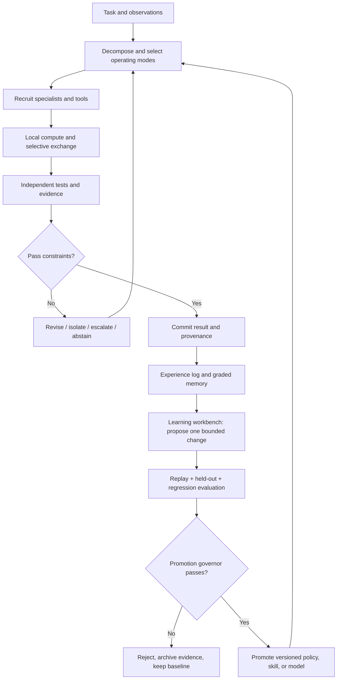

# HIVE — Research Update: Adaptive Organization and Self-Learning

> **Database update purpose:** Add the recent organizational findings and decisions to the HIVE knowledge base. This is a **research and design handoff**, not a claim that the proposed architecture has been built or proven. Keep conflicting approaches as separate, linkable candidates. Prioritize the **self-learning system**, because successful compounding learning could improve other HIVE capabilities.

## 0. Change log — what is new

| ID | Finding / change | Classification | Database action |
|---|---|---|---|
| NEW-01 | **Organization itself is a learnable component.** Topology, routing, communication, verification, group membership, and memory access can be treated as adjustable variables. | Research-derived design hypothesis | Add to core architecture thesis. |
| NEW-02 | **Do not choose one side of most organizational tensions.** Use both where complementary; switch or blend according to task conditions. | **User-selected design direction** | Promote to provisional architectural requirement. |
| NEW-03 | Distinguish **composition, reliability, current-task adaptation, persistent learning, and integrated individuality**. | Conceptual clarification | Create separate concepts and benchmarks. |
| NEW-04 | Separate **specialist learning** from **organizational learning**. Improvement can occur without changing any model weights. | Architecture principle; not yet a HIVE measurement | Create independent update and evaluation loops. |
| NEW-05 | **Communication and coordination have costs.** More agents, debate, and shared context can reduce performance. | Research-supported boundary condition | Require matched-budget baselines and ablation tests. |
| NEW-06 | **Memory is not learning.** Outcomes must change future behavior and survive independent testing to count as learned improvement. | Conceptual + engineering principle | Separate memory, skills, routing, weights, and topology updates. |
| NEW-07 | Treat the **governing/rating formulas as a family**, selected by task and framework—not a universal score. | User research priority + proposed design | Create formula registry, contexts, constraints, and experiments. |
| NEW-08 | Preserve **independent disagreement**, evidence provenance, fault isolation, rollback, and autonomy within bounds. | Convergent engineering principle | Add architectural invariants and failure tests. |
| NEW-09 | Biological, spiritual, philosophical, and fictional hive examples suggest hypotheses but **do not demonstrate** machine consciousness, universal swarm superiority, or specific AI mechanisms. | Evidence boundary | Store analogy and empirical evidence separately. |
| NEW-10 | Prefer **selectively permeable specialist boundaries**: isolation by process/store/permissions/protocol, with typed translators at boundaries; language choice alone does not prevent contamination. | Prior HIVE design inference | Add information-flow security research item. |

### Evidence legend

- **[SOURCE]** Explicit in the uploaded research files or established work cited in those files.
- **[SYNTHESIS]** Reasoned integration of the sources; not necessarily independently experimentally confirmed.
- **[DECISION]** Direction expressly chosen in recent HIVE discussions; not proof of efficacy.
- **[HYPOTHESIS]** Proposed implementation or expected benefit requiring tests.
- **[OPEN]** Unresolved empirical or architectural question.
- **[ANALOGY]** Biological, spiritual, sociological, or fictional parallel, not a validated AI mechanism.
- **[PREVIOUS-WORK]** Recovered from earlier HIVE discussion; not retested for this packet.

---

## 1. Core thesis and the five different outcomes

**Core thesis [SYNTHESIS]:** HIVE is a modular, persistent, self-improving cognitive organization in which the **relationships among imperfect specialists** are themselves designed, observed, tested, and eventually adapted. The framework can contribute capability independently of changes to specialist weights.

| Outcome | Meaning | What would demonstrate it | What it does *not* establish |
|---|---|---|---|
| **Compositional capability** | Specialists jointly complete a task no single specialist covers end-to-end. | End-to-end success with demonstrated complementary contributions. | That the group learns or is more accurate on all tasks. |
| **Collective reliability** | Diverse error paths, verification, and recovery increase successful completion. | Higher held-out task success, with matched cost/compute. | Consciousness or novelty of intelligence. |
| **Adaptive coordination** | The group changes its operating mode in response to a task, failure, or available compute. | Observable, beneficial selection of routing/topology/checking policy. | Persistent improvement across later tasks. |
| **Persistent learning** | The organization retains an update that improves subsequent unfamiliar tasks. | Future held-out gain, transferable learning, bounded forgetting, reproducibility. | Any specific change to neural weights. |
| **Integrated individuality** | Components form an unusually tightly dependent collective; in biology this has specific evolutionary criteria. | Would require its own carefully defined technical test. | Subjective awareness or an AI “soul.” |

**Important distinction:** Increased task success under collaboration is not automatically evidence of a new unified mind. The engineering goal is measurable cognitive capability and learning; consciousness remains a separate philosophical and scientific question.

---

## 2. Twelve consolidated organizational principles

This unifies the five computational clusters and nine biological/spiritual themes with the preceding HIVE analysis. The list is a **working taxonomy**, not twelve proven laws jointly necessary for every system.

| Key | Principle | Mechanism and HIVE translation | Risks / limits |
|---|---|---|---|
| `ORG-01` | **Dependency-aware decomposition** | Divide tasks where coupling is low; preserve interdependent constraints and handoff meaning. | Too many handoffs; missing global constraints. |
| `ORG-02` | **Complementary diversity** | Different capabilities, tools, inputs, and error patterns—not merely more copies of one model. | Correlated failures; costly redundancy. |
| `ORG-03` | **Competence-aware routing** | Choose workers by demonstrated task-conditioned success, cost, latency, and uncertainty. | Miscalibration; controller bottleneck. |
| `ORG-04` | **Typed selective communication** | Explicit claims, evidence, sources, semantics, validity windows, and receivers. | Semantic contamination; message floods. |
| `ORG-05` | **Independent verification** | Separate generating candidates from executable checks, independent evidence, and environmental results. | Shared verifier blind spots; excessive rejection. |
| `ORG-06` | **Epistemic memory** | Store hypothesis, evidence, accepted result, failed experiment, and reusable skill distinctly. | False information promoted to trusted memory. |
| `ORG-07` | **Fault containment** | Timeouts, least privilege, isolation, rollback, circuit breakers, graceful fallback. | Cascading failures; lost recovery state. |
| `ORG-08` | **Flexible topology** | Allow central, distributed, nested, and hybrid coordination according to dependencies. | Over-orchestration or chaotic local interactions. |
| `ORG-09` | **Exploration and selection** | Maintain competing solutions; select using tests and graded evidence. | Premature consensus; lock-in; reward hacking. |
| `ORG-10` | **System-level objectives and budgets** | Allocate compute, memory, bandwidth, and authority by collective outcomes. | Local optimization harming overall performance. |
| `ORG-11` | **Lifecycle and renewal** | Reuse, retrain, compress, prune, replace, or revive elements after evaluation. | Instability, regressions, catastrophic forgetting. |
| `ORG-12` | **Shared operational purpose with dissent** | Clear task goals, policies, and allowed actions; protect independent criticism. | Groupthink and suppressing legitimate alternatives. |

**Cross-domain notes [ANALOGY]:** Immune repertoires suggest diversity, bee scouts suggest competing exploration with a quorum, multicellularity suggests differentiated roles and conflict management, and social/spiritual traditions suggest questions of purpose and mutual obligation. These are **sources of design questions**, not proof that their literal biological or theological mechanisms transfer to software.

---

## 3. Major decision: adaptive organizational duality

**Decision `DEC-ORG-BOTH-001` [DECISION]:** Most disagreements should be treated as **potentially complementary operating modes**. HIVE must not hard-code centralized versus decentralized, competition versus cooperation, or shared versus isolated state as mutually exclusive universal choices. Preserve all useful candidates and test when to operate them simultaneously, switch between them, or blend them.

### 3.1 Three distinct meanings of “use both”

1. **Simultaneous combination:** Different mechanisms run concurrently because they do different jobs (e.g., central policy constraints alongside autonomous local workers).
2. **Contextual switching:** One mode replaces another when task properties or costs change (e.g., independent search for parallel problems, tighter control for interdependent execution).
3. **Adaptive blending:** The controller continuously varies strength, budget, membership, and information flow across modes (e.g., percentage of compute used for exploration versus verification).

**Constraint:** “Use both” does **not** mean activate all mechanisms all the time. Each must justify its cost, interference, safety implications, and effect on whole-system performance.

### 3.2 Discrepancy-to-combination decision table

| Duality | Combined policy candidate | Potential selection signals | Failure conditions to measure |
|---|---|---|---|
| **Centralized ↔ decentralized** | Central policy/constraint management; autonomous local execution and recruitment. | Coupling, deadlines, criticality, failure rates, communication load. | Bottlenecks; unsupervised drift. |
| **Cooperation ↔ competition** | Shared final objective; independent candidate-generation and competing proposals. | Uncertainty, alternative count, verification quality. | Conformity; adversarial waste. |
| **Consensus ↔ disagreement** | Preserve dissent during exploration; commit after evidence-based choice or explicit deadline/quorum. | Verifiability, irreversibility, time budget. | Majority confidently wrong; paralysis. |
| **Specialization ↔ redundancy** | Primary narrow specialists plus overlapping fallback/checker coverage. | Failure severity, costs, availability, correlated error. | Brittle dependency; unnecessary copies. |
| **Shared ↔ isolated memory** | Shared evidence registry/index; protected local scratchpads, procedures, and parameter state. | Sensitivity, relevance, source trust, recency, access needs. | Contamination, leakage, loss of context. |
| **Dependence ↔ independence** | Reusable standalone modules form temporary tightly coupled teams where needed. | Task dependency graph, interface maturity, recovery cost. | Irreversible coupling; integration overhead. |
| **Exploration ↔ exploitation** | Stable production policy plus bounded experiment lanes. | Novelty, expected information gain, remaining budget, error tolerance. | Stagnation; experimental instability. |
| **Autonomy ↔ policing** | Local discretion constrained by contracts, monitors, and reversible interventions. | Risk level, observed reliability, novelty, rule violations. | Overcontrol; unchecked errors. |
| **Stability ↔ evolution** | Tested baseline serves tasks while candidate improvements undergo replay/regression tests. | Held-out gains, forgetting, cost and recovery. | Catastrophic regressions; frozen design. |
| **Small ↔ large teams** | Dynamic staffing and compute allocation; recruit additional workers only when marginal value is positive. | Subtask independence, expected gains, latency and budget. | Coordination cost exceeds added capability. |
| **Shared representations ↔ specialist representations** | Typed common contracts at the boundary; local embeddings/modalities with explicit translators. | Fidelity of translation, alignment need, contamination risk. | Translation loss; interoperability cost. |
| **Online ↔ offline learning** | Fast response-time correction and slower batch consolidation, evaluation, retraining, or pruning. | Task urgency, replay availability, change risk. | Unchecked self-edits; stale information. |

### 3.3 Governing principle

> **Unity without uniformity:** HIVE needs sufficient shared constraints to act coherently, and sufficient differentiated independence to discover mistakes, remain replaceable, and continue learning.

**Unresolved [OPEN]:** The optimal switch/blend policy and its cost are not established. An adaptive hybrid is a **candidate**, not a demonstrated winner over a simpler controller.

---

## 4. What should be learnable — independent layers

The initial priority is to improve **learning speed, retention, transfer, and reliable promotion of improvements**. Keep at least six different update targets separate:

| Layer | Adjustable variables (“dials”) | How improvement would appear |
|---|---|---|
| `L1` External / episodic memory | Retention, retrieval, relevance, provenance, confidence evidence | Better recall/use of prior evidence without escalating stale errors. |
| `L2` Procedural skills | Tool sequences, reusable workflows, preconditions, success checks | Faster, cheaper, more reliable completion of repeatable tasks. |
| `L3` Routing and resource policy | Specialist selection, effort, parallelism, escalation threshold | Better outcomes per resource and less avoidable delay. |
| `L4` Specialist parameters | Fine-tuning, adapters, distillation, selective pruning | Improved measured specialist task performance. |
| `L5` Organizational topology | Team membership, control structure, verification depth, interaction graph | Better collective performance with the same or comparable components. |
| `L6` Communication and representation | Protocol, schema, bandwidth, translators, isolation, representation choice | Less handoff loss and contamination at useful coordination cost. |

Other variables include **when** to verify, when to abstain, when to reuse a cached result, when to combine specialists, and when to deactivate or replace a component.

**Non-equivalences to preserve:**

- Memory accumulation ≠ procedural learning ≠ weight updates ≠ organizational policy learning.
- A different programming language (Rust, Python, C++, JavaScript, etc.) ≠ automatic isolation; process, permission, storage, schema, and validation boundaries matter.
- Quantization ≠ pruning ≠ distillation ≠ fine-tuning ≠ adapter switching. Each trades capability, cost, and reversibility differently.
- Different model identities ≠ uncorrelated errors. Measure correlation empirically.

### 4.1 Dual learning loops



**Fast/task loop:** Observe → decompose → recruit → work → verify → recover/commit.

**Slow/improvement loop:** Attribute outcome → propose bounded update → evaluate against unchanged serving baseline → promote or roll back → record conditions and evidence.

**[HYPOTHESIS]** The slow loop can improve the group while weights remain frozen, by changing topology, routing, coordination, verification, or memory policies. This must be tested against static and simpler baselines.

### 4.2 Why self-learning comes first

Compounding learning requires more than recalling successful past solutions. A stronger measurable criterion is **future unfamiliar tasks becoming learnable with fewer examples, less compute, or fewer trials without unacceptable forgetting**. Track that separately from routine-task acceleration through caching or skill reuse.

Previous HIVE research considered periodic consolidation/replay (“sleep-like” cycles). One earlier **replay comparison**, not a complete HIVE sleep system, reported interleaved replay **74.47%**, blocked replay **62.64%**, and current-only **54.31%** under that study's evaluation. Preserve those numbers with their original context; do **not** relabel them as HIVE benchmark results, proof of dreaming, or proof of beneficial autonomous weight changes. `[PREVIOUS-WORK]`

---

## 5. Governing formulas and rating layers (self-learning priority)

**Decision / research direction [DECISION]:** No single formula should be assumed optimal across every procedure framework. Build a **formula registry**: each candidate specifies the decision it governs, inputs, assumptions, constraints, evidence, calibration method, and benchmark. Keep local scores distinct from the global objective.

### 5.1 Existing mathematical families worth testing

| Formula family | Representative expression | Suitable role | Important limitation |
|---|---|---|---|
| **Bayesian update** | `P(H|D) = P(D|H) P(H) / P(D)` | Revise belief using evidence. | Requires meaningful hypotheses, likelihoods and priors. |
| **Expected information gain** | `EIG(e) = H(Θ|D) − E_y[H(Θ|D,e,y)]` | Choose informative experiments/observations. | Information gain alone may not improve task utility. |
| **Learning progress** | `LP_t = S_t − S_(t−k)` | Detect whether skills are improving on a stable metric. | Can chase noise or easy-to-game tests. |
| **Value of computation** | `VOC(c) = E_z[max_a U(a|D,z_c)] − max_a U(a|D) − C(c)` | Decide whether another agent call/check/search is worth its cost. | Utility and future evidence must be estimated. |
| **Upper confidence bound / bandits** | `UCB_i = r̄_i + c √(ln(t)/n_i)` | Explore potentially good specialists/strategies while exploiting known ones. | Standard assumptions may fail for changing tasks and correlated arms. |
| **Temporal-difference error** | `δ_t = r_t + γ max_a Q(s_(t+1),a) − Q(s_t,a_t)` | Learn sequential action/routing policies. | Reward design and nonstationarity can mislead. |
| **Prioritized replay, EWC, information bottleneck** | See primary work / prior formula research | Retention, consolidation, forgetting constraints, compression. | No universal objective or proven HIVE integration yet. |
| **Difference rewards / credit assignment** | Compare observed group outcome to a counterfactual baseline. | Estimate which specialist and organizational change contributed. | Counterfactual baselines may be costly or biased. |
| **Meta-learning, constrained policy improvement** | Family of task-dependent methods | Improve learning-to-learn and promote safe bounded updates. | Complex testing and stability requirements. |

*The equations in this subsection are standard representative forms recovered from the recent governing-formulas discussion; they have **not** been tested within HIVE. Notation must be defined and calibrated for each implementation.*

### 5.2 Proposed HIVE formulas — unvalidated design candidates

**Expected Learning Value (candidate)**

\[
V(e\mid x)=\mathbb{E}[\Delta J_{\mathrm{future}}\mid e,x]-\lambda_C C(e)-\lambda_F F(e)-\lambda_R R(e)
\]

- `e`: proposed experiment or learning intervention; `x`: current state/context.
- `ΔJ_future`: expected improvement on *future* task performance, not only present-task success.
- `C`: compute/time/energy cost; `F`: expected forgetting/interference; `R`: risk of regression/unsafe change.
- `λ`: context-dependent trade-off weights; **not empirically fitted yet**.
- Use a **vector of raw metrics and explicit hard constraints** alongside any aggregate score to prevent a high score from disguising a catastrophic regression.

**Promotion governor (candidate)**

\[
\operatorname{Promote}(u)=\mathbf{1}\!\left[\mathrm{LCB}(\Delta J_u)>\delta\ \land\ \mathrm{RegressionGates}(u)=\mathrm{pass}\right]
\]

- `u`: proposed update; `LCB`: defensible lower confidence bound of measured gain on held-out evaluation; `δ`: required benefit margin.
- Regression gates should cover failure rate, forgetting, resource budgets, reproducibility, and rollback readiness.
- This is a **proposal**, not a validated probability model or automatic authority to deploy changes.

### 5.3 Candidate measurement dashboard

| Metric | Question answered |
|---|---|
| Held-out task success | Is the whole system more capable? |
| Reliability / critical failure rate | Are errors less frequent and less consequential? |
| Total compute, wall-clock latency, and energy proxy | Is the gain worth the resources? |
| Cost per *correct* task completion | Does orchestration improve efficiency? |
| Error correlation and diversity contribution | Do additional specialists add independent value? |
| Examples/trials to competence on new tasks | Is learning genuinely faster? |
| Transfer gain to novel tasks | Does earlier learning help later tasks? |
| Forgetting / regression on older skills | Was anything important damaged? |
| Retained gain across sessions and versions | Is learning persistent? |
| Routing and organization contribution | Did topology/policy improve outcomes beyond static baselines? |
| Verification precision/recall and abstention | Do checking and rejection help rather than merely slow work? |

**No invented global HIVE score:** Collect outcomes by task family, risk level, and budget before fitting a decision policy. Pareto trade-offs may be more informative than a single scalar rating.

---

## 6. HIVE information boundaries and contamination controls

**[SYNTHESIS / PREVIOUS-WORK]** A specialist is not isolated simply because it uses another coding language, model, or memory format. Meaningful separation requires controls over **who can read/write what, which claims cross a boundary, and under what verification standard**.

| Boundary | Candidate mechanism | Protected against |
|---|---|---|
| Execution | Separate processes, timeouts, resource quotas, sandboxing, restricted tools | Crashes, uncontrolled actions, resource exhaustion |
| Knowledge | Local stores, access controls, provenance, epistemic-state flags | Unverified claims becoming collective fact |
| Communication | Typed contracts, validation, translation, versioned schemas | Representation mismatch, semantic contamination |
| Model updates | Versioned adapters/weights; offline tests; explicit promotion | Cross-task interference and unreviewed parameter changes |
| Organizational updates | Controller candidate isolation, policy registry, rollback | Bad global routing/topology changes |

**Proposed message contract fields:** `message_id`, `source_agent`, `task_id`, `type` (`observation|hypothesis|proposal|test_result|verified_claim`), `payload_schema`, `evidence_refs`, `confidence_basis`, `validation_status`, `scope`, `permissions`, `timestamp`, `expiry`, `model_version`, `procedure_version`.

**Important:** These are design fields, not evidence that a particular transport or isolation method guarantees safety.

---

## 7. Alternative architectures to preserve

| Candidate | Character | Reason to test | Primary risk |
|---|---|---|---|
| `ARCH-A` **Orchestrated specialists** | Controller/router, explicitly assigned workers, independent checks. | Clear dependencies, auditability, predictable workflows. | Central bottleneck, single controller error. |
| `ARCH-B` **Distributed collective** | Local rules, events/shared artifacts, distributed recruitment/selection. | Parallel search and local responsiveness. | Signal storms, premature convergence, attribution difficulty. |
| `ARCH-C` **Adaptive hybrid** | Central constraints + local independence + policy-controlled switching/blending. | Potentially combines benefits of A and B for varying tasks. | Complexity and overhead may exceed benefits. |

**Hold the specialist set fixed** during an initial architecture comparison where possible; otherwise improvements could be wrongly attributed to organizational policy. Also test a capable single-model-with-tools baseline under matched budget.

---

## 8. First experimental priorities (not completed)

The highest-priority experiments measure **organizational self-learning**, not merely whether multi-agent output sounds sophisticated.

| Order | Test | A/B (or more) comparison | Primary outcome |
|---|---|---|---|
| `EXP-01` | Organization changes without weight changes | Frozen models + static orchestration vs frozen models + adaptive organizational policy. | Held-out quality and cost gain attributable to organization. |
| `EXP-02` | Contextual switching vs always-on hybrid | Fixed central, fixed distributed, always-on both, adaptive selector. | Task-conditioned benefit net of routing overhead. |
| `EXP-03` | Independent dissent and checking | Single result vs majority vote vs independent evidence-checked proposals. | Correctness, correlated errors, compute cost. |
| `EXP-04` | Memory and contamination | Unrestricted shared memory vs typed selective shared evidence + private working stores. | Error propagation, task success, latency. |
| `EXP-05` | Compounding future learning | No retention vs retrieval-only vs procedural updates vs organizational updates. | Examples/trials to competence on unfamiliar tasks. |
| `EXP-06` | Rehearsal / consolidation | No replay, interleaved replay, blocked replay, other clearly defined interventions. | Retention, forgetting, transfer, resource cost. |
| `EXP-07` | Dynamic group size | One tool-equipped agent, several fixed agents, adaptive staffing. | Correct tasks per resource and wall-clock. |
| `EXP-08` | Hybrid specialists and software | Generalist only vs specialists only vs specialist + deterministic software/checkers. | End-to-end verified reliability and efficiency. |

**Minimum evaluation requirements:** seeded, reproducible workloads; task taxonomy; resource tracking; comparable tool/data access; held-out tests; ablations; explicit failed cases; versioned configurations; independent reference checks where feasible; rollback after regression.

**Suggested but unvalidated engineering thresholds from an earlier HIVE plan:** ≥25% fewer examples to held-out competence; no more than 5 average percentage points and 10 on any one old-task benchmark of forgetting; no worse reliability than baseline; bounded cost. Treat these strictly as **proposal-stage acceptance targets**, not empirical discoveries or universal standards.

---

## 9. Open disputes: retain both views, do not silently resolve

| ID | Views to preserve | Current status / necessary test |
|---|---|---|
| `DISP-01` Swarm/distributed control ↔ central orchestration | Conditional design trade-off; run `EXP-02`. |
| `DISP-02` Consensus/majority ↔ competitive independent proposals | Correlated errors and objective checking matter; run `EXP-03`. |
| `DISP-03` Common global memory ↔ protected specialist memory | Typed, selective sharing is candidate compromise; run `EXP-04`. |
| `DISP-04` Shared model/backbone ↔ independent specialists/adapters | Compare total cost, specialization gains, and interference on identical workloads. |
| `DISP-05` Natural-language messaging ↔ structured/latent translators | Compare fidelity, throughput, interpretability and isolation; no assumed winner. |
| `DISP-06` Fully autonomous improvement ↔ governed changes | Default to evaluated/versioned promotions until independent evidence supports less oversight. |
| `DISP-07` Many small experts ↔ a single larger workhorse | Evaluate matched compute, tools and quality; neither wins universally. |
| `DISP-08` Continuous online adaptation ↔ periodic consolidation | Test by change type and forgetting/latency cost. |
| `DISP-09` Tighter integration ↔ replaceability | Tight coupling may aid some tasks but increases recovery/maintenance risk. |
| `DISP-10` Biological organizational analogy ↔ independently verified computation | Use analogies to generate hypotheses, never to close empirical questions. |
| `DISP-11` Shared purpose ↔ plural independent dissent | Preserve goal alignment without treating internal agreement as truth. |
| `DISP-12` One formula ↔ context-dependent formula families | Current user direction prefers formula selection by framework; benchmark choice. |

### Claims to quarantine or annotate

- A larger group **must** be more intelligent. **Unsupported**; collaboration has measurable overhead and can decrease performance.
- Several differently prompted/models **must** provide independent evidence. **Unsupported** without error-correlation measurement.
- Passing an internal critic **proves** truth. **Unsupported** unless check validity/coverage is established.
- Shared memory **automatically** becomes learning. **False distinction**; retention and behavioral improvement must be measured separately.
- Evolutionary mutual dependence **should** make software modules irreversible. **Misapplied analogy**; replaceability is usually an engineering advantage.
- Forest fungal networks are an established benevolent distributed intelligence. **Contested/overstated** in the research source.
- Neural/global integration establishes artificial consciousness. **Unresolved** and separate from demonstrated task competence.
- Immune receptor diversity estimates describe all receptors already present in one individual. **Overgeneralized**; theoretical and realized diversity must be distinguished.
- Spiritual, sociological, biological, and computational explanations have identical causal mechanisms. **Category error**; use structural similarities without conflating meanings.
- The biological/spiritual source's reported **November 21, 2026** live checks were completed by **November 20, 2026**. **Inconsistent provenance metadata**; verify before reusing the claims as live-checked on that date.

---

## 10. Data ingestion, versioning, and provenance

### 10.1 Required record types

Use separate records (or equivalent database tables) for:

- **Source** — original file, paper, URL, original claim, retrieval/verification status, publication date.
- **Principle** — normalized principle ID, precise meaning, domain, supporting sources, boundaries.
- **Finding** — observation or conclusion with evidence class and possible falsifiers.
- **Design decision** — decision ID, who/what authorized it, status, options retained.
- **Hypothesis** — expected benefit, mechanism, conditions, risks, test plan.
- **Experiment** — protocol, models, fixed resources, seed, baseline, outcome, result files, regressions.
- **Policy/formula** — inputs, objective, assumptions, version, context, thresholds, evidence.
- **Failure/contradiction** — case, provenance, severity, replication, unresolved explanations.

### 10.2 Suggested decision record

```yaml
id: DEC-ORG-BOTH-001
title: Adaptive organizational duality
status: selected_provisional_direction
origin: user_discussion_2026-11-20
assertion: "Preserve both sides of most organization trade-offs; combine, switch, or blend contextually."
constraints:
  - preserve_independent_disagreement
  - do_not_activate_every_mode_unconditionally
  - compare_to_simpler_matched_budget_baselines
  - require_independent_evaluation_before_promotion
alternatives_retained:
  - fixed_central
  - fixed_distributed
  - always_on_hybrid
  - adaptive_selector
implemented: false
validated: false
linked_experiments: [EXP-01, EXP-02]
```

### 10.3 Suggested experiment record

```yaml
id: EXP-01
question: Does adaptive organization help with frozen specialist weights?
status: proposed
fixed:
  - specialist_models_and_versions
  - tool_access
  - evaluation_tasks_and_data
  - compute_budget_where_comparable
independent_variable: organizational_policy
dependent_variables:
  - held_out_task_success
  - cost_per_correct_completion
  - latency
  - regression_rate
baselines:
  - capable_single_model_plus_tools
  - static_multi_agent_pipeline
hypothesis: adaptive_policy_improves_net_performance
result: null
provenance_required: true
```

### 10.4 Merge rules

1. **Append, do not erase** contradictory theories or historical unsuccessful methods.
2. Cite original sources and distinguish their claims from HIVE translations and user choices.
3. Treat the two `Organizational Principles of Multi-Agent Systems` uploads as **duplicate copies, not independent confirmations** (identical file hashes in this environment).
4. Add backlinks using the actual document names below; create new pages only if the vault lacks those records.
5. Mark every speculative mechanism as `proposed` until its experiment has reported results.
6. A change to the working system needs a named baseline, metric, version, regression test, and rollback path.

---

## 11. Research index and source links

### Files to link inside Obsidian / knowledge base

- [[HIVE_Consolidated_Organizational_Principles_and_Discrepancies]] — source consolidation and discrepancy ledger; the principal predecessor to this packet.
- [[Organizational Principles of Multi-Agent Systems]] — computational five-cluster research.
- [[Organizational Principles of Multi-Agent Systems (1)]] — duplicate; retain only if preserving upload provenance.
- [[Spiritual and Biological Organizational Principles]] — biology/spirituality comparative source; analogies and empirical claims must remain distinguished.
- [[HIVE_Framework_and_Research_Plan]] — prior topic/subtopic research approach and competing options (if present in vault).
- [[HIVE_Build_Plan_and_Source_Foundation]] — previous build decisions and early learning constraints (if present in vault).

### External literature identified in earlier research (not rechecked live in this handoff)

- [Simon — *The Architecture of Complexity*](https://www.andrew.cmu.edu/course/15-440/assets/READINGS/simon-architecture-of-complexity-1962.pdf): near-decomposability and modular organization.
- [Jacobs et al. — *Adaptive Mixtures of Local Experts*](https://www.cs.toronto.edu/~hinton/absps/jjnh91.pdf): jointly learned experts and routing.
- [West et al. — major evolutionary transitions in individuality](https://pmc.ncbi.nlm.nih.gov/articles/PMC4547252/): biological cooperation versus integrated individuality.
- [Yang et al. (2026) — capable language models and collaboration](https://www.nature.com/articles/s42256-026-01268-y): task-specific limits of multi-agent gains; check paper's exact conditions before generalization.
- [Kaesberg et al. (2025) — *Voting or Consensus?*](https://aclanthology.org/2025.findings-acl.606/): debate aggregation alternatives.
- [Karst et al. (2023) — common mycorrhizal network claims](https://www.nature.com/articles/s41559-023-01986-1): evidence caution for fungal-network metaphors.
- [Cogitate Consortium (2025) — adversarial consciousness-theory testing](https://pmc.ncbi.nlm.nih.gov/articles/PMC12137136/): competing consciousness claims remain unresolved.
- [CRITIC: Tool-Interactive Critiquing](https://arxiv.org/abs/2305.11738): model refinement driven by tool feedback.
- [AlphaGeometry, *Nature*](https://www.nature.com/articles/s41586-023-06747-5): learned search paired with symbolic checking in a specific math domain.

### Terms and reminders for the database

`organization-is-learnable` · `conditional-cooperation` · `adaptive-duality` · `selective-communication` · `preserved-dissent` · `organizational-credit-assignment` · `compounding-learning` · `formula-registry` · `promotion-governor` · `epistemic-memory` · `failure-containment` · `fixed-weight-organization-benchmark` · `evidence-ledger` · `multiple-topologies`

---

## 12. Final retained direction

**[DECISION + HYPOTHESIS]** HIVE's central differentiator is not merely assembling specialists. It is developing a **measurably self-improving organization** that can decide:

1. Which specialists, tools, and representations to activate.
2. How they communicate and which state they may share.
3. When to be centralized, distributed, collaborative, competitive, autonomous, or tightly checked.
4. When to change a workflow, memory, policy, model, or organizational topology.
5. Which improvements are real, generalizable, affordable, recoverable, and worth preserving.

**Research priority:** Build and verify the self-learning governor and its evidence/measurement loop **before** assuming that added agents or self-modification necessarily create compounding intelligence.

**Status at issuance:** Research synthesis and selected design direction only; no new HIVE benchmark or working implementation is asserted by this document.
