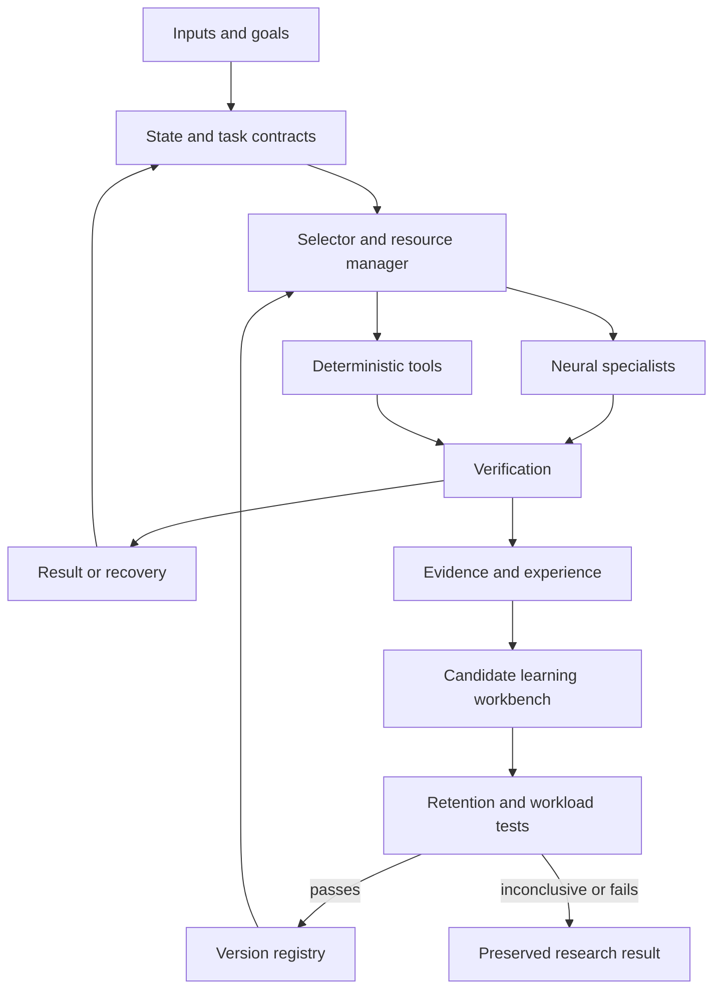
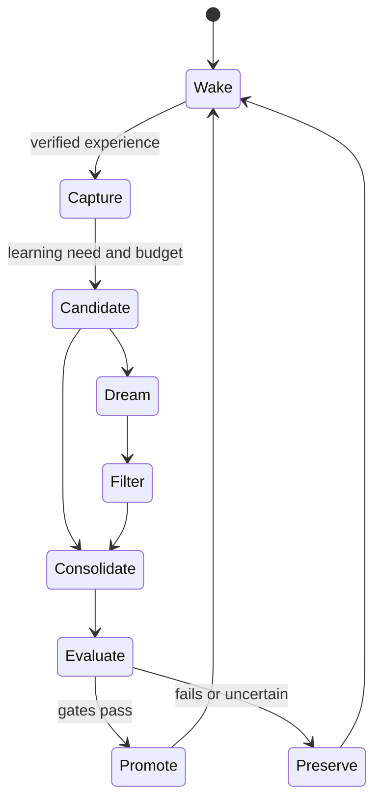

# The proposed HIVE framework

## Design target

**A modular learning system whose specialists, memories, workflows, and connections can improve independently and be evaluated together.**

The framework keeps the previous HIVE goal and four communication channels. Its first useful capability remains orchestrating tools and models, recovering from failures, and converting recurring corrections into dependable local improvements. See [Earlier architecture choices and open alternatives](51_Prior_Methods/H08-Architecture-Proposals.md) and [SOL, Grok, and Nemotron implementation workflow](51_Prior_Methods/H09-SOL-Coding-Handoff.md).

## Separate four kinds of graph

| Graph | Nodes and edges | Authoritative record | Purpose |
|---|---|---|---|
| Research graph | Topics, claims, methods, sources, experiments, disagreements | Authored notes plus typed edge ledger | Explain why a design exists |
| Code graph | Symbols, modules, imports, dependencies | Source at a pinned revision; derived Graphify index | Find affected code and reuse |
| Execution graph | Capabilities, workflows, data dependencies, budgets | Versioned recipe and runtime event log | Complete work |
| Neural structure | Layers, experts, adapters, parameters | Exact model/checkpoint manifest | Perform learned computation |

Edges can connect these graphs through stable IDs. Their meanings remain explicit: a document link cannot by itself change a model or authorize a tool.

## Runtime and learning loop

## Components and first implementation responsibility

| Component | Responsibility | Initial route | Research alternatives |
|---|---|---|---|
| Capability registry | Describe every tool, model, adapter, head, and workflow | Local manifests and an index | [Logical expert scale](10_Research/T07_Resources/P22_Logical_expert_scale.md) |
| Selector | Choose suitable capabilities and escalation | Rules and measured model baseline | [Controller and routing](10_Research/T03_Coordination/P09_Controller_and_routing.md) |
| Execution kernel | Leases, cancellation, retries, dependencies, durable events | Small deterministic service; Ruflo adapter where useful | [Communities and local recruitment](10_Research/T03_Coordination/P10_Communities_and_local_recruitment.md) |
| Local supervisors | Detect stalls and apply bounded repairs | Watchdogs plus repair rules | [Local supervisors and intervention learning](10_Research/T03_Coordination/P12_Local_supervisors_and_intervention_learning.md) |
| Memory service | Keep ownership, dates, source lineage, and retrieval | Existing Studio Brain adapter plus explicit record types | [Memory compartments and promotion](10_Research/T05_Memory/P16_Memory_compartments_and_promotion.md) |
| Evidence service | Distinguish observations, inferences, claims, and synthetic data | Provenance records and task checkers | [Evidence and contradictions](10_Research/T05_Memory/P17_Evidence_and_contradictions.md) |
| Learning workbench | Produce candidate memory, routing, procedure, or parameter changes | Isolated, reproducible jobs | [Wake memory](10_Research/T01_Learning/P01_Wake_memory.md)–[Learning and intentional forgetting](10_Research/T01_Learning/P04_Learning_and_intentional_forgetting.md) |
| Release registry | Bind compatible code, model, adapter, translator, and schema versions | Atomic version manifest and rollback pointer | [Learning and release contracts](70_Local_Build/B07_Learning_and_Release_Contracts.md) |
| Research interface | Make the design and its disputes navigable | Obsidian, Canvas, derived Graphify index | [Obsidian and Graphify](10_Research/T05_Memory/P18_Obsidian_and_Graphify.md) |

## Preserve the four channels

| Channel | Carries | Explicit separation |
|---|---|---|
| Control | Selection, budgets, leases, cancellation | Runtime checks authority |
| Task | Domain data, requests, intermediate outputs | Valid transport does not establish truth |
| Evidence | Observation, source, outcome, uncertainty | A claim retains its source and conditions |
| Teaching | Proposed examples, corrections, candidate updates | Admission and evaluation precede promotion |

A typed envelope may carry a precise text explanation, a numerical array, a scene graph, or an artifact pointer. Choose the representation for its consumer: [Language or native representation](30_Decisions/D06_Language_or_native_representation.md).

## What can change

Let the system state be:

$$
S_t=(K_t,\Pi_t,\Theta_t,G_t,P_t,B_t)
$$

| Symbol | Meaning | Example update |
|---|---|---|
| K | External knowledge and experience | Add a dated correction |
| Pi | Procedures and routing policy | Compile a recurring repair |
| Theta | Model and adapter parameters | Train a specialist candidate |
| G | Execution connections and communities | Test a new grouping |
| P | Protocols and translators | Version a representation bridge |
| B | Resource allocations | Change concurrency admission |

Every improvement record names the changed component. Better retrieval, a new script, and a trained neural model are distinct outcomes.

## Learning lifecycle

This is the proposed HIVE lifecycle. Global sleep, per-specialist sleep, and continuous updates remain comparison arms in [When HIVE should sleep](30_Decisions/D03_When_HIVE_should_sleep.md). A serving specialist may continue while a separate candidate learns only when the resource and compatibility tests support it.

## Architecture boundaries that stay flexible

- A role does not require a separate full model.
- A logical expert may be a program, head, adapter, checkpoint, or validated workflow.
- Model count and active concurrency are measured variables, not fixed at two.
- A small baseline is an experimental starting point; it does not narrow the overall HIVE hypothesis.
- Adaptive orchestration, topology, and protocol changes remain explicit research paths beyond the Google result.

[Experiment index](40_Experiments/00_Experiment_Index.md) · [Biological and physical translation map](20_Metaphors/00_Metaphor_Index.md) · [Terms and measurements](09_Terms_and_Measurements.md)
