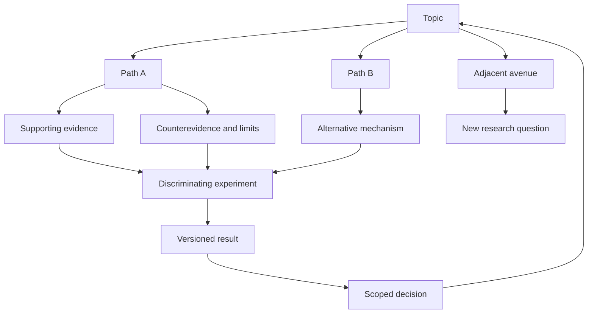

# Topic-first research map

## Navigation rule

**Topic → separate research path → alternative mechanisms → sources and history → experiment → result → further avenues.**

Begin with the question and mechanism. Select software after deciding what must be tested.

## Topic index

| Topic | Separate paths |
|---|---|
| [Learning lifecycle](10_Research/T01_Learning/T01_Learning.md) | [Wake memory](10_Research/T01_Learning/P01_Wake_memory.md) · [Sleep consolidation](10_Research/T01_Learning/P02_Sleep_consolidation.md) · [Dreaming and curriculum](10_Research/T01_Learning/P03_Dreaming_and_curriculum.md) · [Learning and intentional forgetting](10_Research/T01_Learning/P04_Learning_and_intentional_forgetting.md) |
| [Specialist structure](10_Research/T02_Specialists/T02_Specialists.md) | [Independent specialists](10_Research/T02_Specialists/P05_Independent_specialists.md) · [Shared backbone and adapters](10_Research/T02_Specialists/P06_Shared_backbone_and_adapters.md) · [Internal experts and expandable memory](10_Research/T02_Specialists/P07_Internal_experts_and_expandable_memory.md) · [Deterministic and nonlanguage experts](10_Research/T02_Specialists/P08_Deterministic_and_nonlanguage_experts.md) |
| [Coordination and supervision](10_Research/T03_Coordination/T03_Coordination.md) | [Controller and routing](10_Research/T03_Coordination/P09_Controller_and_routing.md) · [Communities and local recruitment](10_Research/T03_Coordination/P10_Communities_and_local_recruitment.md) · [Adaptive graph and grouping](10_Research/T03_Coordination/P11_Adaptive_graph_and_grouping.md) · [Local supervisors and intervention learning](10_Research/T03_Coordination/P12_Local_supervisors_and_intervention_learning.md) |
| [Representations and communication](10_Research/T04_Communication/T04_Communication.md) | [Typed channels](10_Research/T04_Communication/P13_Typed_channels.md) · [Domain-native representations](10_Research/T04_Communication/P14_Domain_native_representations.md) · [Learned codes and translators](10_Research/T04_Communication/P15_Learned_codes_and_translators.md) |
| [Memory, evidence, and knowledge graphs](10_Research/T05_Memory/T05_Memory.md) | [Memory compartments and promotion](10_Research/T05_Memory/P16_Memory_compartments_and_promotion.md) · [Evidence and contradictions](10_Research/T05_Memory/P17_Evidence_and_contradictions.md) · [Obsidian and Graphify](10_Research/T05_Memory/P18_Obsidian_and_Graphify.md) |
| [Verification and contamination](10_Research/T06_Verification/T06_Verification.md) | [Executable verification](10_Research/T06_Verification/P19_Executable_verification.md) · [Critics and calibrated uncertainty](10_Research/T06_Verification/P20_Critics_and_calibrated_uncertainty.md) · [Contamination and boundaries](10_Research/T06_Verification/P21_Contamination_and_boundaries.md) |
| [Resources and scale](10_Research/T07_Resources/T07_Resources.md) | [Logical expert scale](10_Research/T07_Resources/P22_Logical_expert_scale.md) · [Admission and residency](10_Research/T07_Resources/P23_Admission_and_residency.md) · [Sleep without interrupting service](10_Research/T07_Resources/P24_Sleep_without_interrupting_service.md) |
| [Prediction and alternative intelligence](10_Research/T08_Prediction/T08_Prediction.md) | [State estimation and world models](10_Research/T08_Prediction/P25_State_estimation_and_world_models.md) · [Parallel candidates and recovery](10_Research/T08_Prediction/P26_Parallel_candidates_and_recovery.md) · [NCM and dynamical specialists](10_Research/T08_Prediction/P27_NCM_and_dynamical_specialists.md) |
| [Daily application laboratories](10_Research/T09_Applications/T09_Applications.md) | [Video production and posting](10_Research/T09_Applications/P28_Video_production_and_posting.md) · [Live calls and supervisor streaming](10_Research/T09_Applications/P29_Live_calls_and_supervisor_streaming.md) · [Horror haunt game](10_Research/T09_Applications/P30_Horror_haunt_game.md) |
| [Research method and discovery](10_Research/T10_Research/T10_Research.md) | [Branching literature discovery](10_Research/T10_Research/P31_Branching_literature_discovery.md) · [Fair comparison and replication](10_Research/T10_Research/P32_Fair_comparison_and_replication.md) · [Biology and physical translation](10_Research/T10_Research/P33_Biology_and_physical_translation.md) · [Research-system improvement](10_Research/T10_Research/P34_Research_system_improvement.md) |

## Six search lanes for every path

| Lane | Required collection |
|---|---|
| Direct | Strongest relevant primary mechanism or result |
| Competing | Alternative method or explanation |
| Boundary | Failure cases, task assumptions, missing measurements |
| Adjacent | Another field addressing the same underlying problem |
| Implementation | Exact code, version, model, data, license, setup requirements |
| History | Earlier HIVE idea, attempt, result, and revised interpretation |

A path may have multiple parents. Keep one canonical page and add links rather than duplicating its conclusions.

## Frontier questions

- [Causal modularity](10_Research/T02_Specialists/F01_Causal_modularity.md)
- [Developmental specialization](10_Research/T03_Coordination/F02_Developmental_specialization.md)
- [Event-driven and neuromorphic computation](10_Research/T08_Prediction/F03_Event_driven_and_neuromorphic_computation.md)
- [Economic resource allocation](10_Research/T07_Resources/F04_Economic_resource_allocation.md)
- [Metamorphic and compositional testing](10_Research/T06_Verification/F05_Metamorphic_and_compositional_testing.md)
- [Surprise and curriculum selection](10_Research/T01_Learning/F06_Surprise_and_curriculum_selection.md)

## Done for one research pass

- A precise question with at least two meaningful approaches.
- A source-backed claim and its limits, or an explicit unresolved evidence gap.
- A test that could distinguish the approaches.
- At least one adjacent research avenue with a reason for relevance.
- Links to prior methods, an experiment, and a decision.
- A bounded next action with an owner, inputs, and expected artifact.

“Not yet investigated” is a useful status. It must not be converted into “does not work.”
