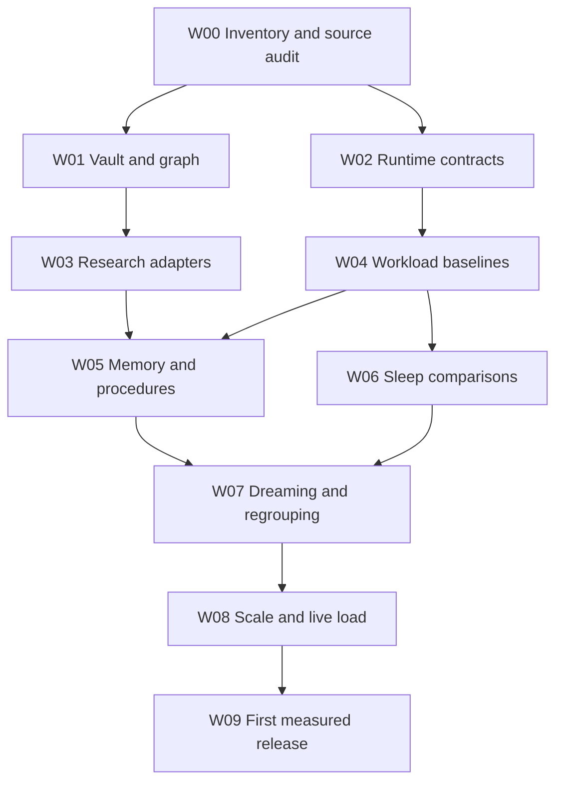

# Local build roadmap and work packages

## Build and research advance together

The local foundation provides repeatable execution and measurement. Research branches can run in isolated candidates as soon as their dependencies are available; learning is not deferred indefinitely.

## Work packages

| Package | Concrete output | Owner role | Acceptance |
|---|---|---|---|
| W00 | Current environment and source manifests | SOL coordinates; Grok and Nemotron inspect separate areas | Exact tools, endpoints, paths, model formats, and readiness recorded |
| W01 | Imported vault, history, graph, Canvas | Evidence/research worker | Links resolve; source hashes preserved; disputes remain navigable |
| W02 | Capability contracts, event log, cancellation, leases | Nemotron implements; Grok reviews | A failed worker can be cancelled/recovered without duplicate completion |
| W03 | Studio Brain and Graphify adapters | Grok implements; Nemotron reviews | Provenance-preserving reads; derived graph rebuilds from a pinned source set |
| W04 | Existing-workflow baselines and frozen task fixtures | Measurement worker | Correctness and latency measured with real foreground workload |
| W05 | Memory and procedural-learning candidates | Assigned coder plus independent reviewer | A repeated correction becomes a tested local rule or workflow |
| W06 | Replay/consolidation comparison suite | Learning worker | Arms and all capacity/compute differences explicit |
| W07 | Dreaming, regrouping, and representation experiments | Parallel research workers | Held-out comparisons and failures preserved |
| W08 | Registry-scale and sleep-under-load results | Runtime and measurement workers | 100/1000/10000 metadata tests separated from actual model concurrency |
| W09 | First promoted useful change | SOL integrates after checks | Repeated task improves under declared quality, retention, and resource gates |

## Scope gates

| Gate | Evidence needed |
|---|---|
| G0: Grounded environment | Local tools and model endpoints demonstrated; installed does not mean operational |
| G1: Repeatable execution | Reproduction manifests, durable task identity, and recoverable outputs |
| G2: Useful baseline | Existing workflow comparison and application-specific targets |
| G3: Learning signal | Retained held-out gain attributable to the named change |
| G4: Foreground compatibility | Resource and latency limits met under the relevant workload |
| G5: Reviewable release | Exact artifacts, rollback pointer, and decision record |

## First benchmark sequence

1. Audit and reproduce the historical small tests: [Reproduce prior simulations and separate estimates from measurements](40_Experiments/E01_Reproduce_Prior_Work.md).
2. Measure the PC and existing applications: [Measure the actual computer and concurrent workload](40_Experiments/E02_Hardware_Workload_Baseline.md).
3. Run one task family across strong generalist, independent, adapter, and hybrid baselines: [Compare generalists, independent specialists, adapters and hybrids](40_Experiments/E03_Expert_Architecture_Comparison.md).
4. Run the sleep mechanism comparisons: [Test sleep, replay order, expansion and distillation independently](40_Experiments/E04_Sleep_Factorial.md).
5. Add dreaming only as its own controlled comparison: [Test whether dreaming adds value beyond verified replay](40_Experiments/E05_Dreaming_vs_Replay.md).
6. Expand grouping, communication, retention, sleep scheduling, and scale tests: [Use measured interference to test regrouping and routing](40_Experiments/E06_Interference_Driven_Regrouping.md)–[Scale 100, 1,000 and 10,000 logical experts with measured active workers](40_Experiments/E10_Logical_Expert_Registry_Scaling.md).

These are dependency stages, not calendar promises. Estimate duration after measuring setup, one training step, and one full evaluation pass.

## Implementation details

[Existing software and readiness](70_Local_Build/B01_Existing_Software_and_Readiness.md) · [Vault import and historical preservation](70_Local_Build/B02_Vault_Import_and_History.md) · [Graphify and knowledge adapters](70_Local_Build/B03_Graphify_and_Knowledge_Adapters.md) · [Runtime and capability contracts](70_Local_Build/B04_Runtime_and_Capability_Contracts.md) · [Topic-based research-agent workflow](70_Local_Build/B05_Research_Agent_Workflow.md) · [Benchmark and measurement plan](70_Local_Build/B06_Benchmark_and_Measurement_Plan.md) · [Learning and release contracts](70_Local_Build/B07_Learning_and_Release_Contracts.md) · [Proposed repository and interfaces](70_Local_Build/B08_Proposed_Repository_and_Interfaces.md)
