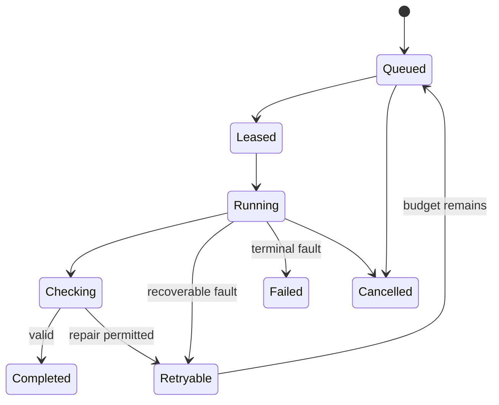

# Runtime and capability contracts

## Minimal deterministic kernel

Implement task identity, dependency tracking, deadlines, leases, cancellation, idempotent completion, bounded retries, and append-only events. Reuse existing coordination through an adapter where it satisfies the contract.

A minimal local event store can use SQLite. Keep its schema and API small enough to replace later if measurements require a different backend.

## Capability manifest

| Field | Required meaning |
|---|---|
| capability_id and version | Stable identity and exact revision |
| kind | Tool, model, adapter, head, workflow, or supervisor |
| input/output schema | Versioned task contract |
| prerequisites | Models, files, services, units, and environment |
| executor | Actual verified invocation adapter |
| model lineage | Base/tokenizer/adapter/quantization compatibility when applicable |
| resources | Measured peak and configured admission limits |
| verification | Checker, supported scope, abstention condition |
| memory scopes | Read/write ownership |
| artifact hashes | Executable, weights, configuration, and supporting data |

## Event state

Test lease expiry, worker restart, duplicate callbacks, cancellation, and a verifier rejection. Exactly-once side effects cannot be assumed from a queue label; use operation-specific idempotency and reconciliation.

## Protocol envelope

Required fields: schema version, task/run ID, channel, producer, target, representation version, units when relevant, source/artifact references, timestamps, and declared operation.

Keep outputs in named artifact files and use hashes/pointers for large payloads. A result may include a concise explanation without transmitting every agent's entire conversation.
