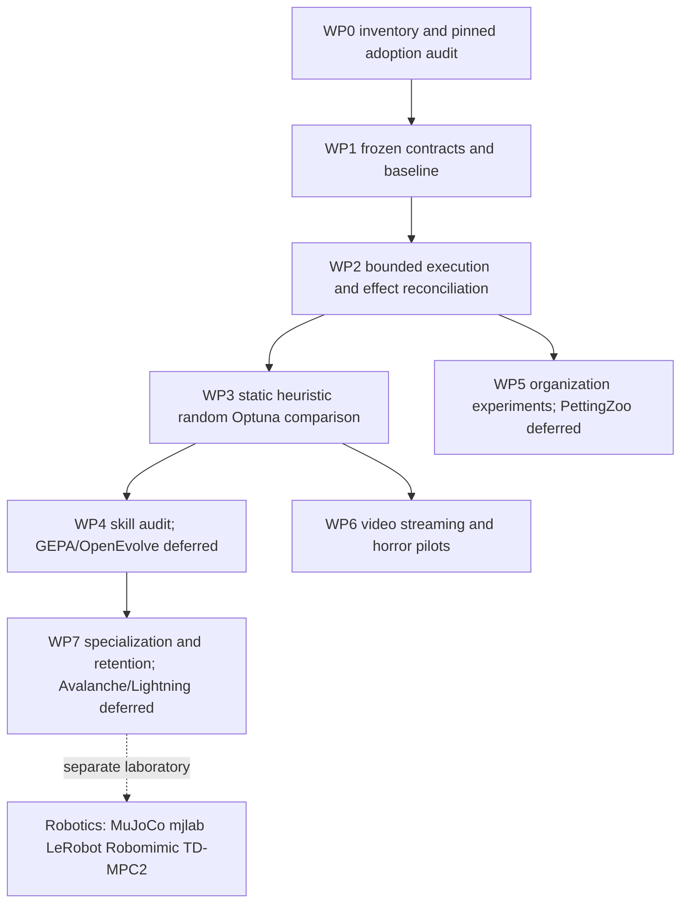

# Runtime v2 and bounded learning acceleration

This is an additive implementation record. [Home](../00_START_HERE.md), [build roadmap](../07_Local_Build_Roadmap.md), [readiness](B01_Existing_Software_and_Readiness.md) and [open decisions](../05_Open_Decisions.md) retain their original research paths. The 19 archived originals are unchanged.

The local runtime now dispatches eligible adapters, independently checks output, stores attributable episodes, evaluates a bounded development-derived correction, applies independent promotion gates and exercises restart/rollback. The learning-acceleration extension compares fixed, heuristic, random and optional Optuna recipes under frozen equal budgets. Known exposed caption evaluation remains regression evidence. No autonomous learning or fresh held-out gain is established.

## Stable implementation and experiment pointers

These pointers target the implementation branch; they are not a claim of production deployment.

- `LA-001`: [architecture and implementation decisions](https://github.com/MomInc-MBS/mominc-mbs.github.io/blob/feature/hive-runtime-v2-20261120/hive/implementation/runtime-v2/LEARNING_ACCELERATION.md).
- `LA-AUDIT-001`: [14-repository adoption audit](https://github.com/MomInc-MBS/mominc-mbs.github.io/blob/feature/hive-runtime-v2-20261120/hive/implementation/runtime-v2/learning_acceleration_adoption_matrix.md) and [exact source pins](https://github.com/MomInc-MBS/mominc-mbs.github.io/blob/feature/hive-runtime-v2-20261120/hive/implementation/runtime-v2/research_repo_pins.json).
- `LA-EXP-001`: [reproducible search executor](https://github.com/MomInc-MBS/mominc-mbs.github.io/blob/feature/hive-runtime-v2-20261120/tools/hive_engine/search.py) and [measured report](https://github.com/MomInc-MBS/mominc-mbs.github.io/blob/feature/hive-runtime-v2-20261120/hive/implementation/runtime-v2/SEARCH_RESULTS.md).
- `RUNTIME2-CODE`: [runtime, adapters, checker, governor, schemas and tests](https://github.com/MomInc-MBS/mominc-mbs.github.io/tree/feature/hive-runtime-v2-20261120/tools/hive_engine).
- `RUNTIME2-EVIDENCE`: [cycle measurements and rollback evidence](https://github.com/MomInc-MBS/mominc-mbs.github.io/blob/feature/hive-runtime-v2-20261120/hive/implementation/runtime-v2/RESULTS.md).

## Dependencies and unresolved alternatives

The research graph describes evidence and dependencies. The code graph identifies implementation, execution events identify measured trials, and a neural graph would describe learned components. These are distinct authorities. Control, Task, Evidence and Teaching channels do not confer deployment permission.

The unresolved question is whether an optimizer beats the strongest unchanged baseline on a fresh independently held task family without forgetting old skills or worsening recovery. The small software experiment does not answer the broader generalist/team comparison. Deferred packages remain live alternatives, with compatibility and resource prerequisites recorded in the audit.
