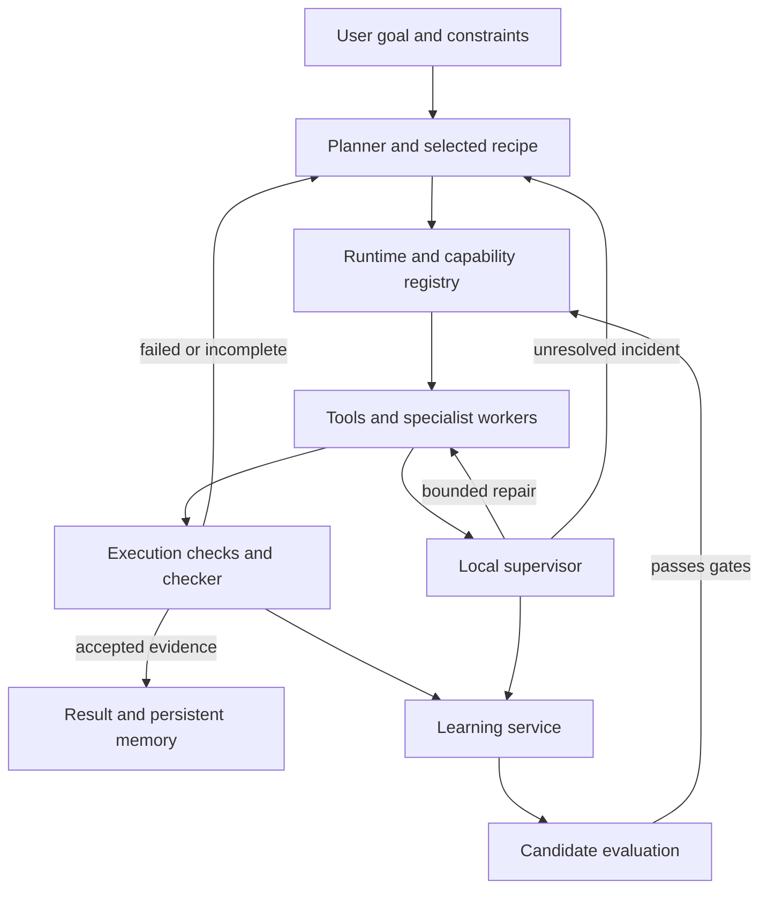
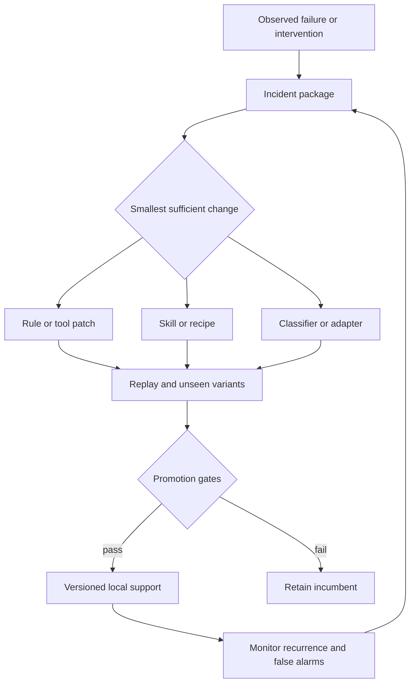

# HIVE First Edition Training and Build Plan

**Edition:** HIVE v0.1  
**Prepared:** 19 November 2026  
**Status:** Implementation and training specification. Hardware performance, training time, and HIVE results must be measured during implementation.

## 1. The build decision

Build HIVE as a persistent local system that learns how to assemble and operate tools, software, and small models. Its first specialty is **model and tool orchestration**: choose a suitable workflow, translate interfaces, execute dependent steps, check outcomes, recover from failures, and improve the responsible component.

The first edition combines two language-model foundations, separately versioned specialist adapters, a compact decision model, deterministic tools, persistent memory, and a software runtime. Three control roles are available: planner/operator, checker, and a challenger used when needed. Their number is independent of the number of specialist groups.

Your newest requirement is a release requirement: **a recurring human intervention must be convertible into a tested tool, rule, workflow, or local supervisor that reduces future intervention and main-controller monitoring.**

The practical starting point is 20 capability packages across five groups, expanding toward 100 through the same interfaces. A package may contain a trained neural specialist, a deterministic program, a model wrapper, or a service. Count these separately. Twenty packages do not imply twenty trained language models.

### What the first edition must demonstrate

1. Complete unfamiliar combinations of known tool operations.
2. Handle a documented change in a tool or model interface.
3. Retain earlier capabilities after targeted learning and a process restart.
4. Detect stalled work without repeatedly polling through the head model.
5. Learn a useful correction through an actual parameter update, alongside memory and workflow improvements.
6. Choose better specialist/tool combinations than a fixed-workflow version under the same resource limits.
7. Roll back an update that fails the release gates.

The broad research hypothesis remains that selective communication and local learning can improve learning efficiency and capability per unit of resource. The first edition tests that hypothesis in a bounded domain. Frontier-model equivalence and general intelligence are later research questions.

### First demonstration

Give HIVE a request to retrieve records, apply a calculation with explicit units, invoke a model through a documented response schema, and save a checked report in a sandbox.

During the sequence, change an API field, inject a stalled worker, and return one plausible but invalid model response. HIVE should repair or escalate each problem, complete only when the final-state checks pass, retain the verified correction, and handle a new variation after restart. Measure the improvement across repeated cases.

## 2. Existing resources and operating limits

The planning hardware is your reported **RTX 5070 Ti with 16 GB VRAM and 64 GB DDR4 RAM**. Your 15 November inventory recorded Ollama running, LM Studio installed with its server offline, Python 3.11/3.12 and uv installed, and Docker Desktop installed with its daemon unchecked. The earlier HIVE foundation recorded Ruflo connected and LAYA prepared with a deterministic fallback. These are earlier observations, not a fresh inspection of the PC. See the project sources in Section 17.

### Reuse and readiness

| Item | First-edition use | Initial action |
|---|---|---|
| Python and uv | Runtime, evaluation, training environments | Create isolated environments and preserve a dependency lock |
| Ollama | Existing stock-model endpoints and deployment comparison | Check endpoint, loaded models, schema handling, and measured memory |
| Ruflo | Adapter for useful coordination functions | Run contract checks against the installed version |
| LAYA | Candidate decision/routing implementation | Pin the actual checkpoint and engine; measure calibration |
| Soup | Existing prepared training frontend | Inspect its environment; reuse only if it reproduces the chosen recipe |
| LM Studio | Optional model inspection using existing installation | No dependency on it for the first executable build |
| Docker Desktop | Isolation for generated-code and simulated-tool tasks | Verify daemon and resource limits before using it |
| Studio Brain / Obsidian | Read-only context source through an adapter | Keep experimental training and authoritative runtime state separately versioned |

Use one canonical ML training path: **PyTorch + Transformers + PEFT + TRL**. An existing frontend can wrap that recipe if the outputs and configuration remain inspectable.

### Proposed starting limits

These values are initial engineering limits, subject to the hardware pilot.

| Resource | Initial policy |
|---|---|
| GPU execution | One inference or training job holding a GPU lease at a time; CPU tools and I/O may overlap |
| Second concurrent GPU request | Enable only after a measured throughput/latency benefit within the same memory cap |
| HIVE VRAM allowance | Start with a 12 GiB ceiling, reduced further when measured non-HIVE usage plus a 2 GiB reserve requires it |
| HIVE host RAM | Start with 32 GiB for interactive work; increase in the dedicated research profile only after measurement |
| Controller sequence | Start with 2,048 tokens total for input plus output; reserve 256–512 for the action and fit state into the remainder |
| Controller action output | Initially 256–512 tokens, with explicit action count and time limits |
| Task graph | Up to eight nodes in the first arena; up to 12 controller decisions per episode |
| Recovery | At most two permitted retry/repair attempts per failed step |
| Training | Exclusive GPU lease; active inference workers drained and conflicting model allocations released |
| Retained model packages | Incumbent, candidate, and one rollback package; shared immutable bases are deduplicated |
| Replay | 2,000 eligible examples total, stratified across skills, protocols, and difficult cases |
| Operational trace storage | Newest 2,000 full episodes within an initial 10 GiB artifact cap; retain compact outcomes for longer |

Admission uses measured free memory, weights, activations or KV cache, runtime overhead, and competing processes. The 12 GiB ceiling is not a prediction of model size. Training activations and optimizer state are measured separately from inference.

Frozen datasets, training-run evidence, and release lineage are pinned separately from rolling operational traces and counted in total storage. Cleanup must not remove artifacts referenced by retained experiments or releases. Set their disk allowance after measuring the initial corpus and available storage.

Create two reproducible profiles: **dedicated research** and **studio sharing**. In the first training pilot, pause competing GPU workloads. Studio-sharing inference must be checked with your actual OBS, cameras, filters, and overlays.

Ollama exposes model lifetime, queue, and request-parallel controls. Its documentation explains that parallel requests increase context-related memory. HIVE still needs its own admission policy and visible queue. [Ollama FAQ](https://docs.ollama.com/faq)

## 3. Architecture and specialist groups



The runtime owns execution state and limits. Models propose decisions through typed interfaces. The supervisor runs independently of the controller’s conversational context. The learning service creates candidate versions while the active system remains on its incumbent versions.

### Twenty initial capability packages

| Group | Four packages | Implementation emphasis |
|---|---|---|
| Control | Planner/operator; route selector; evidence checker; conditional challenger | Small models or classifiers with bounded decisions |
| Protocol and repair | Schema interpreter; tool-call translator; workflow sequencer; failure repairer | Learned translation/diagnosis plus deterministic schema checks |
| Execution | Calculator/solver; SQLite worker; structured-data transformer; isolated Python/test worker | Executable programs and external model wrappers |
| Memory and evidence | Document retrieval; provenance recorder; fact/version resolver; skill registry | Persistent software services with targeted semantic assistance |
| Maintenance and learning | Progress watchdog; resource arbiter; teaching/data curator; experiment/promoter | Deterministic monitoring, candidate generation, evaluation |

The execution group can expose several tools through one package. Retrieval can later include a web-search adapter. Package count is an organizational unit, not a parameter count.

Every package declares a group owner, input/output representation, permitted actions, measured competence, evidence requirements, resource profile, and exact version. Group boundaries control memory access, update ownership, budgets, and which messages are exchanged.

### The three control roles

**Planner/operator:** turns the goal into a bounded workflow, selects tools and specialists, and revises the plan from observations.

**Checker:** examines completion conditions, evidence, and contradictions. It can request additional checks or return incomplete. It cannot turn model agreement into proof.

**Conditional challenger:** activates for novel schemas, unresolved disagreement, repeated failure, or a high-value decision needing another approach. It proposes an alternative workflow or a targeted counterexample.

Initially the challenger can use an existing foundation with a different prompt or adapter. Record shared parameters explicitly: different prompts or role names do not establish independent errors. Prefer independent executable checks whenever they exist.

## 4. Model and software choices

### Starting neural configuration

| Component | Default candidate | Training target |
|---|---|---|
| Main planner/operator | Qwen/Qwen3-1.7B with a controller adapter | Bounded next-action and workflow selection |
| Protocol translator | Qwen/Qwen3-0.6B with its own adapter | Correct current-schema tool calls |
| Repair specialist | Same 0.6B foundation with a separately trained adapter | Local diagnosis and permitted repair |
| Checker | Separately trained 0.6B adapter plus deterministic checks | Missing evidence, contradictions, incomplete tasks |
| Challenger | On-demand 1.7B role initially | Alternative plan or additional test |
| Route selector | Small classifier baseline, then the pinned LAYA implementation | Capability/recipe choice and calibrated abstention |

The official Qwen cards provide these text-model checkpoints and thinking/non-thinking controls. Use non-thinking mode for bounded control outputs at first. Model choice remains a measured baseline, with exact model, tokenizer, and chat-template revisions pinned. [Qwen3-1.7B](https://huggingface.co/Qwen/Qwen3-1.7B) · [Qwen3-0.6B](https://huggingface.co/Qwen/Qwen3-0.6B)

The 0.6B size is a starting experiment. If it fails the task threshold after the dataset and interface are sound, move only the failing capability to a larger measured candidate. Model size is a variable, not a commitment to accepting poor performance.

### What the named HIVE technologies do

| Technology | Assigned role |
|---|---|
| LAYA | Decision interface and routing experiment |
| Ruflo | Replaceable coordination integration |
| NCM | Separately budgeted concept-generation research branch |
| LoRA / QLoRA | Local specialist parameter updates |
| SQLite and artifact store | Durable task state, memories, evidence, and provenance |
| Python tools and solvers | Calculations, transformations, tests, and exact checks |
| Typed messages | Domain isolation and explicit cross-group translation |

**LAYA compatibility:** the current repository distinguishes a new default reader/decision engine from classic encoder checkpoints. Pin the chosen engine explicitly, count its complete reader footprint, and calibrate on HIVE data. An upgrade is a candidate change requiring re-evaluation. [LAYA repository](https://github.com/NandhaKishorM/laya)

**Ruflo integration:** reuse documented coordination capabilities behind an adapter; HIVE’s task journal and evaluation remain authoritative. [Ruflo swarm documentation](https://github.com/ruvnet/ruflo/blob/main/plugins/ruflo-swarm/README.md)

**NCM scope:** Hazy Research’s Next-Concept Modeling provides coarse-to-fine generation and released task checkpoints/evaluation. Its first HIVE task is reproducing a released bounded task and comparing usefulness as a specialist. Confirm the selected revision’s training path before committing to custom training. [NCM repository](https://github.com/HazyResearch/ncm)

### Serving trained specialists

Use a **Transformers + PEFT worker** for the first trained adapters. Preserve Ollama for existing endpoints and the stock-model comparison. This avoids making training progress depend on an unverified conversion path.

Once the native worker passes, optionally merge an adapter with its exact base, convert through a supported exporter, quantize, import as an immutable Ollama model, and rerun the behavior tests. Export is its own release gate. Current Ollama import documentation covers Safetensors and prepared GGUF models. [Ollama import](https://docs.ollama.com/import)

Swaps occur at task or explicit checkpoint boundaries. Drain the affected worker, check compatibility, load and probe the candidate, change the registry pointer, invalidate model-specific caches, and resume. A base-model or tokenizer change requires a complete compatible package. PEFT’s LoRA swapping support has compatibility restrictions; it does not permit arbitrary adapters across unrelated bases. [PEFT hotswapping](https://huggingface.co/docs/peft/en/package_reference/hotswap)

Pin the complete manifest at task admission. Promotion affects new tasks by default. A running task retains its versions unless an explicit checkpoint migration revalidates every remaining step against the candidate manifest.

## 5. Runtime contracts and execution

### Four communication channels

| Channel | Payload |
|---|---|
| Control | Task/attempt identity, selected action, capability, priority, deadline, budget, permission reference |
| Task | Typed inputs, units, constraints, required output, artifact references |
| Evidence | Observed outputs, source/version, executed checks, pass/fail/unknown, verification scope |
| Teaching | Failure class, corrected behavior, supporting evidence, target component, data eligibility |

Use structured fields for control, numbers, schemas, and evidence. Natural language remains useful for user intent, source text, and bounded explanations. Private latent languages are an experiment after explicit communication works.

Every envelope includes task ID, attempt ID, parent event, producer/version, group namespace, representation version, and timestamps. Large content travels as an immutable artifact reference with a checksum.

Ollama can accept a JSON schema and Pydantic can validate its result. HIVE must also check semantic prerequisites and actual outcomes. [Structured outputs](https://docs.ollama.com/capabilities/structured-outputs)

### Controller action vocabulary

```text
SELECT_RECIPE
CALL_TOOL
DELEGATE
RUN_PARALLEL
REQUEST_CHECK
PROPOSE_SWAP
REPAIR
ASK_FOR_INFORMATION
FINISH
ABSTAIN
```

Each action carries typed arguments and a reason code. A free-text reason is optional and short. The controller receives only the current task state, relevant capability descriptions, a bounded evidence packet, and remaining budget.

The runtime rejects unknown capabilities, incompatible versions, excess budgets, missing prerequisites, and unsupported actions. FINISH requests a completion check; it cannot mark itself successful.

### Durable state machine

Normal progression:

```text
QUEUED -> READY -> RUNNING -> VERIFYING -> SUCCEEDED
```

Other states are RETRY_WAIT, BLOCKED, RECONCILING, FAILED, and CANCELLED.

Write the state transition and associated event in one database transaction. A logical step may have multiple attempts, each with a lease and increasing fencing token. Late output from an expired attempt cannot overwrite newer state.

Lease expiry does not prove that a GPU job stopped. Reassign GPU capacity only after confirming completion or termination and memory reclamation. If the backend cannot confirm this, quarantine or restart the affected worker/server and reconcile its tasks before admitting another GPU job.

After a restart, reconcile previously running attempts against tool state and verified artifacts. A timeout after an external write is an uncertain result, not evidence that the write failed.

### Tool isolation and retry classes

| Operation class | Retry policy |
|---|---|
| Read-only or demonstrated idempotent operation | Bounded automatic retry |
| Write with an idempotency key | Reuse the original key and inspect result state |
| Unknown outcome after a write | Reconcile before further action |
| Non-idempotent operation without reconciliation | Escalate; no blind retry |

Generated Python executes in an isolated environment with explicit time, memory, output, and filesystem limits. Runtime workers use structured arguments. Cancellation terminates the owned process tree or container. Drain output continuously and bound logs.

Tools expose meaningful progress such as completed records, bytes transferred, validated artifacts, or milestones. Heartbeats indicate liveness; they do not establish progress.

## 6. Memory and knowledge boundaries

Implement a transparent memory layer before adding an elaborate graph backend.

| Memory type | Stored content | Update rule |
|---|---|---|
| Working state | Current plan, tool observations, unresolved constraints | Scoped to task; checkpointed |
| Episodic | What happened, versions, costs, outcomes | Append event history; compact under retention policy |
| Semantic | Facts with evidence, timestamps, scope, conflicts | Revise by source/version; retain supersession links |
| Procedural | Skills, tested recipes, fixes, adapters | Immutable version plus promotion record |
| Replay | Verified training examples and retained skills | Stratified bounded sample |
| Graph relations | Uses, depends-on, derived-from, supersedes | SQLite edge table initially |

Begin retrieval with metadata and lexical search. Add embeddings only when an experiment shows better relevant recall within the same latency/memory budget.

An observation, a model hypothesis, a source-supported claim, and an executable verified result have different statuses. A model summary does not inherit stronger status than its evidence.

Memory records include provenance, group visibility, validity interval, confidence type where applicable, and deletion/retention policy. Group-local stores can share approved facts through explicit evidence messages.

No training process reads final-test solutions or hidden environment state. The runtime receives only observations it would have in actual operation.

## 7. The first learning arena

Build an executable simulated service with ten operations. The service owns hidden expected state, while HIVE sees documented interfaces and normal returned observations.

Separate runtime-visible checks from the evaluator-only scorer. The runtime may inspect documented tool results and public predicates; the hidden scorer independently judges terminal correctness. Training episodes can receive defined outcome feedback after execution. Sealed evaluation supplies no answer-key, repair, or intermediate hidden-test feedback to the controller, its memory, or its learner.

| Operation | Purpose | Independent outcome check |
|---|---|---|
| calculate | Arithmetic, units, simple symbolic expressions | Exact or tolerance-based expected value |
| query_records | Retrieve and aggregate sandbox records | Database result and required filters |
| search_docs | Find relevant documents | Fixture relevance and permissible source set |
| read_doc | Retrieve document text and version | Exact source identity and content |
| transform_records | Normalize/filter structured records | Output invariants and expected rows |
| validate_payload | Validate a versioned schema | Schema and semantic constraints |
| run_tests | Check a small generated or repaired program | Hidden cases plus explicit invariants |
| get_job_status | Observe an asynchronous task | Actual job state and progress |
| write_artifact | Save a sandbox output | Content hash, location, and idempotency behavior |
| invoke_model | Call a model through a registered interface | Required output contract and downstream task correctness |

A live model response is an observation requiring checks. Simulated model responses provide controlled malformed, contradictory, missing, and correct cases. Live web search enters later through the same evidence boundary; reproducible source snapshots are used for the core evaluation.

### Curriculum stages

1. One valid operation with all information present.
2. Tool selection among relevant and irrelevant capabilities.
3. Two-to-five dependent operations.
4. Missing fields, ambiguity, unsupported requests, and stopping correctly.
5. Renamed fields, enum changes, unit shifts, and schema-version negotiation.
6. Transient failures, hangs, stale results, duplicate messages, and exhausted budgets.
7. New combinations of known tools and new tool documentation.
8. Earlier protocols revisited after new learning.

Vary semantics as well as wording: negation, units, preconditions, output ordering, duplicate records, and conflicting source versions. A collection of near-identical paraphrases does not establish generalization.

## 8. Dataset construction and teacher use

### Proposed first corpus

Create **12,000 independently tracked episodes**. An episode can yield several role-specific training examples; record the resulting count and token volume rather than calling each projection a new independent task.

| Partition | Episodes | Purpose |
|---|---:|---|
| Training | 8,000 | SFT and recipe-learning experience |
| Development | 1,000 | Debugging and limited hyperparameter selection |
| Calibration | 500 | Routing/abstention calibration; no gradient training |
| Promotion reserve | 500 | Candidate comparisons with a predeclared limited evaluation budget |
| Sealed release test | 2,000 | Final reporting after configurations freeze |
| Total | 12,000 | Initial target, not a proven required minimum |

Begin with 300–500 checked seed episodes from the training allocation. Scale only after the generator, validator, and splits work.

Assign scenario families, tool-schema variants, source documents, code templates, and mutation lineages to splits before creating paraphrases. Hold out entire workflow compositions and selected schema changes. Hash and deduplicate across splits.

The promotion reserve is not an unlimited source of feedback. Limit candidate submissions, rotate new held-out families for later rounds, and retire any exposed cases into development. Preserve a fresh release test for later major releases.

### Training allocation

| Case type | Share | Training episodes |
|---|---:|---:|
| Selection and one-step calls | 25% | 2,000 |
| Multi-step composition | 20% | 1,600 |
| Missing information, abstention, stopping | 15% | 1,200 |
| Faults and recovery | 15% | 1,200 |
| Schema/protocol changes | 10% | 800 |
| Evidence and memory-version handling | 10% | 800 |
| Adversarial and misleading inputs | 5% | 400 |

These are starting proportions. Change them using development evidence before freezing the confirmatory configuration.

### Required trace fields

Each episode records task/family/split, visible input, current schemas, permitted actions, tool/model/adapter versions, selected recipe, actions, actual tool outputs, evidence references, checker results, independent final-state outcome, costs, retries, termination reason, and correction provenance.

Separate model-visible input from evaluator-only expected state. Audit a few rendered training examples directly; accidental answer-key exposure invalidates the experiment.

### How larger models help

A larger model may propose tasks, workflows, labels, and repairs. Execute its proposals in the arena. Accept a positive behavior label only when independent checks support it.

Preserve unsuccessful behavior as a failure context, negative checker example, or recovery lesson. A workflow that eventually succeeds can still contain bad intermediate actions: do not train all of them as positive actions.

For ambiguous requests, the correct target can be ASK_FOR_INFORMATION or ABSTAIN. For completed tasks, include stopping examples so that extra calls are not rewarded.

Prefer compact visible decision traces and observed outcomes. Long reasoning transcripts are unnecessary for the initial controller objective.

TRL supports tool-call messages, tool-role observations, and tool schema columns for SFT, with assistant-only loss when the chat template supplies the required masks. Inspect masks in the pinned environment. [TRL SFT documentation](https://huggingface.co/docs/trl/sft_trainer)

For recovery training, prefer next-action prompt/completion records: earlier failed actions stay in the masked prompt, and only the verified corrective action is a supervised completion. Alternatively use explicit per-turn loss masks. Assistant-only loss by itself still trains every assistant turn and therefore cannot exclude failed assistant actions.

Teacher calls, purchased API usage, data generation, and rejected examples count toward total learning cost. A teacher-generated answer does not become ground truth through repetition.

## 9. Training sequence

### T0 — Establish behavior before training

Run the deterministic workflow baseline and a stock generalist through the same arena. Save success, false completion, tool errors, latency, memory, and intervention counts.

Use the same tool wrappers and verifiers for every experimental arm. Establish the cost of a successful basic workflow before adding specialists.

### T1 — Train routing and translation

Train a simple route classifier as the minimum learned baseline. Compare the pinned LAYA implementation using the same cases and calibration set. Route labels include supported groups/recipes and an explicit uncertain/unsupported outcome.

Train the 0.6B translator on intent plus current schema to produce valid tool calls. Include changed fields and units. Score downstream effects, not just valid JSON.

**Exit:** measurable improvement over the stock model on unseen protocol cases without losing earlier tool versions.

### T2 — Train the planner/operator

Train the 1.7B controller on current task state, a short candidate-capability list, observations, and remaining budget. Targets are bounded next actions, workflow selection, proper escalation, and stopping.

Initially select from six reviewed recipes:

1. Direct deterministic tool and check.
2. Retrieve, transform/calculate, and check.
3. Specialist, executable check, and bounded repair.
4. Multiple independent candidates, separate checks, then selection.
5. Tool workflow with conditional challenger.
6. Clarification or abstention.

**Exit:** end-to-end gains over prompted roles using the same fixed recipes and budget.

### T3 — Train checker and local repair

Train the checker with correct, incorrect, unsupported, stale, and incomplete results. Include syntactically valid but semantically wrong arguments and plausible false completion claims.

The repairer receives a bounded incident packet: expected and observed state, relevant schema, error/log excerpt, prior remedies, and remaining budget. It selects a permitted remedy.

**Exit:** fewer accepted bad outcomes and better correctly completed recoveries. An improved rejection rate accompanied by excessive abstention does not pass.

### T4 — Learn recipe selection

Evaluate safe alternative recipes on the same sandbox task families. Record the feasible candidate set, chosen recipe, actual outcome, cost, and selection probability if exploration is used.

Begin with a supervised recipe ranker using these comparisons. Add a contextual-bandit policy only after coverage and logging are adequate. Use bounded sandbox exploration, such as an initial 10% allocation, rather than silently experimenting on external side effects.

**Exit:** improved quality/cost tradeoff against the same specialists with fixed recipes.

### T5 — Run a targeted parameter-learning cycle

Cluster a recurring verified error, collect diverse corrections, train only the affected adapter or classifier, and evaluate its whole dependency neighborhood. Keep another group unchanged.

**Exit:** improvement on unseen variants, retained old skills, persistence after restart, and a successful rollback exercise.

### T6 — Compare independent backbone learning

Run a separately budgeted 0.6B backbone-update pilot with actual backbone parameters trainable. Start with short sequences, batch one, checkpointing, and a measured optimizer footprint.

Compare backbone and adapter learning on the same generative protocol task using the same 0.6B initialization and eligible data. Include duplicated frozen bases with separate adapters as an isolation control. Compare a fully trained compact classifier only on routing, next-action classification, or failure classification with equivalent output labels. Record unique/shared parameters and trainable masks.

This preserves the independent-specialist research question. The adapter-based first edition can be released while a more expensive backbone experiment remains inconclusive.

### Starting controller SFT configuration

All values below are provisional HIVE settings.

| Setting | Starting value |
|---|---|
| Foundation | Exact revision of Qwen/Qwen3-1.7B |
| Method | QLoRA, frozen quantized base |
| Quantization | 4-bit NF4, double quantization, BF16 compute after compatibility check |
| LoRA rank / alpha | 16 / 32 |
| Dropout | 0.05 |
| Target layers | All applicable linear layers, with resolved names recorded |
| Sequence length | 2,048 tokens initially |
| Microbatch / gradient accumulation | 1 / 16 |
| Learning rate | 1e-4; one predeclared comparison at 5e-5 |
| Epoch ceiling | 3; choose earlier checkpoint if development behavior is better |
| Warmup | 3% of update steps |
| Gradient norm clipping | 1.0 |
| Gradient checkpointing | Enabled |
| Packing | Disabled until masking and sequence boundaries are verified |
| Optimizer | Supported AdamW configuration; 8-bit option only after a compatibility pilot |
| Supervised output | Verified assistant decisions, excluding tool/user/evaluator content |
| Checkpoint selection | Executed outcomes, false acceptance, retention, and resource limits |

For the 0.6B worker, begin with rank 8 or 16 and 1,024-token examples where the task fits. Never silently truncate required schemas, constraints, or the target action.

PEFT documents quantized-base adapter training and the NF4/double-quantization/BF16 setup. The exact curriculum, rank, sequence length, and acceptance criteria here are experimental choices. [PEFT quantization](https://huggingface.co/docs/peft/developer_guides/quantization)

### Local training readiness test

Before a full run, verify GPU detection, the chosen precision, quantized loading, forward/backward execution, an optimizer step, checkpoint saving, and reload parity. Record peak allocated and reserved VRAM.

Pin Python, PyTorch, Transformers, PEFT, TRL, bitsandbytes, model, tokenizer, and CUDA-related versions after the successful pilot. Current bitsandbytes build documentation includes recent GPU targets on Linux and Windows, but the actual installed combination still needs this test. [bitsandbytes installation](https://huggingface.co/docs/bitsandbytes/installation)

Estimate training time from measured steps per second. For N role-specific records and an effective batch of 16, update steps per epoch are approximately ceiling(N / 16), adjusted for sampling and incomplete batches. No fixed hours-to-train promise is justified before the pilot.

## 10. Adaptive assembly and role changes

HIVE should learn several different kinds of change, with separate records for each.

| Change | Example | Mechanism |
|---|---|---|
| Selection | Use a calculator, a model, or a retrieval tool | Router/ranker update |
| Expertise | Use the protocol adapter instead of the repair adapter | Compatible package selection |
| Team | Add a checker for a difficult task | Recipe choice |
| Oversight | Move an incident to a more capable group supervisor | Bounded delegation |
| Workflow | Run independent checks concurrently or reorder independent steps | Graph candidate |
| Knowledge | Retain a verified mapping or source fact | Memory/procedure update |
| Parameters | Correct a recurring translation error | Targeted adapter/classifier training |
| Foundation | Replace a base model after comparative testing | Complete package migration |

A learned controller proposes these changes; the runtime checks compatibility, authority, prerequisites, and resource limits.

### Search procedure

Start from the six recipes in T2. Propose one change per candidate: replace one worker, add one check, modify one dependency, substitute a trained adapter, or install one local monitor.

Reject graphs with missing capabilities, invalid representations, unbounded cycles, or costs outside the available budget. Allow parallel branches only when dependencies and side effects permit them.

Use a proposed ceiling of ten graph candidates per offline experiment batch. Screen on development tasks, retain a short list, then use the separately limited promotion evaluation. Record failed candidates and search cost.

Optimize **verified completion subject to correctness and resource limits**. Among acceptable candidates, prefer lower latency, lower compute, and fewer interruptions. A low-cost failure cannot beat a successful workflow merely through a weighted reward.

RouteLLM provides a precedent for learning model selection from quality/cost signals. AFlow provides a precedent for searching executable workflows using execution feedback. The broader HIVE combination of tools, local supervisors, role swaps, and adapters is our proposed integration. [RouteLLM](https://arxiv.org/html/2406.18665v4) · [AFlow](https://arxiv.org/html/2410.10762v4)

## 11. Local supervision and intervention learning

### Three recovery levels

| Level | Trigger | Response |
|---|---|---|
| Deterministic reflex | Exit, deadline, meaningful progress stall, queue pressure, known error code | Registered retry, backoff, worker restart, cancellation, or circuit breaker |
| Local semantic repair | Error needs interpretation within one group | Small repair specialist with a compact incident packet |
| Head escalation | Cross-group problem, exhausted budget, changed goal, missing information/authority | Single structured incident summary |

The supervisor watches process and task telemetry on the CPU. Normal health polling contributes no messages to the head’s context. A heartbeat cannot continually extend a stalled tool’s progress deadline.

Set heartbeat and progress thresholds from each tool’s observed behavior. A five-second heartbeat may suit a short local tool; a lengthy compile needs a different progress contract. One timeout for every tool creates false alarms.

### From your correction to a permanent improvement



An incident package contains the trigger, expected result, actual result, affected versions, remedy, remedy preconditions, observed recovery evidence, negative cases where the remedy must not fire, and escalation conditions.

For a frozen worker, build a progress watchdog. For a reproducible argument bug, patch the tool or translator. For a variable semantic failure, train a local specialist. Adding another model is justified by measured benefit when interpretation is necessary.

Test every remedy on both the reproduced failure and nearby valid behavior. A supervisor that repeatedly kills legitimate long jobs has made the system worse.

### Proposed supervision outcome

For the incident classes covered by the first supervisor, target at least a **50% reduction in head-controller interruptions**, with no reduction in verified recovery and no observed false recovery or duplicate effects in the critical incident suite.

Also record human interventions and human minutes per 100 tasks. This measures your actual oversight burden rather than substituting a token count for it.

## 12. The continuing improvement loop

The first edition has four distinguishable learning mechanisms:

1. **Memory:** retain verified observations and corrections.
2. **Procedures:** create or revise tested skills and local recovery rules.
3. **Selection:** improve the choice of existing recipes and specialists.
4. **Weights:** train adapters, classifiers, and the independent-backbone research arm.

A release report must say which mechanisms changed and what improved. Stored transcripts alone do not count as parameter learning.

### Bounded operating cycle

1. Record executions and interventions.
2. Cluster failures by reproducible cause and affected component.
3. Check whether a simpler tool/schema/procedure correction is sufficient.
4. Collect checked, diverse examples for the selected change.
5. Train or build one candidate.
6. Run component tests, workflow tests, and retained-skill evaluation.
7. Shadow the candidate on replay or reversible work.
8. Promote only if the fixed gates pass.
9. Observe recurrence and regression; roll back when needed.

An initial trigger for reviewing a repeated incident can be 20 occurrences. A weight-update batch should normally wait for at least 200 diverse eligible examples, including generated verified variants; a deterministic critical fix can proceed sooner with focused evidence. These are starting workflow limits.

For continual SFT, begin with **50% new verified cases, 40% retained examples, and 10% difficult abstention/adversarial cases**. Keep the replay budget bounded and preserve rare skills. Change the mixture through a controlled comparison.

All three allocations draw only from eligible training episodes. Replay never draws from retained-skill evaluation cases, and adversarial training never draws from the sealed checker audit. Retention is measured on disjoint held-out cases.

Run training when the exclusive GPU lease is available. The running system uses an immutable incumbent package. Changes to the runtime’s permissions, evaluator, or promotion rules receive a separate code review and a fresh comparison; the candidate cannot redefine its own pass condition.

### Promotion lifecycle

```text
CANDIDATE -> OFFLINE_PASSED -> SHADOW_PASSED -> CANARY -> ACTIVE
```

In v0.1, a canary means a small eligible share of reversible local work, initially 5%, under the same budget. Replaying a read is acceptable; duplicating an external write merely to compare models is not.

Promote a manifest that pins compatible runtime, model, tokenizer, adapter, tool, recipe, representation, and verifier/evaluator versions. Rollback restores that manifest. State/schema changes must preserve rollback compatibility or supply a separately tested migration/restore path. Compatible prior artifacts remain readable.

A model rollback cannot undo an already executed external side effect. Such actions require explicit reconciliation or a registered compensating operation.

### Hallucination and contamination control

The practical target is a declining rate of unsupported accepted outputs. Zero hallucinations cannot be guaranteed.

Ground calculations in tools, code claims in executed checks, and source claims in retrieved evidence. Preserve unknown/incomplete states. Test checker false acceptance and omissions.

Separate incoming text from control authority. A retrieved page or tool response cannot change the action policy, modify tests, or promote its own content to verified training data.

Keep the evaluator and sealed task truth outside the candidate’s writable environment. When the evaluator itself is corrected, rerun both baseline and candidate under the same version.

Repeated adaptive evaluation can overfit a holdout even without direct gradient training on it. HIVE therefore limits promotion queries and uses fresh release tasks; it does not claim the formal guarantees of specialized reusable-holdout algorithms. [Adaptive data analysis and holdout reuse](https://proceedings.neurips.cc/paper_files/paper/2015/file/bad5f33780c42f2588878a9d07405083-Paper.pdf)

Agent Lightning’s current research separates an agent’s execution harness from its learner. It is a relevant later integration for agent-level RL, after supervised training, reward validity, and rollback already work. Its published results do not supply a 16 GB training-time estimate. [Agent Lightning v1.0](https://arxiv.org/html/2608.17528v1)

## 13. Evaluation and release gates

### Required comparisons

| Arm | Configuration | Main question |
|---|---|---|
| A | Deterministic recipes | Is software alone sufficient for the tested task? |
| B | Feasible single generalist, frozen and learning versions | Does HIVE add value over a straightforward model with the same support? |
| C | Fixed HIVE recipes with prompted roles | What comes from organization before weight training? |
| D | Same fixed recipes with trained specialists | What comes from specialization? |
| E | Same specialists with learned recipe selection | What comes from learned allocation? |
| F | Same system with bounded workflow changes and local supervisors | What comes from adaptive structure and local support? |

The learning generalist receives the same eligible corrections and comparable adaptation/tuning resources. All arms receive the same current tool documentation, admissible evidence, tools, checks, memory allowance, task budget, and hardware cap.

Run focused ablations for memory-only versus weights-only versus combined learning; supervision enabled versus disabled; shared adapters versus independently updated tiny backbones. Keep the complete comparison tractable by running it in stages.

Account for model loading, router work, teacher use, rejected candidates, retries, verification, and all adaptation. Equal token counts across different models are not equal computation. Where exact matching is impossible, report quality-resource tradeoffs under common caps.

### Metrics

| Metric | Definition |
|---|---|
| Verified completion | Correct terminal states divided by attempted tasks |
| Wrong completion | Incorrect tasks declared complete divided by all tasks declared complete |
| Checker false acceptance | Known-invalid candidates accepted divided by known-invalid candidates |
| Coverage | Answerable tasks receiving an attempted substantive solution |
| Clarification/abstention | Correct handling of missing or unsupported information |
| Repeated reliability | Share of tasks successful in all four repeated trials, reported separately from best-of-four |
| Retention | Previous-task accuracy after each new learning stage |
| Learning efficiency | Eligible feedback/examples and compute needed to reach a preset development threshold |
| Recovery | Correct recovery with state and side-effect constraints preserved |
| Intervention burden | Head calls, human interventions, and human minutes per 100 tasks |
| Resource use | Peak RAM/VRAM, p50/p95 latency, queue/load time, GPU time, tokens, storage |
| Registry scaling | Selection accuracy and cost at 20, 50, and 100 registered capabilities |

Final-state checks and repeated-trial reliability follow the useful evaluation principles in the original tau-bench. HIVE’s smaller arena remains separately implemented and versioned. [tau-bench](https://arxiv.org/html/2406.12045v1)

Record a task-by-update retention matrix. Test old protocols under their explicit versions so that a legitimate new fact or schema does not get misclassified as forgetting. Continual-learning work such as GEM motivates this evaluation; it does not prove that replay alone solves forgetting for HIVE. [Gradient Episodic Memory](https://arxiv.org/html/1706.08840v6)

### Proposed v0.1 gates

Freeze the thresholds after the feasibility pilot and before the final comparison. These are targets, not predictions.

| Gate | Proposed requirement |
|---|---|
| Basic scoped competence | At least 90% verified completion on the declared in-scope standard workflows; report difficult/OOD slices separately |
| Actual learning | A targeted parameter update improves unseen variants, with old capability retained after reload |
| Adaptive organization | At least 5 percentage points higher completion than the same fixed system, or at least 15% lower predefined measured cost with quality within a 2-point noninferiority margin |
| Statistical support | Predeclare the primary metric/distribution and use a 95% paired interval: gain interval above zero, or cost-reduction interval above zero with quality-difference lower bound above −2 percentage points; point targets must also pass |
| Retention | Relative to the incumbent, no more than 2 percentage points average loss and no more than 5 points in a critical prior-task family; unresolved uncertainty remains inconclusive |
| Invalid results | Reject all 300 deliberately invalid outputs in the critical checker audit |
| State integrity | All critical restart, stale-result, cancellation, duplicate-write, and rollback tests pass |
| Local supervision | At least 50% fewer head interruptions for covered faults without degraded correct recovery |
| Memory/resources | Stay within the measured profile caps; no unbounded queue, log, or replay growth |
| Evidence | Every success record identifies its completed conditions and supporting checks |
| Reproducibility | Frozen manifests, data lineage, seeds, and reports permit a repeat run |

Passing a finite audit does not establish a zero real-world error rate. Report the relevant denominator and uncertainty.

Use the 2,000-episode release allocation for 1,500 end-to-end cases, 300 invalid-result checker audits, and 200 supervision/state-integrity cases. Select a predeclared 200-case subset of the end-to-end cases for four trials total per task, including the original trial. This adds 600 executions per evaluated configuration/seed, not new independent scenarios.

Use a small screening run for implementation decisions, then predeclare five seeds for the principal confirmatory comparison and freeze its sample size before inspecting results. Other ablations use separately declared screening budgets. Any later follow-up is a fresh, labeled experiment. Use paired task/family comparisons; do not treat repeated trials of one task as independent task families.

If a gate is unresolved, identify the failing mechanism. Increase targeted evidence or revise the component before another release evaluation. Preserve failed and inconclusive results.

## 14. Build order and work packages

The following is a planning estimate of **roughly 6–10 working weeks for one experienced developer supported by coding agents**, with overlap between independent work. It is not a training-throughput promise. Re-estimate after the hardware and data pilot.

| Phase | Effort estimate | Deliverable | Exit evidence |
|---|---:|---|---|
| 0. Reproduce environment | 1–2 days | Hardware profile, dependency lock, model/source manifest | Inference and one training update save/reload successfully |
| 1. Build execution foundation | 4–6 days | Contracts, journal, workers, leases, cancellation | Deterministic tasks survive restart with no duplicate effects |
| 2. Build arena and baseline | 3–5 days | Ten operations, truth engine, splits, measurements | Baseline and HIVE use the same checks and inputs |
| 3. Data and narrow specialists | 4–7 days | Checked seeds, corpus pipeline, router/translator | Unseen schema improvement with retained old behavior |
| 4. Controller and checker | 4–7 days | Planner, checker, repair; fixed recipes | End-to-end completion and rejection of bad outputs |
| 5. Supervision and intervention learning | 4–7 days | Watchdog, incident replay, candidate fixes | Covered faults require fewer head/human interventions |
| 6. Adaptive selection and updates | 5–8 days | Recipe learner, graph candidates, adapter promotion | Measured advantage plus successful rollback |
| 7. Release evaluation and scaling | 4–6 days | Comparison report, restart demo, packaged v0.1 | Declared release gates resolved |

### Parallel development ownership

| Workstream | Owns | Integration contract |
|---|---|---|
| Runtime | State, scheduling, resources, worker lifecycle | Task and attempt schemas |
| Arena/evaluation | Tool fixtures, hidden truth, metrics, data splits | Observation and scoring schemas |
| Models/training | Dataset projection, SFT, classifier, package export | Model request/result and artifact manifest |
| Memory/supervision | Retrieval, provenance, incidents, local remedies | Evidence and incident schemas |
| Integration/review | End-to-end behavior, compatibility, release report | Frozen interfaces and release gates |

The evaluator’s hidden answers are kept out of the runtime/trainer workspace. Integrate at small checkpoints. Reviewers evaluate demonstrated behavior and failure handling, not only whether files compile.

### Proposed repository layout

These are paths to implement in the project, not files already built by this plan.

| Directory | Contents |
|---|---|
| hive/contracts/ | Pydantic schemas and representation versions |
| hive/runtime/ | Scheduler, journal, budgets, leases, recovery |
| hive/registry/ | Capability/recipe manifests and compatibility |
| hive/workers/ | Tool, model, PEFT, and Ruflo adapters |
| hive/memory/ | Evidence, episodes, facts, retrieval, procedural records |
| hive/supervision/ | Progress monitors, incident signatures, approved remedies |
| hive/learning/ | Data projections, SFT, replay, recipe learning |
| hive/evaluation/ | Public harness and metrics; hidden data kept outside runtime access |
| hive/promotion/ | Candidate stages, manifests, rollback |
| configs/ | Frozen operating, training, and evaluation profiles |
| tests/ | Critical contract, state, isolation, and regression checks |
| reports/ | Comparative results and observed limitations |

### Command interface to implement

| Command | Expected result |
|---|---|
| hive doctor | Report environment and model/runtime readiness |
| hive arena generate | Generate the versioned task partitions |
| hive evaluate | Execute a frozen comparison and write metrics |
| hive train | Build a candidate adapter/classifier from an eligible dataset |
| hive run | Execute one bounded user task |
| hive incident replay | Reproduce a failure and test a remedy |
| hive promote | Apply a previously qualified candidate manifest |
| hive rollback | Restore the retained compatible manifest |

These are proposed CLI contracts. Implementation must supply them and document the exact arguments before they are usable.

## 15. Scaling and biological design ideas

At each stage, record four counts: **registered, trained, loaded, and executing**. Increase the registry from 20 to 50 to 100 while holding the active GPU allowance fixed.

Include near-duplicate capabilities, obsolete schema versions, and misleadingly similar descriptions. Measure retrieval recall, wrong selections, unnecessary loads, context overhead, and completion. Synthetic distractors are benchmark fixtures and are not counted as implemented experts.

Promote a new specialist when it has a distinct task boundary, enough checked training data, a verifier or clear evidence standard, and a measurable advantage over an existing worker or deterministic procedure.

Biological inspiration is operationalized through testable mechanisms:

| Inspiration | First implementation | Measurement |
|---|---|---|
| Local reflexes | Independent progress/watchdog service | Interruptions and recovery correctness |
| Local plasticity | Update the responsible adapter or classifier | New learning and unrelated-skill retention |
| Selective signaling | Group-local state and targeted evidence packets | Context/communication cost and errors |
| Consolidation | Offline replay and candidate training | Retention and adaptation efficiency |
| Resource regulation | Admission limits, queues, and GPU leases | Stability under load |
| Multiple timescales | Fast tool remedies and slower learning | Recovery latency and recurring-failure reduction |

Private latent languages, new learning rules, connectome-derived wiring, and NCM specialists remain separately budgeted experiments. Their interfaces are accommodated without making every research branch a prerequisite for a working first edition.

## 16. Definition of the first completed edition

HIVE v0.1 is complete when the local package includes:

- A persistent runtime with typed group communication and 20 implemented capability packages.
- Two language-model foundations with independently versioned trained role adapters, plus a measured decision component.
- Working calculator, data, document, model-call, code-test, and sandbox-output operations.
- A progress supervisor that handles covered faults outside the head’s context.
- Versioned memory, skills, evidence, replay, and model packages.
- An executable training pipeline and at least one demonstrated parameter-learning improvement.
- A demonstrated incident-to-local-support cycle.
- Learned recipe selection tested against fixed composition.
- A repeatable evaluation report with resource accounting and retained-skill results.
- A tested restore path for task state and model/recipe versions.

A system may be useful before it passes every research gate. Label that build a development prototype. Declare the first edition ready when its scoped claims are supported by the release evidence.

The first work package is Phase 0 together with the arena skeleton: reproduce the environment, define the contracts, implement the ten operations, and establish the unchanged baseline. Those artifacts make subsequent training measurable.

## 17. Sources and project continuity

### Earlier project materials

- [HIVE Build Plan and Source Foundation](https://chatgpt.com/library?file_id=libfile_fde3_f-f3e3fea948fc8191a86c0fb50df79b39_08dd7e10f8d081918b684a802f5b489c&account_id=personal): existing architecture, tool-protocol domain, independent/shared learning experiments, inventory readiness, and evaluation principles.
- [HIVE AI Core Architecture](https://chatgpt.com/library?file_id=libfile_fde3_f-883a8885b5dc8191902c8826ef127d96_08dd7e10f8d081918b684a802f5b489c&account_id=personal): groups, four communication channels, dynamic specialization, and memory layers.
- [Ian’s software inventory](https://chatgpt.com/library?file_id=libfile_fde3_f-88080c3151d4819190cf5eb539759407_08dd7e10f8d081918b684a802f5b489c&account_id=personal): inventory snapshot of 15 November 2026.
- [Earlier HIVE validation proposal](https://chatgpt.com/library?file_id=libfile_fde3_f-5a766c260dc48191b6753fdb7b966138_08dd7e10f8d081918b684a802f5b489c&account_id=personal): benchmark discovery context. Earlier hypothetical latency, adapter-switching, and large-model-equivalence targets are not carried forward as measured results.

### Implementation sources checked for this plan

| Source | Implementation use |
|---|---|
| [Qwen3-1.7B](https://huggingface.co/Qwen/Qwen3-1.7B) and [Qwen3-0.6B](https://huggingface.co/Qwen/Qwen3-0.6B) | Concrete initial text-model checkpoints |
| [TRL SFT](https://huggingface.co/docs/trl/sft_trainer) | Tool-call fine-tuning and supervised token masking |
| [PEFT quantization](https://huggingface.co/docs/peft/developer_guides/quantization) | Quantized-base adapter training |
| [PEFT adapter swapping](https://huggingface.co/docs/peft/en/package_reference/hotswap) | Compatible version changes |
| [bitsandbytes installation](https://huggingface.co/docs/bitsandbytes/installation) | Platform/build compatibility gate |
| [Ollama FAQ](https://docs.ollama.com/faq) | Model lifetime and concurrency controls |
| [Ollama structured outputs](https://docs.ollama.com/capabilities/structured-outputs) | Schema-bound output interface |
| [Ollama model import](https://docs.ollama.com/import) | Optional deployment conversion route |
| [LAYA](https://github.com/NandhaKishorM/laya) | Explicitly pinned decision-engine experiment |
| [Ruflo swarm](https://github.com/ruvnet/ruflo/blob/main/plugins/ruflo-swarm/README.md) | Existing coordination adapter |
| [Hazy Research NCM](https://github.com/HazyResearch/ncm) | Bounded concept-model research branch |

### Research mapped to the build

| Research | Applied idea | Scope |
|---|---|---|
| [RouteLLM](https://arxiv.org/html/2406.18665v4) | Learn model choice from measured outcomes | Supports routing precedent; does not establish arbitrary team optimization |
| [AFlow](https://arxiv.org/html/2410.10762v4) | Search executable workflow changes | HIVE graph limits and results require local evaluation |
| [Agent Lightning v1.0](https://arxiv.org/html/2608.17528v1) | Separate deployment harness and learner | Later RL integration path |
| [tau-bench](https://arxiv.org/html/2406.12045v1) | Score final state and repeated reliability | Evaluation principles; benchmark installation is optional |
| [GEM](https://arxiv.org/html/1706.08840v6) | Track retention and transfer over learning stages | Evaluation inspiration; first implementation uses a simpler replay baseline |
| [Adaptive holdout reuse](https://proceedings.neurips.cc/paper_files/paper/2015/file/bad5f33780c42f2588878a9d07405083-Paper.pdf) | Guard against repeated-evaluation overfitting | No formal reusable-holdout guarantee claimed |

Pin exact source commits, model revisions, data versions, licenses, checksums, and successful environment versions during Phase 0. Repository support for an individual component does not establish the performance of the combined HIVE system.


